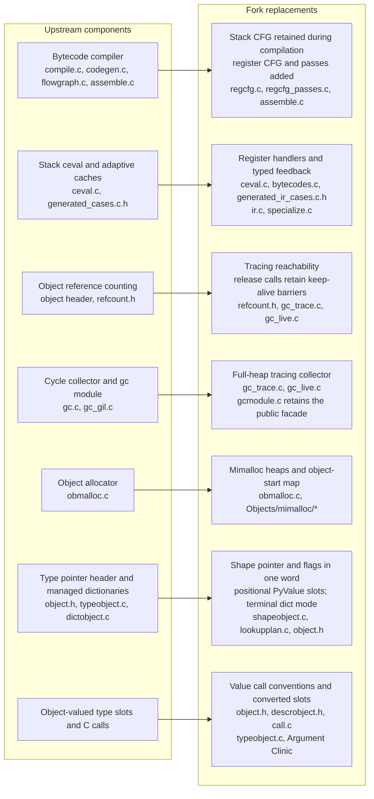
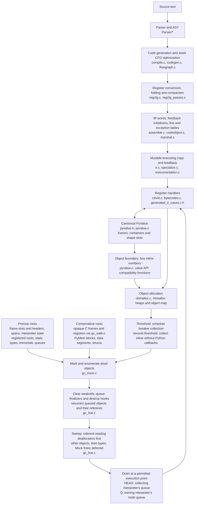
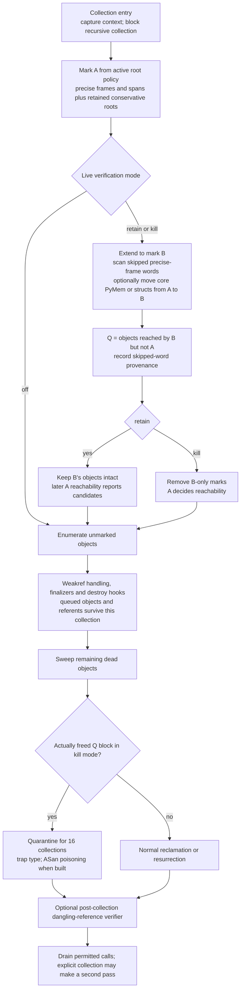

# CPython fork: architecture and implementation review

Reviewed integration head **`5f74a991472`**, against merge base **`3a440b65695615e9fd9912342b79cdd54fced0d2`** with local `main`.

I also inspected pending work at **`1a17992b09b8`** (`boil/7a-rung1`, called **Q** below) and **`6ca5c9e688c5`** (`boil/10a`, called **R**). Neither is part of the inspected integration head. Note 12 is named `12-object-slots-on-values.md`; note 13 and the requested `7a-1.md` and `10a-2b.md` exist on those pending branches.

This is a source review. Historical gate results are attributed to their records. My attempted Python probes could not start because `uv` could not create its shared-cache lock on the read-only filesystem. No new runtime result below is presented as reproduced. I read the [CPython AI policy](https://devguide.python.org/getting-started/ai-tools/).

## 1. Summary

- The fork has built a coherent replacement execution substrate: compiler-produced register IR, canonical `PyValue`, shape-based attributes, and tracing collection without object reference counts.
- Steps 1–6c and all four 6d rungs are landed; precise-root coverage remains partial.
- Per-interpreter queues are implemented on Q, with important ownership, ordering and teardown work reserved for rung 2.
- Generations, the replacement JITs, moving collection and settled package ports remain ahead.
- The representation and lookup code are generally clearer than the former parallel representations.
- The greatest risk is the distributed lifetime contract across C frames, spans, traversals, native resources and interpreter ownership.
- I found additional hazards in compiler read folding, sweep allocation failure, and the root checker’s proof.
- Continue the architecture, but close these contracts before adding collector or JIT complexity. Current evidence establishes substantial implementation progress, not an overall performance win.

## 2. How the code base changed

The cumulative diff changes **1,326 files**, with **226,812 insertions and 163,911 deletions**. Of the additions, 90,959 lines are under `boil/`; generated code, tests and records make these scope figures unsuitable as complexity measures.



**Execution is replaced, but the compiler front end is substantially retained.** There are no `Python/boil_compile*.c` files at this head. The actual path is `compile.c`/`codegen.c`, the existing stack-shaped CFG and optimizations, conversion to the register CFG, register passes, then assembly. See [`optimize_and_assemble_code_unit()`](/tmp/boilarch/Python/compile.c:1662) and [`_PyRegCfg_Build()`](/tmp/boilarch/Python/regcfg.c:1433). This is compilation from the AST without runtime bytecode lowering; it is not direct AST-to-register code generation.

The runtime has one instruction representation. Each word contains a 16-bit handler and four 12-bit fields. The immutable words and feedback initializers live in the code object; [`make_exec()`](/tmp/boilarch/Python/ir.c:247) creates the mutable execution copy and feedback vector. Specialization and instrumentation modify that copy. Upstream tier 2 and its JIT are deleted; the planned replacement tiers are not delivered.

**The value conversion is substantial and real.** Frames, list and tuple elements, dict entries, cells, instance slots and value-call arrays carry `PyValue`. Exact int32s and non-NaN doubles are canonical immediates. NaNs, larger integers and numeric subclasses remain objects. This is broader than adding tagged arithmetic to ceval.

**The object protocol is also substantially complete.** `eb4249ad318` put shapes in headers; `80ba2edf94c` introduced shared lookup plans; `f9685f65468` introduced positional storage; `dba354f43ec` deleted split tables. Dictionary mode is terminal and materializing `__dict__` converts the instance. That is a deliberate simplification with understandable ownership.

Since the previous review, `c66c69d55cf`, `7ad194aa883` and `de1533e8b1a` landed the remaining 6d conversions: attribute and descriptor slots, `tp_call`, wrappers, getters and setters. The remaining numeric, sequence, mapping and other slot families are 6e work. Native `PyObject *` fields and inline numeric receivers still create boxes.

**Memory management is replaced, but its precision is transitional.** Object reference counts, free lists and the former collectors are gone. Auxiliary counters such as dict-key-table `dk_refcnt` remain; these are not object reference counting. The tracing collector still depends on conservative opaque C frames, transitive PyMem scans, interpreter/thread struct scans and writable data segments. Note 11 explicitly leaves much core C opaque until 10b.

The parser, most language semantics, module system, exception machinery and much native type implementation remain CPython code, adapted at their representation and lifetime boundaries. Those retained components account for much of the migration risk.

### Disposition of the earlier review

| Earlier finding at `4bb672e0bf4` | Present disposition |
|---|---|
| Attribute/descriptor slot conversions were not landed | **Resolved in integration**, through all four 6d rungs. The earlier statement was correct for its head. |
| Callback/finalizer ownership could crash subinterpreter initialization | **Still open in integration; substantially addressed on Q.** Routing and readiness are implemented there; rung 2 remains essential. |
| Precise roots were unfinished | **Still open.** R advances the call layer, helpers and allocator entries, but PyMem/writer/struct work remains. |
| C `Py_Is` disagreed with value identity | **Still open**, owned by 6e. |
| ABI isolation depended on filenames | **Still open**, owned by P. The existing `boil2` suffix is useful but insufficient. |
| Pointer-width assumptions were unenforced | **Still open**, owned by 6e and the platform closeout. |
| Compatibility accessors could allocate and abort | **Still open**, owned by 6e; additional callers have moved to values. |
| Written verification exceeded what `gate.sh` executes | **Still open.** `5f74a991472` supplies ASan defaults, not the missing verification driver. |
| Documentation mixed proposal and implementation | **Still open.** `PR.md` already labels itself Phase 1, but its present-tense branch description remains misleading. |
| Performance recovery was unproven | **Still open.** Later instruction measurements show progress, not current-head elapsed-time evidence. |

I found no reason to reverse the earlier architectural judgement. Its strongest safety implications need qualification: the C checker does not yet establish every claimed root invariant, and traversal auditing remains heuristic.

## 3. How execution works now



Registers are frame slots, not machine registers. Frame size is static, and dead temporary slots are cleared. Exact positional calls can overlap the caller’s argument window with the callee’s slots; keyword/default paths use copying. The register allocator therefore preserves constraints inherited from stack windows and exception cleanup.

The return transition is well designed. [`_RETURN_VALUE`](/tmp/boilarch/Python/bytecodes.c:1419) writes the result into the caller before unlinking and clearing the source frame. The generated handler does the same at [`RETURN_VALUE`](/tmp/boilarch/Python/generated_ir_cases.c.h:16667). This closes a genuine collection window rather than relying on a C temporary surviving.

A `PyObject *` boundary can allocate even when it looks like an accessor. `PyValue_Object()` boxes; converting that box back to a value loses the box’s storage identity. Consequently, a span holding `PyValue_FromObject(box)` does **not** keep the box alive. Raw object anchoring through `_PyValueSpan_AppendObject()` is necessary. The 6d design and implementation handle this distinction explicitly.

The collector’s traversal contract is broader than upstream’s cycle-GC contract. It needs every strong edge, including strings and non-GC objects. [`_PyGC_TraceTraverse()`](/tmp/boilarch/Python/gc_trace.c:941) also visits runtime-managed attribute storage itself. That is a sound boundary: the runtime traces storage it lays out; a native type traces its own fields.

### Live collection and verification



Two qualifications matter:

1. **Ordinary debug execution is not automatically A/B kill verification.** `PYTHON_GCVERIFY=retain` and `kill` select that machinery. The older post-collection verifier remains a separate path.
2. **A and B share traversal code.** Their difference can expose an omitted root; it cannot independently prove a missing heap edge. If both traversals omit a member, both can miss its referent.

The walker attributes saved-register locations to their owning frames, including the tail-call convention. Unsupported unwind information falls back conservatively. The current enabled precise walker is x86-64 ELF with suitable glibc; other platforms retain whole-stack scanning. Zero recorded fallbacks therefore means something narrower than “all roots are precise.” Unpinned detach records also cause deliberate conservative scanning and are counted separately.

## 4. Code quality

### Where the fork is clearer

**One runtime value format and one runtime IR remove substantial bookkeeping.** The compiler no longer maintains a runtime lowering and bytecode/IR correspondence. Values need no ownership tag or refcount release sequence in arithmetic handlers.

**The lookup-plan boundary is good.** [`lookupplan.c`](/tmp/boilarch/Objects/lookupplan.c:1) separates resolution from execution and specialization. Its classification of mutable descriptors, member offsets and storage modes is easier to inspect than an interleaving of lookup, cache writes and handler selection.

**Shape-to-dict conversion is transactional.** [`convert_to_dict()`](/tmp/boilarch/Objects/shapeobject.c:599) roots the inputs and provisional dict, performs the triggering operation before publication, then publishes with plain stores. Failure leaves the instance unchanged. This is a useful pattern for later barriers and relocation transitions.

**Generated handlers retain an inspectable source.** `bytecodes.c` remains the source of behavior; generated code shows operand loads, guards, rooting and stores. Regeneration on merges is the right practice.

**Tests increasingly exercise the contract rather than just the result.** Strong examples include collection injection with a witnessed counter, raw-box negative controls, allocation budgets, shape/version exhaustion and control builds that deliberately remove a span.

### Where it is worse

**The lifetime model is harder than upstream reference ownership.** Correctness now depends on several cooperating systems:

- object-start maps and mimalloc domains;
- complete traversal;
- precise frame classification and unwind ownership;
- spans, initialized-prefix lengths and borrowed-edge rules;
- inline collection restrictions;
- finalization and resource ordering;
- interpreter ownership and teardown.

These are legitimate mechanisms, but their composition needs stronger executable checks than the current suite provides.

**The root checker has become a small C analyzer.** At 2,935 lines, it includes parsing, CFG construction, liveness, alias provenance and effect classification. That is defensible for a closed subset. Its acceptance must remain conservative, and its assumptions must be tested independently of the source patterns written to satisfy it. Findings 5.4 and 5.5 show why.

**Naming still carries obsolete concepts.** `shape->type_version` can be a generalized shape version, while `class_version` is the actual type version. `borrow_mask` and `LOAD_FAST_BORROW` now help select local operands despite object reference ownership being gone. `co_stacksize` describes register-temporary storage. These names can be understood, but each requires historical context.

**Public-header prose contradicts the implementation.** [`object.h:19`](/tmp/boilarch/Include/object.h:19) describes reference-count destruction; later sections describe a tracing collector. [`refcount.h:76`](/tmp/boilarch/Include/refcount.h:76) says release functions “do nothing,” followed by their important keep-alive contract. These are dangerous places for stale documentation.

### Tooling assessment

| Tool | Useful guarantee | Important limit |
|---|---|---|
| Handler root checker | Checks handler locals and generated operand handling across collecting calls | Depends on effect classification and its own source analysis |
| C-mode checker | CFG/liveness checks, span scopes, slot provenance, selected borrow rules | Not index-sensitive; does not prove span-prefix bounds; has soundness gaps below |
| Inline audit | Inspects actual DWARF inlining and rejects unchecked collecting bodies, missing DWARF and unsafe clones | Shares the C checker and effect tables; cannot repair their false negatives |
| Traverse audit | Finds missing/partial traversals and now members omitted by both traversal and release | Member mentions count as visits; matching, callbacks, scope and depth remain heuristic |
| Gate ladder | Broad suites, root counters, extension compilation and regeneration | Written verification set and script still differ; several checks fail open |

Audit-2 is an improvement, not a completed traversal proof. Its exact-member allowlist and stale-entry checks are valuable. However, [`visited = set(MEMBER_RE.findall(code))`](/tmp/boilarch/Tools/boil/traverse_audit.py:844) means merely mentioning a member can credit it. A null check is not a visit. Audit-3 should address that distinction, not only last-component matching.

### Dual forms and unnamed retirement

The value API plus object compatibility API is intentional and necessary; it should not be counted as accidental duplication. Likewise, raw box roots and canonical value roots have different purposes.

Less justified residue remains:

- The old refcount-based hole analysis survives in `gc_trace.c`, including [`remove_garbage()`](/tmp/boilarch/Python/gc_trace.c:3340) and `find_holes()`. [`verify()`](/tmp/boilarch/Python/gc_trace.c:3802) explicitly bypasses it with `(void)find_holes` and `(void)report`. I found no named retirement step.
- The sweep’s **heap-order fallback on ordering-allocation failure** is a second behavior without a safe contract or named retirement.
- The `_uuid` weaklist field and unused `tp_weaklist` have only “next cleanup pass” ownership in note 08.
- “No owner until measured” native-field boxes are consciously deferred, but are not scheduled work. Keep them visibly distinct from promised zero-box paths.

The latter two are cleanup issues. The sweep fallback is a correctness issue.

## 5. Issues in the implementation

“Confirmed” below means the code path was traced. It does not imply that I ran its reproducer.

### Confirmed

#### 5.1 Copy propagation changes an already-evaluated local across a reentrant call

**Where:** [`_PyRegPass_CopyProp()`](/tmp/boilarch/Python/regcfg_passes.c:225), particularly lines 255–267; its comment explicitly acknowledges the behavior at [`line 161`](/tmp/boilarch/Python/regcfg_passes.c:161). Introduced by the general folding work, `7f0a265bb87`.

A pending local load survives any intervening operation that neither explicitly writes that local nor changes the source line. A call can nevertheless change it through `frame.f_locals`. The final consumer then reads the new local rather than the value evaluated before the call.

A minimal semantic probe is:

```python
import sys

def change():
    sys._getframe(1).f_locals["x"] = 2
    return 0

def f():
    x = 1
    return x + change()
```

The expression’s left operand is evaluated before `change()`. Folding it into the add changes the result from the saved `1` to the rebound `2`. The existing stack-CFG borrow analysis does not prevent this: it permits a borrowed reference to survive such a call; it does not authorize delaying the read.

**Fix:** materialize pending local reads before an operation that can reenter Python, unless a stronger proof excludes frame mutation. Add same-line cases involving calls and descriptor access, with and without tracing. This is a compiler correctness follow-up, not work to defer to tier 1.

#### 5.2 Sweep ordering becomes unsafe when its graph allocation fails

**Where:** [`order_dead_first()`](/tmp/boilarch/Python/gc_live.c:976) and [`sweep()`](/tmp/boilarch/Python/gc_live.c:1076). The referrer-first implementation landed in `e638f8018da`.

`order_dead_first()` returns `NULL` on allocation failure. `sweep()` then deallocates flagged objects in heap order. That abandons the safety property for which `Py_TPFLAGS_DEALLOC_READS_REFERENTS` exists.

Deferred object-block frees do not make this safe: an earlier `tp_dealloc` can already have freed native state. A concrete core example is pyexpat: [`xmlparse_dealloc()`](/tmp/boilarch/Modules/pyexpat.c:1773) frees an `XML_Parser`; a subparser reads its parent parser during that free, which is why the type sets the flag.

**How to show it:** extend `test_dealloc_reads_flagged_referents` to fail the collector’s libc allocations used by `order_dead_first()`, or use an Expat parent/subparser chain under the same injection. `set_nomemory()` alone is insufficient if it does not intercept these libc allocations.

**Fix:** establish the order before any deallocation. If that fails, abandon reclamation for the pass and undo the dead flags, retaining already queued calls safely. Memory pressure must not select a known unsafe destruction order. **Owner: step 7, before generations.**

#### 5.3 Several buffer consumers still release Python exporters during sweep—or skip release

**Where:** [`PyBuffer_Release()`](/tmp/boilarch/Objects/abstract.c:822), [`picklebuf_dealloc()`](/tmp/boilarch/Objects/picklebufobject.c:108), [`unpackiter_dealloc()`](/tmp/boilarch/Modules/_struct.c:2232), and [`live_destroy_hook_of()`](/tmp/boilarch/Python/gc_trace.c:2020).

The pre-sweep release hook covers memoryviews and managed buffers, not every object holding a `Py_buffer`. Other consumers release during sweep. If the wrapper/exporter has already been swept, release is skipped; otherwise it can run Python from sweep.

This is already traced in audit-2’s hand-off. Its reproducer recorded **zero releases** for a PickleBuffer and a struct iterator over Python exporters. The traversal fixes do not close this resource-lifetime defect.

**Fix:** extend the pre-sweep release contract to all persistent buffer consumers, with once-only delivery. Test an externally retained exporter and an allocating `__release_buffer__`, then test repeated collections and explicit release followed by collection. **Owner: 10a rung 3, coordinated with 7a.**

#### 5.4 The C root checker assumes an argument evaluation order that C does not promise

**Where:** [`FunctionChecker.eval()`](/tmp/boilarch/Tools/cases_generator/root_check_c.py:2409).

Arguments are analyzed left to right; completed object results are treated as held only while later textual arguments execute. Consider:

```c
int collect_int(void);
void consume(int, PyObject *);

Py_GC_PRECISE void bad(void)
{
    consume(collect_int(), PyList_New(1));
}
```

The checker’s modeled order creates the list after `collect_int()`. A compiler can evaluate the second argument first, leaving the fresh list unrooted across `collect_int()` in a precise frame. The eventual callee cannot anchor arguments before it has been entered.

**Fix:** reject unsafe combinations of nested collecting argument expressions, or analyze all permitted orders. The simplest supported-subset rule is to sequence object-producing calls into explicitly rooted temporaries before another argument can collect. Add both textual orders as negative fixtures.

This is a confirmed checker hole; I have not established a current marked core call site that exploits it. **Owner: 10a tooling, before further promotions.**

#### 5.5 The shared effect table incorrectly declares arbitrary hashtable callbacks non-collecting

**Where:** [`NON_COLLECTING_PATTERNS`](/tmp/boilarch/Tools/cases_generator/call_effects.py:152), especially `_Py_hashtable_\w+`; [`Classifier.kind()`](/tmp/boilarch/Tools/cases_generator/root_check_c.py:1625) trusts it before examining bodies.

[`_Py_hashtable_foreach()`](/tmp/boilarch/Python/hashtable.c:268) invokes an arbitrary supplied callback. Hashtable destruction invokes configured destruction callbacks; generic lookup invokes configured hash/comparison functions. These operations are not universally non-collecting.

Thus a precise function can hold a fresh object across `_Py_hashtable_foreach()` and receive no safepoint diagnostic even when its callback collects. The inline audit shares this classification.

**Fix:** replace the family-wide exemption with individually justified entries. Callback dispatchers should default to reentrant unless a checked call-site contract establishes their callbacks’ effects. Add a negative checker fixture with a collecting foreach callback. **Owner: 10a tooling.**

#### 5.6 Per-interpreter queues do not yet close the interpreter lifetime contract

This is partly the earlier review’s finding, but note 13 has exposed additional mechanisms that must land together.

| Path | Integration head | Q |
|---|---|---|
| Main-interpreter callback executed during shared-heap interpreter initialization | Present | Routing/readiness fix implemented |
| Shared heap with independent GILs | Accepted, despite no domain stop-the-world | Rejected by `ae73621efff` |
| Watcher masks and code-extra discovery use collecting interpreter’s metadata | Present | Still present; rung 2 |
| Deleted shared interpreter’s surviving heap remains traceable | No adoption | Still no adoption; rung 2 |
| Safe fork-child interpreter disposal | Existing unsafe clear path | Reserved for rung 2 |
| Cross-owner finalizer dependency order | No ownership routing | Routing can break global order; rung 2 |

The metadata path is explicit: [`live_walk_block()`](/tmp/boilarch/Python/gc_trace.c:2151) asks `live_has_destroy_hook()` using the collecting interpreter; watcher masks are built from that interpreter at [`line 2995`](/tmp/boilarch/Python/gc_trace.c:2995). Q retains that logic.

The deleted-heap path is also concrete: [`PyInterpreterState_Delete()`](/tmp/boilarch/Python/pystate.c:903) removes the interpreter from the domain list, while [`free_interpreter()`](/tmp/boilarch/Python/pystate.c:451) can leave its nonempty subprocess allocated. [`live_page_of()`](/tmp/boilarch/Python/gc_trace.c:1699) then rejects those segments. A surviving object there is not merely leaked: its outgoing edges cease to protect objects in the remaining domain.

**How to show it:** use note 13’s stashed-list test—retain a subinterpreter-allocated list in main, delete the subinterpreter, append a fresh main object, collect under kill, then read it. For metadata, give owners colliding watcher/extra indices and observe which callback/free function is selected.

**Fix:** complete rung 2’s owner-based discovery, registration restrictions, metadata retirement, adoption and fork disposal before declaring finding B closed. Q is a useful incremental landing, not completion of the domain contract. **Owner: 7a rung 2.**

#### 5.7 Gate success can overstate what was checked

Three independently traceable problems remain:

- **Required modes are external to level 3.** [`gate.sh:91`](/tmp/boilarch/boil/tools/gate.sh:91) does not execute kill, ASan, stress, repeated probes or the conditional unbuilt-module check. This remains the earlier review’s open finding.
- **Regeneration compares status, not contents.** At [`line 95`](/tmp/boilarch/boil/tools/gate.sh:95), a tracked generated file already marked `M` can change again while before/after porcelain status remains identical.
- **Missing root telemetry passes.** [`root_stats.py`](/tmp/boilarch/boil/tools/measure/root_stats.py:77) treats a missing file as zero records and zero fallbacks, returning success.

**How to show it:** regenerate over an already modified generated file; run `root_stats.py check` with a nonexistent path; compare level 3’s commands with PROCESS §3.

**Fix:** require clean generated inputs or compare their contents; reject absent/empty telemetry for a run expected to collect; execute a single verification manifest and generate the result summary from it. **Owner: coordinator with 10a closeout.**

#### 5.8 Existing compatibility defects remain open

These were correctly identified previously; their source paths remain unchanged:

| Defect/hazard | Current evidence | Required closeout |
|---|---|---|
| C/value identity disagreement | [`Py_Is` macro](/tmp/boilarch/Include/object.h:202), [`exported function`](/tmp/boilarch/Objects/object.c:2776), `PyValue_Is()` | 6e: one canonical identity contract, preserving NULL behavior |
| Unchecked pointer range | [`_PyValue_FromObject()`](/tmp/boilarch/Include/pyvalue.h:208), [`Py_SET_TYPE()`](/tmp/boilarch/Include/object.h:829) | 6e: reject unsupported object and shape addresses before encoding |
| Foreign native binaries can bypass suffix isolation | [`.so` acceptance](/tmp/boilarch/Python/dynload_shlib.c:39) | P design: ABI-generation validation before calling foreign initialization code |
| Accessors can allocate and abort | [`_PyValue_ObjectOrAbort()`](/tmp/boilarch/Include/pyvalue.h:292), [`PyDict_Next` boxing](/tmp/boilarch/Objects/dictobject.c:2275) | 6e: migrate affected core paths and document the residual contract |

These should not be reported as newly discovered. None is resolved merely by assigning an owner.

### Suspected hazards requiring targeted proof

#### S1. FIFO invocation does not establish finalizer completion order

Integration [`run_queue()`](/tmp/boilarch/Python/gc_live.c:349), and Q’s `run_queue_ex()` at `Python/gc_live.c:466`, permit multiple threads of one interpreter to drain concurrently. The guard is per thread.

If a referrer’s finalizer releases the GIL, another thread can dequeue the referent’s finalizer before the first call completes. Note 13’s cross-owner design relies partly on each owner’s queue ordering its calls; invocation order is weaker than the resource dependency requires.

**Probe:** make an outer finalizer signal entry and block while releasing the GIL; have another thread collect/drain; verify that the inner finalizer cannot close its resource before outer completion. Then use a buffered/raw stream pair.

**Likely fix:** dependency-aware completion ordering for dependent calls, while retaining parallel progress for unrelated calls. A blanket single-drainer rule would reintroduce the backlog problem that motivated parallel drains. **Owner: 7a rung 2.**

#### S2. Version uniqueness may be too narrow for shared objects

[`assign_version_tag()`](/tmp/boilarch/Objects/typeobject.c:1222) and [`_PyType_NewShapeVersion()`](/tmp/boilarch/Objects/typeobject.c:6124) allocate mutable-type/shape versions from the current interpreter. Feedback belongs to the code object’s executing copy.

The proofs usually say versions are never reused *within an interpreter*. Shared-heap operation permits objects—and potentially their shapes and executing code—to be used across interpreters. The same shape can therefore be generalized or re-versioned using another counter. I have not proved that every supported sharing path prevents a collision.

**Probe:** share a heap type and warmed code through the existing native stash fixture, mutate/generalize it from another interpreter with controlled version counters, then execute the original cached site.

**Fix if exposed:** allocate guard generations per sharing domain/process, or enforce and check exclusive ownership of mutable types and executing feedback. **Owner: step 7 domain design, before tiers 0/1 trust these guards.**

#### S3. Debug output can reopen the domain while a dead set is being consumed

After marking, [`collect()`](/tmp/boilarch/Python/gc_live.c:1228) can call `debug_cycle()`, whose [`debug_write()`](/tmp/boilarch/Python/gc_live.c:1126) uses Python `sys.stderr` outside inline mode. A custom writer can release the GIL. Another shared-domain interpreter has its own `gc.collecting` flag and may then collect while the first collector retains a dead-object list.

The domain pin in Q protects interpreter storage, not this whole mark-to-sweep operation.

**Probe:** install a blocking Python stderr writer, enable `DEBUG_COLLECTABLE`, pause there, and collect from a shared interpreter under kill/ASan.

**Likely fix:** avoid Python calls while consuming a dead snapshot, or serialize collection across the whole domain. **Owner: step 7; check while completing 7a.**

## 6. Risks for the next planned steps

| Step | What the current implementation will fight | Settle first |
|---|---|---|
| **6e: remaining slots and inline receivers** | Mixed signatures, `void *` slot tables, Clinic converters, numeric conversion protocols, raw receiver boxes, aborting compatibility reads | Complete inventories and typed checks; preserve error/deletion behavior; close identity and pointer bounds; fix checker holes before promoting rewritten functions |
| **7: generations** | Thousands of direct heap stores, runtime-owned attribute storage, native arrays, suspended frames, weak caches, finalizer resurrection and multiple interpreter owners | Finish 10a/7a contracts; define the collection domain; enumerate all barrier sites; fix unsafe OOM ordering; implement full-mark verification of minor collections |
| **8: tier 0** | Specialized-handler scarcity below 256 despite a 16-bit handler field; eager generator boxing; computed-goto register-allocation sensitivity | Widen the handler metadata assumptions once; define template safepoints and code-range lifetime; fix compiler read semantics before compiling them into templates |
| **9: tier 1** | Kind promises, descriptor mutation, code/type versions, virtual frames, exception windows and stale physical slots | One safepoint/deoptimization description; dependency invalidation across reentrancy; domain-safe guard generations; linear string-building acceptance |
| **10b: moving collection** | Opaque C frames, raw pointers and interiors, data statics, PyMem arrays, value-only traversal callbacks, address identity, native buffers and borrowed caches | A relocation-capable edge visitor or per-type relocation contract; public handles/scopes; explicit pinning; identity/hash policy; cache and shape relocation policy |
| **P: ports** | Changed object layout, slot signatures, vectorcall conventions, traversal requirements, resource destruction and ABI identity | Freeze the settled API and movement rules first; validate native loading independently; port Cython’s generated idioms before regenerating dependent packages |

Several details deserve emphasis.

**Generational barriers cannot be added only to public setters.** Generated shape stores write directly into slots; dict/list/tuple/cell paths do likewise. Native types mutate storage they own. The barrier inventory must include those paths and failure/rollback paths. Note 11’s frame rule is useful: running frames are roots; heap-owned frames need a remembered-owner transition when they suspend or acquire ownership. Test collection inside a resumed old generator before its next yield.

**The moving collector needs locations, not just values.** Current `visitproc` receives a `PyObject *`, and [`_PyGC_VisitValue()`](/tmp/boilarch/Python/gc_live.c:1541) does not expose a rewriting protocol. Updating spans alone will not update container fields, native arrays or registered roots. This is a structural 10b requirement, not a late implementation detail.

**The frame is a useful deoptimization substrate, not a complete deoptimizer.** Virtual frames, compiler temporaries, exception state and not-yet-written results still require metadata. Note 11’s single safepoint/deoptimizer table is the right direction.

**Quadratic `str +=` needs a cold-path answer.** [`PyUnicode_Append()`](/tmp/boilarch/Objects/unicodeobject.c:11751) always allocates and copies for the general case. Step 9 owns the remedy, but its acceptance must include cold code and guard failures, not only optimized traces.

**Performance must be assessed across the whole workload.** I compared the committed `6d.json` instruction values with `baseline.json`, whose recorded upstream baseline is `321925c92c9`:

| Matched group | Rows | 6d / baseline instructions |
|---|---:|---:|
| Kernels | 29 | **1.161** |
| Microbenchmarks | 43 | **0.693** |
| Memory workloads | 6 | **1.699** |

These are calculations from recorded artifacts, not new benchmark runs or timings of `5f74a991472`. They show that the local representation wins coexist with substantial remaining whole-workload costs. Generations are a plausible remedy for some of those costs; they are not evidence that every regression will disappear.

## 7. Process

The loop is catching important defects. It is materially stronger than “generate code, run the suite, land.”

Concrete successes include:

- **6d rung 2 landing review:** ctypes published native bytes before its keeper update could fail. Fixes `18f473cc8ca` and `b8b575d7c4c` restored failure atomicity and supplied stronger tests.
- **6d rung 3 landing review:** the prepend failure test hit an earlier tuple allocation and allowed success; lifetime tests inspected counts rather than referents. `0457f2a3c2c` corrected those oracles.
- **6d rung 4:** the unbuilt-module check caught the `_hashopenssl` getter mismatch (`649506ba537`). Landing review found dict-backed accessors still boxing; `80eddd41953` converted them and added budgets.
- **Audit-2:** review caught delegation to the wrong object and hash-seed-dependent helper traversal. The final breadth-first walk and stricter receiver handling are real improvements.
- **Integration testing:** `4bb672e0bf4` fixed a conservative stale root exposed only by merged stack layout.
- **Hazard tracing:** the CJK writer’s missing `pending` edge was reproduced on the control and fixed, rather than dismissed as a suite flake.

The records also show recurring omissions.

**The proof often arrives after the implementation claims completion.** Several landing reviews returned “fix first” for missing promised assertions or gates. This justifies landing review, but it also says the implementer’s completion checklist is not yet executable.

**The checkers and tests can agree on the same mistake.** The failure helper skipped allocation zero; argument tests inspected lengths rather than elements; the traversal audit inferred members from releases and missed a member omitted by both. These are independent-oracle problems.

**Scope boundaries defer hazards discovered in working code.** The audit-2 buffer release defect was correctly assigned outside the audit. Likewise, Q explicitly reserves metadata/adoption safety for rung 2. Assignment is necessary, but these should remain visible correctness blockers for subsequent collector work.

**Gate provenance remains partly narrative.** Records sometimes establish that a dirty build contained the eventual commit’s code; a binary’s `sys.version` cannot establish the state of separately rebuilt extensions. Those explanations are useful, but hashes of built source and artifacts would be stronger and cheaper to verify.

**The pending queue verification record does not cover the entire standing stress set.** Q records seven files, including `test_ctypes`; note 11’s standing set also includes `test_descr`, `test_sort`, `test_functools` and `test_context`. It names additional exclusions. This may be acceptable as interim evidence, but it is not the full written verification set merely because the ordinary gate 3 passed.

**The C-mode fail-closed claim was already disproved once.** R records `41f411e1005`, where conditional braces caused a marked definition to disappear from parsing. That fix is not in the inspected integration head. The general lesson is to reconcile marked source functions and binary precise symbols with checked bodies, not only return success for functions the parser happened to find.

I would change the loop in four ways:

1. Generate the completion checklist and landing summary from a verification manifest, including exclusions, owners, removal conditions, source/build identity and recorded waivers.
2. Require each safety test to name its negative control: omitted span, failed exact allocation, omitted traversal edge or wrong-owner callback.
3. Add a whole-branch invariant review at the end of each representation change. Rung-local review missed the compiler read semantics and the unsafe sweep fallback.
4. Preserve review rounds rather than overwriting them; keep a final disposition ledger linking every blocker to a fixing commit, rebuttal or explicit open owner.

The CPython suite remains indispensable. Rewriting tests for a different IR or deliberate no-refcount semantics is reasonable. A green modified suite must still be accompanied by a separate record of lost upstream behavior.

## 8. Recommendations, ranked

| Rank | Recommendation | Owning step and acceptance |
|---:|---|---|
| **1** | Complete the interpreter lifetime work; treat Q as an intermediate state | **7a rung 2:** owner metadata, foreign registration restrictions, retirement/adoption, fork disposal and dependency completion tests; restore the B exclusions |
| **2** | Repair and independently test the root checker’s proof | **10a:** argument-order rule, hashtable effects, parser/body coverage, checker dependency tracking; integrate R’s fixes before further promotions |
| **3** | Finish explicit core roots and buffer-release safety | **10a rung 3:** writers, PyMem spans, symtable roots, persistent buffers; kill with `pymem,structs`; exactly-once allocating release callbacks |
| **4** | Remove the unsafe sweep-order fallback | **7, before generations:** injected failure of every ordering allocation must preserve safety and permit a later successful collection |
| **5** | Preserve evaluated local values across reentrant operations | **Coordinator, compiler follow-up before 8:** same-line `f_locals` mutation tests for calls and descriptors; materialize loads where needed |
| **6** | Make gate success mean the written gate completed | **Coordinator/10a closeout:** executable manifest, nonempty root evidence, content-based regeneration checks and build/source digests |
| **7** | Close the remaining value/API contracts | **6e:** C/value identity, address bounds, numeric conversion semantics, compatibility allocation behavior and inline receivers |
| **8** | Make domain and mutation rules explicit before adding generations | **7:** barrier inventory, running/suspended frame rules, cache/version ownership, minor/full-mark comparison, OOM policy |
| **9** | Define JIT interfaces before emitting more machine code | **8/9:** handler-space expansion, code-range lifetime, one safepoint/deopt format, invalidation rules and a linear cold string path |
| **10** | Design relocation as an edge-update and pinning system | **10b:** writable root/heap locations, handles, interiors, native buffers, identities, shapes and weak-cache treatment |
| **11** | Isolate the native ABI before the first settled port | **P design:** distinct package compatibility identity and enforced ABI generation; Cython first, then regenerated users |
| **12** | Publish one current architecture and measurement entrypoint | **Coordinator at 10a/7 closeout:** reconcile note 06, point Phase 1 docs at current state, remove dead verifier residue, record wall time, RSS and pause distributions against upstream |

The architecture’s strongest result is the removal of parallel runtime representations. The next steps should preserve that clarity by making lifetime, mutation and interpreter ownership equally explicit—and executable—before generations and JITs depend on them.
---
Reviewer: codex gpt-6.1-sol xhigh, read-only over a detached checkout of 5f74a991472, 2026-10-28 15:26 to 15:42 PDT; prompt in boil/design/reviews/architecture-review-2-prompt.txt
