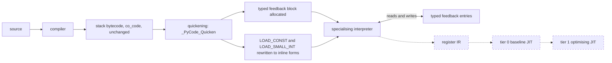
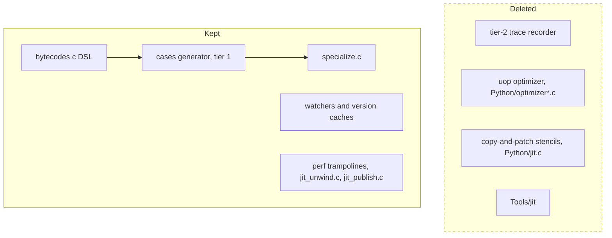
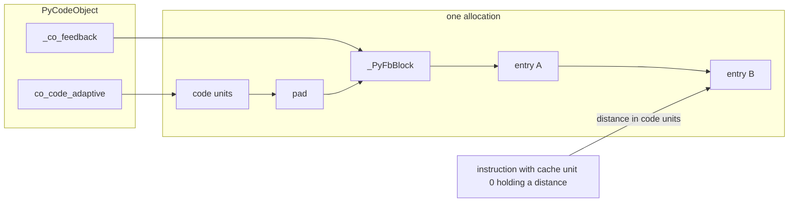
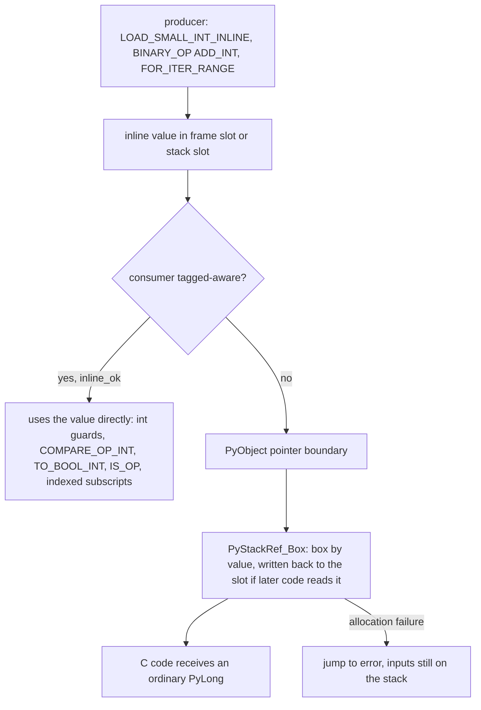

# Phase 1: typed feedback, a NaN-boxed evaluation stack and inline ints; delete tier 2 and the copy-and-patch JIT

This branch is the start of a performance fork of CPython 3.16 that owns its package set. The fork replaces the upstream tier-2 optimiser and copy-and-patch JIT with its own execution tiers, and it rebuilds a pinned set of third-party packages from source (the `ports/` tree) after every interpreter change. Those packages are the compatibility test for the interpreter's C ABI.

Phase 1 of the plan has landed through its fourth tagged-value step. The branch deletes tier 2 and the JIT, replaces the per-opcode inline caches with typed feedback entries, changes `_PyStackRef` to a NaN-boxed layout, and produces inline int32 values on the evaluation stack. Inline floats, the register IR and the JIT tiers have not landed. Each step was measured before it was kept; the results are below.

<!-- RESULTS TABLE: coordinator fills in -->

| Step | pyperformance geomean vs baseline | Notes |
|---|---|---|
| baseline default | 1.000 | 321925c92c9, gcc 15, no PGO, no LTO |
| tier 2 / JIT deletion | <!-- TODO: fill --> | `boil/bench/step1-delete-tier2.json` records 0.980 against baseline |
| typed feedback | <!-- TODO: fill --> | +0.67 percent instructions on richards, go, nqueens, chaos |
| NaN-box encoding | <!-- TODO: fill --> | +3.38 percent instructions against typed feedback, no producers yet |
| inline ints | <!-- TODO: fill --> | instructions against the encoding commit: chaos -0.7, nbody -1.0, spectral_norm -1.0, richards +1.4, go +2.1, nqueens +2.1, fannkuch +1.3 percent |
| inline floats | not landed | the encoding supports them; no producers exist |

For reference, the upstream JIT measured 0.834 against baseline on the same subset (`boil/bench/README.md`). That is the bar for the fork's own tier 0.

## Pipeline

Source and bytecode are unchanged. Quickening is where this branch intervenes: it allocates the feedback block and rewrites constant loads to inline forms. The specialising interpreter then reads and writes typed feedback entries. Dashed nodes do not exist yet.



The deleted components, and what stays:



## Object and value layout

### The `_PyStackRef` encoding

On 64-bit builds without free threading (`Py_STACKREF_INLINE_VALUES`), a `_PyStackRef` is a 64-bit word. This table is from `Include/internal/pycore_stackref.h`.

```
Top 16 bits     Low 48 bits         Meaning
0x0000          0x000000000001      NULL
0x0000          0x000000000002      ERROR
0x0000          ptr, bit 0 = 0      owned reference
0x0000          ptr, bit 0 = 1      borrowed, immortal or deferred reference
0x0000          ptr | 2             PyStackRef_Wrap() pointer (debug builds)
0x0001          int48               index (Py_INDEX_BASE)
0x0002-0x7FF2   double + 2^49       inline float, +0.0 to +inf
0x8002-0xFFF2   double + 2^49       inline float, -0.0 to -inf
0xFFFE          0x0000 then int32   inline int (Py_INT_BASE)
other                               unused: images of NaNs, and 0xFFFF
```

Pointer space is every value below 2^48. `REFCNT` (bit 0) and `INVALID` (bit 1) have meaning only there. Indices and inline values own nothing, so `CLOSE`, `DUP` and `Borrow` leave them unchanged. An index is the position of a virtual iterator or the saved `lasti` during unwinding. It never reaches Python code. NaN results are always boxed, because some NaN images overlap the other regions. Free-threaded and 32-bit builds have no inline values.

### The typed feedback block

Each code object has one block in the same allocation as its bytecode, at the next 8-byte boundary after the code units:

```
| code units, inline caches included | pad | _PyFbBlock | entries |
```

Every specialisable instruction except the conditional branches owns one entry. Cache unit 0 of the instruction holds the distance in code units to its entry, so a handler reaches the entry with one load and no base register. The other cache units stay reserved and zero, so `co_code`, `dis` offsets and pyc files keep their layout. A distance of 0 means no entry. Each entry starts with a 16-byte header: kind, state, backoff counter, and reserved fields.

| Kind | Entry size (bytes) | Opcodes |
|---|---|---|
| COUNTER | 16 | RESUME, JUMP_BACKWARD |
| BRANCH | none | POP_JUMP_IF_FALSE, _TRUE, _NONE, _NOT_NONE; the 16-bit history stays in the cache unit |
| UNARY | 24 | TO_BOOL, UNPACK_SEQUENCE, FOR_ITER, GET_ITER, SEND |
| BINARY | 32 | BINARY_OP, COMPARE_OP, CONTAINS_OP, STORE_SUBSCR |
| ATTR | 40 | LOAD_ATTR, STORE_ATTR, LOAD_SUPER_ATTR |
| GLOBAL | 32 | LOAD_GLOBAL |
| CALL | 24 | CALL, CALL_KW, CALL_FUNCTION_EX |

BRANCH is one of the seven kinds but has no entry in this PR. It is reserved for the register IR, whose block gives it a 16-byte entry.



A site that changes type keeps up to four observations in a polymorphic table that is allocated on demand. A fifth observation sets the state to megamorphic. `specialize.c` writes the typed fields. `dis(adaptive=True)` output is synthesised from the entries.

### Lazy boxing

An inline value is never converted to a `PyObject *` until a consumer needs one. The cases generator inserts the conversion at the point of use, by value.



## Changes

### Deletions

Tier 2 and the copy-and-patch JIT are removed rather than disabled. This covers `Python/optimizer*.c`, `jit.c`, the uop headers, `Tools/jit`, the tier-2 generators, `--enable-experimental-jit`, `PYTHON_JIT` and its tuning variables, `PYTHON_UOPS_OPTIMIZE`, the executor fields on code objects and interpreter state, `ENTER_EXECUTOR`, the `*_JIT` instructions, and their tests and docs. About 68,700 lines go. <!-- TODO: commit 69ffcec5a77 reports 143 files and about 68,700 lines in WORKLOG.md, but `git show --stat` on the rewritten commit reports 108 files and 9,381 deletions; confirm the figure. -->

Base opcode numbers and cache layouts are unchanged. RESUME and JUMP_BACKWARD keep a one-entry cache so pyc files are unaffected. The reason for deleting first: the new encoding never has to be taught to code the fork was going to remove.

### Feedback vector

Fifteen inline-cache structs (`_PyLoadGlobalCache`, `_PyBinaryOpCache`, `_PyCallCache` and the rest) are replaced by seven typed entry kinds. Handlers reach their entry through cache unit 0. The conditional branches keep their 16-bit history inline, because an entry cost five instructions per branch (about 2 percent on richards). The block is allocated eagerly, so the average code object grows from 424 to 875 bytes, and peak RSS rose 5.6 percent on the import workload and 1.4 percent at startup. The register IR will allocate the block lazily. `_testinternalcapi.get_feedback` and a `TestFeedback` class in `test_opcache` cover kinds, polymorphic rows and version recording.

### Encoding and cases generator

`_PyStackRef` takes the layout above, which is the layout the Phase 2 `PyValue` will widen. The cases generator learns which instruction inputs are proven objects and which may be inline.

- `inline_ok` marks a uop that handles inline values itself, so the generator emits no box for it.
- `known_object` tracking marks inputs that are guarded, boxed, asserted by `assert(PyStackRef_IsObject(x))` or freshly constructed. Their `CLOSE`, `DUP` and steal test bit 0 only.
- Box-on-borrow: for any other input that a uop passes to `PyStackRef_AsPyObjectBorrow`, `AsPyObjectNew` or `AsPyObjectSteal`, the generator emits `x = PyStackRef_Box(x)` behind `Py_UNLIKELY`, with the cold body out of line. Array inputs are not checked; C helpers that convert stackref arrays box their elements.
- Guard exits: a guard that may deopt, does not escape and only peeks at its inputs exits if the input is not a pointer, by testing the stack slot in memory. Specialised family members therefore never see an inline value.

The GC and object dumpers skip inline regions. A debug checker walks frames, gdb decodes inline values, and `_PyObject_Init` asserts that addresses stay below 2^48. `Tools/cases_generator/interpreter_definition.md` documents the rules under "Inline values". The encoding alone costs +3.38 percent instructions geomean on richards, go, nqueens and chaos (down from +5.8 for a direct port). About a third of that is the pointer-space test in `LOAD_FAST_BORROW`, which the register IR's static borrow bit removes.

### Producers

Ints have landed. `LOAD_SMALL_INT_INLINE` and `LOAD_CONST_INLINE_INT` are produced by quickening. `BINARY_OP` ADD, SUBTRACT and MULTIPLY on ints use `__builtin_*_overflow` and box to `PyLong` on overflow. `UNARY_NEGATIVE` and `FOR_ITER_RANGE` also produce inline ints. Only exact ints that fit in int32 are inline; `bool` and subclasses are not.

Tagged-aware consumers: the int guards, `COMPARE_OP_INT`, `TO_BOOL_INT`, `IS_OP`, list, tuple and str subscripts and list stores by inline index, and `CALL_TYPE_1`. Everything else boxes, including the array and C-helper paths (the CALL family, BUILD_*, RAISE_VARARGS, MAKE_CELL, frame locals, `super()`). The remote profiler skips frames being torn down.

| Micro loop | Instructions per iteration before | after |
|---|---|---|
| int add | 173 | 75 |
| range loop | 144 | 69 |
| int compare | 102 | 82 |
| float add | unchanged | unchanged |

Remaining boxing, from `Py_STATS` box counters, comes from attribute, global, set and slice stores and from `BINARY_OP_EXTEND`. Handler code size grew (`BINARY_OP_ADD_INT` from 50 to 129 instructions of code).

Floats have not landed. The encoding reserves the inline float region and the identity rule already covers floats, but no instruction produces an inline float. <!-- TODO: if the inline-float commit lands before merge, rewrite this paragraph and fill the table row. -->

### Identity semantics

This is a user-visible change. `is`, `id()` and `operator.is_` use value identity for exact int32 ints and exact non-NaN floats, so `l[0] is x` stays true after one side was boxed. One function, `_PyObject_ValueIdentity`, defines the rule.

- Two exact ints with equal int32 values are the same object. Two exact floats with equal bits are the same object.
- `0.0 is -0.0` is False.
- NaN, `bool` and subclasses keep object identity.
- `id()` of such a value is its inline encoding. It is at least 2^49, so it cannot collide with a heap address.
- C `Py_Is` stays pointer equality in Phase 1.

The language reference permits this for immutable types, and PyPy uses the same rule.

### `PYTHON_TAGGED_VALUES`

`PYTHON_TAGGED_VALUES=0` disables the inline producers, so every int stays boxed. It exists for bisecting a failure to the producers. The full test suite passes with and without it.

### `Py_STACKREF_DEBUG` repairs

The `Py_STACKREF_DEBUG` build aborted during module freezing before any test ran. It is the checker for the encoding, so four fixes landed:

- `take_ownership()` in `Python/frame.c` left the live ID on the wrong frame after `_PyFrame_Copy()` (origin GH-127875).
- `_BINARY_OP_INPLACE_ADD_UNICODE` stole a local while `left` still borrowed it. It now closes `left` first (origin gh-131527).
- The debug index helpers are declared `PyAPI_FUNC`, so `_testinternalcapi` loads under `-fvisibility=hidden`.
- The checker accepts a borrow that outlives a closed slot in `framelocalsproxy_setitem()`, through `_Py_stackref_allow_borrows_outlive_close()`. Every other close with outstanding borrows still aborts.

### Specialisation of instances with a materialised `__dict__`

After `vars()`, `dir()`, copy, pickle or `obj.__dict__` created an instance's dict, `LOAD_ATTR` and `STORE_ATTR` stayed generic. Loads now get `LOAD_ATTR_INSTANCE_VALUE` whenever the inline values are valid. `STORE_ATTR_WITH_HINT` now also replaces values in a split table, under the dict's lock. Loads after `vars()` go from 292 to 35 instructions, and stores from 378 to 63. Stores to combined dicts pay about 4 more instructions for the split-or-combined choice. New `test_opcache` tests cover this, including a free-threaded race test.

### Ports tree

`ports/` holds pinned PyPI packages that are rebuilt from source against this interpreter. Sources and patches are pinned by sha256; a patch must name every file it touches with that file's hash, so a version bump fails loudly. Results are stored by `abi_id` (currently `cpython-3.16-refcnt-v0-tagged`).

Verbs: `build`, `check` (installs into a fresh venv and runs each port's smoke tests with `-I`), and `bench` (median of five runs). The interpreter is itself a port, in `default` and `ft` variants.

Ports: six, attrs, pycparser, markupsafe, pyyaml, cffi, numpy 2.5.4, and the native library libyaml (a static `configure-make` build linked into pyyaml). numpy builds through meson-python with no patches. The only patch in the tree is cffi's, which replaces `Py_FileSystemDefaultEncoding`, removed in 3.16 before this branch, with `PyConfig_Get("filesystem_encoding")`. All ports build and pass `check` against the inline-int interpreter.

### Measurement harness

`boil/tools` holds four stdlib-only tools: `code_stats.py` (static code-object statistics), `micro_loops.py` (`perf stat` instruction counts for loop microbenchmarks), `pyperf_compare.py` (pyperformance JSON comparer) and `rss.py` (peak RSS of fixed workloads). `pyperf_run.sh` seeds the pyperformance venv with the host `uv`, because the target interpreter may have no `ssl` module, and runs the benchmark subset. Baselines for default, jit and ft are in `boil/bench/`.

## Compatibility

- C ABI: unchanged in Phase 1. Extensions see boxed `PyObject *` only. Ports rebuild and pass with no patches caused by this branch.
- pyc files and magic number: unchanged. Opcode numbers and cache layouts keep their sizes.
- `dis`: unchanged. `dis(adaptive=True)` is synthesised from feedback entries.
- `is` and `id()`: change as described under "Identity semantics".
- `sys._jit` remains as a stub that reports no JIT, so tools keep importing it.
- Removed: `--enable-experimental-jit`, `PYTHON_JIT` and its tuning variables, `PYTHON_UOPS_OPTIMIZE`. <!-- TODO: confirm the full list of removed environment variables with a grep for PYTHON_JIT_* in the final tree. -->
- New: `PYTHON_TAGGED_VALUES`.
- Free-threaded build: still compiles and passes its targeted test set. It has no inline values and no performance work.
- `Py_STACKREF_DEBUG`: builds and passes its targeted set.
- The one known test failure, `test_remote_exec_deleted_static_executable`, also fails on the untouched baseline.

## Validation

Each step was gated before it was kept.

- The full test suite on the default build, and for the inline producers also with `PYTHON_TAGGED_VALUES=0`.
- Targeted test sets on the debug, `Py_STACKREF_DEBUG` and free-threaded builds, with no new warnings.
- `make regen-all` or `regen-cases` is stable: regenerated files match what is committed.
- Instruction counts from `perf stat` on richards, go, nqueens and chaos (plus nbody, spectral_norm and fannkuch for producers). Instruction counts do not depend on machine load, so they gate each step against the previous commit. The thresholds are 1.5 percent as the target and 3 percent as the limit that needs a recorded reason; the encoding step was accepted above the target because the register IR removes its largest cost.
- pyperformance geomean on an idle machine, with no build or test running. A run that overlapped other work is kept as `*.noisy.json` and is not used as a measurement.
- `ports check` against the new interpreter.

## Design notes

- `boil/design/01-internal-ir.md`: the register IR, lazy lowering, and the typed feedback vector this branch implements.
- `boil/design/02-tagged-values.md`: the stack encoding, the boxing boundary, identity semantics and the Phase 2 path to `PyValue`. Sections 13 and 14 are history; section 15 is the decision.
- `boil/design/03-deferred-refcounting.md`: deferred reference counting; moved to the start of Phase 2.
- `boil/design/04-shapes.md`: shapes with inline slots, planned for the end of Phase 1.
- `boil/WORKLOG.md`: dated log of decisions, measurements and the reasons for each.
- `boil/bench/README.md`: baselines and how they were produced.
- `ports/README.md`: recipe format, patch rules and verbs.

## Not in this PR

- The 1:1 register IR interpreter (IR step 4), with lazy lowering and static borrow bits. The by-value box overhead is expected to drop there.
- Inline floats (tagged-values step 5).
- Tier 0 baseline JIT and tier 1 optimising JIT.
- Shapes (`04-shapes.md`).
- Phase 2: `PyValue` as the object representation, a tracing GC with deferred reference counting, and a handle-based C API. Phase 2 drops the free-threaded build when the encoding flips.
