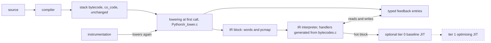
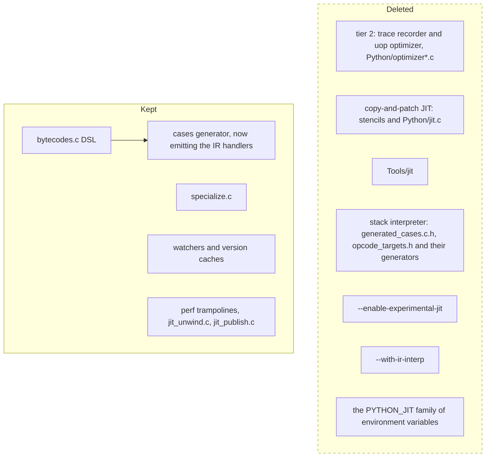
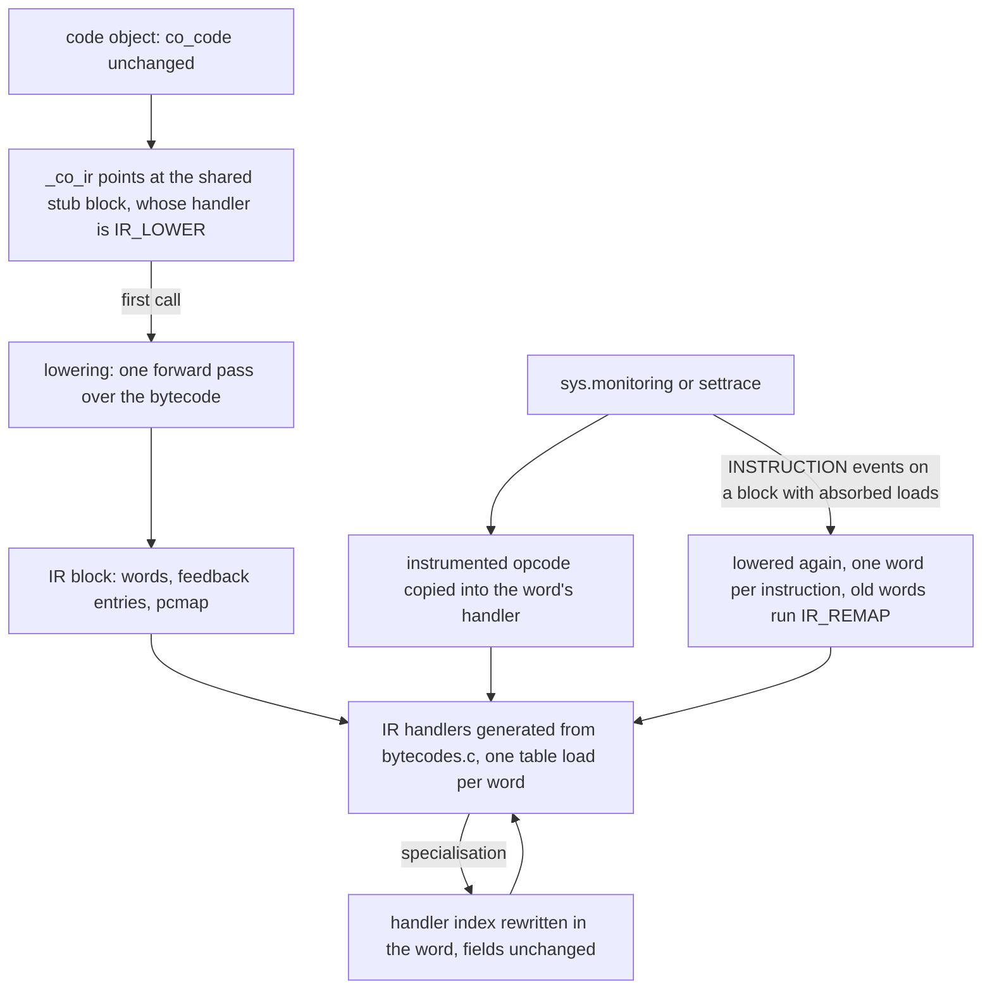
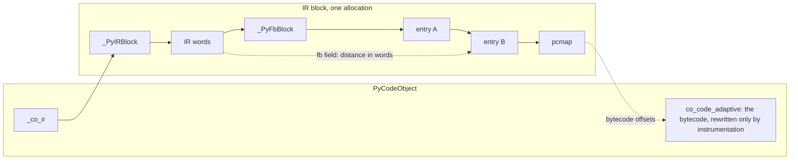
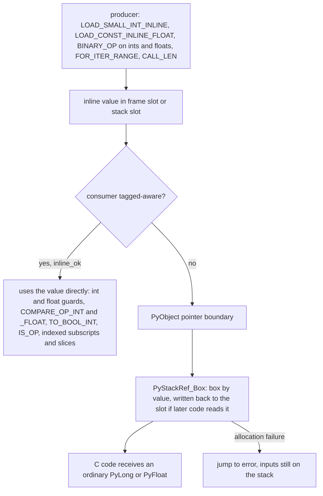
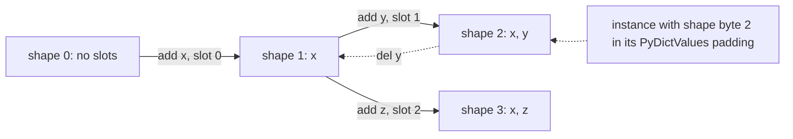
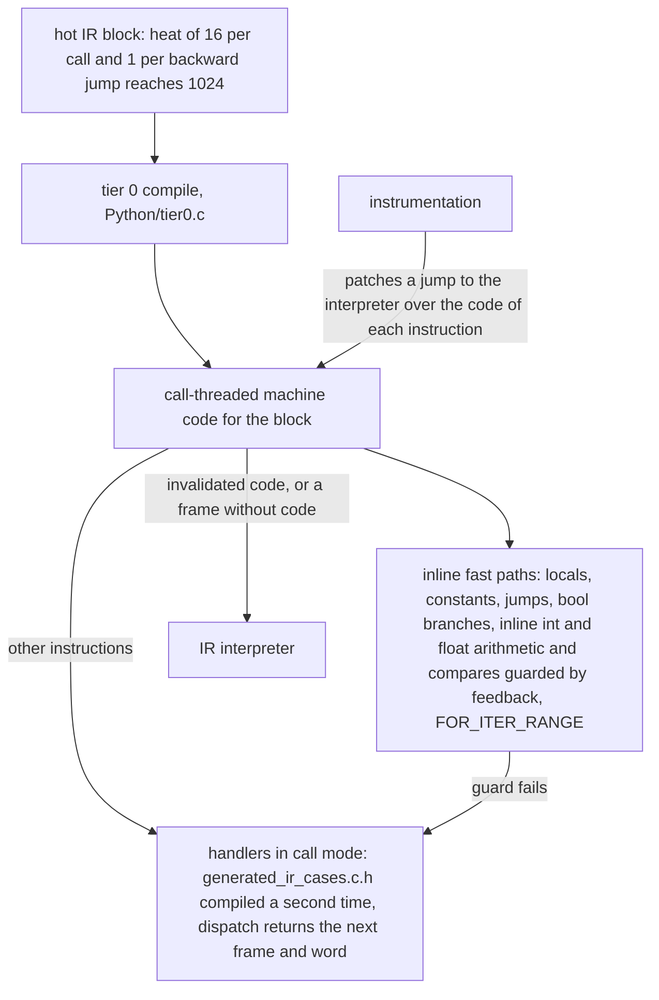

# Phase 1: a register IR interpreter with typed feedback and inline ints and floats; delete tier 2, the copy-and-patch JIT and the stack interpreter

This branch is the start of a performance fork of CPython 3.16 that owns its package set. The fork replaces the upstream tier-2 optimiser and copy-and-patch JIT with its own execution tiers, and it rebuilds a pinned set of third-party packages from source (the `ports/` tree) after every interpreter change. Those packages are the compatibility test for the interpreter's C ABI.

Phase 1 has landed through the register IR. The branch deletes tier 2 and the JIT, replaces the per-opcode inline caches with typed feedback entries, changes `_PyStackRef` to a NaN-boxed layout, and produces inline int32 and float values on the evaluation stack. Every code object now runs as a register IR, lowered from its bytecode at the first call. The stack interpreter is deleted. Shapes and a tier 0 baseline JIT are built only with configure flags. Tier 1 has not landed. Each step was measured before it was kept; the results are below.

<!-- RESULTS TABLE: coordinator fills in -->

| Step | pyperformance geomean vs baseline | Notes |
|---|---|---|
| baseline default | 1.000 | 321925c92c9, gcc 15, no PGO, no LTO |
| tier 2 / JIT deletion | <!-- TODO: fill --> | `boil/bench/step1-delete-tier2.json` records 0.980 against baseline |
| typed feedback | <!-- TODO: fill --> | +0.67 percent instructions on richards, go, nqueens, chaos |
| NaN-box encoding | <!-- TODO: fill --> | +3.38 percent instructions against typed feedback, no producers yet |
| inline ints | <!-- TODO: fill --> | instructions against the encoding commit: chaos -0.7, nbody -1.0, spectral_norm -1.0, richards +1.4, go +2.1, nqueens +2.1, fannkuch +1.3 percent |
| inline floats, wider ints | <!-- TODO: fill --> | `boil/bench/tagged-values.json` records 0.989 against baseline; instructions against inline ints: spectral_norm -26.4, fannkuch -8.7, nbody -5.7, chaos -4.9, nqueens -2.5, float -2.1, go -0.9, richards -0.4 percent |
| register IR, the only interpreter | <!-- TODO: fill --> | instructions per loop against the stack build: richards -0.2, nqueens -1.1, go -3.2, float -2.1 percent; lowering adds about 25M instructions once on richards |
| shapes, `--with-shapes` | <!-- TODO: fill --> | instructions against the same commit without the flag: richards -0.28, go -0.47, deltablue -0.44, raytrace -0.15 percent |
| tier 0, `--with-tier0` | <!-- TODO: fill --> | see "Tier 0 baseline JIT" |

For reference, the upstream JIT measured 0.834 against baseline on the same subset (`boil/bench/README.md`). That is the bar for the fork's own tier 0.

## Pipeline

Source, the compiler and the bytecode are unchanged. At the first call of a code object, the bytecode is lowered into a register IR block, and the interpreter runs that block. The specialising handlers read and write typed feedback entries that live in the same block. Instrumentation lowers a block again when it needs one word per instruction. With `--with-tier0`, a hot block is compiled to machine code. The dashed node does not exist yet.



The deleted components, and what stays:



The removed environment variables are `PYTHON_JIT`, `PYTHON_JIT_STRESS`, `PYTHON_JIT_FITNESS_INITIAL`, `PYTHON_JIT_JUMP_BACKWARD_INITIAL_VALUE`, `PYTHON_JIT_JUMP_BACKWARD_INITIAL_BACKOFF`, `PYTHON_JIT_RESUME_INITIAL_VALUE`, `PYTHON_JIT_RESUME_INITIAL_BACKOFF`, `PYTHON_JIT_SIDE_EXIT_INITIAL_VALUE`, `PYTHON_JIT_SIDE_EXIT_INITIAL_BACKOFF`, `PYTHON_UOPS_OPTIMIZE` and `PYTHON_OPT_DEBUG`. `--with-ir-interp` existed only on this branch, while the IR and the stack interpreter were built side by side.

## Register IR

The interpreter no longer runs bytecode. It runs a register IR in which each instruction is one or two 64-bit words whose fields name frame slots. The bytecode stays the reference for `dis`, pyc files, line numbers, the exception table and instrumentation.

### From source to execution



1. The compiler emits stack bytecode as before. A new code object's `_co_ir` points at the shared stub block `_PyIR_LowerStub`. Its handler, `IR_LOWER`, lowers the code on the first call and moves the frame into the new block. Code that never runs is never lowered. Malformed bytecode raises `SystemError` at that call.
2. Lowering (`Python/ir_lower.c`) follows the stack depth through the bytecode in one forward pass. The temporary at depth d lives in slot `co_nlocalsplus + d`, so locals, cells, free variables and temporaries share one numbering. The pass chooses each handler, including the inline-constant forms that quickening used to choose, and places each feedback entry. A second pass resolves jumps, absorbs loads and lays out the words. The words, the feedback block and the pcmap go into one allocation.
3. `Tools/cases_generator/ir_generator.py` generates the handlers from `Python/bytecodes.c` into `Python/generated_ir_cases.c.h` and `Python/ir_targets.h`. `ir_metadata_generator.py` generates the formats into `Include/internal/pycore_ir_metadata.h`. A family has one format. Register style names a dst and up to three inputs by slot; window style names the slot of the deepest input and binds the rest by offset. Dispatch is one table load on the handler index. In the computed-goto build each handler reads its fields from the word in memory, one 16-bit load per field.
4. Specialisation rewrites only the handler index, with one 64-bit store. Fields never change once a block is lowered.
5. Instrumentation still rewrites `co_code_adaptive`, which the IR shadows. After each rewrite, `_PyIR_SyncInstrumentation` copies the instrumented opcode into the word's handler, and restores the lowering's choice when the instrumentation is removed. Code lowered while instrumentation is active absorbs nothing. When `INSTRUCTION` events turn on for a block with absorbed loads, the code is lowered again with one word per instruction. The old block stays allocated, because frames may still be in it, and each of its words runs `IR_REMAP`, which moves the frame to the same offset in the new block.

### Word layout

From `Include/internal/pycore_ir.h`:

```
Word 0, every instruction
 63          48 47          32 31          16 15           0
+--------------+--------------+--------------+--------------+
|      C       |      B       |      A       |   handler    |
+--------------+--------------+--------------+--------------+

Word 1, two-word formats only
 63                          32 31                           0
+------------------------------+------------------------------+
|  F: feedback distance        |  D: oparg or jump distance   |
+------------------------------+------------------------------+
```

| Field role | Contents |
|---|---|
| slot | `index << 1`, with `IR_BORROW` in bit 0 |
| fb | distance in words from the instruction to its feedback entry |
| imm | the oparg: a constant or name index, a count, a local, or a jump distance in words |

- Handler indices 0 to 255 are the opcodes. The IR-only handlers (`IR_LOWER`, `IR_EXT`, `IR_REMAP`, `IR_SUPER_COMPARE_OP_*`) follow from 256.
- `IR_BORROW` on an input means the slot is a local that the instruction reads as a borrowed reference. Bit 0 is `Py_TAG_REFCNT`, so a handler ORs the field's low bit into the value without a shift, once it knows the value is a pointer. The limit is 32,767 slots; the largest frame in the standard library and its tests needs 803.
- A format with more fields than fit moves the oparg into the feedback entry's `arg` field, or takes word 1.
- An `IR_EXT` word in front of an instruction holds the high 16 bits of its A, B and C, as `EXTENDED_ARG` does for an oparg. No standard library code needs it.

An example, from `_testinternalcapi.get_ir` after the function has specialised:

```python
def g(o):
    return o.x + o.y
```

```
dis offset  bytecode                   word  handler                   A       B          C     word 1
  0         RESUME_CHECK                 0   RESUME_CHECK
  4         LOAD_FAST_BORROW o               absorbed into word 1
  6         LOAD_ATTR_INSTANCE_VALUE x   1   LOAD_ATTR_INSTANCE_VALUE  t0      o, borrow  fb +7
 26         LOAD_FAST_BORROW o               absorbed into word 2
 28         LOAD_ATTR_INSTANCE_VALUE y   2   LOAD_ATTR_INSTANCE_VALUE  t1      o, borrow  fb +11
 48         BINARY_OP_ADD_INT            3   BINARY_OP_ADD_INT         t0      t0         t1    D = 0 (+), F = +15
 60         RETURN_VALUE                 5   RETURN_VALUE              t0
```

Seven bytecode instructions become five dispatches in six words. The feedback entries start at word 8, after the 16-byte `_PyFbBlock` header.

### Absorbed loads

A `LOAD_FAST_BORROW`, or the pair form, whose consumer reads the local through an `IR_BORROW` field gets no word. The consumer is the only dispatch, and the borrow is static, so the load pays no run-time pointer-space test. Absorption stops at line starts, jump targets, exception handlers and the edges of exception ranges. Only register-style consumers with a dst and a borrowable input absorb loads. `STORE_ATTR*` and `STORE_SUBSCR*` have no dst, and `BINARY_OP`, `COMPARE_OP` and `TO_BOOL` take no borrowed inputs yet, so none of them absorbs. Absorbed loads are 5.0 percent of the standard library's instructions.

An absorbed load leaves its temporary slot unwritten. The slot is written only where code that reads the stack can run: a flush before an escaping call stores the borrowed reference there.

### The pcmap

The pcmap holds two bytecode offsets per word. `start` is the first code unit the instruction consumed, which for a consumer is its first absorbed load. `anchor` is the instruction that does the work. Entries take 4 bytes per word, or 8 in code objects of more than 65,535 code units.

`f_lasti` is the anchor of `frame->instr_ptr`. Line numbers, tracebacks, `co_lines()`, jump targets and `f_lineno` assignment keep bytecode offsets. `co_exceptiontable` is unchanged: the unwinder looks up the anchor, and finds the handler's word by binary search over `start`. Out-of-process readers map `instr_ptr` through the pcmap (see "Compatibility").

### Fused compare and branch

When `COMPARE_OP` specialises to `COMPARE_OP_INT`, `_FLOAT` or `_STR` and its next word is `POP_JUMP_IF_FALSE` or `POP_JUMP_IF_TRUE`, the specialiser installs `IR_SUPER_COMPARE_OP_INT`, `_FLOAT` or `_STR` instead. The handler computes the comparison as a C int, runs the jump from the jump word's fields, and records the branch in the jump's feedback entry. The bool never reaches the stack, and the jump is not dispatched.

The jump keeps its word, for code that jumps to it and for instrumentation, so the layout, the pcmap and the feedback distances do not change. Each run checks that the next handler is still a plain jump. When BRANCH or LINE events replace the jump, the handler deoptimises to `COMPARE_OP`, which then specialises again without the jump. `dis(adaptive=True)` shows the superinstruction as the specialisation it extends.

The interpreter gains little. `POP_JUMP_IF_FALSE` costs about 26 instructions with its dispatch, and fusion saves about 4 of them per pair. Richards runs 88K pairs per loop and nqueens 150K. Per loop, richards goes from 563.0M to 562.2M instructions and nqueens from 872.1M to 869.0M. The point is tier 0, which can compile a fused word to one compare and one conditional jump.

### Lowering cost

Lowering every code object of richards `-l 1` costs 37 million instructions. Quickening in the stack build cost 12.3 million, so lowering costs 3.0 times as much. The gap is structural. Quickening skipped a code unit without caches and filled an entry for one with them, about a dozen instructions per code unit. Lowering decodes each instruction, follows its depth, chooses a handler, places a feedback entry and a word, encodes three fields, and writes the word, its pcmap entries and its feedback entry. On 2,159 code objects from 20 standard library modules, that is about 390 instructions per instruction, or 160 per code unit. Lowering runs only for code that runs, while quickening ran for every code object created.

The one-time residual on richards is about 25 million instructions: 908 million at one loop, against 883 million for the stack build.

### Measurements

User-mode instructions per loop iteration, release builds, against the stack build (`build/ref-head`, the tree before the IR ran code):

| Benchmark | IR build | stack build | change |
|---|---|---|---|
| richards | 562.2M | 563.5M | -0.2% |
| nqueens | 870.0M | 879.6M | -1.1% |
| go | 1190.2M | 1229.9M | -3.2% |
| float | 764.3M | 780.3M | -2.1% |

Two more measurements were taken at 33e727d9745, before the fused compare and the single-pass lowering. On `boil/tools/micro_loops.py` the IR ran 0.93 to 0.99 of the stack build's instructions on every row. Peak RSS against the stack build, whose feedback blocks were allocated eagerly, was +1.4 percent at startup, -0.3 on imports, +0.7 on dicts and +1.0 on loops.

### One interpreter

The register IR is now the only interpreter. `--with-ir-interp` is gone. configure defines `Py_IR_INTERP` unconditionally, so that extensions and `sysconfig` can still tell, but nothing in the tree tests it. Deleted with the stack interpreter: `Python/generated_cases.c.h`, `Python/opcode_targets.h`, their generators (`tier1_generator.py`, `target_generator.py`), the `_testinternalcapi` test interpreter (`testbytecodes.c`, `test_cases.c.h`, `test_targets.h`), their regen targets, and every branch that served the stack interpreter, among them quickening and the per-thread copying of bytecode. The commit adds 196 lines and deletes 36,732.

## Object and value layout

### The `_PyStackRef` encoding

On 64-bit builds without free threading (`Py_STACKREF_INLINE_VALUES`), a `_PyStackRef` is a 64-bit word. This table is from `Include/internal/pycore_stackref.h`.

```
Top 16 bits     Low 48 bits         Meaning
0x0000          0x000000000001      NULL
0x0000          0x000000000002      ERROR
0x0000          ptr, bit 0 = 0      owned reference
0x0000          ptr, bit 0 = 1      borrowed, immortal or deferred reference
0x0000          ptr | 2             PyStackRef_Wrap() pointer (debug builds)
0x0001          int48               index (Py_INDEX_BASE)
0x0002-0x7FF2   double + 2^49       inline float, +0.0 to +inf
0x8002-0xFFF2   double + 2^49       inline float, -0.0 to -inf
0xFFFE          0x0000 then int32   inline int (Py_INT_BASE)
other                               unused: images of NaNs, and 0xFFFF
```

Pointer space is every value below 2^48. `REFCNT` (bit 0) and `INVALID` (bit 1) have meaning only there. Indices and inline values own nothing, so `CLOSE`, `DUP` and `Borrow` leave them unchanged. An index is the position of a virtual iterator or the saved `lasti` during unwinding. It never reaches Python code. NaN results are always boxed, because some NaN images overlap the other regions. Free-threaded and 32-bit builds have no inline values.

### The typed feedback block

Each lowered code object has one feedback block, in the same allocation as its IR words:

```
| _PyIRBlock | IR words | _PyFbBlock | entries | pcmap |
```

Every specialisable instruction owns one entry. Its fb field, in word 0 or in word 1, holds the distance in words to the entry, so a handler reaches the entry with one load and no base register. The block exists only for code that has run. Each entry starts with a 16-byte header: kind, state, backoff counter, and reserved fields.

| Kind | Entry size (bytes) | Opcodes |
|---|---|---|
| COUNTER | 16 | RESUME, JUMP_BACKWARD; no IR handler reads these counters, so the lowering gives them no entry |
| BRANCH | 16 | POP_JUMP_IF_FALSE, _TRUE, _NONE, _NOT_NONE; the header holds the 16-bit taken history |
| UNARY | 24 | TO_BOOL, UNPACK_SEQUENCE, FOR_ITER, GET_ITER, SEND |
| BINARY | 32 | BINARY_OP, COMPARE_OP, CONTAINS_OP, STORE_SUBSCR |
| ATTR | 40 | LOAD_ATTR, STORE_ATTR, LOAD_SUPER_ATTR |
| GLOBAL | 32 | LOAD_GLOBAL |
| CALL | 24 | CALL, CALL_KW, CALL_FUNCTION_EX |



A site that changes type keeps up to four observations in a polymorphic table that is allocated on demand. A fifth observation sets the state to megamorphic. `specialize.c` writes the typed fields. `dis(adaptive=True)` output is synthesised from the IR's handlers and entries.

### Lazy boxing

An inline value is never converted to a `PyObject *` until a consumer needs one. The cases generator inserts the conversion at the point of use, by value.



An input that the IR reads as a borrowed local and that holds an inline value is boxed in the same way, and the box is written back to the local, so that the slot owns it and the borrow stays valid.

## Shapes (behind `--with-shapes`)

`--with-shapes` defines `Py_SHAPES`, and configure rejects it together with `--disable-gil`. Without the flag, the three new handlers are compiled but never chosen, and apart from opcode numbers and `__LINE__` constants the machine code is unchanged.

Each type with inline values owns an array of shapes, `_PyTypeShapes`, hung off its shared keys, so `PyHeapTypeObject` does not change. A shape is a path of slot additions from the root, where a slot is the attribute's index in the type's shared keys. A name therefore has the same slot in every shape of its type. `_PyShape` is 8 bytes: the parent, the slot added, that slot's kind byte (only BOXED is written) and a bitmask of the slots present. The array starts with 4 entries and doubles up to 64.

An instance keeps its shape index in one byte of the padding of `PyDictValues`, after `valid`, so instances do not grow. The byte is `_Py_SHAPE_NONE` while the instance has a `__dict__` or invalid inline values, and past 64 shapes per type or 30 slots.



Adding an attribute follows or creates a transition. Deleting one moves to the shape of the remaining insertion order, which for the last attribute is the parent. Materialising `__dict__` (through `__dict__`, `vars()`, `copy`, `pickle` or `__class__` assignment) drops the shape, because the dict can then change the values without the shape seeing it.

### Handlers and deoptimisation

`LOAD_ATTR_SHAPE`, `STORE_ATTR_SHAPE` (replace) and `STORE_ATTR_SHAPE_ADD` (transition) guard the type version, then the shape byte, and use the slot at the cached offset. The shape proves that the slot is filled, or empty for an addition, and that no dict exists, so the NULL, `valid` and dict tests go. The shape fields sit in existing unions of `_PyFbAttr`, which stays 40 bytes, and take no inline cache units.

- A failed type or shape guard deoptimises to the generic instruction, which counts the miss and specialises again.
- A site that has already specialised for another shape of the same type gets the instance-value handlers instead. They test presence, so they serve every shape. `STORE_ATTR_INSTANCE_VALUE` now follows the add transition, so it keeps shapes right.
- Objects with a `__dict__` keep `LOAD_ATTR_INSTANCE_VALUE` and `STORE_ATTR_WITH_HINT`.
- A descriptor added to the class after specialisation still wins, because it changes the type version.

### Effect and purpose

User-mode instructions per iteration, release builds, measured on b36c99a7593 with and without the flag:

| Benchmark | without the flag | `--with-shapes` | ratio |
|---|---|---|---|
| richards | 563.50M | 561.95M | 0.9972 |
| go | 1229.87M | 1224.31M | 0.9953 |
| deltablue | 41.45M | 41.26M | 0.9956 |
| raytrace | 2932.55M | 2925.38M | 0.9985 |

On the attribute micro loops, `o.a = i` with `a` present falls from 115.1 to 110.9 instructions and `z = o.a` from 75.8 to 75.0. Slots, objects with a `__dict__` and instance creation are unchanged.

The interpreter effect is near neutral, as design note 04 predicted: the shape test replaces tests that were already cheap. Shapes are kept for compiled code. After the type guard, one compare of the shape proves that the slot is present and that no dict exists, so a JIT can turn an attribute access into a guard and a load at a constant offset. Once the shape pointer replaces the `PyDictValues` header, as the design note plans, that compare is one pointer compare. The flag stays off by default.

### Limitations

- Objects with a `__dict__`, which includes copies and unpickled objects, have no shape.
- There is no polymorphic shape handler.
- Method loads are unchanged: `LOAD_ATTR_METHOD_WITH_VALUES` still tests `valid`.
- The free-threaded build has no shapes.
- `type.__sizeof__` does not count the shape array.

## Tier 0 baseline JIT (behind `--with-tier0`)

Tier 0 compiles a hot IR block to x86-64 machine code with its own emitter, `Python/jit_x86.h`. It needs neither LLVM nor stencils. `--with-tier0` defines `Py_TIER0` and requires an x86-64 host, the tail-call interpreter (`--with-tail-call-interp`) and the GIL. Without the flag the build is unchanged.



- **Call mode.** `Python/ceval_tier0.c.h` compiles `Python/generated_ir_cases.c.h` a second time, with the handlers renamed `_TIER0_<name>`. They keep the tail-call signature. Where an interpreter handler would dispatch, a call-mode handler stores the next word and the stack pointer in the thread state and returns the frame to continue with. An exception that the frame catches returns at the handler's word; one that leaves the entry frame returns NULL. Instrumented and transparent handlers, `IR_LOWER` and `IR_REMAP` hand the word back to the interpreter.
- **Code per word.** For an instruction without a fast path, the code loads the word's fields A, B and C as immediates, reads the handler index from the word, calls the call-mode handler through a table, and compares the returned frame and next word with the expected ones. A match falls through to the next word's code. Another word of the same frame goes through a jump table. Another frame, or NULL, leaves through `_PyTier0_Continue()`, which continues in that frame's machine code if it has some and otherwise in the interpreter. Because the handler index is read from the word on every execution, specialisation needs no recompilation.
- **Inline fast paths.** Loads and stores of locals and constants, jumps, branches on bools, `FOR_ITER_RANGE`, and int and float arithmetic and compares on inline values run inline. The specialised handler that feedback chose selects the fast path. Its guards branch to an out-of-line slow path that calls the handler the word holds now.
- **Entry and exit.** The code of a block is itself a tail-call handler. The interpreter enters it at any instruction, and it leaves by tail call, so a Python call or return through tier 0 does not grow the C stack. Code lives in its own mapping, written while writable and then made read-only and executable.
- **Invalidation.** Before instrumentation rewrites a handler, it overwrites the first five bytes of every instruction's code with a jump to the interpreter, so frames running the code leave at their next instruction. The code stays mapped until the code object is freed. A block whose code was discarded compiles again once it is hot and free of instrumented handlers, up to four compiles in all. Blocks with an `IR_EXT` prefix, blocks of more than 65,536 words and the static `_Py_InitCleanup` block stay interpreted.

`_testinternalcapi` gains `tier0_compile()` and `tier0_has_code()`.

### Measurements and status

Tier 0 runs fewer instructions than the interpreter and takes more cycles, so it ships off by default. Release builds with clang 21 on a Ryzen 7 3800X, each benchmark body run directly after one warm run, per run; base is the same tree without the flag.

| Benchmark | Instructions, base | Instructions, tier 0 | Cycles, base | Cycles, tier 0 | ms, base | ms, tier 0 |
|---|---|---|---|---|---|---|
| nbody | 1489.8M | 1268.9M | 466.6M | 482.3M | 109.0 | 114.1 |
| richards | 645.8M | 637.8M | 247.6M | 263.6M | 57.9 | 61.0 |
| go | 1432.0M | 1406.5M | 532.0M | 600.2M | 123.6 | 139.1 |

Instructions also fall on spectral_norm (1085M to 918M), nqueens (1068M to 1038M) and float (944M to 933M). Per iteration of the micro loops, an int add goes from 103 instructions to 29, a float add from 130 to 36, and the empty loop from 87 to 36.

The extra cycles are in the front end: L1 instruction-cache misses rise 2.6 to 2.8 times (go 1.23M to 3.23M per run) and op-cache fetches 24 to 35 percent. Indirect and return mispredictions fall, the interpreter's copy of the handlers takes half a percent of cycles, and frame switches take none. A shared call stub that halved code size added five instructions per call and made cycles worse; a higher compile threshold only removed startup code; a contiguous code arena changed nothing. One concrete sink was fixed: clang merged the two stash stores on a frame push into one 16-byte store, which caused two store-to-load stalls per call between compiled frames; a volatile store separates them, and a call loop drops from 128.9 to 117.5 cycles per iteration against the interpreter's 105.7.

`boil/design/05-tier0-jit.md` records the design and what tier 1 needs: values kept in registers across instructions, inline attribute, global, call and return paths, one shared copy of the handlers, state passed in registers rather than through the thread state, and compilation of hot code only, laid out together.

## Changes

### Deletions

Tier 2 and the copy-and-patch JIT are removed rather than disabled. This covers `Python/optimizer*.c`, `jit.c`, the uop headers, `Tools/jit`, the tier-2 generators, `--enable-experimental-jit`, the environment variables listed under "Pipeline", the executor fields on code objects and interpreter state, `ENTER_EXECUTOR`, the `*_JIT` instructions, and their tests and docs. About 68,700 lines go.

Base opcode numbers and cache layouts are unchanged. RESUME and JUMP_BACKWARD keep a one-entry cache so pyc files are unaffected. The reason for deleting first: the new encoding never has to be taught to code the fork was going to remove.

The stack interpreter went once the register IR ran every code object; see "One interpreter" under "Register IR".

### Feedback vector

Fifteen inline-cache structs (`_PyLoadGlobalCache`, `_PyBinaryOpCache`, `_PyCallCache` and the rest) are replaced by seven typed entry kinds. Handlers reach their entry through the fb field of their word. Before the IR, the block followed the bytecode in the code object and was allocated eagerly: the average code object grew from 424 to 875 bytes, and peak RSS rose 5.6 percent on the import workload and 1.4 percent at startup. The block now lives in the IR block, which exists only for code that has run. `_testinternalcapi.get_feedback` and a `TestFeedback` class in `test_opcache` cover kinds, polymorphic rows and version recording.

### Encoding and cases generator

`_PyStackRef` takes the layout above, which is the layout the Phase 2 `PyValue` will widen. The cases generator learns which instruction inputs are proven objects and which may be inline.

- `inline_ok` marks a uop that handles inline values itself, so the generator emits no box for it.
- `known_object` tracking marks inputs that are guarded, boxed, asserted by `assert(PyStackRef_IsObject(x))` or freshly constructed. Their `CLOSE`, `DUP` and steal test bit 0 only.
- Box-on-borrow: for any other input that a uop passes to `PyStackRef_AsPyObjectBorrow`, `AsPyObjectNew` or `AsPyObjectSteal`, the generator emits `x = PyStackRef_Box(x)` behind `Py_UNLIKELY`, with the cold body out of line. Array inputs are not checked; C helpers that convert stackref arrays box their elements.
- Guard exits: a guard that may deopt, does not escape and only peeks at its inputs exits if the input is not a pointer, by testing the stack slot in memory. Specialised family members therefore never see an inline value.

The GC and object dumpers skip inline regions. A debug checker walks frames, gdb decodes inline values, and `_PyObject_Init` asserts that addresses stay below 2^48. `Tools/cases_generator/interpreter_definition.md` documents the rules under "Inline values". The encoding alone costs +3.38 percent instructions geomean on richards, go, nqueens and chaos (down from +5.8 for a direct port). About a third of that is the pointer-space test in `LOAD_FAST_BORROW`, which absorbed loads in the register IR do not pay.

### Producers

Ints and floats have landed. Lowering chooses `LOAD_SMALL_INT_INLINE`, `LOAD_CONST_INLINE_INT` and `LOAD_CONST_INLINE_FLOAT` for constants. Only exact ints that fit in int32 and exact non-NaN floats are inline; `bool` and subclasses are not.

- Ints: `BINARY_OP` ADD, SUBTRACT and MULTIPLY use `__builtin_*_overflow` and box to `PyLong` on overflow. FLOOR_DIVIDE, REMAINDER, AND, OR, XOR, LSHIFT and RSHIFT follow Python's sign rules and box on int32 overflow. `UNARY_NEGATIVE`, `FOR_ITER_RANGE` and `CALL_LEN` also produce inline ints.
- Floats: ADD, SUBTRACT, MULTIPLY and the new TRUEDIV_FLOAT take inline or boxed exact floats, or a float and a compact int promoted to double. `UNARY_NEGATIVE` and `COMPARE_OP_FLOAT` consume inline floats. NaN results are boxed, -0.0 is preserved, and division by zero exits to the generic path so it raises as before.

Tagged-aware consumers: the int and float guards, `COMPARE_OP_INT` and `COMPARE_OP_FLOAT`, `TO_BOOL_INT`, `IS_OP`, list, tuple and str subscripts and list stores by inline index, `BINARY_SLICE` and `STORE_SLICE` on exact list, tuple and str with inline or None bounds (no slice object is built), `CALL_ISINSTANCE` on inline arguments against exact types, and `CALL_TYPE_1`. Everything else boxes, including the array and C-helper paths (the CALL family, BUILD_*, RAISE_VARARGS, MAKE_CELL, frame locals, `super()`). `BINARY_OP_EXTEND` loses its int/float and bitwise entries. The remote profiler skips frames being torn down.

| Micro loop | Instructions per iteration before | after |
|---|---|---|
| int add | 173 | 75 |
| range loop | 144 | 69 |
| int compare | 102 | 82 |
| float add | 139 | 79 |
| float true division | 205 | 83 |
| int floor division | 325 | 86 |
| int left shift | 484 | 86 |

The first three rows compare the inline-int commit with the encoding commit; the others compare the inline-float commit with the inline-int commit. Freelist allocations fall from 4.04M to 0.09M on spectral_norm and from 5.47M to 2.17M on nbody. Heap stores still box (attribute, global, set and list stores), as they must until containers hold tagged values. Handler code size grew (`BINARY_OP_ADD_INT` from 50 to 129 instructions of code).

### Identity semantics

This is a user-visible change. `is`, `id()` and `operator.is_` use value identity for exact int32 ints and exact non-NaN floats, so `l[0] is x` stays true after one side was boxed. One function, `_PyObject_ValueIdentity`, defines the rule.

- Two exact ints with equal int32 values are the same object. Two exact floats with equal bits are the same object.
- `0.0 is -0.0` is False.
- NaN, `bool` and subclasses keep object identity.
- `id()` of such a value is its inline encoding. It is at least 2^49, so it cannot collide with a heap address.
- C `Py_Is` stays pointer equality in Phase 1.

The language reference permits this for immutable types, and PyPy uses the same rule.

### `PYTHON_TAGGED_VALUES`

`PYTHON_TAGGED_VALUES=0` disables the inline producers, so every int and float stays boxed. It exists for bisecting a failure to the producers. The full test suite passes with and without it.

### `Py_STACKREF_DEBUG` repairs

The `Py_STACKREF_DEBUG` build aborted during module freezing before any test ran. It is the checker for the encoding, so four fixes landed:

- `take_ownership()` in `Python/frame.c` left the live ID on the wrong frame after `_PyFrame_Copy()` (origin GH-127875).
- `_BINARY_OP_INPLACE_ADD_UNICODE` stole a local while `left` still borrowed it. It now closes `left` first (origin gh-131527).
- The debug index helpers are declared `PyAPI_FUNC`, so `_testinternalcapi` loads under `-fvisibility=hidden`.
- The checker accepts a borrow that outlives a closed slot in `framelocalsproxy_setitem()`, through `_Py_stackref_allow_borrows_outlive_close()`. Every other close with outstanding borrows still aborts.

### Specialisation of instances with a materialised `__dict__`

After `vars()`, `dir()`, copy, pickle or `obj.__dict__` created an instance's dict, `LOAD_ATTR` and `STORE_ATTR` stayed generic. Loads now get `LOAD_ATTR_INSTANCE_VALUE` whenever the inline values are valid. `STORE_ATTR_WITH_HINT` now also replaces values in a split table, under the dict's lock. Loads after `vars()` go from 292 to 35 instructions, and stores from 378 to 63. Stores to combined dicts pay about 4 more instructions for the split-or-combined choice. New `test_opcache` tests cover this, including a free-threaded race test.

### Ports tree

`ports/` holds pinned PyPI packages that are rebuilt from source against this interpreter. Sources and patches are pinned by sha256; a patch must name every file it touches with that file's hash, so a version bump fails loudly. Results are stored by `abi_id`.

Verbs: `build`, `check` (installs into a fresh venv and runs each port's smoke tests with `-I`), and `bench` (median of five runs). The interpreter is itself a port, in `default` and `ft` variants.

Ports: six, attrs, pycparser, markupsafe, pyyaml, cffi, numpy 2.5.4, and the native library libyaml (a static `configure-make` build linked into pyyaml). numpy builds through meson-python with no patches. The only patch in the tree is cffi's, which replaces `Py_FileSystemDefaultEncoding`, removed in 3.16 before this branch, with `PyConfig_Get("filesystem_encoding")`. All ports build and pass `check` against the IR-only interpreter.

### Measurement harness

`boil/tools` holds four stdlib-only tools: `code_stats.py` (static code-object statistics), `micro_loops.py` (`perf stat` instruction counts for loop microbenchmarks, including the attribute rows of design note 04), `pyperf_compare.py` (pyperformance JSON comparer) and `rss.py` (peak RSS of fixed workloads). `pyperf_run.sh` seeds the pyperformance venv with the host `uv`, because the target interpreter may have no `ssl` module, and runs the benchmark subset. Baselines for default, jit and ft are in `boil/bench/`.

## Compatibility

- C ABI: unchanged in Phase 1. Extensions see boxed `PyObject *` only. Ports rebuild and pass with no patches caused by this branch.
- pyc files and magic number: unchanged. Opcode numbers and cache layouts keep their sizes.
- `dis`: unchanged. `dis(adaptive=True)` and `code._co_code_adaptive` are synthesised from the IR's handlers and feedback entries.
- `f_lasti`, line numbers, tracebacks, `co_lines()` and the exception table keep bytecode offsets through the pcmap. One ordering difference under instrumentation is listed under "Known limitations".
- Out-of-process readers: `frame->instr_ptr` points into the IR words. The debug offsets gain `code_object.co_ir` and an `ir_block` section (words, nwords, flags and pcmap). `_remote_debugging` and `Tools/gdb/libpython.py` map `instr_ptr` to its bytecode offset through the pcmap; other tools that read `instr_ptr` need the same change.
- `sys.getsizeof()` of a code object counts its IR block.
- `is` and `id()`: change as described under "Identity semantics".
- `sys._jit` remains as a stub that reports no JIT, so tools keep importing it.
- Removed: `--enable-experimental-jit` and the environment variables listed under "Pipeline".
- New: `PYTHON_TAGGED_VALUES`, and the configure options `--with-shapes` and `--with-tier0`, both off by default. `pyconfig.h` defines `Py_IR_INTERP`.
- Free-threaded build: compiles; see "Known limitations".
- `Py_STACKREF_DEBUG`: builds and passes its targeted set.

## Known limitations

- **The free-threaded build does not specialise the IR.** It compiles, and its threads share one unspecialised block. test_dis, test_opcache and test_thread_local_bytecode fail there (74 failures). The free-threaded build is not a Phase 1 target. Its thread-local bytecode machinery (`co_tlbc`, `-X tlbc`, `PYTHON_TLBC`) remains, though no frame runs the copies; removing it touches `PyConfig` and the remote debugging offsets, so it is a separate change.
- **Free-threaded heap corruption under sys.monitoring.** Toggling `CALL` events in one thread while ten or more threads make calls corrupts the heap in about one run in eight: a double free in mimalloc's delayed-free list. Setting the events once, a single worker thread, or toggling `PY_START` or `PY_RETURN` does not trigger it. The investigation, with an ASan build, is deferred. Until it is fixed, the free-threaded build does not support toggling sys.monitoring while other threads run. test_monitoring's test_no_unwind_for_shim_frame also fails there.
- **Lowering costs three times what quickening did.** The cost is paid once per code object that runs: 37 million instructions on richards `-l 1` against 12.3 million. Long-running programs amortise it; short scripts pay it. "Lowering cost" under "Register IR" gives the structural reason.
- **Shapes are not available with `--disable-gil`.** configure rejects the combination.
- **A LINE event can follow an opcode event after re-lowering.** In code lowered before tracing began, a line that starts on an absorbed load starts at its consumer. When `INSTRUCTION` events later lower the code again, the load gets its own word and its opcode event, but the line start stays on the consumer, so that line's LINE event comes after the load's opcode event.
- **Tier 0 is x86-64 only** and needs the tail-call interpreter and the GIL.
- `test_remote_exec_deleted_static_executable` fails on the build machine, as it does on the untouched baseline.

## Validation

Each step was gated before it was kept.

- The full test suite on the default build, and for the inline producers also with `PYTHON_TAGGED_VALUES=0`.
- Targeted test sets on the debug, `Py_STACKREF_DEBUG` and free-threaded builds, with no new warnings.
- `make regen-all` or `regen-cases` is stable: regenerated files match what is committed.
- Instruction counts from `perf stat` on richards, go, nqueens and chaos (plus nbody, spectral_norm and fannkuch for producers). Instruction counts do not depend on machine load, so they gate each step against the previous commit. The thresholds are 1.5 percent as the target and 3 percent as the limit that needs a recorded reason; the encoding step was accepted above the target because the register IR removes its largest cost.
- The IR steps gate on instructions per loop against the stack build on richards, go, nqueens and float, with the one-time lowering cost reported separately. Shapes gate on instruction counts with and without the flag.
- pyperformance geomean on an idle machine, with no build or test running. A run that overlapped other work is kept as `*.noisy.json` and is not used as a measurement.
- `ports check` against the new interpreter.

## Design notes

- `boil/design/01-internal-ir.md`: the register IR, lazy lowering and the typed feedback vector. Section 11 records, step by step, where the implementation departs from the plan.
- `boil/design/02-tagged-values.md`: the stack encoding, the boxing boundary, identity semantics and the Phase 2 path to `PyValue`. Sections 13 and 14 are history; section 15 is the decision.
- `boil/design/03-deferred-refcounting.md`: deferred reference counting; moved to the start of Phase 2.
- `boil/design/04-shapes.md`: shapes with inline slots. "Implementation decisions" records step one, which this branch lands behind `--with-shapes`.
- `boil/WORKLOG.md`: dated log of decisions, measurements and the reasons for each.
- `boil/bench/README.md`: baselines and how they were produced.
- `ports/README.md`: recipe format, patch rules and verbs.

## Not in this PR

- Tier 1 optimising JIT.
- IR work left from step 6: oparg folding, absorption into formats without a dst (`STORE_ATTR*`, `STORE_SUBSCR*`), and borrowed inputs for `BINARY_OP`, `COMPARE_OP` and `TO_BOOL`.
- The rest of design note 04: shapes in place of the shared keys, the shape pointer in the `PyDictValues` header, a shape-backed `__dict__`, `LOAD_ATTR_SHAPE_POLY`, method loads through shapes, and shapes on by default.
- Specialisation in the free-threaded build, and removal of its thread-local bytecode machinery.
- Phase 2: `PyValue` as the object representation, a tracing GC with deferred reference counting, and a handle-based C API. Phase 2 drops the free-threaded build when the encoding flips.
