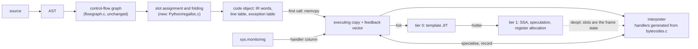

# 06: Architecture v2: a fixed-width register IR from the compiler, one value type, a tracing GC

Status: approved 2026-10-25 with two review amendments (sections 3.2 and 3.4, step 10). Supersedes the encoding in note 01,
the ownership bits of note 02, and note 03 (deferred reference counting),
which is dropped. Notes 04 (shapes) and 05 (tier 0) stand, with the changes in
sections 3.5 and 5.

## 0. What Phase 1 got wrong, and the correction

Phase 1 was built under one constraint: keep the stack bytecode, the
`PyObject*` ABI and reference counting, and bolt the new pieces on beside
them. Each of the three complaints about the result traces back to that
constraint.

**The variable-size encoding.** The IR is lowered from stack bytecode at the
first call, so it inherited the bytecode's shape: an `oparg` that can be
anything, `EXTENDED_ARG`, a feedback entry at a distance. A second word and an
`IR_EXT` prefix were the cheapest way to carry those through. They are not
needed once the compiler emits the IR itself. Section 2 fixes the word at 64
bits with four 12-bit fields and no prefix.

**16-bit slot fields.** In a register VM the operand field names a frame slot in
memory. The register file is the frame; there is no second storage tier to
spill to, and spilling is a machine-register concept that belongs to tier 1,
which allocates machine registers over these slots with liveness it computes
itself. The field width only bounds frame size. Lua 5 and LuaJIT use 8 bits
and reject functions that need more; Dalvik uses 4, 8 or 16 with variable-width
instructions; Ignition uses 8 with `Wide` and `ExtraWide` prefixes, which is
what Phase 1 copied. The right question is how wide a fixed field has to be.
Measured over every code object in `Lib/` (99,269 of them): the largest frame
needs 803 slots, the largest constant table 4,048 entries, the most feedback
sites 1,180, the longest jump 5,458 words. Twelve bits covers all of it with
five times headroom and makes the word fixed.

**Two value representations.** `_PyStackRef` exists because frames had to
carry something `PyObject*` cannot: a bit saying whether this slot owns a
reference count. The inline ints and floats were added to that word because it
was the only word we controlled. So we had NaN boxing in frames, raw pointers
in the heap, boxing at every container store, and ownership ceremony
(`IR_BORROW`, flush before escaping calls, `IR_DROP_BORROW`, dead-temporary
rules) threaded through the generator. All of it is reference counting showing
through. Remove reference counting and every frame slot, container cell and
attribute slot holds the same 64-bit `PyValue`; a store is a store and a read is
a read. Section 3 does that, with a non-moving tracing collector that scans
frames precisely and C stacks conservatively, so that existing C code keeps
working without a handle API.

The result is a design that follows Lua, V8 and JavaScriptCore where they
agree, and departs from CPython where CPython's choices were forced by its ABI:

| | Phase 1 | v2 |
|---|---|---|
| IR produced by | lowering at first call | the compiler, stored in the pyc |
| Instruction word | 64 or 128 bits, `IR_EXT` prefix | 64 bits, fixed |
| Fields | 3 × 16 bits, borrow bit in bit 0 | 4 × 12 bits, no flags |
| `LOAD_FAST`, `STORE_FAST`, `COPY`, `SWAP`, `POP_TOP`, `TO_BOOL` | dispatched, 40 to 45 percent of all dispatches | not instructions; operands name locals directly |
| Bytecode kept beside the IR | yes, with a pcmap | no |
| Value type | `_PyStackRef` in frames, `PyObject*` in the heap | `PyValue` everywhere |
| Ownership bit | yes | none |
| Memory management | reference counts plus cycle GC | non-moving tracing GC, mimalloc as allocator |
| Stack pointer in frames | yes | no; frame size is static |
| Argument passing | copy into the callee frame | callee frame overlaps the caller's argument window |
| C API | `PyObject*`, handle API planned | `PyObject*` stays a heap pointer; `PyValue` for values; no handle API |

## 1. The pipeline

Today's pipeline (Phase 1, PR #1), in one line each: the compiler emits stack
bytecode; at the first call the bytecode is lowered to a register IR with a
pcmap back to bytecode offsets; the IR interpreter specialises in place and
writes typed feedback; instrumentation rewrites the bytecode and is mirrored
into the IR; an optional tier 0 compiles IR blocks to call-threaded machine
code. Two forms of every function exist, and three subsystems (pcmap,
absorption, `IR_REMAP`) exist only to keep them in step.

The v2 pipeline has one form:



- The pyc holds the IR. `dis` shows the IR. There is no stack bytecode.
- Specialisation and instrumentation write the executing copy. The pristine
  words in the code object are the deoptimisation and de-instrumentation
  source. (The free-threaded build's thread-local bytecode is this same
  mechanism, one copy per thread.)
- The feedback vector is allocated with the executing copy, so code that never
  runs costs nothing beyond its words.
- Every tier reads the same feedback vector. Tier 1 deoptimises by writing its
  live machine registers to their frame slots and jumping into the interpreter
  at a word index. Because the IR's registers are the frame slots, the frame is
  the deoptimisation state and no side table is needed.

## 2. The IR

### 2.1 Word

```
 63      52 51      40 39      28 27      16 15       0
+----------+----------+----------+----------+----------+
|    D     |    C     |    B     |    A     |  handler |
+----------+----------+----------+----------+----------+
```

Every instruction is one word. `handler` is a 16-bit index into the dispatch
table (246 handlers today, including 21 instrumented ones; folding `BINARY_OP`'s
operation into the handler adds about 30). A, B, C and D are 12-bit fields
whose meaning is fixed per handler class:

| Class | A | B | C | D | Examples |
|---|---|---|---|---|---|
| 3-slot, feedback | dst | src1 | src2 | fb | `ADD`, `SUBSCR`, `COMPARE_LT`, `STORE_SUBSCR` (A is the container) |
| 2-slot, feedback | dst | src | fb | 0 | `LOAD_ATTR`, `STORE_ATTR` (A is the object), `UNPACK_SEQUENCE` (C is count, D fb), `GET_ITER` |
| 1-slot, feedback, immediate | dst | fb | imm24 | | `LOAD_GLOBAL` |
| immediate | dst | imm24 | | | `LOAD_CONST`, `MAKE_FUNCTION`, `LOAD_DEREF` (B is the cell slot) |
| jump | cond slot | target24 | | | `JUMP`, `JUMP_IF_FALSE`, `JUMP_IF_NONE`, `JUMP_BACKWARD` |
| loop | dst | iter | fb | target12 | `FOR_ITER`, `SEND` |
| call | dst | callee | argc | fb | `CALL`, `CALL_KW` (kwnames in slot callee+argc+2) |
| window | dst | base | count | | `BUILD_LIST`, `BUILD_TUPLE`, `CALL_FUNCTION_EX` |

Rules:

- A slot field names a frame slot, 0 to 4094. Locals, cells and free variables
  come first, temporaries after. A code object that needs more than 4095 slots
  is a compile error, as a function with more than 255 registers is in Lua.
  The stdlib's largest need is 803 and the compiler already bounds literal and
  call stack use at 30 elements.
- A feedback field names an entry in the code object's feedback vector; index
  0 is a shared entry that never specialises, used by sites past the 4,095th.
- Static operands of feedback instructions, such as the attribute name of
  `LOAD_ATTR` or the global's name, live in the feedback entry, which the
  specialised handler reads anyway for its guard. The word carries only
  dynamic operands and the entry index.
- `imm24` is C and D together. A jump target is an absolute word index, 24
  bits. `FOR_ITER`'s 12-bit target is a forward distance; the assembler
  relaxes a loop whose exit is further than 2,047 words by jumping to a
  trampoline `JUMP`, as any assembler does. No stdlib loop needs it.
- A handler writes its dst last, after the operation cannot fail, so `z = f(z)`
  can target `z` directly.
- There is no `EXTENDED_ARG`, no second word, no prefix and no flag bit.

Decoding is one 64-bit load, a `movzx` for the handler, and a shift and mask
per field used. Phase 1's handlers read their 16-bit fields from memory
because a single-pass lowering could not keep them in registers; here the
word is in a register and field extraction is two ALU operations each.

### 2.2 What the compiler folds away

With slots as operands, the stack machine's data-movement instructions have
no counterpart:

| Stack bytecode | v2 |
|---|---|
| `LOAD_FAST x` | the consumer's operand is `x`'s slot |
| `STORE_FAST z` | the producer's dst is `z`'s slot |
| `COPY n`, `SWAP n` | the operands name the slots directly |
| `POP_TOP` | nothing (the temporary is simply dead) |
| `TO_BOOL` + `POP_JUMP_IF_*` | `JUMP_IF_*` with its own feedback; the bool fast path is in the jump |
| `UNARY_NOT` + `POP_JUMP_IF_*` | the inverted jump |
| `RESUME` | the eval-breaker and instrumentation-version check moves into the call and resume paths; `JUMP_BACKWARD` keeps its check |
| `LOAD_FAST_BORROW`, the pair forms, `IR_BORROW`, absorbed loads | gone; there is nothing to borrow |

Measured with the Py_STATS build on the executing Phase 1 interpreter, these
instructions are 45 percent of richards' dispatches (28.6M of 63.3M) and 42
percent of go's (75.3M of 179.2M), before counting `RESUME_CHECK` (4.6 and
3.1 percent). The handler bodies that remain are the ones that do work:
attribute loads, calls, compares, jumps.

Two examples. First the one from the PR description:

```python
def g(o):
    return o.x + o.y
```

```
slot 0 = o, temporaries from 1
0  LOAD_ATTR  r1, r0, fb0        ; r1 = o.x, name in fb0
1  LOAD_ATTR  r2, r0, fb1        ; r2 = o.y
2  ADD        r1, r1, r2, fb2
3  RETURN     r1
```

Four words, 32 bytes, four dispatches. The Phase 1 IR took six words and five
dispatches plus `RESUME_CHECK`; the stack bytecode eight instructions.

Second, a numeric loop body:

```python
for i in range(n):
    total += a[i] * b[i]
```

```
4  FOR_ITER   r_i, r_it, fb, +6
5  SUBSCR     r5, r_a, r_i, fb
6  SUBSCR     r6, r_b, r_i, fb
7  MUL        r5, r5, r6, fb
8  ADD        r_total, r_total, r5, fb
9  JUMP_BACKWARD 4
```

Six dispatches per iteration against thirteen in the stack bytecode.

### 2.3 Slot assignment

`Python/flowgraph.c` already knows the stack depth at every instruction and
already runs peephole passes over basic blocks. A new pass at assembly time
maps each stack position to a temporary slot (depth d becomes slot
`nlocalsplus + d`, exactly as the Phase 1 lowering did), then folds:

1. A `LOAD_FAST x` whose value is consumed by the next instruction in the
   block becomes that instruction's operand.
2. A producer followed by `STORE_FAST z`, where the temporary has no other
   reader, writes `z` directly.
3. `COPY` and `SWAP` are resolved by renaming.
4. `TO_BOOL` and `UNARY_NOT` immediately before a conditional jump fold into
   the jump.

Lua's compiler assigns registers with the same stack discipline (`freereg`),
so this is the standard approach for a register VM, not a shortcut. Temporaries
beyond a block boundary keep their stack-position slot, which makes jump
targets agree on slot contents without a dataflow pass. Tier 1 computes real
liveness over the finished IR.

Dead temporaries keep stale values until overwritten, which can retain
garbage, as Ignition's register file does. The compiler emits a `CLEAR` for a
temporary that held the only reference to a large value only where it can tell
(end of a `with` body, loop exit of a `FOR_ITER` over a materialised
sequence); otherwise we accept the retention.

### 2.4 Code object

| Field | Contents |
|---|---|
| `co_ir` | the words, immutable, from the pyc |
| `co_exec` | executing copy, allocated at first call; handler column rewritten by specialisation and instrumentation |
| `co_feedback` | the feedback vector, allocated with `co_exec`; entry kinds as in note 01 |
| `co_nslots`, `co_nlocalsplus` | frame size, static |
| `co_linetable` | as today, keyed by word index |
| `co_exceptiontable` | ranges over word indices; handler word, slot for the exception, slot for `lasti` or none; no depth |
| `co_consts`, `co_names`, `co_localsplusnames` | unchanged |

`co_code` returns the words as bytes. `dis`, `co_positions`, tracebacks and
`f_lasti` work in word indices. The pyc magic number changes once.

Instrumentation sets the handler of a word in `co_exec` to the instrumented
handler and restores it from `co_ir`'s handler plus the specialisation state
when removed. `INSTRUCTION` events fire per word; there are no absorbed loads
to re-lower. `LINE` events use the line table.

### 2.5 Feedback

The feedback vector is the one from note 01 (kinds COUNTER, BRANCH, UNARY,
BINARY, ATTR, GLOBAL, CALL; 16 to 40 bytes; up to four shapes before
megamorphic), with two additions: an entry carries its static operand
(section 2.1), and CALL entries record the callee's function version so that
tier 1 can inline. The interpreter, tier 0 and tier 1 read the same entries.
`specialize.c` remains the writer.

### 2.6 What the JIT gets

- Fixed-width words: a template per handler, one `mov`/`lea` per field.
- Registers are frame slots, so deoptimisation metadata is "which machine
  register holds which slot", and the interpreter resumes at any word.
- Basic blocks are implicit in the jump targets; SSA construction over 4,095
  virtual registers with explicit defs is textbook.
- Compare and branch fuse in the JIT by peeking at the next word, so the
  interpreter needs no superinstructions.
- No reference counting: a move is a move, a guard failure needs no
  cleanup, and values can stay in machine registers across instructions.

## 3. The object model

### 3.1 One value type

`PyValue` is a 64-bit word with the Phase 1 encoding minus the ownership bit:

```
Top 16 bits     Low 48 bits          Meaning
0x0000          0                    NULL: absent, unbound, error with exception set
0x0000          pointer              heap object; low 4 bits zero
0x0001          int48                internal index, never visible to Python
0x0002-0x7FF2   double + 2^49        float, +0.0 to +inf
0x8002-0xFFF2   double + 2^49        float, -0.0 to -inf
0xFFFE          0 then int32         int
0xFFFF                               reserved
```

`None`, `True` and `False` stay pointers to static objects, so that "is it a
heap object" has one answer and `Py_TYPE` has three cases. Inline ints stay
int32 so that the overflow check is the processor's flag; a 48-bit inline int
is possible in this encoding and is noted as a measured option, not taken.
NaN results are boxed.

`PyValue` is the type of a frame slot, a container cell, an instance slot, a
dict key or value, a function argument and a C API value. `_PyStackRef`,
`Py_TAG_REFCNT`, `PyStackRef_CLOSE`, `PyStackRef_DUP`, `PyStackRef_Borrow`
and the generator's `inline_ok` and borrow annotations are deleted.

`PyObject*` remains a pointer to a heap object. It is what C code uses after it
has established that a value is not inline. Converting a `PyValue` to a
`PyObject*` boxes an inline int or float into a fresh heap object; since there
are no reference counts, boxing has no ownership consequence.

### 3.2 Heap object header

```c
typedef struct {
    uintptr_t ob_header;   /* type pointer in bits 0-47, GC and flag bits in 48-63 */
} PyObject;
```

Eight bytes instead of sixteen. `Py_TYPE(o)` is one `and`. The sixteen flag
bits hold: mark, old (sticky mark for a later generational mode), finalizer
queued, has weak references, static (not heap allocated), owns external
resources, and spare. Only the collector writes them, with the world stopped.

The hidden-class layout is already the instance layout of section 3.3:
header, shape, slots. The open choice is whether the shape should move into
the header word in place of the type, as V8's map does, with the type reached
through the shape. That saves two loads on every `LOAD_ATTR` and `STORE_ATTR`
and costs one on every `Py_TYPE` in the runtime's C code. The right time to
decide is step 6c, when shapes are on by default and we can count both: if
attribute guards outnumber `Py_TYPE` loads in the C runtime on the benchmark
set, the header becomes the shape. Until then the type stays in the header,
and every type has a root shape so that the two layouts are
interchangeable.

### 3.3 Instances

An instance is `header, shape, slots...`. The shape (note 04) is owned by the
type and describes slot order and kinds. Attribute access guards the type
version and the shape pointer, then loads the slot. Slot kinds BOXED, I32 and
F64 exist from the first version; a F64 slot holds a raw double and
`LOAD_ATTR_SHAPE` produces an inline float from it without a tag test. The
shape's property table records the kind; a store of a non-float into an F64
slot transitions the shape. Dictionary mode (a materialised `__dict__`) is a
shape whose single slot points at the dict. `__slots__` classes are shapes
that cannot transition. Weak references live in a side table keyed by
address, with the header flag saying whether to consult it, so the
pre-header goes away.

### 3.4 Memory management

Reference counting is removed. `Py_INCREF`, `Py_DECREF`, `Py_CLEAR`,
`Py_SETREF` and friends compile to nothing; `Py_REFCNT` returns a large
constant so that code which tests `Py_REFCNT(x) == 1` to mutate in place takes
its safe path.

The collector:

- **Allocator:** mimalloc, already in the tree and already used by the
  free-threaded collector to enumerate objects. Size-class pages give a sweep
  by heap visit and an "is this address an object" test for conservative
  scanning.
- **Algorithm:** non-moving mark-sweep, stop-the-world, triggered by bytes
  allocated since the last collection. Generational collection by sticky mark
  bits with a write barrier is a measured follow-up (section 6, step 7), not
  part of the first version, because a missing barrier is a silent heap
  corruption and the barrier audit needs a working collector to verify
  against.
- **Precise roots:** interpreter frames (every slot, plus the frame header's
  references), thread and interpreter state, module and type objects
  (static types are registered at `PyType_Ready`), the finaliser queue.
- **Conservative roots:** each thread's C stack and spilled registers, and
  the writable data segments of every loaded shared object (via
  `dl_iterate_phdr`, as Boehm does). A word is a root if mimalloc says it
  lies inside an allocated block; interior pointers mark their block. This is
  what lets `Objects/`, `Modules/` and every port keep holding raw `PyObject*`
  in C locals and static variables without a handle API.

  Conservative scanning is the first pass, not the end state. A precise
  moving collector (nursery bump allocation, compaction) is the target once
  the ports are green on the tracing collector, and three things in this
  design keep that door open: the collector's root set is an abstraction
  (`gc_roots.c`) that the conservative scanner implements and a precise one
  will replace; new C API functions take and return `PyValue` and are
  written so that the handle discipline can be added at the signature
  without changing callers' logic; and the ports tree records, per port,
  which C code holds heap references across allocations, which is exactly
  the inventory the handle migration will need. The moving collector and
  its handle API are step 10, after tier 1.
- **Traversal:** `tp_traverse` for every type that holds references, not only
  GC-tracked containers. Step 4 of the plan builds a verifier that finds the
  gaps while reference counting still protects us.
- **Finalisation:** `__del__` and weak reference callbacks run from a queue at
  safepoints; an object with a finaliser survives the collection that finds it
  unreachable and dies in the next. `tp_dealloc` is called during sweep only
  for types flagged as owning external resources (files, sockets, buffers,
  locks, mmap, numpy data), and may not touch other heap objects. For every
  other type the body of `tp_dealloc` was releasing references and freeing
  memory, which the collector now does.
- **Observable changes:** `sys.getrefcount` is removed; `__del__` timing is
  not deterministic (PyPy's semantics); `gc.collect` works; `id` is stable
  because nothing moves. Correct code uses `with` and `close`, as thread #15
  settled. The stdlib audit (`tempfile`, `subprocess`, tests that assert
  refcount behaviour) is part of step 5.
- **Free threading:** the first collector is single-threaded. The
  free-threaded build is dropped at step 5, as the plan already stated for
  the encoding flip. A parallel marker is the natural later addition; the
  design keeps mark state in the header so that it can be done with atomic
  bit sets.

Expected effect: the refcount traffic in handlers and in every C function
disappears (the literature puts it at 10 to 30 percent of cycles; in richards the
Py_STATS build counts 25M increments and decrements of mortal objects over
63M instructions, and 12M more on immortal objects that still test the flag), the
per-object header halves, and resident size rises by the collector's
headroom (expect 1.3 to 2 times live data). We measure RSS with every
benchmark from step 5 on.

### 3.5 C API consequences

The handle-scope API of plan idea 7 and thread #16 was designed for a moving
collector. With a non-moving collector and conservative stacks it buys
nothing and would cost a rewrite of every port. It is dropped. What a port
sees instead, by step:

- **After the collector (step 5):** `Py_INCREF` and `Py_DECREF` are no-ops;
  code that reads `ob_refcnt` directly or relies on `tp_dealloc` ordering
  breaks; a `PyObject*` hidden in `malloc`ed memory without `tp_traverse` is
  found by the verifier and fixed by adding a traverse or allocating from
  the GC heap. numpy and Cython should rebuild with small patches.
- **After `PyValue` (step 6):** `PyList_GET_ITEM`, `PyTuple_GET_ITEM` and the
  like become functions that box an inline value on the way out; direct
  access to `ob_item` and to `PyDictValues` breaks and is patched in the
  Cython port, from which pandas, scikit-learn and the rest are regenerated.
  Functions that take `PyObject*` keep taking it. New API takes and returns
  `PyValue`.

The ports tree stays the compatibility test. The number of hand-written patch
lines per port after the Cython port is the metric for the API, as before.

## 4. The interpreter

- **Dispatch:** the tail-call interpreter (clang) with the computed-goto
  build as fallback. The handler signature passes the frame's slot base, the
  word pointer and the thread state in registers. Per instruction: one word
  load, one `movzx`, one table load and jump, two ALU operations per field
  used.
- **No stack pointer.** Frame size is `co_nslots`, fixed. The `stackpointer`
  field, its maintenance in every handler, `_PyFrame_StackPush` and the
  stack-depth accounting in the unwinder are deleted. The collector scans
  `co_nslots` words.
- **Frames.** The frame header (`code, function, globals, builtins, previous,
  pc, flags, owner`) lives on a frame stack; slots live on a separate
  contiguous value stack per thread, `frame->base` pointing into it. The
  generator's frame keeps its slots in the generator object, as today.
- **Calls.** The caller evaluates the callee into slot `c` and the arguments
  into `c+2 .. c+1+argc`. For a Python callee taking exactly those positional
  arguments, the new frame's base is the caller's `base + c + 2` and the
  arguments are already in place: no copy, which is Lua's convention and the
  largest remaining cost in `CALL_PY_EXACT_ARGS`. Keyword and default
  arguments take the copying path. If the value stack chunk lacks room for
  the callee's slots, the arguments are copied to a new chunk.
- **Return** writes the result into the caller's dst slot and pops both
  stacks. Exceptions unwind by table lookup on the word index; nothing is
  decremented.
- **Generators** store the resuming word index in the frame; `YIELD_VALUE`
  writes into the caller's dst slot. The `gi_yield_offset` byte goes.
- **Specialisation** rewrites the handler field with a 16-bit store. The
  family head for deoptimisation is a table lookup on the handler index.
- **Inline values in registers.** With no stack pointer and no counts, a
  handler holds its operands in registers from load to store; the tail-call
  build keeps the slot base, word pointer and thread state in callee-saved
  registers across handlers.

Phase 1's measurements said the interpreter was never where the gains were.
That stays true. The interpreter changes here remove about 45 percent of
dispatches and all refcount work from the rest; an estimate of 15 to 25
percent on the object-heavy benchmarks is reasonable, and we will know at
step 2 and step 5. The point remains that the IR, the frames and the value
type are what tier 0 and tier 1 need.

## 5. Tiers 0 and 1

Note 05's tier 0 was slower in wall time because every value round-tripped
through memory, every handler was called, and reference counts had to be
right at every exit. Over the v2 IR, tier 0 becomes what Sparkplug is: one
template per handler with the fields baked in as immediates, inline fast
paths for `LOAD_ATTR_SHAPE`, `STORE_ATTR_SHAPE`, `LOAD_GLOBAL_*`, int and
float arithmetic and compares with the branch fused, and calls into the
shared handler bodies for the rest. The slot base lives in a register.
Deoptimisation is a jump into the interpreter at the word index, because the
slots already hold the state.

Tier 1 is a method JIT over SSA built from the IR, driven by the feedback
vector: type and shape speculation with guards, inlining of monomorphic
callees using their own feedback, unboxed int and float values in machine
registers across instructions, linear-scan allocation, and a deoptimiser
that writes registers back to slots. The target is V8's Maglev in size and
ambition. Both tiers use the same small x86-64 assembler from note 05, then
arm64.

## 6. Plan

Each step is owned by one Opus 5.5 agent with a brief that carries a clock
deadline, a test ladder (one tiny end-to-end case, then the targeted test
files, then the full suite, then ports, then measurement), a report every 30
minutes or per rung, a "message me if blocked more than 15 minutes" rule and
an explicit scope cut. I validate each gate myself: full suite in debug and
release, `perf stat -e instructions:u` on the four reference benchmarks
(richards, go, nbody, float), the ports build, and RSS where memory changes.
Gates are correctness gates. A performance measurement is recorded at every
step with its attribution, and blocks a step only when the step is the one
meant to deliver that number (decided 2026-10-25 after step 2b: the register
input machinery that the stack pointer and ownership demand regressed
instruction counts, and the cure is steps 3 and 5, not more code in 2b).
Each step lands as commits on `weaver/python-boil-the-ocean` with a worklog
entry; nothing lives on a prototype branch.

| # | Step | Deletes | Gate | Budget |
|---|---|---|---|---|
| 1 | Fixed-width encoding and handlers. `pycore_ir.h` gets the 64-bit word with four 12-bit fields; `ir_generator.py` emits handlers that extract fields from the register; `BINARY_OP` becomes per-operation handlers; static operands move into feedback entries; jumps take 24-bit absolute targets. The Phase 1 lowering is adapted to emit the new words, so that the full suite validates the encoding before the compiler changes. | word 1, `IR_EXT`, `IR_SUPER_COMPARE_*`, the `imm`/`fb` location logic in the metadata generator, `_PyIRFormat.nwords` | full suite debug and release; instructions per loop on the four benchmarks within 1 percent of Phase 1 | 2 days |
| 2a | The compiler emits the IR. `assemble.c` writes words, line table and exception table keyed by word index; `regalloc.c` does slot assignment (section 2.3, folding off); code object fields of section 2.4; `co_exec` copy at first call; marshal and pyc magic; `dis` rewritten for the IR; instrumentation on the handler column. | `ir_lower.c`, pcmap, `IR_LOWER`, `IR_REMAP`, `_PyIR_FUSED`, `co_code_adaptive`, `_PyIR_SyncInstrumentation`, `EXTENDED_ARG`, the stack-depth metadata the lowering used | full suite (test_dis, test_compile, test_peepholer, test_code, test_sys_settrace, test_monitoring updated to the IR); ports; lowering cost gone from startup (richards `-l 1` instructions) | 5 days |
| 2b | Folding (section 2.3): `LOAD_FAST`, `STORE_FAST`, `COPY`, `SWAP`, `POP_TOP`, `TO_BOOL` and `UNARY_NOT` into jumps, `RESUME` into call and resume paths. | the opcodes above and their specialisations, `RESUME_CHECK` | Py_STATS dispatch count on richards and go down at least 35 percent; instructions per loop down on all four; suite; ports | 3 days |
| 3a | Frames and calls (section 4): no stack pointer, frame header on its own stack, value stack with overlapping argument windows, `RETURN`/`YIELD` writing the caller's dst, state in registers in the tail-call build; dead temporaries are NULL so that unwinding, frame clear and traversal visit every slot without a depth; RESUME folded into frame entry and resume. | `stackpointer`, `_PyFrame_StackPush/Pop`, `return_offset`, `gi_yield_offset`, the argument copy in `CALL_PY_EXACT_ARGS`, `RESUME`, `RESUME_CHECK`, the exception table's depth | suite; ports; call micro-benchmark and per-loop instructions recorded against 2b | 4 days |
| 3b | The register CFG (note 07): stack-to-register conversion at the end of the CFG optimiser, a pass driver, general load and store folding, `SWAP`, `COPY` and `POP_TOP` by renaming, liveness, register compaction. | `regalloc.c`'s depth pass and peepholes, `COPY`, `SWAP`, `POP_TOP` as instructions where renaming covers them | suite; ports; the loads 2b could not fold gone from the Py_STATS mix; frame slots per code object recorded | 4 days |
| 4 | Collector, verifier mode. `Python/gc_trace.c`: mark from precise roots (frames, thread and interpreter state, registered static types) and conservative roots (C stacks, data segments) via mimalloc's block lookup; `tp_traverse` audit tool that reports every type with pointer members and no traverse; at every `gc.collect` in a debug build, report any object with a nonzero count that the mark did not reach. Reference counting still owns memory. | nothing yet | zero unreached-but-counted objects across the full suite and the seven ports with the verifier on | 4 days |
| 5 | Collector, live. `--with-gc` configure flag first, default later in the step. Eight-byte header; `Py_INCREF`/`Py_DECREF` to no-ops; sweep by heap visit; finaliser queue; weak reference side table; `tp_dealloc` audit and `OWNS_RESOURCES` flag; `sys.getrefcount` removed; stdlib audit for refcount timing; free-threaded build removed. Sub-gates: 5a flag build runs the smoke ladder; 5b full suite; 5c ports rebuild with patch counts recorded; 5d default on, refcount paths deleted. | `ob_refcnt`, `Py_TAG_REFCNT`, `_PyStackRef` ownership, `IR_BORROW` remnants, the cycle collector (`gc.c`), free lists, the free-threaded build and `gc_free_threading.c`, `Py_STACKREF_DEBUG` | suite; ports; instructions per loop down on richards and go; pyperformance geomean and RSS recorded and compared with Phase 1 | 10 days, in four sub-steps |
| 6a | `PyValue` in the core: list, tuple, dict, set, instance slots, cells, globals hold `PyValue`; `_PyStackRef` renamed to `PyValue` and the duplicate helpers deleted; boxing only at the `PyObject*` conversion. | `_PyStackRef`, `PyStackRef_*`, `Py_STACKREF_INLINE_VALUES`, the boxing at container stores | suite; nbody, float, spectral_norm instructions per loop; RSS | 5 days |
| 6b | `PyValue` at the C API boundary and in the ports: item accessors become boxing functions; Cython port patched and the Cython-generated ports regenerated; numpy; patch counts recorded. | `PyList_GET_ITEM` and family as macros | all seven ports green; hand-written patch lines per port recorded | 5 days |
| 6c | Shapes default on, with I32 and F64 slot kinds live, `LOAD_ATTR_SHAPE_POLY`, method loads through shapes. | `--with-shapes`, shared keys for instances, the `PyDictValues` header | suite; ports; richards, raytrace, deltablue, nbody per loop | 4 days |
| 7 | Generational collection: sticky mark bits, remembered set, write barrier in the store macros, barrier verifier (full mark after each minor collection in debug builds). Kept only if pause and throughput both improve on the benchmark set. | nothing | verifier clean; pyperformance and RSS compared with step 6 | 5 days |
| 8 | Tier 0 over the v2 IR (section 5), x86-64. | the Phase 1 `tier0.c` and `ceval_tier0.c.h` | geomean below the deleted upstream JIT's 0.834 against the Phase 0 baseline; suite with tier 0 on | 8 days |
| 9 | Tier 1. | | 2x geomean over Phase 0 on pyperformance, 3x on the numeric subset; ports green | open |
| 10 | Precise moving collector: nursery with bump allocation and evacuation, compaction of the old space, handle discipline in the C API for references held across allocations, ports migrated with the inventory from step 5. | the conservative scanner | ports green; allocation-heavy benchmarks and RSS compared with step 7 | open |

Dependencies: 1 before 2a before 2b. Step 3 and step 4 are independent of
each other and of 2b, and run in parallel once 2a has landed. Step 5 needs 4
and benefits from 3. Step 6a needs 5 (no ownership means `PyValue` is a
rename plus container changes); 6b needs 6a; 6c needs 6a. Steps 7, 8 and 9
follow 6. A Sonnet agent keeps the ports tree rebuilding after every step
that changes the ABI (3, 5, 6a, 6b, 6c).

Why this order. The IR work comes first because it is independent of the
object model, is where the current design is weakest, and because every
later step writes handlers in the generator, which should be in its final
form. Step 1 is kept separate from 2a so that the encoding is validated with
the existing full suite before the compiler, `dis`, marshal and their tests
change in one move. Step 4 exists so that the first time the collector decides
an object is dead, we have already shown over the whole suite and every port
that it finds everything reference counting kept alive. Step 5 comes before
`PyValue` because removing ownership is what makes one value type a rename
rather than a redesign. Note 03's deferred reference counting is skipped: its
only lasting part, root enumeration, is step 4.

## 7. Decisions needed

1. **Non-moving collector with conservative C stacks first, precise moving
   collector later (step 10).** Decided in review: conservative scanning is
   acceptable as a first pass; the design keeps the root set abstract and the
   new API `PyValue`-typed so that the moving collector and its handle
   discipline arrive as a step, not a rewrite.
2. **Hard limits: 4,095 slots and 4,095 feedback sites per code object,
   16M words, 24-bit constant index.** Compile error beyond the slot limit;
   no specialisation beyond the feedback limit. Measured headroom is five
   times over the stdlib.
3. **Inline ints stay int32.** int48 is available in the encoding; take it
   only if a benchmark shows it.
4. **The free-threaded build ends at step 5.** A parallel marker is the
   later path to multi-core, not a concurrent reference-counting scheme.
5. **Skip deferred reference counting (note 03) entirely.** Its root scan is
   step 4; the rest would be deleted at step 5.
6. **Generational collection is step 7, not part of step 5**, so that the
   first collector has no write barrier to get wrong.

## 8. Sources

Lua 5 and LuaJIT (fixed 32-bit words, stack-discipline register allocation,
overlapping call frames, NaN boxing); V8 (Ignition's register file and
feedback vectors, Sparkplug, Maglev, maps, sticky-mark-bit discussions in the
Orinoco notes); JavaScriptCore (NaN-boxing layout, Baseline and DFG tiers);
Boehm-Demers-Weiser (conservative stack and data-segment scanning, interior
pointers); Demers et al. 1990 (sticky mark bits for non-moving generational
collection); Ruby's non-moving GC and PyPy's finalisation semantics as
precedents for the observable changes.

## 9. Step 1 measurements

User-mode instructions per loop (`perf stat -e instructions:u`) of the
pyperformance worker for each benchmark, run at 2 and at 10 loops, with the
difference divided by 8. That excludes startup, imports and lowering. Repeat
runs agree to within 0.1 percent. Phase 1 is f655ef62814. Both computed-goto
builds use gcc 15.2 with `-O3`, and both tail-call builds use clang-21 with
`--with-tail-call-interp`. Ryzen 7 3800X.

gcc, computed goto (Phase 1 is `build/final-snapshot`):

| benchmark | Phase 1 | v0 | v1 | v1b | v1b / Phase 1 |
|---|---|---|---|---|---|
| richards | 562.3M | 618.3M | 583.0M | 575.9M | 1.024 |
| go | 1190.0M | 1356.5M | 1271.4M | 1244.9M | 1.046 |
| nbody | 1013.1M | 1127.8M | 1038.1M | 1030.3M | 1.017 |
| float | 763.6M | 825.0M | 789.8M | 779.7M | 1.021 |

The variants:

- v0 decodes each field from `ir_word` with a shift and a mask, as section
  2.1 planned.
- v1 reads each field from the word in memory, at `this_instr`, with a
  16-bit load and a shift (B, D) or a mask (A, C). CD is a 32-bit load and a
  shift.
- v1b is v1 with the fields as `uintptr_t`, which removes GCC's 16-bit
  arithmetic and zero extensions.
- Making the feedback stride 32 bytes rather than 40 was worse by 0.3
  percent on go and is not kept.
- With the compare-and-branch superinstructions disabled, Phase 1 runs go
  at 1199.5M (+0.8 percent) and the other three within 0.2 percent. Their
  deletion is therefore not the gap.

clang-21, tail call (Phase 1 built the same way):

| benchmark | Phase 1 | v1b | ratio |
|---|---|---|---|
| richards | 643.2M | 631.6M | 0.982 |
| go | 1418.5M | 1382.6M | 0.975 |
| nbody | 1489.8M | 1336.8M | 0.897 |
| float | 941.9M | 906.5M | 0.962 |

The tail-call build passes the 1 percent gate. The computed-goto build stays
within the 3 percent allowance for the fallback dispatch, except go at 4.6
percent.

**Why v0 lost.** Keeping `ir_word` live through the handler body changed
GCC's register allocation in `_PyEval_EvalFrameDefault`. In v0, STORE_FAST
and LOAD_ATTR_INSTANCE_VALUE keep `next_instr` in a stack slot: every
handler loads it, stores it back after `next_instr += 1`, and dispatch loads
it again. The base of `opcode_targets` is also spilled. Only `frame`,
`stack_pointer` and `ir_word` stay in registers, and each field costs a
copy, a shift and a mask. Phase 1 kept `next_instr` in a register, because
every field read used it as a base. In v1 the only value spilled is the
`opcode_targets` base, as in Phase 1. `next_instr` and `this_instr` live in
registers, and dispatch loads only the 16-bit handler. Section 2.1's claim
that a field costs two ALU operations from a register holds per field, but
not for the handler as a whole.

**What remains in v1b is the layout.** LOAD_ATTR_INSTANCE_VALUE runs about 8
more instructions than in Phase 1. The attribute-load micro loop of
`boil/tools/micro_loops.py` goes from 67 to 74, while the loop skeleton is 2
cheaper. The extra instructions:

- A and C need `& 0xfff`, because their 16-bit loads overlap the next field
  (+2).
- The borrow test compares the field with its canonical slot
  (`cmp`/`setne`/`movzbl`) instead of testing a flag bit (+2).
- The feedback entry is an index times 40 from `frame->ir_feedback`, where
  Phase 1 addressed it relative to `next_instr` (+1 to 2).
- The unscaled dst field leads GCC to build `&localsplus[A]` in a chain of
  `lea`s (+2).

Steps 2b (folding the data-movement handlers that dominate go's dispatch
count, and with them most borrow tests) and 3 address these.

**Tail call against computed goto.** In both trees the tail-call build runs
many more instructions than the computed-goto build. For v1b the ratio is
1.30 on nbody, 1.16 on float, 1.11 on go and 1.10 on richards; for Phase 1
it is 1.47, 1.23, 1.19 and 1.14. This is a step 3 item, the interpreter
state kept in registers across handlers, and not something to chase in
step 1.

| micro loop, instructions per iteration | Phase 1 | v0 | v1b |
|---|---|---|---|
| empty loop, i >= 1025 | 68.0 | 75.1 | 66.0 |
| int add, result not cached | 65.8 | 79.0 | 68.8 |
| float add | 75.1 | 87.9 | 77.9 |
| two STORE_FAST | 57.0 | 69.0 | 61.1 |
| attribute load | 67.0 | 85.1 | 74.0 |
| attribute store, existing | 116.9 | 121.1 | 119.2 |

## 10. Step 2a decisions

Step 2a moved the IR into the compiler. The stack bytecode, the lowering
(`Python/ir_lower.c`), its stub and pcmap, `IR_LOWER`, `IR_REMAP`,
`_PyIR_FUSED`, `co_code_adaptive` and the instrumentation sync are gone.
These are the choices made on the way, where they differ from or add to
sections 2.3 and 2.4.

**Pipeline.** `Python/regalloc.c` maps depth d to slot `co_nlocalsplus + d`,
in a function of its own so that step 2b can fold there.
`Python/assemble.c` chooses each handler, encodes the words, numbers the
feedback entries, relaxes FOR_ITER and SEND, and writes the line and
exception tables by word index. Nothing is folded, so `LOAD_FAST_BORROW`
keeps a word and every input field names its canonical slot. Handlers still
keep `stack_pointer`, and the exception table keeps its depth column. The
`IR_BORROWED` machinery for absorbed loads stays in the generator for step
2b.

**Code object.** The trailing array, `co_words`, holds the words followed by
the feedback table: one 32-bit entry per feedback site, `kind << 24 | arg`,
where arg is the static operand. Entry 0 is the shared entry. `co_code`
returns the words, and `co_fbinit` returns the table. `code()` takes the
table as a new last positional argument, `fbinit=b''`, and `replace()`
takes `co_fbinit`, defaulting to the code object's own table. Marshal
writes the table after `co_code`. The pyc magic is 3707.

**Checking.** The Python and C-API constructors check every word: the
handler exists, and the slot fields are below `co_nlocalsplus +
co_stacksize`. A feedback field must be below the number of entries, and
must not be 0 for a handler that reads its operand from the entry. A word with
an inline constant handler whose constant is no longer a compact int or a
float, as after `replace(co_consts=...)`, runs `LOAD_CONST` instead. Code
whose length is a whole number of 2-byte units but not of words is padded
with zero words (CACHE): Cython builds each function's code object from
zeroed code of that kind, which never runs and only spans its line table,
and the numpy and pyyaml ports fail to import without it. Marshal does not
check, just as it trusts bytecode today. Sites past the 4095th share
entry 0 and run a NOFB handler, which carries the operand in the word
(`LOAD_ATTR_NOFB`, `COMPARE_OP_NOFB` and so on).

**Executing copy.** `_PyCode_GetExec()` (Python/ir.c) allocates the words
and the feedback vector together on the first call and initialises the
entries from the table. It is called when a frame is pushed, by
`PyFrame_New`, by the specialiser when it inspects a callee, and when
instrumentation is forced. Frames point into the copy (`ir_words`,
`ir_feedback`). The assembler always emits the inline constant handlers
(`LOAD_SMALL_INT_INLINE`, `LOAD_CONST_INLINE_INT` and `_FLOAT`). The copy
runs the boxing forms instead in a build without inline values or under
`PYTHON_TAGGED_VALUES=0`, so the words do not depend on the build.

**Instrumentation.** Instrumentation rewrites handlers in the executing copy
and restores them from the code object's words. The pristine words replace
the `real[]` array of note 01: the handler to restore is that word's, or for
a NOFB site the NOFB form of the instrumented instruction. A restored word is
generic and warms up again. INSTRUCTION events fire once per word; the
`IR_JUMP` words described below have none.

**Offsets.** Word indices are used everywhere:

- `f_lasti`, `tb_lasti` and `co_lines()`, `co_positions()`, the line and
  exception tables;
- monitoring offsets, including the legacy branch events;
- `dis` offsets and lazy-import locations.

`co_lines()` ends at `len(co_code) // 8`. This is the visible API change of
the step.

**Relaxation.** FOR_ITER and SEND reach `IR_MAX_FORWARD` (2047) words. The
assembler relaxes a loop whose exit is further away into trampolines. A
relaxed FOR_ITER at w exits by distance 1 and is followed by three
`IR_JUMP` words: to the body at w + 4, to END_FOR (where a generator
returns), and past END_FOR. A relaxed SEND has two: to w + 3 and to
END_SEND. `IR_JUMP` does not save the instruction pointer, so the events
after it see the loop as the instruction before. `dis` shows these words as
`JUMP_FORWARD`, with `handler` `IR_JUMP`.

**Handler numbers.** The IR-only handlers now follow the pseudo-instructions
of the compiler. `IR_JUMP` is 267, not 256. As a result
`opcode.opname[n]` names one opcode, pseudo-instruction or handler for every
n.

**dis.**

- `Instruction` gains four fields:
  - `handler`, the name of the word's handler;
  - `dst`, the slot written;
  - `srcs`, the slots read, or the base of a window;
  - `fb`, the feedback index.
- `cache_info` lists the fields of the feedback entry. These come from the
  table, or with `adaptive=True` from the executing copy (state, counter,
  arg, first, second). `show_caches` prints them as a `FEEDBACK` line.
- Each line ends with a register column, for example `r1 <- r1, r2`.
- With `adaptive=True`, an IR-only generic handler such as
  `BINARY_OP_SUBTRACT` or `LOAD_ATTR_NOFB` shows as the instruction it
  runs. Specialisations show as themselves.
- `opcode` takes its tables from the generator (`_ir_formats` via
  `_opcode.get_ir_formats()`, and `_ir_opmap`). `_cache_format` and
  `_inline_cache_entries` are deleted.
- Limit: disassembling bare `co_code` bytes cannot show an operand that
  lives in the feedback table, such as COMPARE_OP's operator or a global's
  name, because those bytes do not include the table.

**Readers.** `_Py_DebugOffsets` drops the IR block and renames
`co_code_adaptive` to `co_words`, and it adds `interpreter_frame.ir_words`.
`_remote_debugging` computes the word index as `(instr_ptr - ir_words) / 8`
and reads the handler as the low 16 bits of the word. `Tools/gdb/libpython.py`
computes `f_lasti` the same way.

**Byte order.** A pyc stores the words in the order they have in memory,
which assumes a little-endian host as every supported 64-bit target is. A
big-endian port would swap them in marshal.

**Smaller changes.**

- Whether `GET_ITER` of a `yield from` must reject a coroutine depends on
  `CO_ITERABLE_COROUTINE`. `types.coroutine()` sets that flag on a copy of
  the code object, so the compiler cannot know it. The lowering used to
  resolve it; now `_PyEval_GetIter` reads the running code's flags.
- The compiler builds a function's annotations dict 15 pairs at a time
  (`BUILD_MAP` and `DICT_UPDATE`), so that a function with thousands of
  annotated parameters stays within the slot limit.
- `EXTENDED_ARG` is never emitted. The opcode stays defined because
  `opcode.EXTENDED_ARG` and `dis` document it.

**Measurements.** gcc with computed goto (dev-default), against step 1 and
against step 1 with absorption disabled (step1-noabsorb), which emits the
same words as 2a. Instructions per loop are the worker at 2 and 10 loops,
differenced, the median of four or five runs; each build has its own pyc
cache.

| per loop (M instructions) | step 1 | step1-noabsorb | 2a | 2a vs noabsorb | 2a vs step 1 |
|---|---|---|---|---|---|
| richards | 577.3 | 594.5 | 597.0 | +0.4% | +3.4% |
| go | 1244.1 | 1305.7 | 1312.7 | +0.5% | +5.5% |
| nbody | 1030.3 | 1030.3 | 1028.6 | -0.2% | -0.2% |
| float | 780.0 | 800.4 | 803.2 | +0.4% | +3.0% |

The gap to step 1 is the absorption that 2a does not do; step 2b's folding
is to win it back.

| one-time (M instructions) | step 1 | step1-noabsorb | 2a |
|---|---|---|---|
| `python -c pass` | 54.1 | 53.5 | 46.7 |
| richards `-l 1` | 995.0 | 1012.4 | 974.2 |
| richards `-l 1` less one loop | 417.7 | 417.9 | 377.2 |

Deleting the lowering saves about 40M instructions on a richards worker and
6.8M at startup.

Peak RSS is the median of five runs, measured two or three times.

| max RSS (KiB) | step 1 | step1-noabsorb | 2a | 2a vs noabsorb |
|---|---|---|---|---|
| `python -c pass` | 10448 | 11248 | 11384 | +1.2% |
| twelve stdlib imports | 19280 | 20204 | 21178 | +4.8% |
| richards `-l 10` | 22356 | 23464 | 24136 | +2.9% |

Imports and richards exceed the 2 percent allowance. The code objects carry
the cost: after the imports, their 3,758 code objects hold 842 KB of stack
bytecode in step 1 and 1,334 KB of words plus 257 KB of feedback tables in
2a. A loaded code object now holds 8 bytes per instruction where it held 2
bytes per code unit. A quarter of the words load a local or a constant;
2b's folding removes many of them.

## 11. Step 2b decisions and measurements

Step 2b folded loads, stores and truth tests into the words that use them.
Step 3 takes over what is left.

**What landed.**

1. A `LOAD_FAST_BORROW` keeps no word when the next word reads it through
   an input field, on the same line and in the same block (option A of
   section 2.3). The commits are e06e93ea0db and 9fe2885ef6e.
   `RETURN_VALUE` reads its value through a field (710a7d5ae0c).
2. A `STORE_FAST` folds into the word that produces its value, through the
   `_PyIR_STORE_DST` format flag (5d12e1cd240).
3. `COPY 1` just after `LOAD_FAST x` becomes a second load of `x`, which
   then folds, so `x and y` and `o.a += 1` keep no `COPY` (82b2b301236).
   Renaming `SWAP` and `POP_TOP` needs liveness, so it moves to step 3.
4. `POP_JUMP_IF_FALSE` and `_TRUE` test the truth of any value
   (82b2b301236). They are families with TO_BOOL's specialisations: BOOL,
   INT, LIST, NONE, STR and ALWAYS_TRUE. The flowgraph drops the `TO_BOOL`
   before a jump, and a `UNARY_NOT` there inverts the jump.
5. Removing `RESUME` moves to step 3, which rewrites the call and resume
   paths anyway.

A fix came out of item 1 (7a616230c10). The generic handlers boxed an
inline local and wrote the box back into the local, so the local stayed
boxed. Now the box belongs to the handler, and the local keeps its inline
value.

Plan section 6 lists the opcodes 2b would delete. 2b deletes none of
them:

- `TO_BOOL` and `UNARY_NOT` remain where a bool is a value, as in
  `return not x`.
- `COPY`, `SWAP` and `POP_TOP` remain for the cases that need renaming.
- `RESUME_CHECK` remains until step 3.

**Decisions.**

- *Jump feedback.* An entry of POP_JUMP_IF_FALSE or _TRUE is a UNARY
  entry of kind BRANCH. The counter drives specialisation. The taken
  history replaces the oparg in the header, which the jump does not need
  because its target is in the word. `make_exec` and instrumentation's
  `warm_up` now set the counter of every entry. POP_JUMP_IF_NONE and
  _NOT_NONE keep header-only entries.
- *Opcode numbers.* The twelve jump specialisations do not fit in the 106
  numbers between RESUME and the instrumented opcodes. The cases generator
  puts the overflow in the unused numbers below RESUME (117 to 127).
  Nothing in C uses MIN_SPECIALIZED_OPCODE as a range.
- *Where the truth test folds.* `fold_truth_tests()` in
  `Python/flowgraph.c` runs after the peepholes, so COMPARE_OP, IS_OP and
  CONTAINS_OP absorb a TO_BOOL first. The JUMP_IF_FALSE and _TRUE pseudo
  instructions expand to `COPY 1` and the jump.
- *Operand-kind variants: tried and removed.* This was Lua 5.4's
  ADDK/ADDI technique: spare bits of the handler index record which inputs
  are locals, and each pattern of the hot families gets its own generated
  handler. It made 519 handlers instead of 302. ceval.o text grew from
  217.0K to 371.8K and data from 2.8K to 33.1K, behind a 4096-entry table.
  It won back part of the per-loop regression (table below). The
  regression is the run-time operand machinery, which step 3 removes, so
  the variants would be deleted again.
- *Gates.* From 2026-10-25, gates check correctness, and 2b reports
  dispatch counts and instruction counts without gating on them
  (section 6).

**Dispatches.** These are Py_STATS opcode executions of one pyperformance
worker at `-l 2` (`--worker -l 2 -w 0 -n 1 -p 1`, build/dev-pystats). The
day-1 worklog figures count a whole default run, so they are about four
times larger.

| dispatches | 2a | item 1 | items 1-2 | items 1-4 | vs 2a |
|---|---|---|---|---|---|
| richards | 21.83M | 17.81M | 16.86M | 15.33M | -29.8% |
| go | 60.47M | 50.29M | 46.23M | 42.96M | -29.0% |

The plan's target was 35 percent. Before items 3 and 4, the breakdown of
what they could remove was:

- richards: 1.50M TO_BOOL before a jump; 0.63M each of COPY 1 and TO_BOOL
  from `and` and `or`; 0.25M UNARY_NOT. The projection was 14.7M (-32.5%).
- go: 1.52M TO_BOOL; 0.73M COPY after LOAD_FAST_BORROW (`o.a += x`);
  0.20M COPY after LOAD_FAST; 0.73M SWAP before STORE_ATTR, deferred. The
  projection was 43.8M (-27.6%).

The value contexts that remain in richards are 0.43M COPY after
LOAD_ATTR, from `self.a and ...` as a value, and 0.25M TO_BOOL_BOOL and
UNARY_NOT, from `not self.x` as a value. The rest of the gap to 35 percent
is the loads under windows, calls and globals, and RESUME_CHECK (1.01M in
richards, 1.89M in go), all of it step 3's work.

**What step 3 inherits** (go, after items 1 to 4):

- LOAD_FAST_BORROW, 3.45M. Its successors:
  - LOAD_ATTR_INSTANCE_VALUE, 1.29M, where the load is below another word,
    as in `f(a, b.c)`;
  - CALL_PY_EXACT_ARGS, 1.00M;
  - LOAD_GLOBAL_MODULE, 0.53M;
  - LOAD_SMALL_INT_INLINE, 0.24M.

  In richards: 0.67M, mostly before LOAD_GLOBAL, LOAD_ATTR and calls.
- STORE_FAST, 1.50M. Its predecessors are RETURN_VALUE, 1.00M (the
  caller's result, which step 3 writes straight to the caller's dst), and
  COPY, 0.25M (chained assignment).
- SWAP, 0.75M, after BINARY_OP, before STORE_ATTR and STORE_SUBSCR in
  augmented assignment.
- POP_TOP, 1.00M, half of it after RETURN_VALUE.
- RESUME_CHECK, 1.89M.

**Instructions per loop.** These are user-mode instructions per loop of
the worker, from runs at 2 and 10 loops, differenced. Each figure is the
median of four, and each build has its own `PYTHONPYCACHEPREFIX`. The
column "before 3-4" is 7c9ccdcaca3.

gcc 15, computed goto:

| per loop (M) | step 1 | 2a | before 3-4 | 2b | 2b vs 2a |
|---|---|---|---|---|---|
| richards | 575.1 | 594.3 | 704.1 | 733.4 | +23.4% |
| go | 1244.2 | 1312.4 | 1689.9 | 1774.1 | +35.2% |
| nbody | 1030.3 | 1028.6 | 1563.4 | 1640.6 | +59.5% |
| float | 782.0 | 804.4 | 963.8 | 995.2 | +23.7% |

clang 21, tail calls:

| per loop (M) | before 3-4 | 2b |
|---|---|---|
| richards | 680.7 | 672.9 |
| go | 1589.8 | 1570.3 |
| nbody | 1675.8 | 1675.8 |
| float | 995.4 | 990.5 |

Items 3 and 4 remove 7 to 9 percent of dispatches. In the tail-call
build, where each handler is its own function, they save up to 1.2
percent of instructions. In the gcc computed-goto build they add 3 to 5
percent, because GCC allocates registers for the whole eval loop at once,
as the next paragraph shows.

Where the 2a-to-2b rise comes from:

- **Step 3** removes two costs:
  - the stack-pointer sync on handler entry: SYNC_DST, SYNC_TOP and
    SYNC_LAG, including `stack_pointer += IR_IS_LOCAL(field)`;
  - the canonical-slot arithmetic, `nlocalsplus + depth`, that decides
    whether a field names a local.
- **Step 5** removes two more:
  - the borrowed-or-consumed tests at run time (`IR_LOAD_BORROWED`,
    `IR_BORROW_KNOWN`, `IR_CLEAR_IF_BORROWED`, `IR_DROP_BORROW`);
  - the release of the old value of a dst that names a local, and the
    test for it.

**GCC spills.** Since item 2, GCC spills `frame`, `next_instr` and
`stack_pointer` to the stack frame across the whole computed-goto loop
(`-0x188`, `-0x190` and `-0x198(%rbp)`). Every handler reloads them.
These are `%rbp`-relative references in `_PyEval_EvalFrameDefault`:

| build | %rbp refs | lines | text |
|---|---|---|---|
| 2a | 2309 | 24.0K | |
| item 1 | 3816 | 29.8K | |
| before 3-4 | 7448 | 40.4K | 238.9K |
| 2b | 10176 | 44.6K | 263.8K |
| experiment base: items 1-2 with the variant generator, no variants | 8629 | 42.2K | |
| the base, operand machinery stubbed out | 2327 | 23.8K | |
| stubbed, with LOAD_ATTR variants | 2291 | 26.4K | |
| stubbed, with BINARY_OP variants | 5330 | 55.6K | |
| operand-kind variants, full | 11248 | 69.2K | |

The stubbed rows replace `IR_IS_LOCAL`, `IR_LOAD_BORROWED`,
`IR_BORROW_KNOWN`, `IR_CLEAR_IF_BORROWED` and `IR_STORE_RESULT` with their
stack-only forms. That build keeps the state in registers, as 2a does. The
code size and register pressure of the run-time operand machinery cause
the spills. Changing GCC's register-allocation options (`-fira-region`,
`-fira-algorithm`, the conflict-table size, the loop limits) made no
difference. Step 3's removal of the stack pointer is the cure, and step 3
should measure the computed-goto build first.

Micro loops: instructions per iteration of `for i in range(1000):`
around the body, in the gcc build, with `x` and `y` locals holding inline
ints. "Variants" is the operand-kind experiment, without and with the
inline-local fix:

| body | 2a | before variants | variants | variants + fix |
|---|---|---|---|---|
| `x + y` | 131 | 225 | 190 | 158 |
| `z = x + y` | 138 | 202 | 168 | 136 |
| `pass` | 69 | 71 | 71 | 79 |
| `z = x` | 104 | 109 | 109 | 123 |
| boxed `x + y` | 170 | 225 | 190 | 203 |

**nbody.** nbody boxes 1.9M floats per run, 1.5M of them in
`STORE_SUBSCR_LIST_INT`, which stores an inline float into a list. 2a has
the same boxing. Step 6a removes it, when lists hold `PyValue`.

**Startup and memory.** `python -c pass` takes 54.0M instructions in
step 1, 46.6M in 2a, 47.5M before items 3 and 4, and 47.7M in 2b. Peak
RSS is from `boil/tools/rss.py`, the median of five warm runs, in KiB:

| max RSS | step 1 | 2a | before 3-4 | 2b |
|---|---|---|---|---|
| startup | 9428 | 9572 | 10480 | 10524 |
| imports | 11572 | 11644 | 12600 | 12720 |
| dicts | 65032 | 64300 | 65496 | 65652 |
| loops | 10024 | 10016 | 11112 | 11208 |

Items 1 and 2 added about 0.9 MB at startup, which the 57K of extra
interpreter text does not explain. It is not yet investigated. Items 3 and
4 add 44 to 160 KB.

**Known failures.**

- dev-debug: test_sys `test_remote_exec_deleted_static_executable`, as
  before.
- dev-stackrefdebug: test_embed `test_asyncio_task_during_interpreter_clear`.
  The function and code references of a never-run coroutine's frame leak
  at interpreter clear. I believe this predates 2b, but it has not been
  checked on an older build.
- dev-ft: 78 failures in the rung-2 files, all of them tests that expect
  specialisation, which the free-threaded IR does not do. That is the 73
  known before plus five, because test_to_bool now has five subtests and there
  is a new test_pop_jump_if.

## 12. Step 3a decisions

### 12.1 Milestone 1: no stack pointer

**Invariant.** Every one of a frame's `co_nslots` slots holds a value or
NULL. A slot at or above `co_nlocalsplus` is a temporary. A handler that
consumes a temporary takes it and stores NULL. A handler writes a
temporary result only into a NULL slot, which debug builds assert. A
handler that writes a local releases the old value. An input is borrowed
when its slot is below `co_nlocalsplus`. Everything that used to walk
`localsplus` up to the stack pointer now walks all slots and skips NULL:
unwinding, frame clear, both collectors, frame traversal, `f_locals`,
`f_lineno` assignment, frame copy, and the remote debugger.

**Exception table.** An entry names the handler, the slot that receives
the exception, and the lasti flag; the depth is gone. When lasti is set,
the slot below the exception's receives the offset. `dis` prints the
slot as `[rN]`. The magic number is 3712.

**The unwinder clears from the handler's first slot up, not every
temporary.** A handler can run while temporaries below it are live: the
iterator of an enclosing `for`, the exit method of a `with`. In the
stack numbering these lie below the handler's depth, so clearing from
the handler's first slot (the lasti slot, or the exception slot) upward
releases exactly what the old pop-to-depth released. When no handler
matches, every temporary is cleared.

This is a constraint on 3b. **3b must either keep handler-live
temporaries below the handler's first slot or give the exception table
a liveness record.** Register compaction that numbers a temporary live
across a handler above the handler's first slot would have the unwinder
release a live value.

**`return_slot`.** The frame gains a 16-bit `return_slot`. For a frame
with a pending call it names the slot the callee's result goes to; for
a suspended generator it names the slot where the value sent in goes.
`gi_yieldfrom` reads the receiver at `return_slot - 2`, because SEND's
window is receiver, index, value. `_PyFrame_SetReturnValue` writes
there. The entry frame and the `__init__` shim use slot 1.

**LOAD_SPECIAL is window style.** Its two outputs are written to its
window rather than to `dst`, because register-style outputs could
overlay a folded local input.

**Free-threading risk, not yet addressed.** The generator now keeps
some values in C variables rather than in slots across escaping calls
(the values with no slot). On the free-threaded build, a deferred
reference held only in a C variable is invisible to the collector. The
rung-2 suite does not show it; the failures are the known 78.

**Deleted.** `stack_pointer`, `stackpointer` and `stackpointer_valid` in
the frame; `_PyFrame_GetStackPointer`, `_PyFrame_SetStackPointer`,
`_PyFrame_StackPeek/Pop/Push`, the stack-pointer validity helpers;
`STACK_LEVEL`, `WITHIN_STACK_BOUNDS`, `LOAD_SP`, `SAVE_SP`,
`_Py_assert_within_stack_bounds`; the TOP role; `IR_CLEAR_IF_BORROWED`
and the borrow test; the entry sync; the `pop_1_error` and
`pop_2_error` labels; the GH-129236 NULL-stack-pointer skips in the
collectors.

### 12.2 Milestone 2: frame and value stacks

**Layout.** The header (code, function, globals, builtins, locals,
previous, `instr_ptr`, the IR bases, `return_slot`, owner) stays on the
frame stack; the slots go on the value stack, and `frame->base` points at
slot 0. The two stacks share each chunk of the thread's data stack and
grow towards each other, so `_PyThreadState_HasStackSpace()` checks the
room for both with one comparison and no second chunk allocator exists:

```
  chunk:  | slots of A | slots of B ... |    free    | header B | header A |
          ^ data[0]                     ^ top        ^ limit
```

A header records `saved_top`, the value stack's top before its push,
which popping it restores; an overlapping callee can end below or above
its caller's last slot, so the top cannot be recomputed. Generators,
frame objects, the entry frame and the base frame keep their slots in
`owned_slots`, after the header. `_PyFrame_Copy` moves the slots and
leaves NULL, because the slots it leaves may be the caller's.

**Overlapping window.** `CALL_PY_EXACT_ARGS` and
`CALL_BOUND_METHOD_EXACT_ARGS` push the callee with its base at
`caller->base + c + 2`, or `c + 1` when there is a self; the callable
moves to `f_funcobj` and its slot becomes NULL. Nothing is copied. A
caller whose slots are not on the value stack, a generator, copies, as do
the keyword, default and vectorcall paths. `IR_WINDOW_TAKEN()` tells the
cases generator that the handler disposed of its window itself.

The overlap relies on the slots above a call's window being dead, which
holds while temporaries are numbered by stack depth. **3b must keep every
temporary that is live across a call below the call's window, or make the
callee copy when one is not.** Walkers of thread frames visit the
overlapped slots once for each frame; the free-threaded collector's
count of deferred references from stacks is then high for them, which
only keeps live objects alive.

**Clearing.** A frame on the frame stack ends with its temporaries NULL,
after a return or an unwinding, so clearing walks its locals only; debug
builds check the rest. Frame entry no longer fills the callee's
temporaries in the overlapped region with anything but NULL over NULL.

**Return.** A return or a yield resumes the caller at the word after its
`instr_ptr`; `return_offset` and `gi_yield_offset` are gone. When a
generator returns to the `SEND` or `FOR_ITER` that resumed it,
`_PyEval_GeneratorReturnTarget()` reads the exit distance from the
caller's word, which costs only generator returns. The entry trampoline and
the `__init__` shim keep `instr_ptr` on a `NOP` before the word that a
return reaches.

### 12.3 Milestone 3: RESUME and the tail-call signature

**RESUME.** `_PUSH_FRAME` and `start_frame` (frame entry, inline calls,
`DISPATCH_INLINED` and generator resumption) skip a `RESUME` when it would
do nothing: the eval breaker equals the code's instrumentation version,
which is RESUME_CHECK's test, and in the free-threaded build the frame's
bytecode is the thread's. Otherwise the `RESUME` word runs as before, so
instrumentation, the periodic checks and the `PY_START` and `PY_RESUME`
events are unchanged; it also runs after `MAKE_CELL` and `COPY_FREE_VARS`
and at a generator's first start, which come before it. The word stays in
the code, for its location, its offset and the exception table.
RESUME_CHECK is deleted (magic 3713). `JUMP_BACKWARD` keeps its
eval-breaker check.

**Tail-call signature.** The handlers pass the slots, the word pointer and
the thread state, with the word itself; a handler reads the frame from
`tstate->current_frame`, which every frame switch sets together with
`frame`, as debug builds check at each dispatch.

**GCC.** ceval.c is compiled with `-fno-gcse` under GCC with computed
gotos (`CFLAGS_CEVAL`), which the GCC manual advises for computed gotos.
`#pragma GCC optimize` cannot do it: it stops the inlining of every header
function into the loop. Removing the stack pointer and adding
`-fno-gcse` leave the spills that the run-time local-or-temporary tests
cause (section 11): with `IR_IS_LOCAL` stubbed to 0 the loop has 2021
frame-pointer references rather than 3736 (2a had 2309). Step 5 removes
those tests.

### 12.4 Measurements

These were taken at f4983b9da5e by the section 11 method:

- user-mode instructions per loop of one pyperformance worker, from runs
  at 2 and 10 loops, differenced;
- the median of four runs;
- a separate `PYTHONPYCACHEPREFIX` for each build.

The step 1 and 2b columns are snapshot builds run with the current Lib.

gcc 15, computed goto (`-fno-gcse` for 3a):

| per loop (M) | step 1 | 2b | 3a | 3a vs 2b | 3a vs step 1 |
|---|---|---|---|---|---|
| richards | 574.8 | 731.9 | 702.3 | -4.0% | +22.2% |
| go | 1243.9 | 1775.0 | 1686.4 | -5.0% | +35.6% |
| nbody | 1030.3 | 1640.6 | 1509.3 | -8.0% | +46.5% |
| float | 779.8 | 993.8 | 971.8 | -2.2% | +24.6% |

clang 21, tail calls:

| per loop (M) | 2b | 3a | 3a vs 2b |
|---|---|---|---|
| richards | 674.8 | 679.2 | +0.7% |
| go | 1566.7 | 1578.2 | +0.7% |
| nbody | 1675.8 | 1620.2 | -3.3% |
| float | 989.4 | 1003.1 | +1.4% |

-fno-gcse accounts for most of the gcc gain: before it, at 5119930d271,
the figures were 726.4, 1758.8, 1587.0 and 1003.0. In the tail-call
build, reading the frame from the thread state costs 0.3 to 0.5 percent
against passing it, measured at 4ed1d4ab1d1 (675.6, 1574.0, 1611.4,
999.4).

**Dispatches** (Py_STATS, one worker at `-l 2`):

| dispatches | 2a | 2b | 3a | 3a vs 2b | 3a vs 2a |
|---|---|---|---|---|---|
| richards | 21.83M | 15.33M | 14.57M | -5.0% | -33.3% |
| go | 60.47M | 42.96M | 41.35M | -3.7% | -31.6% |

Each run still dispatches about 6.8K `RESUME`, at first starts, after
the cell prefix and when the eval breaker is set.

**Calls.** These are instructions per call of `f(a, b)` and `o.m(a)`,
from loops of 0.1M and 1.1M iterations, differenced (each the median of
five), less the cost of an empty loop:

| per call | step 1 | 2b | 3a |
|---|---|---|---|
| gcc `f(a, b)` | 353.2 | 453.3 | 438.2 |
| gcc `o.m(a)` | 384.3 | 473.3 | 467.2 |
| clang `f(a, b)` | | 425.0 | 420.0 |
| clang `o.m(a)` | | 447.9 | 449.0 |

During the work, the gcc figure for `f(a, b)` moved as follows:

| commit | instructions |
|---|---|
| 2b | 453 |
| milestone 1 | 494 |
| split stacks | 521 |
| overlap | 488 |
| locals-only clearing | 467 |
| inline pop | 461 |
| `-fno-gcse` | 438 |

The split stacks cost 27 instructions, the second bump pointer and the
`saved_top` store. The overlap and the narrower clearing win back
54 instructions.

**Startup and memory.** `python -c pass` takes 54.08M instructions in
step 1, 47.68M in 2b and 47.51M in 3a under gcc. Under clang it takes
50.09M in 2b and 50.13M in 3a. Peak RSS from `boil/tools/rss.py`, in
KiB, gcc:

| max RSS | step 1 | 2b | 3a |
|---|---|---|---|
| startup | 9392 | 9500 | 10228 |
| imports | 14620 | 15192 | 12684 |
| dicts | 64536 | 64404 | 65488 |
| loops | 10096 | 10248 | 11068 |

Run to run, the figures vary by up to 1 MB at startup and 2.5 MB for
imports. Two more paired runs put 3a above 2b by 0.8 to 1.0 MB for
startup and loops, and by 0.3 to 0.8 MB for dicts and imports. The chunk
size is unchanged, and the cause has not been investigated.

**Code.** These are `%rbp`-relative references, instruction lines and
text in `_PyEval_EvalFrameDefault`, in the gcc build:

| build | %rbp refs | lines | text |
|---|---|---|---|
| 2b | 10176 | 44574 | 211.0K |
| 3a without `-fno-gcse` | 6151 | 38241 | 176.0K |
| 3a | 3736 | 36510 | 164.0K |
| 3a, `IR_IS_LOCAL` stubbed to 0 | 2021 | | |

The clang build has 291 handler functions with 149.7K of text; 2b had
294, with 148.3K.

**Tests at f4983b9da5e.**

- dev-debug, full suite: only `test_remote_exec_deleted_static_executable`
  fails. test_external_inspection `test_cache_per_thread_isolation`
  failed once under load; it passed three times alone.
- dev-default, full suite: the same test_sys failure.
- dev-stackrefdebug, full suite: the 15 files that fail on 1b71d70deb4
  with the same flags. Where counted, the tests are the same.
  test_repl's failure, `test_asyncio_repl_is_ok`, fails on both builds.
- dev-ft, rung 2: the known 78 failures, plus test_sys.
- dev-tailcall, rung 2: passes.
- Ports: all seven pass.

**Deleted in milestones 2 and 3:**

- `return_offset` and `gi_yield_offset`, with `_SAVE_RETURN_OFFSET`;
- the argument copy in `CALL_PY_EXACT_ARGS` and
  `CALL_BOUND_METHOD_EXACT_ARGS`;
- the NULL fill of an overlapped callee's slots, and the walk over a
  thread frame's temporaries at clear;
- `RESUME_CHECK`, `_QUICKEN_RESUME` and `_Py_Specialize_Resume`;
- the `frame` parameter of the tail-call handlers.

## 13. Step 3b decisions

Step 3b replaces `Python/regalloc.c` with a register CFG
(`Python/regcfg.c`) and a pass pipeline (`Python/regcfg_passes.c`), as
note 07 proposed. Section 5 of note 07 records what was built; this
section records the decisions and the measurements.

### 13.1 Conversion and the verifier

**The conversion runs after `optimize_load_fast`.** The borrow decisions
are made on stack instructions, and the register passes keep them: only
a load that the analysis marked LOAD_FAST_BORROW folds into its reader.
A register-style handler reads a borrowed field without taking a
reference, so a folded LOAD_FAST would let the reader keep a value it
does not own. A STORE_FAST from a folded LOAD_FAST would store a
borrowed reference.

**A COPY of a local becomes a second load in the flowgraph, not in the
register CFG.** The flowgraph simulates each block's stack. A `COPY n`
of a value pushed by LOAD_FAST or LOAD_FAST_CHECK becomes another load
of that local, provided nothing in between can escape or write the
local. Doing this before `optimize_load_fast` lets the second load
borrow.

**Same-line rule.** A load folds, and a store is eliminated, only if
every op between the two is on the same line. Line events and
`f_lineno` assignment see the frame at line starts. `f_lineno`
assignment pops slots by stack depth (`mark_stacks`), and a value that
is pending across a line start would be in no slot it knows of.

**A fold across a call reads the local after the call.** `return x +
g()` reads x when the add runs. If g rebinds x through `f_locals` of
its caller, the add sees the new value, where 3a's stack machine pushed
x first. Python code cannot rebind a caller's local any other way.

**The verifier runs after every pass in debug builds.** It checks:
- every input is defined on every path;
- windows hold only temporaries, and after compaction are consecutive;
- only canonical temporaries cross a region boundary;
- the two constraints of section 12 (handler-live temporaries lie below
  the handler's first slot, and a temporary live across a call lies
  below the call's window);
- with liveness, that no two live temporaries share a slot and that
  every live temporary is in the frame.

A value that nothing reads is not an error: a loop without an exit
keeps what is below it.

### 13.2 The passes

The driver runs SWAP renaming, copy propagation, store elimination,
POP_TOP removal and truth folding, in that order, once each.

- **Copy propagation** keeps the pending borrowed loads of a region and
  folds one into its only reader if the reader takes it in a borrowable
  field. A write to the local, or a line change, kills the pending load
  (`y = x; x = x + 1; return y`).
- **Store elimination** looks back from a STORE_FAST to the producer of
  its value. The producer must have the STORE_DST format and be on the
  same line. Nothing in between may raise, escape, jump, have a dst,
  write any local, or read the value. An op that writes a local releases
  the old value, which may run code, so store elimination must not move
  a store across it (`a, b = x, y`).
- **SWAP renaming** removes a SWAP whose outputs one register-style
  reader pops, by permuting the reader's inputs.
- **POP_TOP removal** removes a POP_TOP together with a pure producer
  whose inputs are all locals. "Pure" is the DSL's annotation, and
  LOAD_CONST, LOAD_SMALL_INT and LOAD_COMMON_CONSTANT now carry it. A
  POP_TOP that copy propagation gave a local, as for the statement `x`,
  goes on its own. If nothing else is left on the line, a NOP keeps the
  line event.
- **Truth folding** turns `COPY 1; POP_JUMP_IF_FALSE; [NOT_TAKEN];
  POP_TOP` into JUMP_IF_FALSE_OR_POP, which keeps the value where it
  jumps and releases it where it falls through. The same applies to the
  TRUE sense and to the pattern after a LOAD_FAST of a local. These two
  instructions have no feedback entry, because the jump target fills
  fields CD. They test truth with `_PyStackRef_Truth`, which handles
  bools, None, inline ints and inline floats before calling
  PyObject_IsTrue.
- **UNARY_NOT tests the truth of any value**, so the flowgraph drops the
  TO_BOOL before it. TO_BOOL remains only for `not not x`.

**A call stores its result in a local.** The CALL, CALL_KW and
CALL_FUNCTION_EX families now have the STORE_DST format. A member that
produces the result itself moves it to the local at its end. A member
that pushes a frame names the local as the frame's `return_slot`, and
`_PyFrame_SetReturnValue` releases the local's old value. Its only cost
for a temporary slot is a test of NULL. The frames of properties and of
a Python `__getitem__` now return to a local too.

A generator's frame still leaves to the family head when dst names a
local. It hands that slot every value it yields, and at the end of a
FOR_ITER its return value would overwrite the loop variable. The
generator calls a member that always pushes such a frame STORE_RETURN.

### 13.3 Compaction

**A temporary holds its slot until an op takes it.** Liveness would
free a slot at the value's last read. But a consumer takes its inputs,
and a value no op takes stays in its slot until the frame is cleared:
the iterator under a loop that never exits, or the exception under a
`finally` that never ends. Freeing such a slot by liveness would let a
later value overwrite a live reference. So slots are allocated LIFO:
- a value takes the lowest slot above every held slot;
- a canonical temporary takes the slot of its stack position;
- a window's outputs go where its window is.

**Placement rule.** A handler may write output j only to the slot of
the input at the same stack position, or to a slot that no input holds.
The generated code may write an output before it has consumed every
input. Hence two adjustments:
- a folded load whose reader also reads a temporary above it reserves a
  slot until the reader runs;
- a single output that the rule would push above every held slot takes
  its own-position input's slot instead.

**`co_stacksize` is the slot count that compaction assigns.** It covers
every slot a word names and the depth at every region's entry, where
the unwinder puts an exception.

**Windows pin the layout.** Over Lib (99,328 code objects) the
temporaries total falls from 476,883 to 473,896 (0.6%). The frame-slot
distribution is unchanged at the reported precision: mean 7.58 against
7.61, median 7, p90 14, p99 25, maximum 803. The maximum is a test
function with 800 locals.

Call and BUILD_* windows need their operands consecutive at the top,
which is exactly what the stack depth measures. As an experiment,
disabling the placement rule and the reservation gained only another
0.4%. A smaller frame needs constants as operands, so that constant
loads do not take temporaries, or windows that do not need consecutive
slots.

### 13.4 What was cut, and what remains

**CLEAR insertion (pass g) is cut.** Every consumer takes its inputs,
so a dead temporary's slot is already NULL. The only values held are
those below a loop that never exits. The RSS figures in 13.5 show no
retention to recover.

**COPY, SWAP and POP_TOP remain as instructions.** Their uses over Lib:
- COPY (58,062):
  - `with`: COPY 1 of the context manager before LOAD_SPECIAL, 20,625;
  - exception-handler cleanup: COPY 3 before POP_EXCEPT, 29,444;
  - chained assignment, and COPY of a temporary.
- SWAP (57,561): 42,936 feed LOAD_SPECIAL's window in `with`. Most of
  the rest are around comprehensions (LOAD_FAST_AND_CLEAR, BUILD_LIST)
  and exception cleanup.
- POP_TOP (344,153): 217,199 drop a call's result, 10,425 a CALL_KW's,
  and 44,395 follow another POP_TOP in cleanup sequences.

Renaming covers only the cases where one register-style reader takes
the value. A window reader or a value that crosses a block boundary
needs the instruction.

**The largest remaining item** is POP_TOP after a call: 0.79M
dispatches on go. A call whose dst names no slot would remove it.

### 13.5 Measurements

These were taken at 691c92537c6 by the section 12.4 method. The step 1
and 3a columns are snapshot builds run with the current Lib; the step 1
and 3a gcc figures reproduce those of 12.4.

gcc 15, computed goto, user-mode instructions per loop (M):

| per loop (M) | step 1 | 3a | 3b | 3b vs 3a | 3b vs step 1 |
|---|---|---|---|---|---|
| richards | 576.2 | 701.6 | 676.3 | -3.6% | +17.4% |
| go | 1243.9 | 1685.9 | 1628.7 | -3.4% | +30.9% |
| nbody | 1030.3 | 1509.3 | 1407.1 | -6.8% | +36.6% |
| float | 780.5 | 971.5 | 952.7 | -1.9% | +22.1% |

clang 21, tail calls. The 3a column is from 12.4; the 2b snapshot,
measured again now, is within 0.7% of its 12.4 figures:

| per loop (M) | 2b now | 3a (12.4) | 3b | 3b vs 3a |
|---|---|---|---|---|
| richards | 669.9 | 679.2 | 660.1 | -2.8% |
| go | 1567.6 | 1578.2 | 1528.2 | -3.2% |
| nbody | 1675.9 | 1620.2 | 1515.6 | -6.5% |
| float | 988.7 | 1003.1 | 987.3 | -1.6% |

**Dispatches** (Py_STATS, one worker at `-l 2`):

| dispatches | 2a | 3a | 3b | 3b vs 3a | 3b vs 2a |
|---|---|---|---|---|---|
| richards | 21.83M | 14.60M | 12.77M | -12.5% | -41.5% |
| go | 60.47M | 41.35M | 37.12M | -10.2% | -38.6% |

| executions (M) | richards 3a | richards 3b | go 3a | go 3b |
|---|---|---|---|---|
| LOAD_FAST_BORROW | 0.711 | 0.555 | 3.489 | 1.483 |
| COPY | 0.704 | 0.069 | 0.327 | 0.256 |
| SWAP | 0.130 | 0.016 | 0.753 | 0.022 |
| POP_TOP | 0.579 | 0.125 | 1.009 | 0.792 |
| STORE_FAST | 0.261 | 0.038 | 1.507 | 0.355 |
| TO_BOOL_BOOL | 0.249 | 0 | 0.063 | 0 |
| JUMP_IF_*_OR_POP | 0 | 0.635 | 0 | 0.264 |

The loads that remain are mostly window operands: on go, 1.0M of the
1.48M LOAD_FAST_BORROWs are followed by CALL_PY_EXACT_ARGS.

**Startup and compile time.** `python -c pass` takes 47.49M
instructions under gcc (3a: 47.52M) and 50.23M under clang (3a, 12.4:
50.13M). Compiling every file of Lib takes 5.62 s against 4.86 s in 3a
(+16%, gcc, best of three).

**Memory.** Peak RSS from `boil/tools/rss.py` in KiB, gcc, the median of
six paired runs. Three more runs, with both binaries read into the page
cache first, agree:

| max RSS | 3a | 3b |
|---|---|---|
| startup | 11086 | 11546 |
| imports | 14914 | 16048 |
| dicts | 64834 | 65636 |
| loops | 10430 | 11156 |

The difference is in the executable's clean, file-backed pages. After
the imports workload, 3b has 3,680 of its 3,684 KiB of text resident and
3a has 3,260 of 3,656, and rodata adds 240 KiB more. Heap and anonymous
memory are 92 KiB smaller in 3b (13,356 against 13,448 KiB). The traced
Python allocations are 89 KB smaller (11.78 MB against 11.86 MB), and
the code objects of the loaded functions are 2.3% smaller. Which text
pages a run touches depends on the layout, and this has not been
investigated further. No private memory is retained that a CLEAR would
free.

**Tests at 691c92537c6.**

- dev-debug and dev-default, full suite: only test_sys fails.
- dev-stackrefdebug, full suite: the same 15 files as at 7025c33d2b2,
  of the kinds in 12.4 (stackref leak reports at exit, faulthandler).
- dev-tailcall, rung 2: passes.
- dev-ft, rung 2: the known 78 failures (test_opcache 69, test_dis 8,
  test_monitoring 1), plus test_sys.
- Ports: all seven pass.
