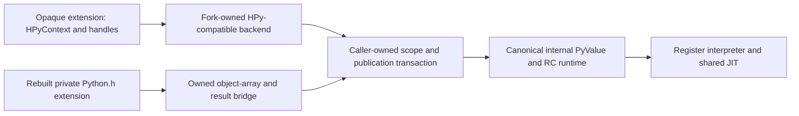

# Extension API

The preferred direction is an opaque, HPy-compatible extension API backed by canonical internal PyValue, plus a slower interpreter-specific bridge for rebuilt Python.h source. This is a design direction; the runtime backend and bridge described here are unimplemented. Existing universal-value storage work remains partial. Hard binary compatibility with old CPython extensions is not a goal.

Reuse HPy's context API, declaration machinery and suitable tooling rather than publishing PyValue's representation or designing another complete public C API. HPy's current repository says it is no longer actively maintained, so adoption would require a maintained fork and a verified source pin. HPy 0.9.0 (`f6114734b4a5d03cfb9d24d3e8c71f77e8803881`) is the proposed evaluation baseline, not an installed or verified dependency. Its MIT notices must accompany reused code. Its CPython backend's pointer/array casts cannot implement this runtime's value storage. [HPy repository](https://github.com/hpyproject/hpy), [release](https://github.com/hpyproject/hpy/releases/tag/0.9.0), [license](https://github.com/hpyproject/hpy/blob/master/LICENSE).

The public handle is an opaque context-resolved reference, not PyValue bits or a borrowed scalar PyObject pointer. Follow HPy's ownership convention: inputs are borrowed, API results are owned, Dup adds an owner, Close releases it, and returning transfers one result owner. Fields and registered globals have separate persistent-reference contracts. V8's scope/escape conventions inform lifetime design; they introduce no V8 runtime or collector dependency. [HPy API](https://github.com/hpyproject/hpy/blob/master/docs/api.rst), [V8 embedding](https://v8.dev/docs/embed).

| Reference | Lifetime contract |
|---|---|
| Borrowed input handle | Caller owns its root through invocation; duplicate before retention |
| Owned local handle | Explicit close or result transfer; never put a local directly in a persistent field |
| HPyField | Owned extension payload, initialized and traversed; publish new owner before releasing old |
| HPyGlobal | Registered per-interpreter identity, retained until replacement/clear or interpreter teardown |
| Buffer lease | Exporter plus export record; pointer validity ends at release |
| Legacy object-array slot | Owns each boxed argument through parser, implementation and deferred cleanup |
| Retired scalar box | Held through actual caller-state publication, then released with cleanup status |

The backend must implement Field traversal/clear and Global isolation in the existing reference-counted runtime. There is no permanent scalar box cache, boxed core mode, or arbitrary lifetime extension. Extension-owned payload may be exposed through declared shapes; builtin container layouts remain private. [Fields](https://docs.hpyproject.org/en/latest/api-reference/hpy-field.html), [globals](https://docs.hpyproject.org/en/latest/api-reference/hpy-global.html), [type definitions](https://docs.hpyproject.org/en/latest/api-reference/hpy-type.html).

Every native invocation has an explicit caller-owned scope. Before allocation, the producer supplies a stable owning evaluated window, using the existing pure `_PyValue_OwnArray` promotion. Scope capture duplicates its roots into independent storage and stops depending on the source window. NOARGS/O uses bounded caller storage; variable arrays may allocate only while the original owning window remains stable. A mutable container's raw array does not satisfy that contract. No unbounded alloca or implicit TLS owner engine is required.

The call sequence is capture → box/parse → invoke → stage → publish → cleanup. Stage consumes the owned object result using pure PrepareOwned and retains its retired scalar box. Publish is nonallocating and nonreentrant: retain the displaced destination owner, move the new value, then publish the caller's actual frame, PC and live-home/window state. Only afterward may cleanup release input boxes, parser resources, displaced owners and retired boxes. Returning from a callee cannot end its scope early. Cleanup failure leaves the transferred result in the caller's published home for normal error handling; it does not close it twice. Abort instead leaves the destination unchanged, publishes the error state and drains the staged owner once. An absent C self/metadata uses an explicit absence sentinel, never a language argument.

This bridge can preserve many ordinary parser-based method bodies: generate one stable owned PyObject argument array and let parser outputs borrow from it through implementation and cleanup. Current getargs already has array parser entry points. Nested converters and keyword lookup results need the same owner context; raw value-array casts are invalid. Native-handle wrappers can parse handles directly and avoid boxing. Change Clinic producers and regenerate their products together. [HPy argument parsing](https://docs.hpyproject.org/en/latest/api-reference/argument-parsing.html).

Cleanup is a reentry boundary even on success. The VM caller must reuse the existing post-cleanup offset/epoch/frame revalidation and reload path before decoding the next handler or reusing cached frame/IR/feedback pointers. Publication before cleanup does not make stale pointers valid afterward.

The small-edit claim has limits. Borrowed scalar container getters cannot acquire container-length lifetime from a call-local arena; use owned GetItemRef plus cleanup or a scoped borrow promoted before escape. Unchecked GET_ITEM macros, direct builtin fields, raw value pointer identity and refcount inspection require edits. Void construction setters need a proven pre-reserved retirement budget; arbitrary unbounded setter loops require a checked API or bounded source changes. Advanced legacy custom types remain private hybrid until ported to opaque payload/Field APIs.

HPy's hybrid mode supports incremental legacy methods/slots but produces an interpreter-specific binary. Rebuilt bridge modules therefore carry the fork's private ABI identity. Do not advertise portable hpy0 loading before the context/slot protocol is implemented and tested. A loader can check declarations, not infer every indirect API call in a native body: initial private fixtures declare capabilities, and every exposed table slot must have defined callable behavior. [ABI modes](https://docs.hpyproject.org/en/latest/overview.html).

| Stage | Concrete implementation hypothesis |
|---|---|
| 1 | Shared scope/result engine and one real NOARGS/O Python→native→caller-publication fixture, including abort and cleanup failure |
| 2a | FASTCALL/keyword/METH_METHOD and Clinic owned-array parser consumers of the accepted engine |
| 2b | Verified HPy-compatible context/local-handle backend and opaque fixture consuming that same engine |
| 3 | Remaining VARARGS/init/new/getset/slot families, Field/Global/custom types/buffers, mapped bundled consumers and loader conformance |

Stage 1 names the actual route: `_CALL_NON_PY_GENERAL` and specialized `_CALL_BUILTIN_O` call an explicit-scope gateway derived from `cfunction_vectorcall_NOARGS` / `cfunction_vectorcall_O` semantics. The gateway invokes the registered native body and stages its result; the generated VM caller publishes live state and ends the scope. A synthetic C scope test is useful but is not evidence of that real route. Shared-file ownership and exact producer functions must be agreed before edits.

The first checks exercise canonical scalar/object results, displaced owners, callbacks during boxing, OOM, abort, pending exceptions and exact-once cleanup through both cold and warmed real dispatch. Later slices add field cycles, globals/subinterpreters, buffer leases and ABI rejection. Completing HPy ecosystem coverage is not a prerequisite for completing and measuring the internal universal-value interpreter checkpoint.

Implementation status, 2026-11-01 23:49 UTC: the fixed scope engine and gateway
passed independent component source review. A separate
[specialized O-call successor](../issues/pyvalue-rc-restoration/o-caller-source-grant-20261101-v1.md)
now supplies actual generated publication and post-cleanup reload; its corrected
checkpoint has 40 host tests and four selected syntax checks passing. Independent
review accepts the actual specialized O-call production route; corrected legal
cleanup fixtures are now source-bound and still need candidate execution. Generic dispatch/NOARGS adoption,
other calling conventions, the HPy backend and rebuilt-extension conformance
remain required later work. No candidate native execution is claimed.

Variable-engine update,2026-11-02: author5c218de9 passes independent partial
component review3f0c4a38. The same scope now has drainable variable storage,
typed C-function dispatch, actual current-vectorcall eligibility/recheck, and
generated flat Clinic fixtures. Header6270ec5d is frozen. Three actual syntax
TUs pass;22 methods remain AST-only. Generic VM caller adoption follows the
attribute source freeze and must preserve caller publication and original
retirement order. Recursive/kwargs-dictionary parser contexts and typed scoped
registration remain unimplemented; engine source acceptance is not real-route,
HPy-backend or runtime conformance.

The detailed source cut, wrapper-family classification, official-source limitations, and retained dictionary rejection/supersession evidence are in [the design proposal](../../build/pyvalue-opaque-extension-api-design-20261101-v1/proposal.md). The existing 660-path consumer census remains the migration inventory; this design does not replace it or authorize broad API removals.

Exception-contract correction,2026-11-02: deallocators preserve the entry
exception and report failures as unraisable. Earlier unexecuted destructor-error
injections are retracted as valid witnesses. Corrected tests cover legal reentry,
unraisable reports and primary preservation. Checked native-body and execution-
refresh failures remain real error routes; no deallocator contract or debug
assertion is relaxed. See the [correction record](../issues/pyvalue-rc-restoration/deallocator-fixture-correction-20261102-v1.md).
