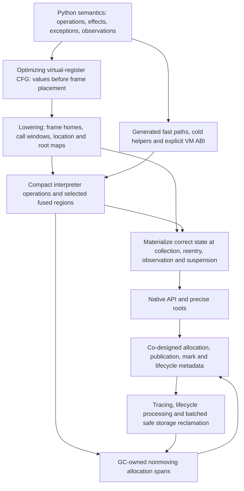

# Reassessing the IR, interpreter and allocator/collector

2026-11-01. Candidate under independent research review. This reopens the
architectural recommendation in [the earlier transport candidate](vm-design-candidate.md).
That document remains an exact historical review/publication snapshot. Its
measured rejections and correctness contracts stand; retaining the particular
IR and collector is no longer an assumption of the next design.

Source layers are distinct: the maintained VM source is `4615e52c9bb`; the
saved matched evaluator captures use the qualified `e9` image identified in
their result records. Mandatory nursery/cadence source is isolated at
`47ccf35e21a94fde9351d1c2e4571bf207257a4c` (runtime change `5cc1e5310e2`),
and the unbuilt object-map iterator is isolated at
`c43c8374dbd56ca7862be49a31820ded6ac5a9d9`. The table's minor-collection
candidate refers to the former, not a landed maintained runtime. Source links
below point to maintained code unless the isolated candidate is named.

## Assessment

We have established useful correctness contracts and some local improvements.
We have not established that the current combination is a good performance
architecture. The latest broad result remains 0.871× upstream across 29
workloads. Neither the source-level simplifications that lost on elapsed time
nor the correctness of the nursery validates the surrounding architecture.

A memory-register interpreter is reasonable. It does not need a native register
allocator just to execute bytecode. LuaJIT also addresses values in memory
slots; its compact bytecode, explicit machine-state convention and separate
optimizing trace compiler are distinct design decisions. The current Boil IR
combines several of those concerns too tightly: stack-shaped ownership, physical
frame homes, exception layout and operation encoding constrain optimization.

## Concrete costs and limits of the evidence

| Area | What the source or saved evidence establishes | Assessment |
| --- | --- | --- |
| Virtual registers | `pycore_regcfg.h` creates fresh single-definition temporaries within regions, mutable locals and canonical stack positions at joins/handlers | Useful middle-end groundwork, but not a general SSA optimizer |
| Slot assignment | `regcfg.c` keeps slots until a consumer takes the value, places later temporaries above held ones, and preserves contiguous windows | This is stack-constrained placement, not general allocation from live ranges |
| Frame density | The historical 99,328-code-object Lib census reduced temporary slots 476,883→473,896, about 0.6%; windows constrain placement | The register conversion earned dispatch reductions, not a large frame compaction result. This is historical evidence, not a new current corpus run |
| Frame roots | `_PyFrame_GCValues` scans every local/temporary home; `IR_CONSUME_INPUT` conditionally clears temporary slots | Root representation imposes mutator work and limits temporary reuse; omitting clears without a new consumer is incorrect |
| Runtime words | Every operation has an eight-byte word with a 16-bit handler and four 12-bit fields; hot code keeps pristine and executing copies | Convenient decoding and specialization, but density is unvalidated. A smaller word can also add decode/escape/cache work |
| Feedback | Every entry uses the 48-byte attribute-cache stride, including 16-byte counters and 24-byte call caches | Specific footprint/init/cache overhead to evaluate; direct indexing is its benefit. This no-scan allocation is separate from frame-root scanning |
| Generated handlers | Integer add loads and guards two operands, handles overflow, consumes temporary homes, stores a result and dispatches; ordinary handlers publish the current IP | Semantic coverage is substantial. Cross-operation redundancy and publication frequency are not optimized as a block |
| Machine backend | Rejected slot-base emission removed its target stores but added frame/IP stack traffic; elapsed regressed on every nominated workload | Generated C is not a validated optimal backend. Fewer source operations did not imply better native execution |
| Minor collection | The current candidate seeds/traverses all old objects and promotes a small cohort in place | A generation boundary exists; the usual avoidance of old-heap work does not yet exist |
| Heap management | General allocator enumeration, initialized-object identification, marking, death classification and per-object reclamation are separate stages | Correctness layering has costs. Allocator and collector ownership should be designed together |

Sources: [IR encoding](../../Include/internal/pycore_ir.h),
[register CFG](../../Include/internal/pycore_regcfg.h),
[placement](../../Python/regcfg.c), [root range](../../Include/internal/pycore_interpframe.h),
[slot operations](../../Python/ceval_macros.h),
[feedback](../../Include/internal/pycore_feedback.h),
[executing allocation](../../Python/ir.c),
[generated handlers](../../Python/generated_ir_cases.c.h),
[collector](../../Python/gc_trace.c),
[historical compaction result](../archive/legacy/design/06-architecture-v2.md#133-compaction),
[rejected native and elapsed result](../issues/interpreter-dispatch-state/performance-results.md).

Our existing copy/store/truth rewrites and fixed-point liveness are real work,
not an empty compiler. Copy propagation stops at redefinitions, line changes
and operations that may run Python. Those restrictions preserve observable
locals and reentry. More optimization needs explicit effects and recovery
state rather than removing the restrictions by assertion.

## Integrated target

Prefer an optimizing virtual-register middle-end, a deliberately generated
interpreter backend, and GC-owned stable storage for core managed objects.
Keep the eight-byte value representation as a working choice, subject to its
own allocation/boxing measurements. Stable C-visible addresses remain a strong
constraint; the present mimalloc-based collection policy does not follow from it.

This is a target, not a claim that complete SSA, a 32-bit word, assembly or a
new collector will each independently win. Implement one useful slice at a
time; retire a losing slice rather than preserve it as a runtime option.

The middle-end should distinguish logical values from physical homes and
express effects, exceptional edges and observation points. SSA or block
parameters are appropriate tools before slot assignment. Start with a region
whose effects can be proved: eliminate redundant moves/guards and combine a
short operation sequence while retaining its error and recovery states.
Python calls and overloaded operators can reenter; allocations can collect;
tracing and suspended frames require correct materialization. No arbitrary
operation sequence may keep hidden unrooted pointers in C registers.
Regions must also remain bounded and preserve loop-backedge/eval-breaker
service. A path that does not allocate still has signal, monitoring and queued
work obligations. Delaying publication requires an observer protocol; the GIL
alone does not establish that asynchronous frame observation is harmless.

Frame slots remain a sensible interpreter baseline. The first useful region
can keep the existing frame contract at its boundaries and use C temporaries
inside a proven no-safepoint path. This can eliminate store/reload and dispatch
between operations without requiring a general runtime native register
allocator. A broader materialization/root-map design is a larger subsequent
change, not a prerequisite for every small region.

The backend should share operation semantics and specify state transport,
fast/slow continuations and publication rules. Existing compiler/tail controls
remain a cheap diagnostic, not the whole architecture plan. Native captures
must show whether a proposed ABI actually reduces traffic. Handwritten assembly
would offer control but would also duplicate substantial semantic machinery;
a specialized generator is the preferred direction if ordinary C cannot deliver
the required code. That larger investment needs a demonstrated consumer.
Existing allocating/reentrant call effects and precise root machinery are a
starting point for this work; the proposal is to connect and complete them for
an optimizer consumer, rather than replace them with an unrelated annotation
system. The retained partial H2 decoder is not a complete root-map producer.

## Collector choice from here

I would choose tracing with stable addresses and integrated allocation for
core managed traffic. I would not choose all-old minor scans over a general
allocator as the final performance design. A nonmoving span/arena collector
can share size, object-start, mark and generation metadata with allocation,
enumerate initialized objects directly and reclaim eligible dead storage in
batches. Native/opaque, raw-memory and large allocations need explicit storage
and tracing rules; they do not disappear into a bitmap abstraction.

An allocation bit and an initialized-object bit are different. Unpublished
constructors, freed blocks and deferred lifecycle objects must remain
distinguishable. Weakrefs, resurrection, finalizers, buffers, watchers and native
callbacks still require ordered processing before storage reuse. Empty spans
can be released cheaply; partially live spans may retain slack. Stable storage
trades away unrestricted compaction and must report fragmentation/RSS.

The first storage slice should cover a source-relevant allocation family with
its actual lifetime and embedded storage, rather than only schedule more
cell/tuple minors. Exact coroutine/frame traffic is a candidate, subject to
death-work and allocation evidence. The existing object-map iterator is a
bounded transitional experiment; it does not establish the integrated design.

For the proposed remembered-edge design, real generational work avoidance
requires complete core write barriers and a remembered set, with conservative
rescanning for opaque native owners. Other mutation-tracking strategies would
need their own complete contract. Opaque owners may limit the benefit.
In-place sticky marking is compatible with stable
addresses. Incremental/concurrent marking addresses pause scheduling, while
movement addresses locality/fragmentation; neither follows automatically from
choosing generations. Defer concurrency and copying until their independent
costs and alias/pinning contracts justify them.

Historical coroutine samples show material roots/closure, inventory and
reclamation costs. Inventory/classification is about 12.14% of sampled CPU and
sweep/storage about 9.60%; neither category is entirely avoidable allocator
overhead. One explicit allocator leaf accounts for only 1.147%. These are older
profiles and opportunity bounds, not forecasts for the new candidate. Richards
has no timed GC in that profile, so GC cannot explain its interpreter costs.

## Ranked hypotheses

| Priority | Hypothesis and smallest useful candidate | Acceptance question |
| --- | --- | --- |
| 1 | Existing runtime pays avoidable object-inventory work. Finish the isolated object-map iterator's causal failure/recovery feedback before its fixed whole-workload comparison | Does real elapsed improve while allocation/publication/free/OOM and domain coverage remain correct? Retire it if not |
| 2 | A specific short region loses time to dispatch plus redundant home traffic. Give it complete effects and exceptional/observation states; lower it through the existing semantics | Does the entire sequence execute faster, including guards and exits, on its actual consumers without unresolved control regressions? |
| 3 | Core allocation plus cheap-death storage management is cheaper when integrated. Design one stable-address allocation cohort including embedded storage and lifecycle processing | Does mutator + collection time improve at an acceptable measured RSS/fragmentation cost? A shorter free loop alone is insufficient |
| 4 | Old-work avoidance outweighs barriers and remembered-set maintenance. Add complete core stores and a conservative opaque-owner boundary to the selected storage policy | Does total work fall across young-heavy and mature-heavy workloads? Faster minor timing without barrier/major costs is insufficient |

Compact words and typed feedback are promising layout studies, not an excuse
to combine unrelated changes into the first candidate. Compare total hot code,
feedback and frame footprint, dispatch count, decode instructions and elapsed
time. A 32-bit format needs enough warmed-handler space, wide operands and
location/exception mapping; halving word width does not halve total memory.

Performance decides adoption. Code size, instruction counts and profiles explain
results; there is no arbitrary text-size veto. Freeze representative workloads,
controls, sample counts, noise handling and acceptable memory tradeoffs before
each experiment. Source correctness and emitted-code review precede timing;
qualification precedes integration. The 04:18:11 UTC boundary remains in force
for currently dispatched work; structural rewrites require later explicit
budgets rather than shortened qualification.

## Primary design references

- [LuaJIT bytecode](https://github.com/LuaJIT/LuaJIT/blob/v2.1/src/lj_bc.h)
  provides compact memory-register operations, including constant operands;
  [its x64 VM](https://github.com/LuaJIT/LuaJIT/blob/v2.1/src/vm_x64.dasc)
  controls machine-state transport. Its trace SSA is a separate execution tier.
- [Deegen's author description](https://sillycross.github.io/2022/11/22/2022-11-22/)
  motivates semantic generation of specialized interpreter machinery. Its Lua
  results are not evidence of a Boil speedup.
- [MMTk's implemented plans](https://www.mmtk.io/status) include integrated
  nonmoving mark/sweep and in-place generational StickyImmix. These demonstrate
  that stable addresses do not require our current allocator/collector split;
  they are not drop-in CPython integrations. StickyImmix's in-place generations
  do not imply that every configuration disables Immix defragmentation/movement.
- [The preserved LuaJIT collector proposal](https://github.com/tarantool/tarantool/wiki/LuaJIT-3.0-new-Garbage-Collector)
  discusses arenas, side metadata and nonmoving generations. It is an outdated
  proposal, distinct from LuaJIT 2.1's shipping collector.

External sources consulted 2026-11-01. Rolling branch sources are research
references, not frozen executable experiment inputs. Independent research
reports and review dispositions belong to
[the design issue](../issues/fundamental-runtime-design/status.md).
