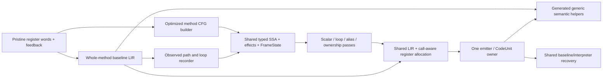
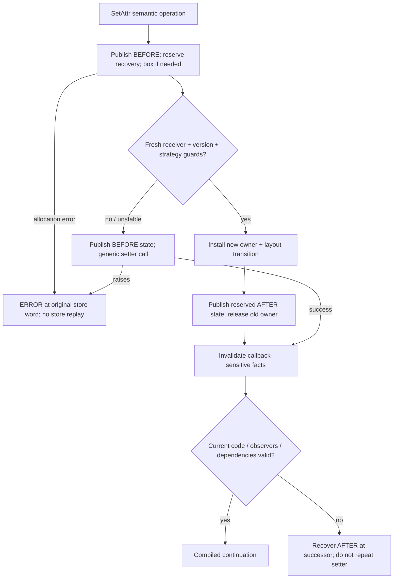

# Attribute semantics, feedback and a shared optimizing IR

Design proposal, 2026-11-01. This is read-only design, not an implementation or
performance claim. The inspected method compiler is frozen at
`15987a03c236d5257b8a7b944bf858ee20e52fc3` in `build/worktrees/jit-method-baseline`.

## Recommendation

Use feedback to build **guarded, typed SSA operations** for both optimized
methods and recorded traces. Keep the existing register-word IR as the
interpreter/baseline input and recovery coordinate system. Keep one semantic
helper ABI, frame-state format, owner and machine backend. An `OBJECT`, `STRING`
or `UNKNOWN` tag alone cannot justify bypassing Python attribute semantics.

An opaque native operation can be a generic call followed by a compiled
continuation. It does not, by itself, require abandoning compiled execution.
Recovery is needed when a guard fails, assumptions become invalid, or a required
frame/state transition cannot yet be represented safely.

The [dictionary-storage addendum](dictionary-storage-comparison.md) compares
LuaJIT location prediction with Python's existing shared-key/hint/shape hybrid
and a simpler general-dictionary policy, without assuming a storage rewrite.

## What exists today

The pipeline is Python AST/bytecode CFG → RegCFG → compact register words →
executing copy with feedback and quickened handlers. RegCFG temporaries are
fresh within regions; joins and exception edges use agreed canonical homes,
without general SSA PHIs. Each executable word is 64 bits: handler16 plus four
12-bit fields, with C/D also usable as one 24-bit operand. These operands name
frame homes, feedback or immediates—not hardware registers or typed SSA IDs.
See `Include/internal/pycore_regcfg.h:15–46`, `pycore_ir.h`,
`Python/regcfg.c`, `regcfg_passes.c` and `assemble.c`.

The stack/frame representation is `_PyStackRef`: the selected 64-bit GIL build
can carry exact int32 and non-NaN float values inline, as well as boxed-object
references and NULL. NaNs are boxed. Ordinary instance dictionaries/slots still
hold boxed `PyObject *` values. This is not an implemented unboxed string or
general inline-value heap. `pycore_stackref.h:56–76,300–321` is the authority.

Current interpreter specialization already distinguishes attribute strategies.
It rewrites executing handlers while pristine words stay unchanged. The M1
method baseline separately predecodes a whole method into fixed-home LIR and
calls generated generic semantic helpers. It has 63 callable helpers and 290
explicit classifications. **Its STORE_ATTR helper is currently absent**:
`generated_jit_helpers.c.h` classifies it for before-effect interpreter fallback.
It does not yet compile a specialized attribute store or typed optimizing SSA.
`jit_baseline.c`, `jit_backend_x86.c`, `jit_runtime.c` and `pycore_jit.h` define
that actual boundary.



## How `obj.x = value` actually chooses behavior

The write hook is `__setattr__`; `__getattribute__` is the read hook.
`__setattribute__` is not the Python attribute-assignment protocol.

`_STORE_ATTR` calls `PyObject_SetAttr`, which dispatches through the receiver
type's `tp_setattro` (or legacy `tp_setattr`). Python-defined `__setattr__`
is reached through `slot_tp_setattro`. A C extension may provide a different
native setter. The path may execute Python, raise, allocate or mutate the
receiver/type. A builtin is not automatically a writable ordinary object.
See `bytecodes.c:1991–2000`, `Objects/object.c:1517–1545` and
`Objects/typeobject.c:11028–11052`.

For `PyObject_GenericSetAttr`, the generic implementation looks for a descriptor
on the receiver type/MRO first. If it supplies `tp_descr_set`, that setter runs
before an instance-dictionary store. This includes properties, user descriptors
and C member/getset descriptors; their strategies and effects differ. Only
after that decision can a normal dictionary/inline-values store be selected.
The language's [descriptor rules](https://docs.python.org/3/reference/datamodel.html#invoking-descriptors)
are a semantic requirement, not a speculative optimization hint.

The specializer makes this distinction concretely:

| Receiver/attribute situation | Current specialization behavior | Safe optimizer choice |
|---|---|---|
| Custom Python `__setattr__` or non-generic C `tp_setattro` | `analyze_descriptor_store` refuses ordinary-field specialization | Generic effectful call; later guarded Python-callee inlining if its state/effects are supported |
| Property or arbitrary overriding descriptor | Current STORE_ATTR specializer declines | Descriptor/generic call, with exact once-only effects and exception recovery |
| Writable object-valued member slot | Guarded STORE_ATTR_SLOT | Guard type/version and descriptor strategy, then boxed slot store with RC ordering |
| Ordinary instance attribute | Managed inline values, dictionary hint, or shape strategy | Guard the actual layout/storage representation and version before field access |
| Attribute addition | Shape-add/insertion-order path where supported | Distinct transition operation; preserve insertion order, capacity and publication rules |
| Read-only builtin, incompatible slot, `__class__`, unsupported descriptor case | Generic path raises or applies its special semantics | Preserve that path and error; never assume “OBJECT means instance dictionary” |

The decisive code is `specialize.c:806–818,1289–1393`.
Custom hooks are rejected before ordinary descriptor analysis. Only the ABSENT
case reaches the current ordinary dictionary strategy; this specializer is
deliberately more conservative than every optimization Python might permit.

## Feedback is evidence, not a proof

`_PyFbAttr` stores a receiver type version plus strategy-dependent dictionary,
function/class version or shape, location/index, and sometimes a borrowed
descriptor/function or shape transition. Shape indices are meaningful together
with their owning type and version, not globally. Executing guards include type
version and shape/storage checks; the property name alone is insufficient.
An existing shape proves layout/presence, not the type of the boxed value in
that field. A loaded integer/string still needs its own value-type fact.
See `pycore_feedback.h:111–137`, `bytecodes.c:2667–2679,2717–2743,2942–3078`.

Feedback states are COLD/MONO/POLY/MEGA/OFF. A poly table records up to four
observations; another distinct observation can mark the site megamorphic.
The currently executing handler is still a chosen specialization. A recorded
POLY table is **not** an implemented four-way inline-cache dispatcher or a
precise type-frequency histogram. Header hits/misses are reserved, and branch
history is not a complete execution count. `specialize.c:341–344,432–466,513–539`
and `pycore_feedback.h:60–89,157–168` establish these limits.

Proposed optimizer policy:

* MONO: one guarded strategy, with a generic continuation or side exit.
* POLY: a bounded guard chain only where the recorded strategies and expected
  code size justify it; all arms share the same semantic effect contract.
* MEGA/unstable: generic helper/call and retained compiled surroundings; stop
  repeatedly compiling new shape arms. Cache failures and use fixed cooldowns.
* No feedback: generic semantics or a guard justified by other proven facts.

Feedback may be stale or incomplete. Guards and registered invalidation
dependencies must remain correct independently of how often a pattern occurred.
Receiver/MRO mutations and mutations of a descriptor's own class are separate
dependencies; a receiver version alone need not cover the latter. The current
specializer conservatively rejects mutable descriptor classes as MUTABLE.
Do not retain raw borrowed feedback descriptor pointers indefinitely: copy
scalar identities/versions, use checked weak/versioned handles, or add a normal
traceable owner for strong Python references. Never create hidden
code→artifact→function→code ownership cycles or delay finalizers by retaining
observed objects merely to optimize them.

## The type model should have independent dimensions

| Dimension | Examples | What it proves |
|---|---|---|
| Semantic type facts | Unknown, exact int, exact str, str subclass, exact receiver class C, bounded union | Which Python operations/subclass hooks remain possible |
| Physical representation | TaggedStackRef, boxed owned/borrowed PyObjectRef, Int32/Int64, Float64, Bool, NULL | Register class, boxing, overflow and recovery requirements |
| Layout/access strategy | Managed values + type/version/shape, member offset, dictionary hint/version, generic setter | Whether and how an attribute location can be accessed |
| Ownership/liveness | Borrowed, owning, transferred, snapshot-live, alias set | Which releases, moves and eliminations are legal |
| Effects and recovery | Pure, read/write, allocation, raise, arbitrary callback, release, observation; BEFORE/AFTER/ERROR | Reordering, invalidation and exact resume PC |

`STRING` can be a useful semantic category, but exact `str` and a `str` subclass
are different facts; neither says that the receiver has an instance field named
`x`. A stored exact string is still boxed in today's object layout. `OBJECT`
must not ambiguously mean “all Python values”, “boxed representation” and
“ordinary instance with no hooks”. `UNKNOWN` remains compilable through generic
operations; it is not a reason to discard an entire method.

The facts form refinements/unions with PHIs and dominance. For Python arithmetic,
exact-int guards exclude custom `__add__`; checked fixed-width arithmetic can
exit before overflow into arbitrary-precision semantics. Those scalar choices
are separate from receiver layout and attribute strategy.

## Worked store: guards, ownership and a destructor

Consider `def update(obj, value): obj.x = value; return obj.x` on an ordinary
class without custom hooks. Logical operand roles in current STORE_ATTR are
**A=receiver home, B=value home, C=feedback index**; the name index is in the
feedback argument. STORE_ATTR_NOFB uses its CD immediate instead. This follows
`pycore_ir_metadata.h` and is not a new encoding or captured sample word.

Suppose feedback supports an existing managed-value field. Illustrative
optimizing SSA—not current implemented nodes—is:

```text
S0 = FrameState(BEFORE, STORE_ATTR_word, logical homes + owners + exception state)
o  = HomeValue(receiver_home)                 : PyObjectRef
v  = HomeValue(value_home)                    : Unknown/Tagged
PublishReentrantState(S0, live owners)        # valid BEFORE state before preparation
EnsureRecoveryAndCleanupCapacity(S0)         # may allocate; nothing committed yet
boxed = BoxForHeapIfNeeded(v, S0)             # rooted; may allocate/raise BEFORE store
GuardReceiverTypeVersion(o, C_version, S0)
GuardGenericSetAttrAndNoOverridingDescriptor(C, name_x, dependency_version, S0)
GuardManagedValuesAndShape(o, C_version, shape_s, S0)
new_owner = TransferOrAcquireStoreOwner(boxed) # no callback; handle old==new alias
old_owner = MoveDisplacedFieldOwnership(o, offset_x) # cleanup owner, no extra INCREF
StoreOwnedField(o, offset_x, new_owner)       # field now visibly contains new value
S1 = FrameState(AFTER, successor_word, consumed inputs + remaining owners) # prebuilt map
PublishReentrantState(S1, old_owner cleanup root) # reserved storage; cannot allocate/fail
ReleaseOldOwner(old_owner)                   # can run arbitrary Python __del__
KillCallbackSensitiveFactsAndRecheckEpoch()
result = GenericOrReguardedLoadAttr(o, name_x)
```

This is a contract sketch; the implementation must derive exact operand
consumption, error roots and release order from the shared semantic source.
An integer held inline in a frame may require allocation to become a boxed
heap value. That allocation must succeed before publishing the field store.
The BEFORE state and roots must already be valid before callback-capable
preparation. A general materializer can allocate: its roots, partial progress,
OOM and observation route need a proved contract; this sketch assumes its
entry contract, not magical allocation-free reconstruction. All recovery and
cleanup capacity is reserved before the irreversible store. Guards are checked
fresh after boxing/materialization because allocator or destructor callbacks
can change the receiver or its type. There is no intervening callback between
the final guards and raw installation; any future preparation there requires
another validation. The AFTER publication uses prebuilt maps/reserved storage.
Shape-add also needs a separate insertion-order/shape transition, not this
existing-field operation.

The new value must be installed before the old value's last-reference release.
Current STORE_ATTR_SHAPE/SLOT already follows that essential ordering. A finalizer
may inspect `obj.x`, assign another value to it, replace the class descriptor,
or enable monitoring. Therefore the subsequent read cannot automatically be
forwarded as `value`, and a shape/type guard cannot automatically survive that
release. Remove a guard or load only with a real effect/alias/dependency proof.



Three states are essential: a failed guard before work can retry the original
store; a successful setter followed by invalidation resumes after it; a setter
that raises propagates its existing exception at the original raising word.
A setter can partially mutate and then raise, so ERROR must never mean “undo
everything and call it again”. Cleanup owners and traceback PC are part of the
state map, not incidental backend details.

## Opaque calls, methods and traces

A generic Python/C setter, descriptor or extension operation can remain inside
a compiled method as an effectful call. Publish canonical frames/homes, PC and
owners before it; hold the native artifact pin through any callback and return;
afterward invalidate affected type/layout/alias facts and test code/observer
epochs. On ordinary success continue compiled execution. On failure propagate
the existing error. If retirement or observation requires recovery, resume at
the correct AFTER point. M1's Action/phase ABI and CodeUnit lifetime already
provide the beginning of that shared substrate, while its missing STORE_ATTR
adapter still forces BEFORE fallback today.

An optimized **method builder** reads the full CFG and versioned feedback,
creates joins/loop PHIs and guarded alternatives. An actual **trace recorder**
observes operations/outcomes along a hot path, does not replay them, and records
loop PHIs plus side exits. It pauses inside opaque C calls; it can record the
call/outcome boundary without pretending to trace that native implementation.
Both feed the same typed SSA, effect ledger, FrameState, LIR, call-aware register
allocator and owner. Python-callee inlining later needs guarded targets and
logical inlined frames, not a second incompatible trace IR or frame engine.

## What to adapt from established systems

V8 Maglev uses feedback during SSA building, carries known facts, and connects
speculation to recovery frame states; representation selection and allocation
are distinct tasks. Apply that separation here, with Python-specific ownership
and effect boundaries. [Maglev design](https://v8.dev/blog/maglev).

V8 Maps describe layouts and property transitions, not merely a language-level
“object” type. Its descriptor/transition structures motivate explicit layout
strategies, while Python still needs MRO/data-descriptor/setattro checks.
[Maps](https://v8.dev/docs/hidden-classes),
[descriptor and transition structures](https://github.com/v8/v8/blob/main/docs/objects/descriptor-and-transition-arrays.md).

LuaJIT's IR has typed values, PHIs and guard metadata; its recorder and snapshot
restorer separate observed execution from recovered interpreter state. Reuse
those architectural ideas, not Lua's value/GC or metamethod assumptions as
Python ownership rules. [Typed SSA definitions](https://raw.githubusercontent.com/LuaJIT/LuaJIT/v2.1/src/lj_ir.h),
[actual recorder](https://raw.githubusercontent.com/LuaJIT/LuaJIT/v2.1/src/lj_record.c),
[snapshot restoration](https://raw.githubusercontent.com/LuaJIT/LuaJIT/v2.1/src/lj_snap.c).

## Concrete adaptation sequence

1. Complete the next useful generic helper slice from `bytecodes.c`: attribute
   read/write, iteration and selected container/call operations needed by the
   fixed M2 programs. Retain explicit unsupported/suspension classifications.
   Exercise custom `__setattr__`, properties, slots, type/descriptor mutation,
   inline-int boxing OOM, aliased replacement, destructor reentry and a setter
   that mutates then raises. This establishes a real generic compiled
   continuation before optimizing it.
2. Add natural nomination at selected CALL/backedge sites, cached static
   unsupported decisions and fixed compile/cache budgets. Do not add universal
   per-function counters or repeatedly scan unsupported methods. Separate
   release seen evidence from debug-only frequency diagnostics and timing.
3. Build a shared typed SSA/FrameState verifier and one genuinely observed loop
   with nonconstant inputs, PHIs, a branch, an attribute operation and a call
   boundary. Add checked arithmetic, scalar CSE/DCE and call-aware allocation;
   snapshot/ownership/effect uses keep values live. Keep optimized loop values
   in registers where legal rather than permanently publishing every IR home.
4. Lower one monomorphic attribute strategy through explicit guards to a direct
   field operation. Add a bounded polymorphic chain only after that path and
   its invalidation tests work. Keep megamorphic/custom hooks as generic calls;
   guarded Python hook/descriptor inlining and broader alias/RC elimination
   are later passes over the same IR.

The fixed small workload matrix in the sibling M2 directory covers call-heavy,
varying-loop, mixed-object and suspension-fallback paths. Diagnostic runs must
show genuine natural entry and post-call continuation before timing is
interpreted as compiled-program evidence. Record compile cost/bytes, fallback
reasons, invalidations and cache limits outside scored execution. A component
loss selects the next mechanism to change; it is neither a reason to hide a
regression nor another vote on whether the JIT architecture should exist.
