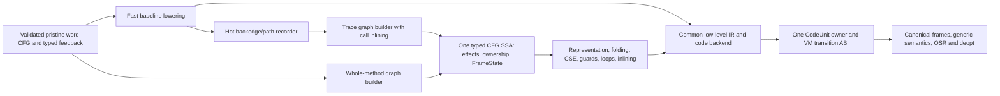

# Whole-method baseline and one optimizing JIT

Build a whole-method native baseline with complete generic semantics, then let whole-method and tracing frontends feed one optimizing compiler. Tracing chooses hot paths, loops and inlined calls; it does not own a second instruction set, allocator, exit format or backend. JIT is the strategic direction. Experiments select implementations, tiering policy and optimizations rather than repeatedly deciding whether JIT should exist.

This is a read-only proposal against the selected RC runtime observed at PRIMARY a8723dda258a762ee5e053aa1412d58a7067c4d1. Actual frame values are NaN-boxed `_PyStackRef` values on supported64-bit/GIL builds; heap containers and the C API still use boxed objects and reference counting. Older tracing-GC/PyValue architecture prose is not authority. The a4b0 quickened-block source and all prior results remain preserved and unactivated. No source, compiler or target execution is requested here.

## Architecture and first useful scope

Compile all reachable basic blocks of a method, including cold branches, calls and exception destinations. Known arithmetic/loads/branches get direct code; every other valid IR operation has a generic semantic-helper lowering. A missing optimized lowering is an opaque helper node, not a reason to reject the method. Instrumented/eval-frame modes may deliberately use the interpreter until their transition contract is supported; that is a mode boundary, not an arithmetic-family coverage policy.

The baseline uses fixed canonical home locations and emits direct native control flow, without building optimizing SSA. Method and trace optimizers construct the SAME typed SSA; both lower into the baseline's common low-level IR/emitter. These are lowering levels, not incompatible optimizing IRs. First implementation must run complete methods containing loops, attributes, Python/C calls and handled exceptions, return from helpers into compiled code, and support interpreter↔compiled calls. A six-operation leaf alone is no longer the milestone.

## The concrete VM ABI

Use `JitAction entry(JitContext *ctx)` and generated `JitAction op(ctx, const DecodedOp *op)`. Context contains the actual thread/current frame, original word PC, and typed transfer fields. Actions are Continue, Branch, EnterFrame, Return, Raise, Yield and Deopt. Every transfer also states whether its word is before an unperformed operation or after a completed effect; status alone never determines replay. Normal helpers return to the next native block; dynamic branch helpers set a validated target. Constants/fields are decoded once into immutable descriptors. There is no hidden call to EvalFrameDefault for every unsupported opcode.

One VM trampoline consumes frame-changing actions. Reuse the existing CALL window preparation, `_PyFrame_PushOverlapping`/PushUnchecked, recursion checks, `return_slot`, `_PyEval_FrameClearAndPop` and existing exception unwinder ordering. It switches actual VM frames and dispatches the callee's selected tier, without one C-stack recursion per Python call. EnterFrame transfers argument/window owners once, publishes the caller's call word and the callee/current_frame chain, and applies recursion accounting once. A return transfers the result into the caller's declared slot, clears/unlinks the dying frame in the existing order and resumes the post-call native continuation; an external call returns its result normally. Native/C API calls still use the existing vectorcall/StackRef conversion route. Reentry from an extension creates a separate ordinary VM activation, with all prior state published.

Initially the trampoline may resolve a CodeUnit at each frame transfer. Later versioned call-feedback links and a cold-selected native CALL form avoid repeated resolution at stable callsites; preserve function/code-version and eval-frame guards. One outer C→Python tier resolution is a deliberate measured cost. We do not promise that every unrelated interpreter frame pays zero work. The architectural benefit is amortization across the entire method and native loops, not another entry-filter trick.

Source anchors: [CALL/window/frame preparation](../../Python/bytecodes.c), especially `_INIT_CALL_PY_EXACT_ARGS`, `_PUSH_FRAME`, `_SAVE_RETURN_SLOT`, `_RETURN_VALUE`, `_YIELD_VALUE` and `exception_unwind`; [frame layout](../../Include/internal/pycore_interpframe_structs.h); [frame push/clear helpers](../../Include/internal/pycore_interpframe.h). These are PRIMARY-relative paths, not new APIs already implemented.

## Generic semantics: reuse bodies, generate a new consumer

Extend the existing cases generator with a helper backend consuming `Python/bytecodes.c` semantics and the same field/borrow/window rules as `Tools/cases_generator/ir_generator.py`. It must lower dispatch/frame/error/yield macros into the actions above. Generate adapters for all valid pristine handlers, including NOFB, wide operands, window instructions and operation-specific BINARY_OP forms. A coverage test compares the full valid-pristine-handler table against emitted adapters. Specialized feedback remains a source of guards/ICs, never a second semantic authority.

This is substantial generator work: current handlers jump to evaluator labels and switch frames; they cannot simply be called as C functions. Retain shared generic bodies and label semantics rather than maintain a handwritten duplicate interpreter. For helpers with uncertain effects, materialize all homes and conservatively invalidate cached value/type facts on return. Existing generator `Properties.escapes`, error and stack-effect information helps, but does not constitute a complete optimizing effect/RC-ownership specification.

Primary files: `Tools/cases_generator/{analyzer,ir_generator}.py`, `Python/{bytecodes,ir}.c`, `Python/ceval_macros.h`, and `Include/internal/pycore_{ir,feedback}.h`. Proposed new consumers are `jit_helpers_generator.py`, generated semantic helpers, method lowering and the VM trampoline. Keep current immutable IR and handler IDs; executable method code is a separate CodeUnit, not a persisted private opcode added per optimization.

## One state, ownership and exit contract

At each reentrant/effect boundary publish the original word `frame->instr_ptr`, canonical frame homes, current_frame chain, return location and exact owned/borrowed/inline/NULL state. Actual frames have base/saved_top, not an operand stack_pointer. `IR_CONSUME_INPUT`, `IR_KEEP_BOX`, borrow drops and local-store-before-DECREF ordering in `Python/ceval_macros.h` are semantic obligations. DECREF/finalizers, allocators, descriptors, equality and native calls may execute Python. No borrowed machine-register pointer survives such a boundary without a retained owner or reload.

Baseline retains homes at every helper. Optimized code uses FrameState at every guard, callback/exception/observation boundary and safepoint, with logical inlined frames, resume word, before/after-effect phase, live ownership locations and boxing recipes. A borrowed value names its surviving owner/alias; it is not merely an unqualified pointer bit. Deopt reconstructs the pre-operation state on a guard exit, or the post-effect continuation on a lazy exit: it never replays an already performed call/store/DECREF. Materialization that can fail preserves the active compiled owner/state until a defined OOM path has taken ownership; it cannot leave a half-reconstructed frame visible to Python.

Unboxed int32/f64 values become StackRefs at boundaries; large integers and NaNs follow existing boxed semantics. Do not invent container-inline values or change C ABI. An optimized value's machine spill is not automatically an RC owner. Separate raw numeric spills from owned tagged storage, and account every duplicated or transferred reference. Suspended generators retain canonical homes plus a word continuation; they never retain a native stack address.

Use `JUMP_BACKWARD`'s existing periodic check as a mandatory native loop service point. At that point baseline/optimized code can poll, tier up, invalidate, or OSR using the same FrameState. Do not turn NO_INTERRUPT await/yield paths into ordinary hot-loop entries. A long-running method must OSR without waiting to return. Monitoring/tracing/eval-frame changes invalidate entry links and exit active native execution at the next required statepoint before callbacks. Baseline initially maintains per-operation IP publication; optimized native-PC→word maps serve tooling, but do not by themselves make asynchronous frame observation correct.

## Values before slots, real register allocation

Current `_PyRegCfg` has useful pre-compaction virtual temporaries, exception edges, `nimplicit` owner liveness, canonical merge homes and a verifier; it is not whole-method typed SSA. Do not label compacted homes as machine registers. First decode the validated physical-word CFG and reconstruct SSA by versioning writes to each home and adding merge/loop phis. Generic helper nodes clobber their declared effects; an unknown helper conservatively reloads canonical state. A later retained pre-compaction graph can reduce reconstruction cost without changing the shared optimizer contract.

`Python/regcfg.c` liveness/compaction/verifier and `Include/internal/pycore_regcfg.h` explain where canonical/exception homes must agree. Optimizer liveness must include implicit exceptional owners, not only continuation reads. Representation selection runs across phis before allocation. Start with call-aware linear-scan allocation over GPR and FP classes, split lifetimes at calls, explicit fixed ABI operands, parallel phi moves with a cycle temporary, and reusable typed spill slots. Guard-exit/statepoint uses extend liveness. The existing six-register scalar emitter is a testable encoding seed, not this allocator.

Share one LIR/assembler, relocation resolver, W→RX allocator, code cache, invalidation/active-use lifetime and native-PC/state maps. CodeUnit owns bytes and scalar metadata; code owns one optional exec-owned JitState shared by baseline, optimized methods and traces. The required pointer/header growth is a charged design cost, not assumed present in RC or hidden in the rejected prefix fields. Initially refer to constants by owning-code indices, not untracked embedded PyObject pointers. Mutable dependencies use weak/versioned records. Any retained strong object/dependency pool needs code traverse/clear integration, including code→artifact→function→code cycles. Detach links and detach owned references before reentrant release. Recording must not retain arbitrary observed objects beyond their language lifetime and change finalizer/weakref behavior. Invalidate future links first; the trampoline pins the active artifact across helpers, extension reentry and GIL release, and defers unmapping until no activation can execute old code. Use existing `jit_x86.h` encodings/labels, `jit_publish.c` and `jit_unwind.c` where applicable (publication is currently conditional on `_Py_JIT`, so build integration is still owed), extending them for calls, FP, relocations and real native frames rather than claiming the leaf prototype is complete.

Proposed file ownership is concrete: `Include/internal/pycore_jit.h` and `Python/jit_runtime.c` define Context/Action/FrameState/CodeUnit and the trampoline; `Python/jit_baseline.c` compiles the complete word CFG; the new helper generator emits shared semantics; `Python/jit_ir.c` holds the common typed graph; `jit_regalloc.c` and `jit_backend_x86.c` implement the shared location/code machinery. Method and trace builders are separate graph producers, not separate backends. Initial supported execution stays Linux/x86-64/GIL with the selected RC ABI; other platform support is a later port, not a blanket correctness exemption. Canonical boxed owners at boundaries are the bring-up policy, not a permanent requirement to spill every optimized value on every guard.

## Stages that test choices

| Stage | Deliverable and focused correctness contract | Specific performance question |
|---|---|---|
| 1 | Shared transitions/helper generator plus complete baseline methods: loops, calls, attributes, branches, try/finally, reentry and yield; generated handler coverage and ownership negatives | Does predecoded native control flow beat dispatch after real helper/call/startup/code-size costs? Compare mixed-operation and call-chain programs, not one ADD leaf |
| 2 | OSR and one typed SSA/FrameState pipeline; method builder and trace builder both lower a complete numeric loop, including induction, branches and a generic call boundary | Which method/path selection and register policy amortizes compilation and transitions? Measure long-lived loops and short methods separately |
| 3 | Feedback-guided guards/ICs, call inlining, guard/CSE propagation and loop optimizations on the shared graph; side traces use the same exits/backend | Which guarded specialization/inlining policy helps polymorphic object/call workloads without exit churn or code-cache growth? |

Use component semantic tests, actual emitted paths, transition/exit attribution and representative end-to-end benchmarks to refine those policies. Preserve cold startup, warmed time, memory/code size and regressions as separate evidence. The29 workload suite is a continuing integration/regression dashboard, not a vote on JIT's existence after each incomplete component. Correctness and supported-mode integration still precede deployment. No implementation timing or speedup is promised by this design.

## Primary V8 evidence and deliberate differences

[Sparkplug](https://v8.dev/blog/sparkplug) compiles bytecode directly, uses interpreter-compatible frames and shared builtins, and maps machine PCs to bytecode offsets. We adopt semantic coverage and frame compatibility; we do not infer that V8's GC frame rules satisfy Python RC/reentry. Its separate architecture-specific baseline emitter is not a reason to duplicate our optimizing backend.

[Maglev](https://v8.dev/blog/maglev) uses CFG SSA, precomputed loop/liveness information, speculative feedback, frame-state deoptimization, representation selection and explicit register allocation. We adopt these as one shared method/trace substrate, not V8's JavaScript object or number semantics. [V8 baseline source](https://github.com/v8/v8/blob/main/src/baseline/baseline-compiler.cc), notably VisitJumpLoop and builtin/runtime calls, supplies a concrete native-control-flow/OSR implementation reference; [Maglev graph builder](https://github.com/v8/v8/blob/main/src/maglev/maglev-graph-builder.cc) shows guarded map checks with generic access fallback. Rolling sources were inspected2026-11-01 and are references, not frozen executable inputs.
