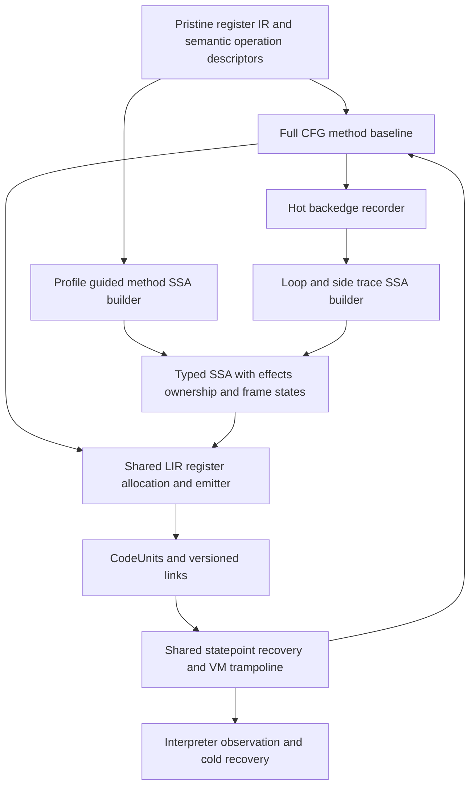

# One method and tracing JIT

Design proposal, 2026-11-01. Source reference: the integrated RC runtime at primary HEAD `a8723dda258a762ee5e053aa1412d58a7067c4d1`, with the [method-baseline agreement](jit-method-research-20261101.md). This proposes a system to implement; it does not claim that the components below already exist. Earlier arithmetic-prefix results establish particular mechanisms and costs, not whether a Python JIT is worthwhile. The quickened-block candidate remains frozen and unactivated. Linked rolling LuaJIT/V8 sources were inspected on this date; they are design references, not frozen build inputs.

## Shared pipeline

Build a complete method baseline, then record hot paths through its execution and optimize those paths with the same optimizer and backend used for optimized whole methods. Keep one operation-semantics authority, one native calling convention, one statepoint format and one executable-code lifetime mechanism.

The baseline compiles the complete pristine CFG, including generic Python operations, branches, calls, handlers and suspension exits. Its first implementation lowers directly to LIR with canonical homes at generic helper boundaries. Optimized methods and traces use SSA before the same LIR. Baseline coverage must not depend on arithmetic specialization. An unsupported optimized operation remains a normal baseline helper call or a precise exit.

This follows LuaJIT's separation of recording, SSA optimization, snapshots and assembly, rather than copying its Lua object or GC model. Its recorder translates observed bytecodes to SSA and handles loop closure, function entry and trace links. Python's arbitrary-precision arithmetic, descriptors, reentrant finalization and reference ownership require additional contracts. [LuaJIT recorder](https://github.com/LuaJIT/LuaJIT/blob/v2.1/src/lj_record.c). V8's baseline/optimizing tier separation provides a complementary model for rapid coverage followed by feedback-driven compilation; its reported JavaScript performance is not evidence for this implementation. [V8 Maglev](https://v8.dev/blog/maglev).

## Runtime interfaces agreed with the method owner

Use a `CodeUnit` for a compiled method or trace: source code identity and execution-copy generation, entry word, native range, word-PC map, dependency set, statepoint table, entry adapters and outgoing links. An active activation protects its code and artifact. Code-owned constants follow the code object's normal lifetime; mutable function/type dependencies use weak or versioned records rather than arbitrary strong cache references. Any artifact-held strong references must participate in code-owner traversal/clear, including cycles such as code → artifact → function → code. Detach links/artifacts before releasing references that can reenter. It does not inherit the tiny prefix owner's fixed two-input or sixteen-operation layout.

The common entry descriptor is `{code, word, frame-home state, ownership, effect epoch}`. `JitContext` carries the actual thread state, current interpreter frame, word PC and typed transfer fields. Native entry and generic helpers return a `JitAction`: Continue, Branch, EnterFrame, Return, Raise, Yield or Deopt. A shared VM trampoline performs frame transitions; Python-to-Python calls do not recursively grow a native C stack for each Python frame. Versioned direct links can bypass trampoline work when they preserve the same frame/return convention. Reuse the current call windows, `_PyFrame_PushOverlapping` and `return_slot`, with argument/result ownership and recursion accounting applied once.

OSR, baseline entry, trace exits and optimized-method exits use that descriptor. A machine entry accepting unboxed registers is an adapter for a verified descriptor, not a second Python frame ABI. Calls from outside the VM still resolve a tier once; its cost is measured rather than declared absent.

The actual frame has `base`, `saved_top`, `instr_ptr`, `ir_words`, `ir_feedback`, `return_slot`, `previous` and owner state. It has no separate operand-stack pointer. Locals and temporary homes contain `_PyStackRef` values or NULL, and consumed temporaries must be NULL. Preserve those facts at every publication boundary. See [frame layout](../../Include/internal/pycore_interpframe_structs.h), [frame helpers](../../Include/internal/pycore_interpframe.h) and [frame cleanup](../../Python/frame.c).

## Trace selection, recording and loops

Start recording at an actual hot backedge in baseline machine code, keyed by code identity, original word and code/dependency epoch. Put counters and patchable transfers at selected baseline backedges/call sites, not universal interpreter frame-entry hooks. A bounded policy controls recording length, inline depth, compilation work, code memory and repeated aborts. Thresholds are implementation choices to measure, not a new benchmark-family admission rule.

The recorder observes the normal execution of baseline operations. It receives decoded operation identity, actual branch, argument/result facts and frame transitions at explicit recorder points. It never executes a Python operation again to discover its result. Suspend recording inside opaque callbacks and record an effectful call plus its actual outcome; do not accidentally inline arbitrary extension reentry. Exact Python callees can instead create explicit logical inline frames within a bounded depth. Compilation failure or recording abort discards compiler state and lets that execution continue normally without leaving a compiler error pending. Only the recording thread carries a recorder context. Capture scalar/version facts while the language already owns the object; do not retain arbitrary observed objects past their semantic lifetime and thereby change weakrefs or finalizer timing. If a fact cannot safely become a guard, constant or weak dependency, end recording at that boundary.

At the loop header import actual homes, guarding required exact types and layouts. The trace builder assigns SSA values to locals/temporaries and an effect token to ordered operations. On return to the same header, reconcile incoming and backedge values with PHIs; construct adapters and parallel moves for different machine locations. Close the trace only when frame depth, exception state, ownership and loop-carried representation agree. An incompatible backedge exits or ends recording; it must not reinterpret a register as a different Python value.

OSR begins at the baseline loop header after its required periodic work, with real current homes, not by rerunning the method prologue. A native loop retains the corresponding periodic check each iteration, and preserves the distinction between ordinary and NO_INTERRUPT backedges. Long unrolled paths also need bounded checks. The existing semantics live in `_CHECK_PERIODIC`, `JUMP_BACKWARD` and `JUMP_BACKWARD_NO_INTERRUPT` in [bytecodes.c](../../Python/bytecodes.c).

A frequent guard exit may record a side trace from its verified snapshot. Initially each such exit materializes homes and enters baseline. Later an exit adapter can transfer registers/spills directly to a compatible linked trace, with parallel moves and version checks. A cold or invalid target always has a baseline destination. Nested loops can link through these adapters; unrestricted trace stitching is not needed for the first loop.

## SSA, effects and staged optimization

Add a semantic `JitGraphBuilder` that lifts decoded pristine operations and their control/exception edges into typed SSA. Reuse operation metadata and source mappings; do not optimize the bit-packed frame-slot encoding as if those homes were machine registers. The current compiler already has virtual registers, implicit exception-live operands and liveness before `_PyRegCfg_Compact`; it canonicalizes jump/handler stack positions without PHIs. Preserve that compiler/interpreter path while introducing SSA for optimized CodeUnits. See [regcfg interface](../../Include/internal/pycore_regcfg.h), [pass driver](../../Python/regcfg.c) and [existing copy propagation](../../Python/regcfg_passes.c).

Every optimized instruction carries a result representation, an effect classification, ownership transitions and an original operation/word anchor. Types distinguish exact builtins from subclasses, boxed from unboxed values, and checked machine integers from general Python integers. Effects distinguish pure scalar work, guarded heap reads, writes, allocation, possible exceptions, arbitrary Python callbacks, reference release/finalization and observation/safepoints. A scalar or effect PHI is separate from a frame-state recipe. DCE must retain snapshot-live values and operations whose refcount or exception effect is observable.

Implement optimization in coherent layers:

1. Constant folding, copy propagation, CSE and DCE for proven pure operations; checked integer and exact floating operations; redundant guard removal through dominance. Preserve Python overflow, negative division, NaN and signed-zero semantics. Integer overflow exits before the failed operation and lets baseline perform arbitrary-precision arithmetic.
2. Loop PHIs, induction/range analysis and demand-driven narrowing; guard-aware peeling and LICM. Hoist only when alias/effect dependencies, exception ordering and the destination snapshot permit it. LuaJIT uses loop peeling, copy substitution and existing folding/forwarding to expose invariants while respecting guard dependencies; it is not an example of moving every apparently constant load out of a loop. [LuaJIT loop optimizer](https://github.com/LuaJIT/LuaJIT/blob/v2.1/src/lj_opt_loop.c). Its narrowing pass also motivates proving where narrow arithmetic pays rather than narrowing all numbers. [LuaJIT narrowing](https://github.com/LuaJIT/LuaJIT/blob/v2.1/src/lj_opt_narrow.c).
3. Guarded field/item load forwarding and dead-store elimination using explicit alias classes and version dependencies. Descriptors, dictionary mutation and arbitrary callbacks kill the relevant facts. LuaJIT's memory optimizer is a useful implementation reference, not a proof of Python alias safety. [LuaJIT memory optimization](https://github.com/LuaJIT/LuaJIT/blob/v2.1/src/lj_opt_mem.c).
4. Bounded exact-callee inlining, then escape analysis and scalar replacement of demonstrably unobservable temporary objects. Preserve identity, weakrefs, finalizers, exceptions and OOM behavior; keep allocation at its semantic point until materialization is sound. Do not defer an observable last DECREF across a call. LuaJIT's sinking analysis considers escapes through snapshots, PHIs and remaining uses; Python needs stronger lifetime rules. [LuaJIT sinking](https://github.com/LuaJIT/LuaJIT/blob/v2.1/src/lj_opt_sink.c).

Whole-method optimization uses the same graph and passes, selecting multiple blocks from baseline feedback. It complements path specialization: traces remove cold branches and cross hot call boundaries; optimized methods cover stable broader control flow without a second optimizer.

## Snapshots, exceptions and ownership

A `FrameState` identifies every logical inlined frame, its code and original word, call/return destination, exception-handler context, and each live home as NULL, an owned/borrowed boxed value, an unboxed scalar or a permitted materialization recipe. Each guard/statepoint refers to a frame state plus allocated machine locations. Snapshot-only values participate in liveness and register allocation. LuaJIT explicitly maps changed slots and frame links and restores interpreter state from exit registers/spills. [LuaJIT snapshots](https://github.com/LuaJIT/LuaJIT/blob/v2.1/src/lj_snap.c).

Use distinct before-operation and after-operation states. A guard before a store/call exits at that operation; a guard after an effectful call resumes after it, preserving its result and exception outcome. Never replay a call, descriptor, mutation or finalizer to rebuild a snapshot. A raising operation selects its error state and original word so the existing handler/unwinder sees the correct live homes and traceback. Yield publishes generator-owned homes and exception state and leaves native code through the common Yield action; optimized suspension/resumption can follow after baseline suspension works.

Initially retain existing boxed owners in canonical homes whenever an unboxed value might otherwise require allocating during recovery. Optimize short-lived scalar chains only where a checked exit can resume from a reconstructible prior state without replaying effects. Before an irreversible effect, materialize live scalar results or prove their representation can be installed without allocation. General lazy boxing needs a materializer with explicit fallible allocation points, rooted intermediate owners and a defined OOM exception state; it is not free snapshot bookkeeping. Inlined frame storage likewise must be reserved before irrevocable effects or created through a specified rooted failure path. Do not promise allocation-free arbitrary deoptimization.

Before any opaque helper/extension call, frame inspection or possible reentry, publish current frames, homes, `instr_ptr`, return slots and exception state. Transfers own exactly one reference where required; aliases/borrows cannot outlive their owner. Publish replacement homes before releasing old owners because DECREF can invoke Python. The existing [store/boxing macros](../../Python/ceval_macros.h) are the semantic reference. At first, fully materialize across generic calls and re-import facts afterward. Later call summaries may preserve selected registers and facts, but only with declared clobber, ownership and callback behavior. Retain the existing RC collector and its cycle-collection obligations.

## Backend, invalidation and amortization

Lower both optimized graphs and baseline operations to one LIR supporting GP/FP classes, fixed ABI operands, call clobbers, branches, PHI parallel moves, statepoints and exception edges. Start with linear-scan allocation with interval splitting, spill slots and rematerialization of safe constants; expose callee-save costs and snapshot liveness. The old six-register scalar leaf allocator is not this backend. LuaJIT's assembler integrates register/spill allocation with snapshot mappings and parent/side-trace entry moves, demonstrating why recovery must be part of allocation. [LuaJIT assembler](https://github.com/LuaJIT/LuaJIT/blob/v2.1/src/lj_asm.c).

Code publication is W^X and transactional. Compile privately; validate all source/dependency epochs again; publish a complete CodeUnit and patch an owned entry/link. Stop new entry and unlink dependents before retiring code; free RX memory and metadata only after no active native activation can reach them. Link/reference teardown must also implement the ownership rules above, rather than making an untraversed strong-reference cache. Reuse the existing tooling registration surface where applicable, while supplying actual unwind/PC/state maps for this ABI: [jit_publish.h](../../Include/internal/pycore_jit_publish.h), [jit_publish.c](../../Python/jit_publish.c), [jit_unwind.c](../../Python/jit_unwind.c). These are ingredients, not a completed lifetime manager.

Observer activation invalidates relevant links and forces statepoint recovery before executing newly observed operations. Local/global monitoring, trace/profile callbacks, eval-frame overrides, DTrace and frame access must share this policy. Recheck epochs after callbacks and periodic work. A long trace cannot defer an observation request indefinitely; every loop has an exit-capable check. Preserve pristine words and use existing semantic handler/word mappings rather than serializing native entry handlers. See [IR mappings](../../Python/ir.c) and [instrumentation](../../Python/instrumentation.c). Dependency invalidation also covers mutable callee/type/dict assumptions; a code-object pointer alone is not a sufficient guard.

The proposed benefit comes from entering once, carrying loop values in registers across many operations/iterations, eliminating repeated dispatch and home traffic, sharing guards and inlining calls. Generic operations still cost helpers and publication; exits, spilling, code size and compilation can erase the gain. Longer regions improve the opportunity to amortize boundaries, not a guarantee that every longer trace wins. The trace manager must bound recording, side traces and code memory. [LuaJIT trace management](https://github.com/LuaJIT/LuaJIT/blob/v2.1/src/lj_trace.c).

## Executable work sequence and hypotheses

First agree semantic descriptors, JitAction/JitContext and FrameState/ownership verification with the baseline owner. Deliver baseline end-to-end branches, calls, exceptions and generator exits through that ABI; provide PC mappings and ordinary observer behavior. In parallel build the common LIR/allocator and SSA verifier. Use A's proposed `Include/internal/pycore_jit.h` and `Python/jit_runtime.c` for the shared contract, `Python/jit_ir.c` for the graph, and `jit_regalloc.c`/`jit_backend_x86.c` for locations and emission. The tracing-specific addition is `Python/jit_trace.c` for recording, loop closure and side-trace selection; optimization passes consume the common graph. These are proposed paths, not existing completed APIs or competing runtime modes.

Next implement one real loop recorded from baseline with header PHIs, checked arithmetic, a branch exit and periodic polling. Include an ordinary Python call and an opaque extension bridge in the same qualification path. Prove exact before/after-call recovery, NULL/owned homes, callback invalidation, exception positions, spill pressure and bounded OOM cleanup. Then add side traces/linking and bounded inlining; stage range/loop and memory/escape passes against the same recovery contract.

Measure choices inside this architecture: baseline compilation/startup versus direct dispatch; trace compilation and warmup; hot-loop work saved versus checks/spills/exits; side-trace frequency and code-memory limits; inlining versus generic-call publication. Use whole-program elapsed and resources across the registered suite, retain repeated regressions, and separate cold from warmed accounting. Use behavior and state-reconstruction tests before timing, broad qualification after measured promise. An arithmetic-only benchmark win or loss does not establish or refute the architecture, and no old timing result is replaced by this design.
