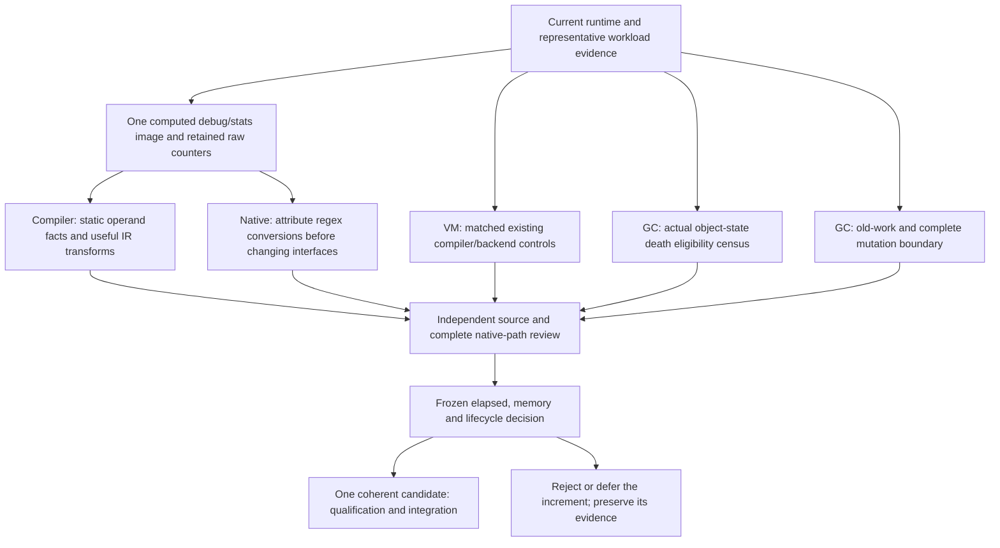

# Runtime work after the Fable peer review

2026-11-01. Coordinator disposition and concrete work plan. The
[Fable review](../issues/fundamental-runtime-design/claude-fable-5.1-review-20261101.md)
is preserved verbatim, SHA256
`d9c2a4d3fa93e829014c5ee9ed11715fac3b527187f98b886b5b9e1b5a1c4eec`.
It ran directly as `claude-fable-5-1`, medium effort, normal print mode;
tool session 78126 returned zero. This plan is subject to independent review
before new native execution. The earlier integrated architecture remains a
target under investigation, not a performance result.

Current execution is owned by the [issue state](../issues/fundamental-runtime-design/status.md).
The original plan below is retained as the reviewed starting point. The later
comparison-region implementation was [rejected on measured elapsed](../issues/fundamental-runtime-design/region-elapsed-outcome-review-20261101-v1.md),
despite verified local work removal. Integrated storage was also
[rejected on elapsed](../issues/fundamental-runtime-design/span-elapsed-outcome-review-20261101-v6.md)
after focused correctness passed. The compiler/backend control passed native
feedback, then its fixed elapsed pilot rejected Clang computed/tail. GCC computed
is fixed for the remaining GC timebox under the pre-score selector. A separate
maintained-source page-map inventory port passed exact source review and is
preparing focused native feedback. RC has passed focused debug/release and
canonical generation checks; remaining qualification is being planned. The hard
15:14:44 UTC GC cutoff governs the remaining work. No rejected prototype is
adopted merely because it implements this plan.

## What changes

The prior ranking had three GC items and one IR region. That did not reflect
the scope of the runtime or provide an owned native-interface track. Replace
that sequence with parallel compiler/IR, interpreter/backend, native-interface
and GC mechanisms, supported by a small shared attribution baseline. Each
track owns a useful question and its next artifact; none waits for completion
of a collector rewrite or a general SSA implementation.

The 29-workload table contains both substantial wins and losses. That motivates
different investigations; it does not assign a cause to each benchmark by name.
Richards' win with no timed GC does not establish that interpreter work is
irrelevant elsewhere. Likewise, stdlib-heavy losses do not establish boxing
dominance. Keep total elapsed and resource costs as the eventual decision.

## Peer findings: accepted, narrowed or rejected

| Finding | Disposition and evidence |
| --- | --- |
| Native/value boundaries were unowned | Accept. Assign a named native census and consumer alongside compiler/VM work. |
| Existing counter data is insufficiently retained | Accept. Preserve existing emitted handler/pair/native-PC counters and original raw dumps. Do not invent a bug in the already full-domain emitter. |
| More all-old cell/tuple scheduling is not the structural GC answer | Accept. Do not integrate the pending mandatory-adoption/cadence candidates as an assumed foundation. |
| Cheap death should be investigated before a broad allocator rewrite | Accept as a question; measure actual object-state eligibility and cost first. |
| A type-only no-finalizer/no-weakref flag reaches coroutine traffic | Reject. Coroutines/generators support managed weakrefs and have finalizers; completed-state behavior is more precise than type capability. |
| Bulk page return can follow directly from that type flag | Reject. Ownership, delayed death/resurrection, metadata and quarantine must close first. |
| Data-segment roots explain a large fixed cost | Unproved. Saved hot data phases are about 1.10% of coroutine elapsed and 0.37% of generator elapsed, including transitive work. Root+closure is not scan-only cost. Do not time a build that simply drops required roots. |
| Most native-heavy losses are boxing | Unproved. The historical census records zero inline boxes for json_loads/unpickle and many for regex_compile. Counts are neither current attribution nor allocation/time. |
| Regressions in unrelated controls are noise | Reject. The slot-base change altered common handlers too; repeated quiet regressions are real outcomes. Native paths show changed state traffic without a complete causal decomposition. |
| Select tail dispatch even at an elapsed loss | Reject as an automatic rule. Compare existing compiler/backend choices, then select on useful measured behavior and explicit resource tradeoffs. |
| Upstream already omits routine IP publication | Reject that precedent. The pinned 3.14 generated NOP and LOAD_FAST_BORROW publish IP. Any lazy publication proposal still needs its own observer/root contract. |
| No compile-time optimizing IR has a consumer before a runtime tier | Reject the categorical claim. Static operand provenance is a concrete compiler fact; general SSA still needs a useful consumer and measured payoff. |
| Hardware counter access must be fixed before progress | Reject as a prerequisite. Keep the existing denial; do not change sysctls/capabilities or repeat permission probes. Existing counters, timers, emitted code, elapsed and RSS support useful work. |
| All attribution must precede every mechanism | Narrow. Collect the smallest evidence needed for each decision, expand to all 29 at adoption, and allow independent designs to proceed in parallel. |

The exact [IR/VM audit](../issues/fundamental-runtime-design/fable-ir-vm-audit-20261101.md),
[GC audit](../issues/fundamental-runtime-design/fable-gc-audit-20261101.md)
and [native audit](../issues/fundamental-runtime-design/fable-native-audit-20261101.md)
bind the relevant source and retained evidence. They do not report new timings.

## Workstreams and first hypotheses

| Track / owner | First useful question and artifact | Control and decision |
| --- | --- | --- |
| Shared baseline / qualification_review_resumed, coordinator | Build one unchanged-runtime GCC computed O1 debug/stats image. Retain original raw dumps and full parsed counters on coroutines, generators, regex_compile, json_loads, unpickle and Richards. | Exact runtime/tool/config/origin/root audits and actual coverage2/mode0. Eighteen registered warmup/low/high processes are counter observations, not timed samples or per-PC hotness. Missing evidence accepts nothing. |
| Compiler and IR / coroutine_design_review | Can compiler-known local/temporary provenance remove repeated runtime boundary comparisons in ADD cleanup? Produce a complete encoding, reader/rewriter and specialization design, starting from the saved native shared-load chain. | Separate metadata production from consumption with a source ablation; preserve publication, root homes, exception and ownership semantics. Verify the intended removal in emitted paths; whole-workload elapsed and resource evidence decide, including controls. |
| Interpreter/backend / coroutine_design_review, coordinator | Do existing compiler/backend choices change common-state transport profitably? Reuse the reviewed GCC-computed/Clang-computed/Clang-tail comparison on unchanged runtime. | Compiler and backend contrasts remain separate. Tail is not presumed necessary or superior; ordinary C calls, precise roots and frame transitions remain audited. A loss is reported, not renamed noise. |
| Native/value boundaries / restart_audit | Are regex code-list numeric extractions a material current conversion site? Preserve native-PC tables and distinguish inline input, cached-int reuse and fresh boxes at `_sre.compile`. | First use existing counters and symbol identities. If ambiguous/overflowed, nominate one narrow observational counter change. Convert a site only after attribution, with object-form versus value-form source control and identity/error/root tests. |
| GC / qualification_review_resumed | How many dead coroutine objects and bytes are actually eligible for a completed-state cheap-death path, and what work do they incur? Design an observational constructor/classifier/sweep census. | Preserve every death record, lifecycle action, free and schedule. Any subsequent shortcut first isolates eligible deallocator work while retaining storage ownership; compact death representation and bulk storage return are separate hypotheses. |
| GC old-work / qualification_review_resumed, coordinator | Is avoided mature tracing large enough to pay for complete core mutation tracking and opaque-owner rescans? Produce an actual write/owner boundary and total-cost model. | A dummy card store is only a lower-bound intervention, not a complete remembered-set cost. No claim of generational benefit from all-old minors; correctness and whole mutator+minor+major cost decide. |

No first candidate changes the native ABI wholesale. The native track must
state its receiver/argument/result/storage forms and any eventual slot decision
before a port. Object-value caching and reuse of proven-dead storage are
different proposals; float caching has identity/root/retention obligations.

Static provenance is a compiler optimization consumer even though operands'
runtime types are unknown. A full SSA middle-end, general block materialization
or a new machine generator remains conditional on a concrete transformation.
The compare/branch region stays provisional: saved synthetic pairs and an
unexecuted disassembly are not registered-workload hotness. Same-word adaptive
redispatch must not be counted as adjacent bytecode.

## Concrete current assignments

The counter-retention change in `boil/bench/run.py` passed independent review
and is integrated at `129131574a8`. It changes host reporting, not target runtime behavior:
warm-up/low/high parsed counters, handler/pair/site differences and an exclusive
raw-dump journal. Seven focused host tests and all sixteen related counter-
record tests passed, exercising normalization, metadata rejection, raw retention
on parse failure and CLI/journal bindings. No native census has run.

The single-image held baseline preparation has a new explicit scope,
02:12–02:37 UTC, checkpoint 02:22. It uses the existing clean managed source
at `417a9443a59`, whose runtime bytes equal qualified e9, and one new
`build/gcc-computed-debug-stats` directory. It reuses build, source/config,
process, root and cleanup protocols. It does not reactivate the old four-arm
VM0 helpers, cadence diagnostic or any expired source grant. Native admission
needs exact source/tool/helper bindings, finite commands and independent review.

After those bindings pass, propose one inclusive 45-minute build/focused/census
batch, followed by at most fifteen minutes of independent outcome review.
This is attribution only: no scored elapsed run or runtime adoption. Actual
activation sets the clock; source/tool/audit/child failure stops the batch and
preserves its envelope. There is no automatic rebuild or replacement workload.
Full-corpus native timing and qualification belong to the selected mechanism,
not to an instrumented-image speed claim.

The 04:18:11 UTC boundary remains the old nursery-adoption dispatch's deadline.
Its native timing/qualification is deferred for architecture reassessment,
not extended or reported as a performance rejection. Unmerged mandatory
adoption/cadence and object-map candidates earn no integration credit.
The existing private opt-in in the maintained baseline is explicit retirement
debt: one selected collector policy must replace/remove it before the next
collector adoption. It is not a permanent supported alternative.

## Decision discipline

Use the smallest semantically complete candidate that answers the question.
Timeboxes bound work, not the architecture's ambition; a larger useful change
gets a justified explicit scope rather than an artificial sequence of tiny
patches. Designs and reviews should name unresolved obligations and deciding
evidence, without repeating entire frozen manifests in prose.

Before scores, name the primary, controls, samples, noise handling and memory
tradeoff. Report all 29 workload ratios and RSS for an adoption decision;
retain absolute memory and upstream-relative RSS alongside parent-relative
changes. There is no automatic requirement of upstream RSS parity or an
arbitrary text-size cap. Counts and profiles explain elapsed results, and
counts from instrumented images do not supply release timings.

Quiet measurements and shared full-suite/perf-map windows serialize. Source,
design and light review can overlap with separate ownership. Each candidate
receives independent review, appropriate semantic/root/lifecycle checks,
complete-path emitted evidence, measured acceptance and qualification before
integration. Experimental source controls are retired with the decision;
the work log and rejected evidence remain.
