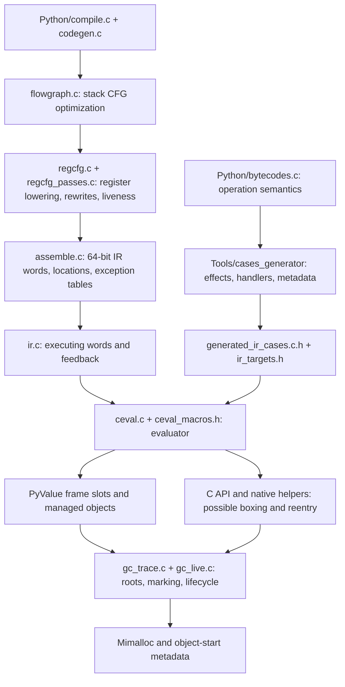
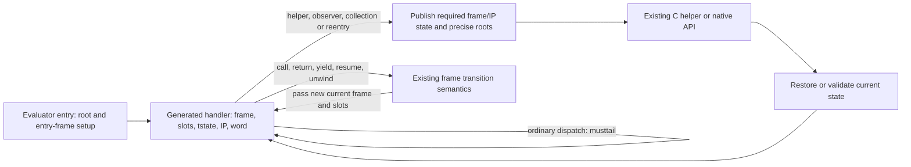

# Candidate: explicit interpreter state transport

Historical proposal. Its tracing collector and source assignments are superseded.
Use the [overall design](runtime-architecture.md),
[interpreter contract](handler-and-observer-contract.md) and
[current board](../issues/README.md) for the selected runtime and work.

2026-11-01. Coordinator synthesis for design review. Proposed architecture,
not a landed backend or a speedup claim. Repository source at the start of
this review is `417a9443a599e879c76c34c13ae76943bd6f6b3e`.

Keep the register IR, eight-byte values, generated operation definitions and
nonmoving tracing collector. The next interpreter candidate uses the existing
generated-C tail-call backend with an explicit frame/state calling convention.
Test it against matched compiler controls before committing to a backend.
Assembly is a possible later experiment if the measured remaining problem
requires it; it is not the first rewrite.

## Why change direction

Two source-level improvements have now lost on elapsed time. Constant operands
reduced some IR work but regressed the selected workloads. Handler-local slot
bases removed the intended outgoing cache stores, while common frame/IP traffic
worsened in emitted code. The fixed slot-base comparison regressed coroutines
11.98% and 11.00%, and generators 26.13% and 26.71%. Independent
[elapsed review](../issues/interpreter-dispatch-state/reviews/quiet-outcome-20261101-v1.md)
rejects that increment. Neither code size nor a presumed cache cause decides it.

This supports testing a more explicit state convention. It does not establish
that dispatch explains the full gap to upstream. The last broad matched result
is still 0.871× upstream across 29 workloads; the new four-row rejection is not
a replacement broad result. GC, allocation and native representation boundaries
remain separate costs.

## Current code organization

IR registers are memory slots, not hardware registers. Our temporaries have
limited single-definition structure, while locals remain mutable and joins
have canonical slots without SSA phi nodes. Existing constant/control-flow
folding, copy/store/pop/truth rewrites and fixed-point liveness are useful.
General SCCP, GVN/CSE and LICM are absent. Adding those passes does not by itself
control the machine registers used to execute each handler.

The maintained measured backend is a large generated-C evaluator with computed
gotos and GCC-controlled allocation. A generated tail-call backend already
exists: each handler receives `slots`, `tstate`, `next_instr`, `ir_word` and,
in statistics builds, `lastopcode`. It reloads `frame` from thread state.
The deferred [H1 experiment](../issues/h1-tail-dispatch/status.md) already
contains a passed-frame convention; it requires reconciliation and a current
matched comparison, not rediscovery or automatic adoption.

## Existing designs and what transfers

| Design | Useful mechanism | Limit for Boil |
| --- | --- | --- |
| LuaJIT assembly VM | Explicit machine-register roles, dispatch/decode sequences and native transition conventions | Architecture-specific implementation; Python frame, observer, native root and exception contracts still need their own solution |
| CPython tail-call interpreter | Small generated C functions connected by guaranteed tail calls and a convention with more argument registers | Compiler/target support, ordinary helper-call spills, argument shuffles and root auditing still matter |
| Deegen | Generate dispatch, continuations and fast/slow paths from operation semantics through a specialized LLVM pipeline | A larger build-time compiler project; its Lua results do not predict Python performance |
| Boil computed-goto evaluator | Shared semantics, existing coverage and portable C implementation | A local source change can redistribute register pressure across the whole evaluator |
| LuaJIT trace compiler | Typed SSA, guards, snapshots, redundancy elimination and allocation sinking across operations | This is a separate optimizing execution tier; its gains cannot be assigned to interpreter staging |

LuaJIT's VM explicitly assigns roles in
[`vm_x64.dasc`](https://github.com/LuaJIT/LuaJIT/blob/v2.1/src/vm_x64.dasc).
Its base register is not universally callee-saved: native transitions include
explicit save/reload work. The transferable idea is a deliberate transport
contract, not that assembly removes all publication or spills.

[CPython's documented tail interpreter](https://docs.python.org/3.14/whatsnew/3.14.html#tail-call-interpreter)
provides a practical C-based comparison. Clang's
[`musttail` and `preserve_none`](https://clang.llvm.org/docs/AttributeReference.html)
specify guaranteed tail transfer and a calling convention; they do not pin all
interpreter variables or remove ordinary C-call clobbers. `preserve_none` has
an unstable ABI, so compiler identity is part of the build contract. These
external sources were consulted on 2026-11-01; rolling branches are not frozen
experimental inputs.

Deegen's [author description](https://sillycross.github.io/2022/11/22/2022-11-22/)
shows a useful middle ground between ordinary C and handwritten assembly:
semantic C++ is transformed through LLVM into a specialized interpreter.
The 2022 discussion predates Clang's current `preserve_none` support; that
historical limitation is not a present reason to require a new meta-compiler.
Retain the lesson about shared semantics and deliberate continuations. Test
the existing backend before adopting the larger pipeline.

## Proposed transport contract

Use the existing generator and handler domain. The first ABI increment carries
`frame` explicitly alongside `slots`, `tstate`, `next_instr` and `ir_word`.
Use the literal order `(slots, tstate, frame, next_instr, ir_word)` from retained
H1, with `lastopcode` appended in statistics builds. Argument order affects
transport and is part of the frozen experiment, not a later tuning variable.
This is the existing H1 direction:
it avoids a thread-state frame reload without simultaneously introducing slot
base recomputation. Five arguments are a candidate, not a proven optimal set.
Upstream's [3.14 tail ABI](https://github.com/python/cpython/blob/3.14/Python/ceval_macros.h)
also transports frame explicitly. Its stack-reference layout differs from
Boil's slot IR; reuse the principle, not an unreviewed source transplant.

The entry/throw path, ordinary dispatch, predicted joins, direct labels,
specialization redispatch and frame-changing continuations all need the same
valid state. Check frame/slot agreement where those values are initialized;
startup sentinel arguments need their own initialization rule. Preserve the
distinction between the current published instruction and the next instruction.

Retain every existing publication and rooting obligation in the first increment.
A hardware register containing a pointer is not a declared precise root.
Managed slots and explicit C root spans remain authoritative at collection and
reentry boundaries. Ordinary C calls can still force spills. Any handler-local
root registration must end before tail transfer: `musttail` ends local lifetimes,
so passing a pointer to a handler's stack local into the next handler is invalid.
The outer evaluator's entry frame remains live during the handler chain.

Do not infer that a helper is harmless from its name or its common fast path.
Only separately proved effects can justify later removal of publication or
reload work. Monitoring, exceptions, finalizers, native callbacks and generator
close paths keep their existing semantics.

## Ordered hypotheses

These are separate experiments. Each receives exact source, commands, samples,
reviews and a clock before execution. The budgets below bound preparation and
execution; they do not authorize silent retries or permanent runtime switches.
They are provisional ceilings, not an executable schedule. Each activation
must fit the remaining integration deadline and downstream qualification;
otherwise defer that experiment explicitly.

| Order | Hypothesis and smallest experiment | Deciding evidence and stop rule | Initial budget |
| --- | --- | --- | --- |
| VM0 | The existing C backend/toolchain choice changes real common-handler transport. Compare frozen GCC computed-goto, Clang computed-goto and Clang tail images with identical runtime source and declared O3 policy. | Separate the compiler effect from the backend effect. Build/root failure stops that arm; native inspection explains mechanisms, elapsed decides benefit. No flags search. | 20 min plan/source review; 60 min serial build, focused feedback and fixed timing window |
| VM1 | Passing frame in the selected generated tail backend removes a repeated load more cheaply than it adds pressure. Reconcile H1 and change only this ABI. | Audit every entry and call/return/yield/unwind path, linked precise frames and stale roots. Compare full nominated native paths and the fixed original workloads. Reject if elapsed does not improve or controls regress without a bounded resolution. | 30 min source; 45 min native feedback; 30 min fixed elapsed campaign |
| GC1, parallel | Enumerating object starts from authoritative page metadata avoids repeated allocator free-map reconstruction. Change inventory enumeration, retaining marking and lifecycle behavior. | Prove map set/clear, page/domain, free/realloc, debug padding, huge allocations and OOM behavior; use omitted/stale-start controls. Measure whole elapsed and GC phases; inventory samples are only an opportunity bound. | 25 min design review; prototype budget set only after review |
| VM2, conditional | One named collecting/helper boundary causes redundant publication or reloads after VM1. Refactor that boundary using existing effects. | Must identify actual emitted repeated work and prove the full transitive effect/root contract. Reject a broad leaf exemption or removal of required publication. | 30 min attribution; no implementation without a specific consumer |
| IR1, conditional | One compiler-known operand or expression form removes dispatch without redistributing a larger cost. Start with a named literal read-subscript consumer or proven redundant pure operation. | Bound encoding, debugger entry, exceptions, root lifetimes and feedback. The rejected constant-operand source is not revived; a new consumer needs its own elapsed test. | 30 min design; implementation budget follows review |

For VM0/VM1, freeze primary workloads and regression controls before running.
Use the original coroutine, generator, unpack and spectral kernels rather than
inventing a favorable replacement. Require improvement in both fixed rounds,
with descriptive noise checks and no unresolved repeated control regression.
Set numerical thresholds and exact process counts in the experiment plan.
The existing five-serial-sample method is descriptive, not a confidence interval.
Use no text-size veto and no extra counter-permission probes. Report RSS and
absolute memory costs where relevant.

The first compiler/backend comparison uses a declared common build policy.
Upstream tail-interpreter results emphasize PGO; a result without PGO therefore
does not settle optimized-release performance. Any later PGO comparison must be
a separately predeclared matched experiment, not a rescue run after a failure.

## Collector direction

Keep one nonmoving collector while reducing actual work. Mandatory nursery and
cadence candidates have passed bounded correctness feedback; their three-arm
cost experiment is prepared but not yet run. The current minors still scan all
old objects, so cheaper scheduling alone does not provide generational old-scan
avoidance. Nursery coverage and complete remembered-owner boundaries remain
subsequent measured increments.

The [structural proposal](../issues/gc-nursery-old-work/object-map-inventory-proposal-20261101.md)
uses existing object-start metadata and allocator page enumeration, restricted
to initialized managed objects in the selected object-heap domains. The separate
raw PyMem/interior-pointer inventory remains intact; object-start bits are not
a raw-memory inventory. It can attack repeated allocator inventory work
without replacing storage ownership, weakrefs, finalization or native pointers.
It must still account for abandoned pages, domain boundaries and mutations
during lifecycle work. Huge singleton pages use their canonical object position
rather than scanning bitmap space proportional to the payload size.
It does not remove required object classification or claim the entire sampled
inventory share as recoverable time.

Moving collectors require writable alias and pinning contracts that this runtime
does not yet have. LuaJIT's proposed arena/bitmap collector is useful design
material, not evidence that a copying nursery is required or that the proposal
shipped in LuaJIT 2.1. Existing eight-byte values and stable C pointers constrain
that comparison. See the [current architecture](runtime-architecture.md) and
[GC/root contract](gc-roots-and-lifetimes.md).

## Decision and implementation boundary

The recommendation is to test the generated tail backend and explicit state ABI
first, alongside the metadata inventory design. Select one winning supported
configuration for adoption; experimental comparison arms do not become product
options. Retain a build backend only where a concrete supported platform needs
it. If this C approach loses, report the loss before proposing a bounded assembly
backend. General SSA and JIT work do not repair an unmeasured interpreter cost
by assertion.

The [independent design review](../issues/h1-tail-dispatch/reviews/candidate-design-20261101-v1.md)
records the exact reviewed document identity, findings and dispositions.
The three source canvases are retained under
`build/vm-design-canvas-20261101/`: `existing-designs.md`, `boil-vm-review.md`
and `gc-and-boundaries.md`. Their identities belong to that review. The
repository document is authoritative; the Loom artifact mirrors a named source
snapshot. Acceptance here means experiment planning, not backend adoption.
