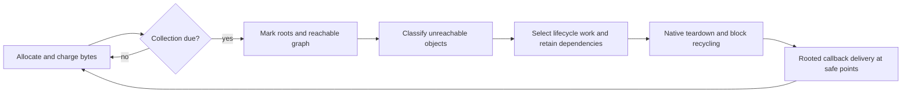

# GC architecture: fast common paths and the next collector

Coordinator plan, 2026-10-30. The supported nonmoving collector is landed;
the [current cost study](pre-I-gc-policy-and-experiment-decisions.md) measures
GC at 47%/54%/30% of coroutine/comprehension/generator hot time. Mark/root
closure is 8%/4%/11% of wall time and is included in those totals. Death
classification, repeated lifecycle checks and sweeping are substantial costs.
This plan identifies broad opportunities, not forecasted speedups.

Background work has two owners: archive/retire finished worktrees, and
implement the first selective-death slice. The qualified serving images and
upstream comparator stay fixed. Architecture changes beyond that first slice
remain proposals with explicit correctness and measurement obligations.
The [closure record](worktree-closure-plan.md) now records 32 retired worktrees
and eight retained roots. The first slice passes independent source review
and an O1 debug build. Its initial finite run passed all 12 existing controls;
a new resurrection test had the wrong callback-free weakref expectation.
Pinned upstream source confirms the correction. The corrected focused 13 and
four affected modules (599 tests, 46 skips) pass on unchanged debug products;
the original failure remains in the [first-slice record](pre-I-first-slice-decision.md).
Release measurement and landing review remain; no speedup is claimed.

## The collector today

1. Allocations use mimalloc and publish an initialized-object map. Pressure
   counts requested object/PyMem bytes, including full realloc requests.
2. The default post-collection allocation allowance is
   `max(32 MiB, last_live_object_bytes)`. This is allocation headroom, not an
   RSS ceiling. Object allocation schedules collection at an eval breaker;
   sufficiently overdue allocation can collect inline.
3. With the GIL held, capture/protect the supported thread roots. Mark from
   precise spans/checked frames and conservative C/PyMem/data roots, then
   traverse reachable objects. Build the complete unreachable-object list.
4. Process weakrefs and identify finalizers/native destroy hooks. Retain
   selected callbacks, active acquisitions and their reachable storage so
   callback delivery and resurrection remain safe.
5. Order the native deallocators that read referents; run required teardown
   while dependent storage remains intact, then recycle blocks. Allocation
   failure before safe sweep retains objects rather than guessing an order.
6. At safe execution points, one rooted interpreter-wide drainer runs queued
   callbacks. Nested/competing collectors can enqueue and return. A blocked
   callback delays other callbacks under this deliberately simple policy.

All automatic collections currently inspect the whole heap. There is no
young generation, remembered set, copying nursery or active physical liveness
map. No reference counting remains. The full dead list is also a graph used
to preserve lifetime ordering; excluding an object from a callback cohort
must not remove it as a connector in that graph.

## Three architectural improvements

### 1. Classify lifecycle work once; give ordinary objects a short path

Use one authoritative set of collection facts: actual weakref presence,
finalizer eligibility, buffer readiness category and native teardown needs.
Each stage visits only its relevant cohort. Objects with no work in a stage
should not repeatedly incur a type query, callback predicate or header read.

The first implementation uses existing flags plus aggregate/per-entry kind
bits, avoiding new worklist allocations or OOM paths. Compact stage lists are
a later measured choice, not necessary to establish the design. Preserve
static-builtin weakrefs, post-resurrection DEAD/FINALIZED rechecks, buffer
retention and all ordering connectors. Collection facts are not permanent
assumptions about a mutable Python type.

This directly targets the current samples. It is the smallest change and is
already prototyped in the separate selective-death worktree; native validation
and elapsed benefit remain separate gates.

### 2. Make reclamation a GC operation, with native teardown as an exception

Separate three jobs: determine reachability, perform required native cleanup,
and recycle memory. Common GC-owned objects should have a small, explicit
cleanup contract rather than paying unnecessary reference-count-era teardown
machinery. Resource-bearing and opaque native types keep the required existing
cleanup path until their contracts are ported and verified.

Investigate allocator/page/size-class information already available from
mimalloc and the initialized-object map. Avoid redundant map/header work and
make freeing batches of known-dead storage cheap. Do not install another
freelist layer merely because allocation is visible in profiles: mimalloc
already has optimized allocation and reuse.

Bulk recycling applies only after required teardown and retention are settled.
Lists with separately allocated storage still need that storage reclaimed;
exported buffers, side tables, type lifetime and native resources cannot be
discarded with an arena reset. The old deallocator path remains an explicit
native-type contract, not an unnoticed way to bypass cleanup.

This is a medium-size interface/implementation change, best developed from
one representative core layout and a measured common-path cost. Its benefit
must justify any new metadata and allocator complexity. It addresses work
that a generational collector would otherwise still pay for every dying young
object.

### 3. Add nonmoving young/old collection with separate minor/major budgets

Most allocation can enter a young generation; minors enumerate and reclaim
young objects while retaining old ones. Remember old owners that acquire
young references, and trace those edges during a minor. Majors use the full
collector to reclaim old garbage and mixed-generation cycles.

The [existing generations design](7-nonmoving-generations-design.md) and
store/allocator/frame ledgers provide a starting point. The real missing
contracts include:

- A young-object index that avoids walking every old mimalloc block and
  handles resize, address reuse and abandoned thread heaps.
- Nonallocating owner barriers across specialized stores, containers,
  type/shape fields, raw backing tables and native extensions.
- Constructor/promotion safety. An allocation can survive a collection
  before all its fields are safely traversable; being new is not a barrier
  exemption.
- Running/suspended/escaped frame ownership and strong roots at each handoff.
- An independent full-trace young-reachability oracle before minor reclamation.
- Major scheduling based on more than promotion, so old garbage is eventually
  revisited even during streams of short-lived allocations.

This is multiweek engineering under the current Linux/main-interpreter/GIL
scope, not a threshold adjustment. It saves repeated old-object work but
does not remove classification, native teardown or finalization of dying
young objects. Measure survival and old-live work before activating it.
Start a small ports/fixture set while defining these contracts: an old native
container gains a young child, the child remains usable after a minor, and
clearing the edge eventually permits reclamation. Buffer exports and native
backing tables need representative cases. This tests visible lifetime and
data behavior rather than counting barrier calls.

## Rare paths and cadence are separate decisions

Rare work should have separate cohorts and explicit scheduling, but calling
it rare does not make its lifetime rules optional. Weakrefs to selected dead
objects must be handled before reclaiming their storage. Selected finalizers
and release callbacks retain their objects/dependencies. An unready buffer
owner remains alive. User callbacks execute only at the safe queue boundary.

Minors and majors may have different cadences because they discover different
garbage. Callback delivery has its own safe-point boundary. These are not
permission to discover a resource-bearing object, drop its cleanup into an
unbounded maintenance queue and free the object anyway. The first slice
changes none of these cadences.

External resource pressure and delayed reclamation belong in the measurements
alongside CPU, pauses and RSS. A policy that saves collection CPU by retaining
files, buffers or large payloads too long is not automatically an improvement.

## Copying nursery versus whole-heap movement

A copying nursery offers cheap bump allocation: trace survivors, evacuate
them, then reset dead nursery storage. [PyPy's collector description](https://doc.pypy.org/gc_info.html)
shows that established design, with large objects allocated outside the nursery.
Survival rate, native cleanup and pinning determine whether it wins here.

Our current traversal reports child values through `visitproc`; it does not
provide all writable reference locations. **Precision sufficient to keep an
object alive is not yet precision sufficient to move it.** PyValue and shapes
make representation regular, but they do not update every copy of a pointer.

Movement needs writable heap/root visitors, safepoint handles or compiler
location maps, and explicit address-stability rules. Raw C locals/registers,
transitive PyMem references, interior pointers, exported buffer addresses,
frame/code interior pointers and external native caches all need treatment.
Address-derived identity/hash and weakref table keys also need stable identity
or relocation support.

Ambiguous references cannot safely be rewritten. [MPS documents pinning their
targets](https://memory-pool-system.readthedocs.io/en/latest/topic/scanning.html#ambiguous-references).
Pinned nursery objects prevent a simple whole-region reset, so a copying
design needs deliberate pinned/nonmoving space and evacuation rules.

The recommended lower-risk progression is nonmoving generations first, then
an explicitly movable nursery for supported layouts/root interfaces, with stable native and
large-object space. A small ports tree should test handle/pinning/buffer
contracts early. Rebuilding packages permits migration; it does not find their
hidden raw pointers automatically. Whole-heap movement adds relocation of
long-lived native graphs and is a larger separate project. A credible calendar
estimate requires a relocation/ports inventory first. Nonmoving generations
are not a technical prerequisite for a copying nursery: both need the young
heap/mutator/root contracts, while movement adds relocation and pinning work.

## Immediate course

1. Finish bounded debug/behavior validation of selective death processing;
   then measure the unchanged workloads on release products. Keep or reject
   the change by broad cost and semantic evidence, with no promised 2x gain.
2. Prototype one allocator/reclamation improvement only when the profile
   identifies its shared cost. Retain RSS, resource release and pause evidence.
   Existing 32/64 MiB budget sensitivity remains an inexpensive diagnostic.
3. Close the remaining mutator/young-index contracts before enabling minors.
   Do not restore repaired S3 snapshot work or deferred subinterpreter work as
   prerequisites; those historical ledger sections are superseded.
4. Complete [worktree archival](worktree-closure-plan.md). Keep one integration
   branch, the current runtime/comparator and only the topic trees with active
   owners. H1/H2 patches remain available without active checkout overhead.
