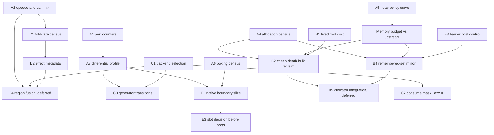

# Peer review: Boil runtime design and work breakdown

Read-only review of the worktree at `ca24abdb349`. I read the design and status documents, the three research reports, both new hypothesis documents, the IR word format, slot macros, generated handlers for ADD_INT, COMPARE_OP_INT, POP_JUMP_IF_FALSE_BOOL, LOAD_FAST_BORROW, CALL_PY_EXACT_ARGS, RETURN_VALUE and YIELD_VALUE, the register placement code, the collector and allocator structure, the value header, and the recorded performance tables. Nothing was built, run or modified.

## Verdict

The design documents are careful and the correctness contracts are real. The work breakdown is not aimed at the measured problem. Three of four ranked hypotheses are collector mechanics, yet none of them is the collector change the data points to, and the biggest measured losses outside the GC are in a track that has no owner at all: the value/native boundary. The IR and interpreter discussion is large but mostly defensive, because the interpreter is the part of the fork that is already winning.

The single most important fact in the record is the shape of the 29-workload table, not its geometric mean.

| Group | Workloads | Ratio to upstream | What they have in common |
| --- | --- | --- | --- |
| Compute in pure Python, little allocation | float, richards, nbody, raytrace, chaos, go, deltablue, spectral_norm | 0.98 to 1.99 | Register IR, inline numbers and shapes win |
| Allocation heavy, generator or coroutine frames | generators, coroutines, comprehensions | 0.60 to 0.85 | Short-lived objects, 22 to 39 percent sampled GC |
| Stdlib C modules and object protocols | xml_etree_iterparse, unpickle, deepcopy, logging, json, pickle, regex_compile | 0.64 to 0.83 | Values crossing the C API, allocation inside C, unconverted object-form slots |

Source: `boil/issues/gc-cleanup-scanning/performance.md:82-112`. Richards at 1.886× with zero timed GC shows the interpreter core is not the deficit. The deficit is prompt reclamation of short-lived objects and the cost of leaving the value world. The plan should follow that.

## Findings on the architecture and the evidence

1. **Correctness has been standing in for attribution.** No per-workload profile exists for the current head, no per-opcode or opcode-pair dynamic mix exists for any registered workload, no RSS ratio exists for the 29 rows, and hardware counters are blocked by a permission denial. Every hypothesis document says "do not invent hotness" and then proposes mechanism work anyway. The missing census is cheaper than any proposed mechanism and should come first.

2. **The chosen GC hypotheses attack the wrong layer.** The collector is nonmoving full-heap mark and sweep with a 32 MiB allocation debt and a growth factor of one (`gc_live.c:1928-1936`). Every dead object is enumerated, classified into a 16-byte dead record, ordered, swept and freed individually (`gc_trace.c:2196-2320`, `gc_live.c:1113-1461`). Reference counting frees a coroutine at the moment it dies, with the cache line still warm. This fork touches it again tens of milliseconds later, cold, up to four times. The object-map iterator and the coroutine span cohort both shave the enumeration and the final free while keeping dead records and lifecycle processing, which the GC report itself admits "deliberately limits the first win". The general mechanism is cheap death for trivially destructible types, not a one-type allocator with a new owner-index probe on every precise edge.

3. **The nursery as built is not a generational collector.** Minors seed every old object as a root (`gc_trace.c:2222-2229`), so minor work scales with the old heap. The generators kernel holds a persistent 100,000-node tree built in setup and allocates roughly 100,000 generator objects per loop; every collection retraces the tree. Without write barriers the all-old nursery can never make that cheap, so it should be retired, not adopted. Barriers are the keystone decision for the collector and are ranked fourth. They should be costed second.

4. **Fixed per-collection root cost looks material and is unexplained.** Roots plus closure is 10.7 percent of sampled CPU in coroutines, whose live set is tiny. Each collection conservatively scans every writable PT_LOAD segment of every loaded shared object (`gc_trace.c:1296-1321`, `2493-2497`) plus thread and interpreter structs. That is a per-collection constant that frequent small collections pay in full. The phase timers already exist and should settle it.

5. **The interpreter track has a measurement problem, not a design problem.** Both rejected handler experiments regressed unrelated controls by 20 to 50 percent (unpack_sequence +47 to +53 percent for a slot-base change it never executed). A 19,000-line monolithic evaluator redistributes GCC register pressure on any edit, so handler-level experiments cannot be evaluated in it. The per-handler tail-call backend matters here as experimental infrastructure, not as a speed hypothesis. Until it exists, every small interpreter change will be rejected on noise.

6. **The real per-word overhead is visible in source and cheap to remove.** 284 of 300 handlers store `frame->instr_ptr` on every word. Each consumed input runs `IR_IS_LOCAL`, which loads `nlocalsplus` through `frame->ir_words` and compares, so a binary op pays two loads, two compares and two conditional stores for a fact the compiler knew statically (`ceval_macros.h:520-536`). The handler field is 16 bits for 302 handlers, leaving seven spare bits in every word. A static consume mask is a one-week change with a trivial causal control. The two-word compare-and-branch region is a superinstruction with large admission, metadata and instrumentation machinery for an unmeasured pair frequency. It should wait.

7. **The compiler cannot earn an optimizing middle end at compile time.** Copy propagation must stop at any op that may run Python because the compiler sees generic ops before specialization. Type facts only exist at runtime. An effect-aware SSA middle end has no consumer until a runtime tier exists, and a runtime tier is post-parity work. Keep the effect model as generator metadata and stop there.

8. **The native boundary is the largest unowned cost.** Argument Clinic boxes every `PyObject *` parameter; `binaryfunc`, `richcmpfunc`, `hashfunc`, `reprfunc` and `METH_VARARGS` remain object-form; every method call on an inline int or float boxes `self`; floats box with a fresh allocation every time and ints outside -5..1024 do too. Seven of the twenty-two losing workloads spend most of their time in exactly this code. The issue is queued, unassigned and has no cost measurement. There is also no extension ABI story, which is the largest product risk in the fork; it is correctly deferred, but the slot decisions made in this track determine how much porting work gets redone.

9. **Memory is a whole-workload cost that no acceptance rule covers.** Fork peak RSS was 2.3 to 4.5× upstream in the four profiles. The stable-storage proposal gates RSS at 5 percent above the fork parent, not against upstream. A memory budget relative to upstream belongs in every performance decision.

## Mechanism-based breakdown

Each row is a falsifiable claim, the smallest artifact that answers it, the causal control, the semantic obligations and the decision. Ranks are within track; cross-track order follows below.

### Track A: attribution and tooling (prerequisite, one week)

| ID | Claim or census | Smallest artifact | Control | Decision |
| --- | --- | --- | --- | --- |
| A1 | Hardware counters can be enabled | Fix `perf_event_paranoid` or grant `CAP_PERFMON` on the measurement host | none | Blocks nothing else but halves the samples every later experiment needs |
| A2 | Per-opcode and pair dynamic mix for all 29 kernels | Extend the pystats serializer in `boil/bench/run.py:445-475` to keep per-opcode and pair counts; one pystats run per kernel on head and on upstream | none | Produces words per loop versus upstream instructions per loop, per kernel |
| A3 | Differential symbol profile head versus upstream for all 29 kernels | perf record both arms, one disjoint classifier: evaluator, GC phases, allocator, boxing, native module, other | none | Replaces the four 0b15 profiles; selects the primary workload for every track |
| A4 | Allocation census | Debug counters: allocations and bytes by type and size class, deaths per collection split by trivially destructible versus lifecycle-bearing, survivors, collections per loop | none | Supplies the eligibility fraction G3 and G5 need |
| A5 | Heap policy curve | Run the 29 kernels on head with threshold 8, 16, 32, 64, 128 MiB; record elapsed and peak RSS; no code change | none | Fixes the operating point and a memory budget relative to upstream |
| A6 | Boxing census | Existing `boxes` metric with the empty `by_instruction` breakdown fixed, plus A3's boxing category | none | Ranks native-boundary sites by count and by sampled time |

### Track B: allocator and collector

| ID | Hypothesis | Smallest implementation | Causal control | Semantic obligations | Decision |
| --- | --- | --- | --- | --- | --- |
| B1 | Fixed per-collection root cost is material on small-heap workloads | Read existing phase timers for precise, stack, data segment and struct phases on coroutines and generators | Test-only build that skips the data segment scan, to bound the gain | Any `PyObject *` in a C global must stay a root: registered static roots plus the segments of extension modules that are not audited | If data scanning exceeds 3 percent of elapsed, restrict it to unaudited modules and register the rest; else drop |
| B2 | Dead objects of trivially destructible types dominate deaths and can be reclaimed without dead records or lifecycle passes | Per-type flag computed once: no finalizer, no `tp_del`, no weakref support, no buffer, no watchers, not `DEALLOC_READS_REFERENTS`, not a type. Dead objects of those types skip the dead array and are freed per page in bulk after the lifecycle phases | Same build with the flag forced false | Weakref lists, resurrection, hook ordering, types last, coroutine frames with escaped frame objects, quarantine and verifier modes | Accept if A4 shows the eligible fraction above half of deaths on the losing workloads and elapsed improves on them with controls within 1 percent |
| B3 | Barrier cost is affordable | Insert a card-mark store at every core managed-field write site with no consumer: shape slots, list, dict, set, cell, tuple C API setters, generator and frame fields. Measure mutator slowdown on all 29 | The same binary with the mark compiled out | Enumerate write sites from the existing traversal metadata; opaque native owners are treated as always dirty and counted | If the cost exceeds the GC share A3 attributes to old-heap tracing on generators and comprehensions, stop generational work |
| B4 | A remembered-set minor avoids old-heap work | Young is every new object, not a type list; minor traces roots, dirty cards and young; sticky marks on old objects; promotion is clearing the young bit | The same policy with the remembered set forced to "every old object", which is today's nursery | Dirty-set overflow fails closed to a major; resumed old generators and thrown-into frames mark dirty; `ob_ref` and direct struct writes from extensions rescan | Accept if whole-workload elapsed improves on generators and comprehensions and nothing regresses beyond 1 percent at the A5 memory budget |
| B5 | Allocator integration (spans, bitmaps, bulk page release) | Design only after B2 and B4 settle which heap region reuse matters | | | Defer |

### Track C: interpreter backend

| ID | Hypothesis | Smallest implementation | Causal control | Semantic obligations | Decision |
| --- | --- | --- | --- | --- | --- |
| C1 | Handler experiments are not measurable in the monolithic evaluator | Build the existing generated tail-call backend with Clang and `preserve_none`; compare GCC computed goto, Clang computed goto and Clang tail on unchanged source | The three arms are each other's controls | Frame reload, stale roots, `musttail` local lifetimes, unwind paths | Adopt the one maintained backend; delete the others. Pick the tail backend even at a small loss if its handler-local variance is lower, because every later experiment depends on it |
| C2 | Dynamic locality checks and universal IP publication are a material per-word cost | Static consume mask in the spare handler bits; publish `instr_ptr` only in handlers that escape, deopt or raise, as upstream does | Mask present but ignored; IP publication retained | Enumerate every reader of `frame->instr_ptr`: tracebacks, `f_lineno`, monitoring, generator return targets, deopt, the collector's frame visitor. Each must be after a publishing handler | Accept on the A3 primary with controls within 1 percent |
| C3 | Generator and coroutine transitions carry fork-specific cost | Paper diff of YIELD_VALUE, SEND_GEN, RETURN_GENERATOR, CALL_PY_EXACT_ARGS against upstream; candidates are the generator-owned caller argument copy loop, `_PyFrame_Copy` at 6.9 percent, `_PyThreadState_UpdateLastProfiledFrame` on every yield | A3 attribution decides which | Exception state linkage, suspension release ordering, frame ownership | One change per candidate, each gated on generators |
| C4 | A fused compare-and-branch region beats two dispatches | Only after A2 reports the pair above 5 percent of dynamic words on a losing workload and C1 is adopted | The volatile ablation in the existing design is adequate | As written in the hypothesis document | Defer |

### Track D: compiler and IR

| ID | Claim | Artifact | Decision |
| --- | --- | --- | --- |
| D1 | The compiler earns its register form | A2 ratio of words per loop to upstream instructions per loop, plus a fold-rate census: fraction of LOAD_FAST and STORE_FAST folded, static over Lib and dynamic over kernels | If words per loop are not below upstream on the losing kernels, the compiler is not the lever; if they are and elapsed still loses, per-word cost is, which is Track C |
| D2 | Effect metadata is complete | Finish per-op none, alloc, reentrant classification in the generator, already seeded by `call_effects.py` | Keep as metadata; no SSA, no block arguments until a runtime tier is scheduled |
| D3 | Word density and feedback stride | Measure code, feedback and frame bytes per kernel and cache misses once A1 lands | Study only; no format change without a miss measurement |

### Track E: value and native interfaces

| ID | Hypothesis | Smallest implementation | Causal control | Semantic obligations | Decision |
| --- | --- | --- | --- | --- | --- |
| E1 | Boxing at Clinic and object-form slots is the main cost in the stdlib-heavy losers | A6 census, then convert the top site family on the worst native workload, likely json_loads or unpickle: value-form `hashfunc`, `richcmpfunc` or Clinic `self: value` | Same build with the converted path routed through the object form | Box identity: `Py_Is` differs from `PyValue_Is`; aborting accessors on OOM; canonical result checks on specialized paths | Accept on the primary native workload with controls within 1 percent |
| E2 | Float boxing allocation is avoidable | Freelist or small cache for boxed floats, measured on nbody controls and json | none needed | None beyond canonical form | Only if A6 shows float boxes above a few percent |
| E3 | Extension ABI | Decide which slot typedefs become value-form before any port; write the decision down | | | Defer ports; do not defer the decision |

## Cross-track ranking

1. A1 to A6 together, one person, one week. Everything else is guessing without them.
2. C1 backend selection. It can start today and unblocks all handler work.
3. B1 fixed root cost. Timers already exist; a day of reading.
4. B2 cheap death for trivially destructible types. This is the general form of what both GC hypotheses were reaching for.
5. E1 native boundary slice. Seven losing workloads and no owner.
6. C2 consume mask and lazy IP publication.
7. B3 barrier cost control, then B4 if affordable.
8. C3 generator transitions, guided by A3.
9. D1 fold-rate census.
10. Everything in the stop or defer list.

## Parallel assignments and dependencies

| Owner | Weeks 1 to 2 | Weeks 3 to 6 |
| --- | --- | --- |
| Attribution | A1, A2, A3, A5, then A4 and A6 | Maintains the per-kernel attribution table every track gates on |
| Interpreter | C1 | C2, then C3 candidates from A3 |
| Collector | B1 with existing timers | B2, then B3; B4 only if B3 passes |
| Native | A6 with attribution owner | E1 on the worst native workload; E3 decision document |
| Compiler | D1 census from A2 | D2 metadata; no implementation |

## The cycle each hypothesis runs

Each ID above is one cycle. Time scales are days, not UTC minutes.

1. **Hypothesis.** One sentence, the primary workload named from A3, the control set, the memory budget from A5, and the decision rule written before any code.
2. **Design.** One page: mechanism, semantic obligations enumerated as a checklist of readers or writers, the causal control, and the ablation that distinguishes the mechanism from layout noise.
3. **Design review.** One reviewer, one day, answering only: is the control causal, is the obligation list complete, is the decision rule falsifiable.
4. **Implementation.** Bounded to one or two weeks. Tests for every obligation on the checklist. The control arm is a compile-time ablation in the same source, not a runtime flag.
5. **Implementation review.** Diff, obligation tests, emitted code for the hot path on the adopted backend.
6. **Accept or reject.** All 29 kernels, both arms, counters plus elapsed, RSS against the budget. Accept integrates and deletes the control arm. Reject records the result and deletes the branch. Inconclusive is a reject.

## Stop or defer

- **Stop** nursery adoption and cadence work. The all-old minor cannot become generational; B4 replaces it.
- **Stop** the two-word compare-and-branch region until A2 shows the pair matters and C1 is adopted.
- **Defer** the coroutine span cohort and the object-map iterator; B2 subsumes their target with a general mechanism. Finish the iterator's witness only if A3 shows enumeration above 5 percent on head.
- **Defer** VM1 frame-argument ABI; fold it into the C1 decision rather than a second experiment.
- **Defer** SSA, block arguments, 32-bit words, an LLVM handler generator and assembly. None has a consumer.
- **Defer** copying, incremental and concurrent collection, and subinterpreters.
- **Defer** third-party ports, but make the E3 slot decision now.

## Process notes

The hour-granular grants, 45-minute prototype ceilings and the integration boundary produce experiments too small to measure and too costly to document. Five serial samples without counters cannot resolve a 1 percent primary gate when controls swing 50 percent on layout. Fix the counter permission, adopt a backend with local handler variance, and size experiments to a week with a named primary workload. Every acceptance should report all 29 ratios and peak RSS against upstream, since the fork's memory multiple is a cost the geometric mean hides.
