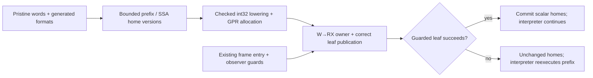

# First native tier: a transactional compact-integer prefix

2026-11-01. **Design only, against clean RC source
`d7df12b1d81722927e71d9734c70eeafdccfee73`.** RC qualification and independent
design/source reviews precede any implementation or execution grant. The
tracing-GC attempts stay retired on their preserved branches.

Compile one bounded straight-line arithmetic prefix at ordinary function
entry. Keep Python calls, floor division, returns and all unsupported work in
the existing interpreter. The hypothesis is that reusing unboxed intermediate
values across several operations removes more work than native admission and
commit add. This is deliberately a small first native tier with a real
registered consumer; it offers no speedup forecast.

## Actual starting point

The RC tree owns eight-byte `_PyStackRef` frame values, with inline int32 and
non-NaN doubles plus owned/borrowed object forms. Its authoritative interface
is `Include/internal/pycore_stackref.h`; later public `PyValue` and inline
heap containers are absent. `FromPyObjectNew/Steal` retain object forms, so
inline-only argument guards would miss boxed exact integers. DECREF can again
run destructors and Python. The tracing runtime's effect assumptions cannot
be imported.

`pycore_regcfg.h` and `regcfg.c` supply useful operands, exception edges,
liveness, alias constraints and physical frame-home assignment. Fresh
temporaries are single-definition within regions; mutable locals and canonical
join slots have no SSA phi nodes. Compaction is neither hardware register
allocation nor a proof that every home must remain in memory during native
execution. The interpreter generator currently promises current frame slots
at escaping calls. This candidate preserves that promise at every boundary.

`jit_x86.h` is an unused small assembler. `jit_publish.c` supplies optional
perf/GDB/backtrace publication, not compilation, executable-memory ownership
or dispatch. Its `_Py_JIT` guards have no enabling declaration in the inspected
configure inputs. `jit_unwind.c` describes old trampoline/stencil frame
layouts; reusing those rules for a new native leaf would be incorrect.

## One consumer and its cost ledger

The registered `spectral_norm.eval_A(i, j)` computes
`1.0 / ((i+j)*(i+j+1)//2+i+1)`. The proposed maximal supported entry prefix
contains **four arithmetic operations**: two `i+j`, one `+1`, one multiply.
It stops before `//`. Leading/interspersed inline constant loads are value
transport; `1.0` is carried as bits, without native floating-point arithmetic.

With `DEFAULT_N=130`, each A or transposed-A application invokes `eval_A`
130×130 times. Four applications per outer iteration, ten iterations, imply
**676,000 calls per registered loop**, or 2,704,000 source arithmetic
operations in the nominated prefixes. These are source-derived counts,
not measured native entries. Arguments vary through 0–129; specialization
must use their actual runtime values, never substitute a sampled value.
Actual RC words, folded loads, physical aliases and successful admission still
need a finite native witness before this consumer earns a mechanism claim.

Each admitted call pays a descriptor/observer check, guards and extraction for
the distinct inputs, writable-home validation, scalar staging, one native
call/return and scalar commit. It retains normal Python frame creation,
call/return protocol, IP publication and the remaining arithmetic dispatches.
Four operations may be too little to amortize these costs. Include rejected
entry checks on unrelated functions and compilation cost in the decision.

## IR, ownership and machine registers

Translate pristine finalized IR words using the existing generated formats.
Build **local SSA versions of frame homes** for this prefix: reads use the
current version; consumed temporary homes become NULL; writes create a new
version after all inputs are captured. This handles destination/input aliases
and slot reuse. No joins, loops, phi nodes, general CSE or code motion are
needed. Persisting the entire pre-compaction RegCFG is unnecessary here;
later loop optimization would need genuine logical values/joins or an
explicit memory-home model, not accidental reuse of physical slot numbers.

Admit at most sixteen words, at least three arithmetic operations, and only
checked int32 ADD/SUBTRACT/MULTIPLY plus supported inline constant transport.
Reject branches, calls, heap operations, protected exception ranges, owning
pointer copies, and any unsupported opcode. Bounds are finite implementation
scope, not performance thresholds. Do not recognize a benchmark's source name
or expression spelling. A decoded source-word witness must establish that the
nominated prefix actually fits; otherwise stop rather than enlarge the menu.

Live-in integers may be inline or exact boxed compact integers **borrowed from
unchanged local homes**. Guard with the existing compact-integer contract;
bools, subclasses and other objects decline. Writable homes must initially
contain NULL or inline scalars. An owned pointer temporary or object-valued
overwritten local declines before native entry. No native intermediate owns
a reference; boxed local owners stay in the frame. No DECREF, INCREF, boxing,
Python callback or allocation occurs in the native interval.

The frame stays untouched except for its existing per-word IP publication
until the prefix succeeds. A shadow home map describes the exact consumed
NULLs and scalar live-outs. On overflow, return before committing any value
home, restore the prefix entry IP and let the interpreter reexecute from its
first word. There were no Python-visible effects to replay. On success commit
the scalar/NULL map and continue at the first unsupported word. Do not invent
lazy IP publication as a second optimization.

Use a standard SysV x86-64 frameless leaf accepting scalar-input scratch,
scalar-result scratch and the borrowed current-frame address for IP stores.
Allocate SSA integer versions with a small linear scan over caller-saved GPRs;
reserve argument registers, RSP/RBP and callee-saved registers. Spill only
int32 values into the caller-provided scratch block. Emit 32-bit arithmetic
followed immediately by overflow exits. No spill is a hidden owning reference.
The native instruction sequence, moves/spills, IP stores, entry and commit
must all appear in the retained emitted-code review.

## Entry, observation and lifetime closure

Store one prefix descriptor/hot counter in `_PyCodeExec`, compile once after
64 eligible entries, and own its code until `_PyCode_ClearExec`. A NULL
descriptor costs an entry check; account for it. Build descriptors from
immutable code words, not mutable specialization handlers. Install no new
handler ID or public runtime option. Qualify one Linux/x86-64/GIL/inline-value
path; unsupported builds continue through the interpreter.

Do not hook RESUME alone: `IR_SKIP_RESUME` often bypasses it. Add one shared
entry decision after existing entry notifications in `_PUSH_FRAME` and
`start_frame`, regenerating all users. The current generated file has fourteen
RESUME-skip sites, including generator/send entries, which must remain gated
out. A pre-entry hook inside `IR_SKIP_RESUME` would run too early relative to
DTrace/lltrace on some paths. Keep recursion checks and function-start events
in their existing order.

Require ordinary initial entry, no generator/coroutine/async-generator flags,
no tracing/profile/monitoring events, no active DTrace/lltrace or PEP 523 hook,
and no pending breaker. Instrumentation-version equality alone does not prove
that events are disabled. Recheck admission after cold compilation/publication
and before reading scalar inputs. Frame homes and instruction state must be
current across that work. No native code can survive a callback boundary with
borrowed facts. A later interpreter call can mutate locals or enable observers;
the next entry repeats all guards.

Calls, error creation, ownership releases, yield/resume, return and deopt to
generic arithmetic remain interpreter operations. In particular a local
replacement that could release an object is outside admission: establish the
new value before releasing the old one through the existing interpreter.
Overflow/OOM and custom reflected/in-place behavior use that same path.
Guard failure is an ordinary unchanged-prefix decline, with no exception set.
Compile/map/protect failures must leave the interpreter usable and preserve
the user's existing exception state; do not indiscriminately clear errors.

Add a bounded W→RX code owner with no RWX mapping, checked emitter capacities,
and complete failure cleanup. Register/unregister code around that lifetime;
publication returning NULL is not compilation failure. Add the correct leaf
CFI (CFA=RSP+8 with untouched stack) through the existing registration path,
preserving the old trampoline rules for its callers. Code pages, descriptors
and scratch have explicit size accounting. No general code cache, tracing
recorder, cross-thread execution or collector integration is needed.

## Finite review, source and measurement proposal

First finish RC critical qualification. Then seek a separately reviewed
90-minute source attempt as a ceiling, without a promise it is sufficient:
at thirty minutes require exact admission/ownership
and entry-site closure; at sixty require emitter/overflow/commit/W→RX/CFI
closure. Freeze a complete candidate or retain an incomplete patch and stop.
Likely files are `Python/ir.c`, `pycore_ir.h`, a small prefix compiler/owner,
`jit_x86.h`, `bytecodes.c` plus generated cases, publication/unwind interfaces
and focused tests. Do not alter the assembler's word encoding, RegCFG passes,
container ABI, cyclic collector or Python arithmetic fallbacks.

Propose one subsequent sixty-minute fresh debug/O3 feedback batch. Tests cover
inline/boxed inputs; int32 extrema and every overflow exit; bool/subclass and
reflected/in-place fallback; aliased destinations/reused homes; owned-pointer
decline and destructor reentry; unbound locals/error IP; observer enable/disable
and entry notification order; PEP 523; generator/coroutine exclusion; compile
OOM/W→RX failures; code teardown; and native backtrace/unwind. Use an independent
`operator`-call oracle whose calls prohibit prefix compilation. Include a
prefix `step(x,y): return (x*3+y, y-1)` invoked by a changing recurrence,
with bounded varied arguments and a consumed checksum; tuple creation stays
outside the prefix. A constant-result loop cannot establish useful execution.

Before scores freeze a two-round, five-value comparison of unchanged registered
spectral_norm, coroutines, Richards and unpack_sequence against the qualified
RC parent, with rotating order and actual origins. Primary and four-row elapsed
ratios must improve in each round and remain improvements under leave-one-value
median sensitivity; inconclusive results earn no extra samples. Control losses
over 2% need explanation. Retain raw vectors, RSS, compilation counts/time and
whole-process elapsed including startup/warmup, alongside warmed measurements.
Treat sensitivity as a robustness check, not independent samples or a confidence
interval. Text size, instruction counts and hardware counters are diagnostics,
without a veto or prerequisite. A first registered-workload loss rejects this
increment before expensive broad qualification. All scopes above are proposals,
not execution authority.

Source anchors in the selected RC worktree: `pycore_stackref.h` encoding and
compact-integer helpers; `pycore_regcfg.h` regions and operands; `regcfg.c`
`_PyRegCfg_Build`; `pycore_ir.h` formats and `_PyCodeExec`; `ir.c` execution
allocation/clear; `bytecodes.c` `_PUSH_FRAME`/`start_frame` and integer bodies;
`ceval_macros.h` `IR_SKIP_RESUME`/`IR_STORE_DST`; `ir_generator.py` `IRStack`;
`jit_x86.h`; `jit_publish.c`; `jit_unwind.c` and their internal headers.
The source-fact receipt under `build/jit-first-native-tier-design-20261101`
pins those files and the primary registered spectral_norm source. Existing
LuaJIT/Fable comparisons remain in `interpreter-lowering-research/results.md`,
`fable-ir-vm-audit-20261101.md` and `build/vm-design-canvas-20261101`; their
tracing-era ownership assumptions do not replace the selected RC contracts.
