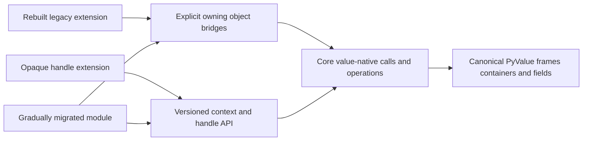

# Opaque extension API and gradual migration

The user has refined the extension target: design an explicit opaque interface
in the style of HPy or V8; let rebuilt extensions use a slower migration bridge
with limited edits, then adopt the new API gradually. Old binary compatibility
is not required. This supersedes the immediate dictionary API-removal action;
its prepared script remains unexecuted. The earlier exact-action approval
question is no longer the next step.

Independent review has accepted the [preferred design](../../design/extension-api.md).
The [first native-scope source slice](native-scope-source-grant-20261101-v1.md)
is authorized. The API backend and runtime bridge remain unimplemented; this
is not an HPy conformance claim. The dictionary storage checkpoint remains
useful. Core restoration and its correctness review continue in parallel.

## Proposed boundary

There is one core value representation. An external handle identifies a rooted
runtime value; its bits and the runtime's object/container layouts are not a
public extension contract. The interpreter and JIT use internal value operations
directly rather than creating extension handles for every operation.

| Surface | Intended contract |
| --- | --- |
| Core | Canonical PyValue, explicit RC ownership/publication; internal layouts may evolve |
| New extensions | Opaque handles and explicit runtime context; local, object-field and persistent lifetimes are distinct |
| Rebuilt legacy methods | Owned, fallible object conversion at call boundaries; slower execution is acceptable |
| Gradual migration | Old and new methods/types can coexist through explicit adapters; no interpreter representation switch |
| External buffers | Explicit acquisition/release and owner lifetime; no generic container interior-pointer cast |

HPy already separates local handles, fields and globals, and supplies a hybrid
migration path. It is the first candidate to reuse rather than inventing an
incompatible handle ecosystem. Its porting guide also makes ownership changes
explicit. [HPy porting guide](https://docs.hpyproject.org/en/latest/porting-guide.html),
[HPy ABI and migration overview](https://docs.hpyproject.org/en/latest/overview.html).

V8 provides a useful reference for local scopes, persistent roots and escaping a
result into its caller's scope. These are API lifetime ideas; they do not imply
changing our selected collector. [V8 embedding guide](https://v8.dev/docs/embed).

## Compatibility that can be offered honestly

Ordinary object-based method bodies should be able to use a centralized adapter
that snapshots evaluated arguments before any boxing, owns the resulting object
array through the call, and handles result publication and cleanup. Their parser
outputs can borrow that stable array. This is a concrete candidate for modest
source edits; its producer/parser implementation still needs review.

An old borrowed container getter has a harder contract. A newly boxed scalar
cannot borrow ownership from a container that stores only its inline value. A
call-local box arena also cannot promise that pointer survives every later call
while the container remains alive. Such uses need an owned getter and release,
or an explicit bounded compatibility scope with promotion before escape. Direct
container-layout access and persistent borrowed pointers require source changes.
We will not hide those changes behind a permanent box cache or fresh unowned box.

Opaque handles, object-field roots, persistent roots, custom type layouts, buffer
leases, exception propagation, reentry and runtime attachment need one reviewed
contract. Registration must distinguish actual call conventions; function-pointer
casts are not adapters. Rebuilt hybrid binaries remain private-runtime-specific
and old binaries must be rejected before their initialization function executes.

## Active design work

`coroutine_design_review` completed the source-oriented HPy/V8 design and now
implements a fixed native-scope/result engine. `restart_audit` owns the actual
specialized O-call consumer and generated publication seam. The generic caller,
variable parser families and HPy backend are subsequent consumers.
`value_api_consumer_map` independently reviews implementation. HPy is no longer
actively maintained, so the preferred direction requires a fork-owned backend
and verified source pin; its CPython pointer casts cannot be reused unchanged.

The register-interpreter checkpoint still follows coherent universal-value
restoration. It uses verified JIT-off execution and existing basic optimizations;
the extension interface must not route the internal interpreter through a slow
public handle layer.
