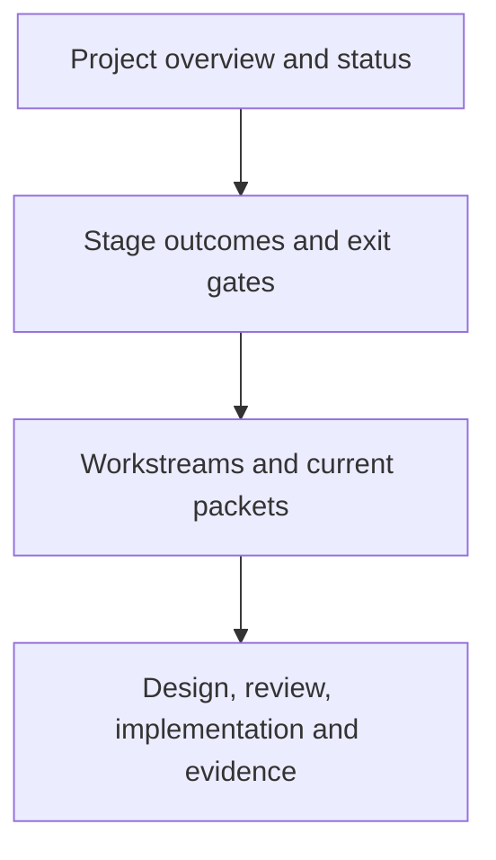

# PyJIT

We are rebuilding CPython around universal eight-byte PyValues, a register
interpreter, and a cohesive method and tracing JIT. Memory management uses
reference counting with cyclic collection. Extensions are rebuilt and ported.

**Current status, 2026-11-07:** runtime HEAD `7780e32e0e2` is clean; release,
debug and stats builds each report 117 modules, and both full suites passed
54,361 tests with no failures. Final-v4 measurements are complete. Candidate /
upstream and candidate / interim elapsed factors are 1.263136 / 1.054877 on
29 kernels and 1.084920 / 0.902391 on the declared 12-result subset. These
noisy sequential results establish no convincing broad elapsed-time win or
upstream parity. The coordinator's [final report](bench/results/interpreter-throughput-20261106.md)
contains validation, evidence limits and next work; see also [status](STATUS.md),
the [Integration C receipt](issues/interpreter-throughput/integration-c.md)
and the [throughput follow-up](issues/interpreter-throughput/follow-up.md).

**Historical checkpoint outcome, runtime `6a0e4c12c17`:** constructor and
format work, following `05286694774` (native child accounting).
All five build-info objects match their respective source HEADs: upstream
`3a440b65695`, interim `eba351fee7d`, and candidate `6a0e4c12c17`. The module
rosters are 116/116/117. Both full profiles passed 54,351 tests with no
failures (release: 2,531 skips; debug: 2,469). The strict whole-source R27
census failed: 6,512 dumps contain 11,028,818 core/core-pending/unresolved
boxes and incomplete process identity/accounting. The raw capture finished
with 87 records across 29 kernels: 18/29 startup-inclusive raw-zero, all loop
deltas zero, but strict kernel admission failed. See the [full census receipt](issues/checkpoint-closure/full-census-6a0e4c12c17.md).
The matched diagnostic campaign is complete and shows a throughput gap.
R27's failed zero-box criterion is now diagnostic, not an admission veto.
Candidate/baseline elapsed-time factors are 1.287/1.075
for 29-kernel geomeans and 1.096/0.913 for the 12-result pyperformance
subset against upstream/interim (lower is better); peak-RSS factors are
1.259/1.062. See the [diagnostic report](bench/results/checkpoint-6a0e4c12c17.md).

The earlier full-v2 failures remain historical evidence. Keep correctness and
workload identity/accounting trustworthy, but do not require zero-box R27 to
begin or admit performance work: the full census is diagnostic and helps rank
useful PyValue ports. Follow the updated [work queue](issues/checkpoint-closure/follow-up-6a0e4c12c17.md).
Prioritize steady-state throughput; RSS is secondary. The source review and
hardware-counter analysis identify GCC-side hypotheses but do not prove one
cause for the regressions. See the [source review](issues/checkpoint-closure/steady-state-source-review.md)
and [counter report](bench/results/checkpoint-6a0e4c12c17.md).
The [narrowed slowdown summary](issues/checkpoint-closure/slowdown-summary-6a0e4c12c17.md)
separates migration debt from hot-loop costs and records the GCC-only plan.

Start with [current status](STATUS.md) for progress and blockers, or the
[stage map](ROADMAP.md) for the route to completion. A new coordinator should read
the [handoff](HANDOFF.md) before assigning or executing work.

| View | Question it answers |
| --- | --- |
| [Status](STATUS.md) | What works, what blocks us, and what happens next? |
| [Roadmap](ROADMAP.md) | What must each stage deliver? |
| [Architecture](design/runtime-architecture.md) | How do values, IR, interpreter, memory and JIT fit together? |
| [PyValue](design/pyvalue.md), [native boundary](design/native-boundary.md), [register IR](design/register-ir.md), [value API](design/value-api.md) | What are the canonical specs for the value, the C boundary, the IR and the value-native API? Read them after the architecture page. |
| [Process](PROCESS.md) and [gates](design/validation.md) | How do we admit a change? |
| [Standing direction](GOAL.md) | Which decisions must survive a handoff? |
| [Experiment index](issues/README.md) and [log](WORKLOG.md) | Where is the detailed evidence? |
| [Documentation ownership](DOCUMENTATION.md) | Which page should an agent update? |

The `pyjit/` directory owns project documentation, benchmarks and local gate
tools. CPython implementation stays in its usual source directories. Build
trees, historical artifacts, existing branches and ABI identifiers retain their
recorded names; see the handoff before reusing an older script.
