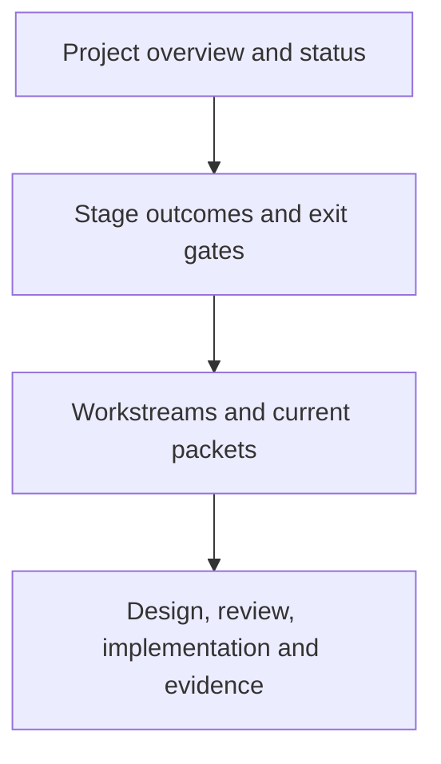

# PyJIT

We are rebuilding CPython around universal eight-byte PyValues, a register
interpreter, and a cohesive method and tracing JIT. Memory management uses
reference counting with cyclic collection. Extensions are rebuilt and ported.

**Current outcome:** the earlier interpreter runs, but the restored universal-value
runtime has not linked. There is no performance result for that runtime.
**Next milestone:** a qualified register-interpreter baseline, measured with JIT off.

Start with [current status](STATUS.md) for progress and blockers, or the
[stage map](ROADMAP.md) for the route to completion. A new coordinator should read
the [handoff](HANDOFF.md) before assigning or executing work.

| View | Question it answers |
| --- | --- |
| [Status](STATUS.md) | What works, what blocks us, and what happens next? |
| [Roadmap](ROADMAP.md) | What must each stage deliver? |
| [Architecture](design/runtime-architecture.md) | How do values, IR, interpreter, memory and JIT fit together? |
| [Process](PROCESS.md) and [gates](design/validation.md) | How do we admit a change? |
| [Standing direction](GOAL.md) | Which decisions must survive a handoff? |
| [Experiment index](issues/README.md) and [log](WORKLOG.md) | Where is the detailed evidence? |
| [Documentation ownership](DOCUMENTATION.md) | Which page should an agent update? |

The `pyjit/` directory owns project documentation, benchmarks and local gate
tools. CPython implementation stays in its usual source directories. Build
trees, historical artifacts, existing branches and ABI identifiers retain their
recorded names; see the handoff before reusing an older script.
