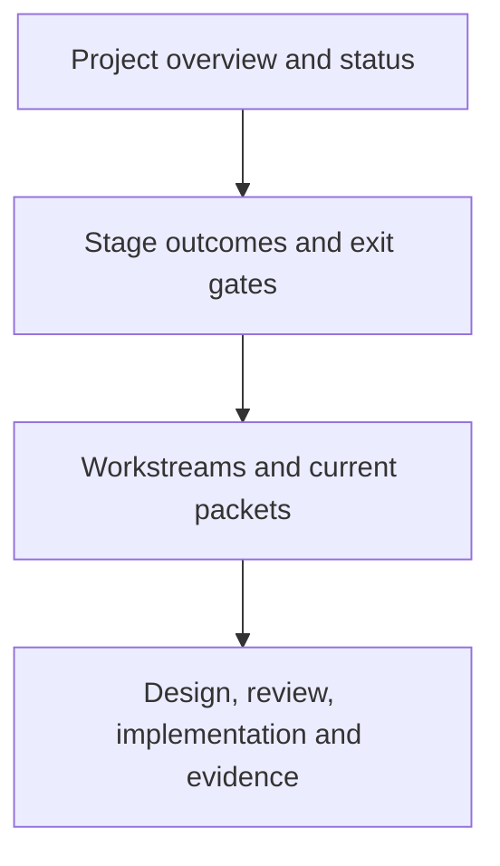

# PyJIT

We are rebuilding CPython around universal eight-byte PyValues, a register
interpreter, and a cohesive method and tracing JIT. Memory management uses
reference counting with cyclic collection. Extensions are rebuilt and ported.

**Current outcome:** the candidate is based on runtime commit `1ab005e79b8`,
with constructor/dispatch, float-formatting, descriptor and native-child-
accounting changes under full-v2 qualification. All three builds,
regeneration, lint, ABI and frozen-main checks passed. The release suite ran
54,347 tests and has three failures (two AST, one opcache); `test_tools` also
changed `sys.path`. Debug also ran 54,347 tests with the same three failures
and environment change. Thirteen native identity probes pass, including
negative cases. Private stats probes still find boxes in
specialized initialization, cold lookup, float formatting/f-strings and long
formatting. R27 and functional qualification remain open; there is no current
performance measurement.
**Next milestone:** close ownership/accounting debt, qualify one clean runtime,
then measure it against matched upstream and interim controls with the JIT off.

Start with [current status](STATUS.md) for progress and blockers, or the
[stage map](ROADMAP.md) for the route to completion. A new coordinator should read
the [handoff](HANDOFF.md) before assigning or executing work.

| View | Question it answers |
| --- | --- |
| [Status](STATUS.md) | What works, what blocks us, and what happens next? |
| [Roadmap](ROADMAP.md) | What must each stage deliver? |
| [Architecture](design/runtime-architecture.md) | How do values, IR, interpreter, memory and JIT fit together? |
| [PyValue](design/pyvalue.md), [native boundary](design/native-boundary.md), [register IR](design/register-ir.md), [value API](design/value-api.md) | What are the canonical specs for the value, the C boundary, the IR and the value-native API? Read them after the architecture page. |
| [Process](PROCESS.md) and [gates](design/validation.md) | How do we admit a change? |
| [Standing direction](GOAL.md) | Which decisions must survive a handoff? |
| [Experiment index](issues/README.md) and [log](WORKLOG.md) | Where is the detailed evidence? |
| [Documentation ownership](DOCUMENTATION.md) | Which page should an agent update? |

The `pyjit/` directory owns project documentation, benchmarks and local gate
tools. CPython implementation stays in its usual source directories. Build
trees, historical artifacts, existing branches and ABI identifiers retain their
recorded names; see the handoff before reusing an older script.
