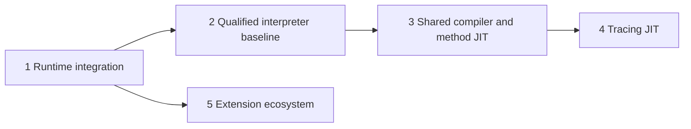

# Stage map

Stages describe outcomes and gates, not percentages or an inflexible waterfall.
The baseline extension profile is part of runtime integration; wider extension
migration can proceed alongside later compiler work.

| Stage | Deliverable | Exit evidence |
| --- | --- | --- |
| [1. Runtime](stages/01-runtime/README.md) | One coherent canonical-value runtime under RC | Qualified at `0267d428808`; selected interpreter batch kept after performance admission |
| [2. Baseline](stages/02-baseline/README.md) | A trustworthy register-interpreter starting point | Baseline qualification complete; parity remains open (broad screen 1.2412× upstream) |
| [3. Method JIT](stages/03-method-jit/README.md) | Cohesive method compilation through shared optimizing IR | Whole-method/native transitions, recovery, ownership and measured workloads validated |
| [4. Tracing](stages/04-tracing-jit/README.md) | Hot-path compilation using the same compiler core | Trace guards, exits, recovery and interactions with method code validated and measured |
| [5. Extensions](stages/05-extensions/README.md) | Practical incremental source ports and opaque interfaces | Declared extensions rebuild and pass their behavior/lifetime tests against the selected API |

Within a stage, workstreams may proceed in parallel when ownership is disjoint.
Each workstream links its current experiment and states the next gate. An agent
working on one packet does not change stage status to complete; the coordinator
does that after validating the composition and its exit evidence.

Keep progress labels distinct: designed, independently reviewed, implemented,
tested, committed, integrated, qualified and measured. A successful component
compile closes only that component gate. The current states live in
[STATUS](STATUS.md); selected subsystem contracts live in [design](design/runtime-architecture.md).
