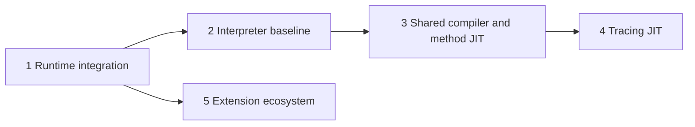

# Stage map

Stages describe outcomes and gates, not percentages or an inflexible waterfall.
The baseline extension profile is part of runtime integration; wider extension
migration can proceed alongside compiler work. [Status](STATUS.md) records
current qualification, measurements and limitations.

| Stage | Deliverable | Exit evidence |
| --- | --- | --- |
| [1. Runtime](stages/01-runtime/README.md) | Canonical-value runtime under RC | Integrated runtime passes behavior and ownership gates |
| [2. Baseline](stages/02-baseline/README.md) | Trustworthy register interpreter | Qualified behavior and measured performance, with limits recorded |
| [3. Method JIT](stages/03-method-jit/README.md) | Method compilation through shared optimizing IR | Native transitions, recovery, ownership and workloads validated |
| [4. Tracing](stages/04-tracing-jit/README.md) | Hot-path compilation using the same compiler core | Guards, exits, recovery and method-code interactions validated |
| [5. Extensions](stages/05-extensions/README.md) | Incremental source ports and opaque interfaces | Declared extensions rebuild and pass behavior and lifetime tests |

Workstreams can proceed in parallel when ownership is disjoint. The coordinator
validates composition and stage exit evidence. The [active plan](issues/interpreter-performance56/plan.md)
describes the reviewed target and migration; [designs](design/runtime-architecture.md) describe contracts.
