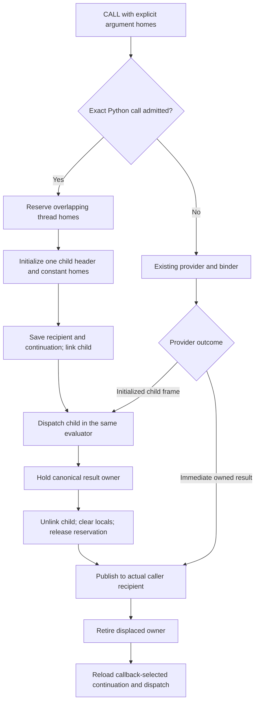
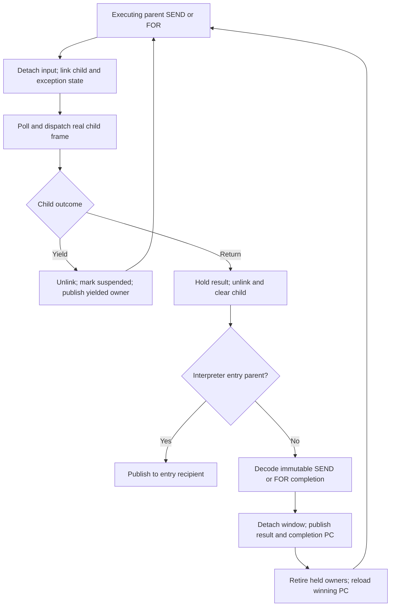

# Activation transfers

Selected runtime: golden54 `61015a9452d9069646fb5fede9ff963896833b89`.
This document describes its call, construction and resume boundaries. The
[frame ABI](call-and-frame-lifetimes.md), [register IR](register-ir.md) and
[interpreter](interpreter.md) define storage, encoding and observation in detail.
Round53's [report](../issues/activation53/report.md) and
[review](../issues/activation53/astra-review.md) record rejected alternatives;
none changes this selected contract. Golden54 adds only the public C-constructor
repair below. The [active performance plan](../issues/interpreter-performance56/plan.md)
reviews successor contracts separately from implemented behavior.

The [combined performance proposal](proposals/interpreter-performance56.md)
and [critical audit](../issues/interpreter-performance56/review.md) describe
reviewed successor work; they do not upgrade the selected implementation.

## Ordinary calls and returns

An activation owns its function, independently pinned executing code, named
locals and live temporary homes. Thread frames use an initialized arena frontier.
An exact call from a thread frame overlaps its argument homes with the child's
binding prefix. It reserves once and initializes one header; it does not copy
those arguments or acquire another owner for each. Heap callers need a move into
thread storage. Hidden constants are initialized once at construction, never at
resume. Source positions do not authorize execution or transfer.



The result remains owned across callback-capable child cleanup. Returning a
temporary moves its owner; returning a named local currently duplicates it before
frame retirement, since an exposed frame can retain that local. Ordinary return
publishes inline. It does not enter the generator-completion adapter or normalize
an already canonical result through the generic value bridge.

The caller's instruction cursor records the executed call while its separate
return PC records future control. A finalizer may expose the caller, install
hooks or select another continuation. Publish consistent ownership/control state
before callback-capable closes, then reload the winning PC. Never overwrite a
callback-selected redirect with a saved cursor. Observation reconstructs source
events from this semantic state.

## Generative construction

The selected path constructs a temporary thread frame using the existing binder
and initializer. Any creation prefix executes normally. RETURN_GENERATOR allocates
the generator/coroutine object, moves the header and every physical home, NULLs
source homes and releases the thread reservation. The object retains its own
executing code and function owners. Initial resume uses the actual successor and
the explicit incoming recipient.

```mermaid
flowchart TD
    provider[IR call or native vector provider] --> bind[Bind inputs into thread frame]
    bind --> prefix[Execute creation prefix if present]
    prefix --> constructor[RETURN_GENERATOR]
    constructor --> allocate[Allocate generator or coroutine]
    allocate --> move[Move header and physical homes; clear source homes]
    move --> seal[Seal CREATED heap frame; release thread reservation]
    seal --> return[Return canonical generator or coroutine owner]
```

Cell/closure setup and generator-expression iterator acquisition can precede
construction. Code flags alone cannot authorize skipping them. Async-generator
hooks, origin tracking, allocation errors, observers and alternate evaluators
retain their established behavior. Allocation occurs once at creation, not on
each resume.

The physical-home move is broader than upstream's live-stack copy. Its source
NULL stores maintain the arena's initialized-frontier invariant; deleting them
requires a replacement lifetime proof. Constants also move with the frame.

Public `PyGen_New`, `PyCoro_New` and `PyAsyncGen_New` construction from an
existing frame bypasses ordinary RETURN_GENERATOR. This cold ingress explicitly
installs the initial discard recipient, acquires the frame-object association
owner, and completes subtype state before publishing that association and
GC-tracking the object. Fallible coroutine-origin construction precedes the
ownership move. Failure frees the untracked allocation and consumes the stolen
input frame reference. The subtype wrappers return the common constructor
directly. These repairs do not redirect normal Python creation through this
public helper or change the ordinary call/resume ABI.

## Resume, suspension and completion

Exact SEND/FOR admission already dispatches the child within the same evaluator.
It publishes the child input, frame/exception links and recursion state, then
polls and dispatches. Initial non-None send and running/finished state have their
own semantic checks. Real parent frames remain visible while their children run.

Yield reverses those links, marks suspension and transfers a canonical owner to
the parent's declared recipient. Completion first retires the child while
holding its result. For a normal parent, the generator-return adapter decodes
the pinned immutable SEND/FOR word and performs the corresponding canonical
transaction. An interpreter-owned entry parent instead receives the result
directly through its recipient. Source lines and columns are not execution
authority.



SEND completion may overlap an input home. FOR exhaustion retains the last item
binding. Observed PRE/POST callbacks, failures and supported observer redirects
retain the existing semantic transaction. Ordinary and interpreter-entry
recipient paths handle their pending redirects.
No persistent chain cache, completion descriptor or extra continuation-kind
store is installed on every resume.

## Evidence and limits

The selected header occupies 14 eight-byte words on the measured configuration,
versus upstream's 10. Extra execution-image and recipient state, canonical-value
classification and full physical-home construction/clear remain costs. Overlap
and the initialized frontier save work upstream still performs. Source store
counts and flat samples alone cannot establish their net elapsed-time cost.

Round53 tested direct final-home construction across IR/native calls, a shared
completion terminal, and a narrower native-only constructor. All removed the
intended native work and passed focused semantic checks, but all failed measured
breadth. Native-only construction improved generators while repeatedly losing
on DeltaBlue and Richards. These implementations remain experimental branches,
not hidden selected behavior. See the [benchmark tables](../issues/activation53/benchmark-tables.md)
and [next plan](../issues/activation53/next-steps.md).
