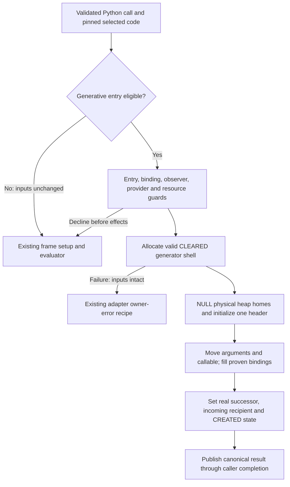
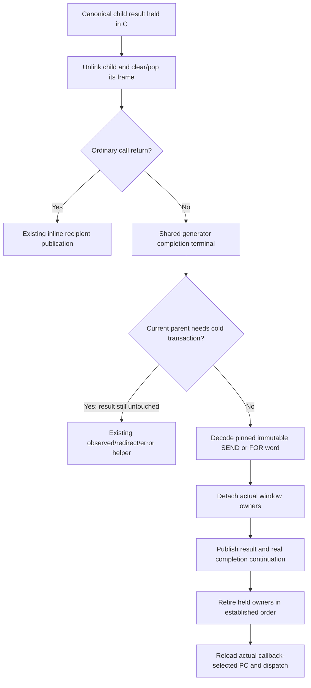

# Final-home activation and canonical completion experiments

Reviewed experiment, not selected runtime behavior. Golden51 remains selected.
The [active plan](../issues/activation53/plan.md),
[thesis](../issues/activation53/thesis.md),
[Astra review](../issues/activation53/astra-review.md) and
[phase evidence](../issues/activation53/phase-evidence.md) own decisions and
measurement. The selected [frame ABI](call-and-frame-lifetimes.md) and
[IR contract](register-ir.md) remain the baseline.

## Problem and bounded decision

Ordinary exact calls already initialize once in overlapping thread homes and
return canonical owners inline. Generative construction first builds a thread
frame, then allocates its object and moves the header and every physical home.
Completion crosses a C adapter/status boundary to recover SEND/FOR semantics.
The experiments remove those specific costs. They do not claim that calls alone
explain the full upstream gap.

Astra corrected the thesis to two independent lanes: direct construction only
when **physical word zero is RETURN_GENERATOR**, and a shared canonical
completion terminal after child cleanup. Arbitrary-prefix construction, stored
continuation-kind/descriptor state and terminal-local owner moves are excluded.
The full [review resolution](../issues/activation53/review-resolution.md) records
why. Existing resume already dispatches within one evaluator; no new descent
loop is needed to remove hypothetical evaluator recursion.

## Direct final-home construction

The shared constructor accepts explicit executing code and already validated
binding facts. It returns MISS before effects, ERROR with original input owners
intact, or a canonical owned result after transfer. Exact IR, validated known
positional plans and eligible native vector boundaries use this same storage
and owner implementation. The frame-returning generic API remains unchanged;
its unsupported calls retain the current path.

Eligibility requires matching immutable and executable word-zero authority and
its validated incoming recipient. It skips no helper, closure/cell setup,
GET_ITER/GET_AITER, RESUME or instrumented word. Unprepared code, unsupported
bindings, PEP523, observers, coroutine origins and unsupported concurrency retain
ordinary construction. Existing recursion and capacity admission stay in force.
Native vector coverage is restricted to eligible exact positional bindings;
keyword/default/general binding coverage must be stated per adapter, not assumed.

The GIL GC allocator links the object and schedules collection; this bounded
allocation does not call Python. Keep allocation, initialization and transfer in
one audited nonescaping segment, with no poll or callback-capable release.
Code is independently pinned before allocation and determines type and slot
size. Function.__code__ is never reselected afterward. A shell is GC/deallocation
valid in CLEARED state before commit; every physical home is NULL before it can
be treated as an owning frame. Allocation failure moves no inputs. No fallible
operation is allowed after the first input move until seal.

After seal, previous is NULL, owner is GENERATOR, the state is CREATED, instr_ptr
is the actual successor and return_slot is the initial send recipient. The
object has one result owner. No transient child-current-frame, recursion or
exception link is manufactured to imitate the skipped incomplete frame. Actual
resume uses the established entry transaction. A precommit failure cannot close
a CREATED coroutine and generate a false unawaited warning.

The IR adapter needs an explicit checked terminal branch before thread
reservation. Allocation/error behavior cannot hide inside the old pure
initialization uop. Success ends CALL using its existing recipient, continuation,
redirect and displaced-owner rules; it cannot fall into frame push. Native
adapters publish to their existing object/value return ABI and retire their
owned scratch arrays exactly once. Ordinary calls pay at most the reviewed
eligibility branch; extra guards/allocation stay in the generative arm.

The removed work is the transient reservation/header/pop, full frame move and
source NULL loop, plus creation dispatch. Native vector creation can also avoid
its creation-only C evaluator entry. Heap allocation, final NULL initialization,
argument moves, final owners and defaults/constants remain real costs.

## Shared completion terminal

Eligibility is established after child cleanup: a finalizer can change hooks,
expose the parent or redirect it. The shared terminal removes the C adapter
call/prologue/status-return sequence on admitted completions. It retains
immutable operand decoding, window detachment, receiver destruction, recipient
publication and continuation reload. Ordinary return keeps its short branch.
No return-kind store, descriptor, chain cache or work on every resume is added.

SEND may overlap any detached input home. FOR exhaustion preserves the loop's
last item binding. Commit actual continuation and owner phase before closes;
callback-selected redirects, including same-PC intent, retain authority.
Observed PRE/POST and error attribution remain on the existing cold transaction.
A hook installed after commit affects subsequent execution, not retroactive
completion events. Source attribution is never execution authority.

Use one shared terminal or one implementation at the return join, not a full
transaction body in every return variant. Its internal value transport and
owner contract must be explicit in the implementation proposal. Sharing source
with the cold commit/retirement path should prevent ownership drift. Backend
terminal code remains a trusted compiler boundary unless actual meaningful
post-emission checks prove a narrower claim.

## Qualification and admission

Each lane follows proposal, independent peer review, implementation, focused
release/debug tests, source/native post-review and coordinator integration.
Exercise admitted and rejected creation entries, genexpr/closure prefixes,
mutable code, constants/bindings, origins/warnings, hooks/PEP523, recursion,
allocation failure, pre-first-send throw/close, GC and escaped frames. Completion
adds nested SEND/FOR, discard/local/overlap, far exits, cleanup-installed hooks,
PRE/POST failures and redirects.

Record actual constructor/completion hits in separate diagnostic runs; Python
monitoring start/yield counts alone do not prove fast-path coverage. Inspect
native ordinary CALL as well as the optimized paths. Screen lanes separately
against actual golden51, then worthwhile composition; confirm target results,
run all29 and compare directly with upstream. Full diagnostics follow a candidate
worth promotion. Reject paths that merely move work, add enough common cost to
lose breadth, or fail to remove the targeted native boundary.
