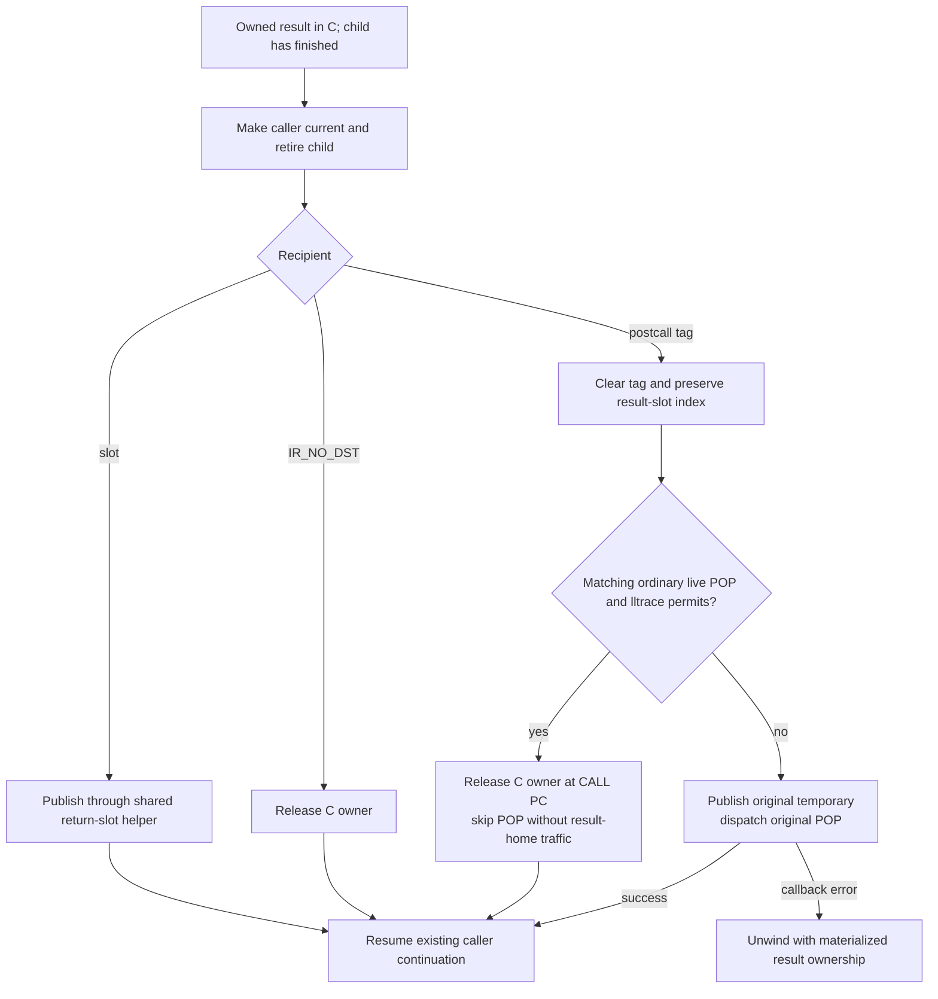

# Calls, frame homes and observation

The active runtime is
`build/worktrees/execution-boundaries-20261108`, integrated commit `4b3d739d867`,
containing the operand, boolean-boundary and ignored-result completion changes.
Release and debug each passed 54,421 full-suite tests; debug passed on retry
after an unexplained profiling failure, retained in the
[investigation](../issues/execution-boundaries-20261108/profiling-investigation.md).
Performance promotion is withheld after repeated broad regressions; see the
[candidate report](../issues/execution-boundaries-20261108/report.md). The immutable golden
`0765e9be47f` and its functional qualification `0267d428808` remain the baseline;
see the [checkpoint report](../bench/results/interpreter-parity-20261108.md).

This page records the current ownership/observation contract and its retained
implementation history. Release points are a selected runtime policy, not a
Python language requirement for immediate finalization. See
[language and lifetime policy](lifetimes-and-language-semantics.md),
[register IR](register-ir.md), [interpreter](interpreter.md), and
[observer contract](handler-and-observer-contract.md).

## Current execution-boundary increment

The merged runtime keeps canonical NOP and POP words and their coordinates.
POP_TOP names a register owner to retire; its inherited name does not imply a
runtime operand stack.
One shape-reader alias fixes its local-receiver/temporary-result ownership mode;
three bool edge aliases skip admitted NOP execution; two Python-call aliases
complete ignored results without an intermediate home on the ordinary path.
Generated formats, effects and family mappings remain inherited. Debug and
free-threaded builds decline the new bool variants; free-threaded builds also
decline discarded-call selection. No borrowed frame-home policy, general owner
map or native JIT recovery protocol is added.

The shape alias's receiver remains owned by the local. Canonical result
duplication is unchanged; its temporary publication is unconditional, and there
is no receiver owner or displaced local to retire. Other shape modes preserve
the R4/R5 ordered-retirement protocol below.

For bool edges, generated `SAVES_IP` facts exclude successors such as END_FOR
and IR_JUMP that intentionally leave the prior PC in place. Selection checks
canonical/live targets once. The successful bool interval cannot run
Python, poll or suspend, so a constant edge continuation can omit NOP decode
and PC publication. Instrumentation invalidates these dependencies before
patching an anchor. The unrefined `POP_JUMP_IF_FALSE_BOOL` handler keeps its old checked-NOP
continuation.

For ignored results, `CALL_PY_EXACT_ARGS_DISCARD` and
`CALL_PY_GENERAL_DISCARD` require a matching immediate canonical POP, a temporary
destination and the same known source line. Generator/coroutine callers and
callees, bound-method/keyword/EX handler variants and native completion are
outside this selection. The physical call handler has canonical specialization,
feedback and observer mappings; it is not serialized into canonical code.

`IR_POSTCALL_DISCARD` uses a high bit in the existing caller `return_slot`, keeping
the original slot index for fallback. Exact entry installs the tag at its
existing recipient save after unchanged guards/preparation. General entry
carries a nonowning constant flag while keeping the destination numeric through
preparation. It tags only a successful Python-child commit. The consuming
provider pins an explicit code object and initializes the child with that same
code, so commit-time synchronous flags describe the actual child even if a
callback mutates function.__code__. Native fallback ignores the tag request and
uses ordinary publication/input retirement. No after-effect call replay is added.

On return, the owned result stays in C while the child is unlinked and retired.
The caller is current and its destination has not changed. Completion then
publishes ordinary recipients, closes IR_NO_DST results, or decodes a tagged
recipient. A live matching ordinary POP and permitted lltrace allow direct
closure at CALL PC and continuation past the dormant POP. This path does not
publish, load or clear a caller result home. Wrapped/instrumented/declined POPs
receive the result in their original temporary before dispatch, preserving
observer state and error cleanup. Child-cleanup finalizers can change which
path completion selects. POP line/opcode observation active before this guard
materializes the original POP path. Such observation enabled by the result
finalizer itself starts at
the next real instruction: disposal has already committed as CALL completion,
so the dormant POP is not observed retroactively.

CALL PC during direct disposal is an explicit implementation-coordinate choice;
raw f_lasti without an active POP line/opcode action can differ from the old
standalone POP while its source line and selected release order remain unchanged. It is not a language mandate
or general permission to change supported debugging behavior. A successful
f_lineno setter cancels a pending tag before changing the saved caller PC.
Cross-parent writes during a result finalizer do not establish a general jump
extension; the [documented f_lineno interface](https://docs.python.org/3/reference/datamodel.html#frame.f_lineno)
is restricted to the bottom-most frame. The active observation path materializes its result home. See the
[lifetime policy](lifetimes-and-language-semantics.md).

These changes eliminate bounded execution and slot traffic, not physical
anchor storage. Their new selection/completion checks and handler text require
net compiled/performance accounting. Neither the local operand screen nor the
combined candidate establishes a logging speedup. Combined performance
promotion is withheld after repeated broad regressions; see the
[report](../issues/execution-boundaries-20261108/report.md).

## Retained implementation history

The common positional-call transfer is integrated at `8a8fdc91368`, including
default filling, empty varargs and fresh empty kwargs. Its
[integration receipt](../issues/interpreter-throughput/integration-a.md)
records checks and limitations. The bounded overlap-initialization recipe
below is integrated at `ba37cc10058`; its checks and mixed screening results
are recorded in the
[B receipt](../issues/interpreter-throughput/integration-b.md).
The independent [call-path follow-up audit](../issues/interpreter-throughput/call-followup-audit.md)
records retained GCC structure and a possible future experiment. It is static
evidence, not a throughput result.

## Earlier integration batch: R1–R5

R1–R3 simplify call preparation while preserving caller ownership and
fallback semantics. R4 declares the shared success-path first-output
publication phase. R5 adds a checked canonical-source fact for one shape
result's first temporary flush. The batch retains the owning frame-home model;
it adds no native JIT recovery protocol. See the [R4 receipt](../issues/interpreter-architecture-20261107/integration-r4.md)
and [R5 receipt](../issues/interpreter-architecture-20261107/integration-r5.md)
for the implementation details, reviews and evidence. Current results establish
no broad speedup or upstream parity.

## Golden parity packet: P1/P2, M2b, M1 and P3

P1/P2 is integrated at `0539e0c1ff9`. `_PyFrame_CodeHome` accepts a typed
`PyCodeObject *` and returns a duplicated pointer borrow: mortal code gains a
reference, while immortal code retains its no-count tag. Both ordinary frame
initialization and unchecked trampoline initialization use this helper. The
generic object-to-value constructor keeps its scalar checks and reaches the
pointer-borrow tail only after those checks have established pointer form.
Successful refresh publishes the original PC and can return immediately;
failure still performs the later validation because error construction may
reenter. These ownership and refresh changes have focused release/debug checks,
but no performance claim. See the
[source review](../issues/interpreter-parity-20261108/p2-source-review.md) and
[post-review](../issues/interpreter-parity-20261108/p2-post-review.md).

M2b was integrated at `73c20472a9f`. Its retained fallback continuation executes
one checked live NOP inline, with original PC publication and the NOP word
retained; wrappers keep their handlers and debug lltrace declines. M1 is
integrated at `d93b83800a5`. Its owned exact-dict first-probe identity hit
begins with borrowed container/key inputs and uses shared ordered retirement.
A temporary owns the result before key/dict retirement; a folded local is
written afterward, following successful retirement and callback refresh. A
decline leaves the generic reader path and input state untouched. These changes do not alter the current register-word
layout. Regeneration removes affected entries from the unused legacy
optimizing expansion table, so a future optimizing frontend needs a suitable
lowering before using that table.

P3's private unbound `CALL_PY_GENERAL` guarded entry shares the call-record
initializer and existing overlap/consuming paths. The successful guarded entry
keeps its callable/provider proof only until potentially allocating kwargs
preparation; final callable, code, vectorcall, hook, defaults, stack-capacity
and argument-offset checks remain after allocation. Push/final post-allocation
guards remain in place, and the generic fallback still uses the generic
transaction runner. P3 is integrated at `10627c339fa`; the combined batch
passed release/debug correctness qualification at `0267d428808`. The batch is
kept after measured review, with the spectral regression accepted; upstream
parity remains open. See the [checkpoint report](../bench/results/interpreter-parity-20261108.md),
[M2b post-review](../issues/interpreter-parity-20261108/m2b-post-review-round2.md),
[M1 post-review](../issues/interpreter-parity-20261108/m1-post-review.md),
[implementation contract](../issues/interpreter-parity-20261108/implementation-contracts.md).

## R5 canonical-source publication

`attr = IR_CANONICAL_HOME_DUP(found)` records a narrow producer fact on the
existing frozen publication contract. The checker accepts the direct,
unconditional assignment with one simple identifier argument and its matching
retirement marker; existing assignment, output, and suffix checks still
apply. The generator does not prove the C pointer provenance of `found`. The
shape-home writer audit establishes that premise, while the intrinsic's fatal
debug assertion checks `_PyValue_IsHome(found)` before duplication.

The internal `_PyObject_StoreInstanceValue` boundary now states and asserts
that its borrowed input is a canonical home value or NULL. In-tree object and
generic setter adapters canonicalize object inputs; specialized shape stores
transfer canonical frame-home owners. This writer chain is a manual source
proof supported by the fatal assertion, not a static pointer-provenance
checker. Rebuilt external callers of the internal API must satisfy the
explicit precondition.

Only the checked result's first temporary flush uses a direct canonical
store. It preserves the temporary NULL/same-value assertion and debug home
check. Folded locals still use `_PyValue_Publish` on final publication after
receiver retirement, so callbacks can mutate the local and success replaces
the current home. Error exits, result cleanup, refresh, companion outputs,
and other producers retain their previous paths. The R5 change does not add
frame state, error root maps, recovery protocols, or a method/tracing backend;
native JIT recovery remains future work. The bounded design and proposal
history are in the
[canonical-output proposal](../issues/interpreter-architecture-20261107/canonical-output-boundary-proposal.md)
and [RHS refinement](../issues/interpreter-architecture-20261107/canonical-output-rhs-review.md).

## R4 first-output publication phase

`IR_RETIRE_PUBLISHED_RESULT(attr, receiver)` declares one success-path fact
for the five specialized attribute producers. The generated
`_PyIRFormat.result_phase` is either
`_PyIR_RESULT_PHASE_NONE` or
`_PyIR_RESULT_PHASE_DST_TEMP_CANONICAL_BEFORE_RETIRE`. The latter describes
only the first output and only its temporary-home case: publication occurs
before the receiver is released. It is not a general root map, failure
protocol, effect summary, or proof that the full handler cannot run Python.

For a folded local, the old home remains owning until receiver retirement
begins; the new result remains owned by C and is installed only after
successful refresh. A finalizer or callback may mutate public locals during
retirement. If retirement/refresh fails, the handler does not install its new
result and preserves callback mutations; the helper closes the C-owned result.
On successful completion, the final store replaces the current home and retires
its actual displaced owner. For a temporary destination, the published home
owns the result; the unwinder handles it after an error. The final-store
omission applies only to the already-published temporary output.

Generic `IR_COMPLETE_ATTR_READER` has the same first-output phase through the
checked completion helper. `value_reader_complete()` and
`value_attribute_complete()` publish/store that result before closing the
receiver and refreshing state. Generic lookup may call Python before entering
that helper, so the phase does not claim publication before lookup or whole-
handler purity. The method form also publishes a second result, which this
phase intentionally does not describe. The checker accepts only its validated
producer sequence and effect-free, disjoint suffix; it rejects conditional or
ambiguous result assignments, reassignment, result escape, suffix overlap,
frame access, and releases before any later uop.

## What a home means

The frame has one `PyValue` array. Locals, cells, free variables and hidden
constant homes precede transfer temporaries. A home contains NULL, an inline
value, an immortal, or its owning object reference. A mortal borrow is a C-local
view supported by an owner; it is not a second owner in a frame slot.

This is the current owning-home contract, not a requirement of eight-byte
values. Pinned upstream can carry a borrowed argument into a synchronous
child frame, preserve overwritten caller locals and promote on frame escape.
The [source comparison](../issues/interpreter-parity-20261108/borrow-frame-followup.md)
and [next-packet proposal](../issues/interpreter-parity-20261108/borrowed-frame-views-proposal.md)
review that alternative. No borrowed mortal frame slot is supported by the
current candidate; changing it requires updating GC edge accounting, copies,
retirement, observations and native transfers together.

Three distinct questions must remain separate:

| Fact | Meaning | Current representation |
| --- | --- | --- |
| Initialized/valid | Reading the bits is safe | Every physical slot contains a valid value or NULL |
| Owns a value | Someone must retain/release this value | Slot contents and the value tag; a NULL slot owns nothing |
| Future-read live | A later operation reads this value before replacement | Compiler temporary-register liveness, discarded after compaction |

A value can own a reference without a future read, including values below a
non-exiting loop. `regcfg.c:789` and the verifier at `1274` preserve that case.
Locals remain observable through frame locals even after their last program
read. Consequently, exporting future-read liveness alone cannot justify
skipping initialization, tracing roots, copying homes, or releasing owners.

The compactor tracks occupied slots until consumption (`compact_op`, around
`regcfg.c:898`), allocates later held temporaries above earlier ones, and
maintains contiguous call windows. Exception edges preserve canonical homes
below the handler's boundary; unwinding releases higher homes in reverse order.
GC visits all physical slots (`gc.c:483`), and frame copying moves all of them
(`pycore_interpframe.h:224`). Those consumers require the NULL invariant today.

## Existing frame stack and ordinary cleanup

Thread stack chunks already contain opposing frame-header and value stacks.
`base` names the homes and `saved_top` restores the value frontier on pop.
Generators and detached frame objects own separate arrays. Exact positional
calls already overlap a thread caller's argument window with the child's
initial locals; they do not allocate a second argument array.

Exact positional calls and the common positional-call transfer use the
thread-stack overlap path through `pycore_interpframe.h:_PyFrame_PushOverlapping`.
Generator-owned callers use the existing non-overlap transfer branch. The
common path fills defaults and installs empty varargs and fresh empty kwargs
as needed; its checks and limitations are in the A receipt.

**Normal thread cleanup is already locals-only.** At `frame.c:185`,
`_PyFrame_ClearExceptCode` asserts temporaries are NULL, then clears only
`co_nlocalsplus`. Exception unwind clears temporaries separately; generators
and detached/exposed-frame paths need their existing full handling. Earlier
throughput notes describing all frame retirement as a full-slot scan were too
broad. Do not implement that optimization a second time.

## Call ownership protocol

The generic binder currently consumes copies while the actual caller window
remains owning (`ceval.c:3054`). Allocation, keyword comparison, error creation,
monitoring and reference release may reenter. Offering original window owners
to this consuming binder would leave observable stale owners or require rollback
after arbitrary partial consumption. This duplication is a consequence of the
provider contract; it is not evidence that frames lack a stack.

The exact path bypasses the generic transaction runner; the common positional
transaction performs allocating preparation. Both retain the ownership
discipline of prepare/guard/commit below.
Instrumented, free-threaded, keyword/EX and generator-owned callers retain
their existing provider paths. The common overlap path also declines when the
executable or sufficient stack space is unavailable. The protocol is:

1. Prepare while the actual caller homes remain owning. Pin code and any
   resource needed across allocation. Allocate a fresh empty `**kwargs` dict
   when required; the empty `*args` tuple may be the immortal singleton.
   Complete monitoring/preparation exactly once using the existing transaction.
2. Refresh after the last possible escape. Reread callable, code identity,
   standard vectorcall, defaults, entry policy and stack capacity. A declined
   shape releases prepared resources and refreshes before fallback. A failure
   remains an error; a callback already performed must not be replayed.
3. Commit with no allocation, release that can run code, instrumentation,
   deoptimization or other failure between first ownership detachment and a
   clearable, published child. Frame/header initialization and owning duplicates
   must have a transitive non-escaping proof. Use the pinned code, or prove the
   helper's fresh `func_code` read equals it at this point.
4. Publish the child's current-frame link and caller return destination before
   any remaining release. Keep the existing child-not-started failure cleanup,
   recursion/RESUME, monitor and exception protocols. No fallback after commit.

| Input/resource | Before commit | After overlapping commit |
| --- | --- | --- |
| Callable window owner | Caller window | Child `f_funcobj`; old window cell NULL |
| Receiver and supplied arguments | Caller contiguous window | Same physical cells, now child argument locals |
| Missing positional defaults | Defaults tuple owns source values | Child owns duplicates in missing local homes |
| Empty varargs | Immortal singleton | Child's varargs local |
| Prepared fresh kwargs dict | Owning C local | Child's kwargs local, C owner cleared |
| Other caller-window cells | Caller owners or NULL | Retired exactly once or left NULL under the reviewed mapping |

Do not blanket-clear an overlapping window: argument cells are now child
homes. Borrowed locals are not legal array inputs for this call window.
Ordinary CALL provenance is verified by `regcfg.c:1172` and `1440`.
Instrumented calls retain the existing provider, preserving its monitor-once
behavior. CALL_KW and CALL_FUNCTION_EX remain outside the overlap path.

## Bounded initialization recipe: reuse the known-NULL overlap

Integration B applies this bounded recipe using an existing ownership
invariant, not a future-read map. Let `B` be the child base, `A` its supplied argument
count, `E = B + child_nslots`, and
`P = previous->base + previous_nslots`. The initial child argument owners are
`[B, B+A)`. The caller's non-argument homes in `[B+A, min(E,P))` are already
NULL under the existing overlapping-call contract. Only `[max(B+A,P), E)`
needs new NULL stores, when that interval is nonempty.

The proof obligations are precise:

- Both frames use the same thread value stack/chunk; previous owns thread
  storage, and `B` lies in its temporary call window, above its local/constant
  homes. Supplied arguments fit inside the existing window and child locals.
- Occupancy/stack ordering puts every other caller-held owner below the call
  window, including dead-but-owned temporaries. The existing overlap helper
  already relies on higher homes being NULL; the future-live verifier check
  alone is not the whole proof.
- Capture caller extent before child fields or stack frontiers change. There
  is no escaping call between the final guard and using the known-NULL range.
- Zero any newly exposed tail before the child can be observed. Skip the
  transferred arguments. Fill hidden child constants normally afterward,
  including mortal constants installed by `code.replace`. Then install
  prepared defaults/empty varargs/kwargs for the common-call route.
- Preserve `saved_top` and parent ownership boundaries. Do not reuse this
  argument for generator storage, stack growth into another chunk, ordinary
  non-overlap entry, or arbitrary free stack memory containing stale headers.

The implementation is confined to overlap initialization: it computes the
already-valid prefix, initializes the remaining tail, and retains normal
constant filling. The helper accepts the proven prefix boundary; debug
assertions verify every skipped non-argument cell is NULL. It does not treat an
argument count as evidence that uninitialized memory is valid. No code-object
layout or per-op bitmap is needed.

Tests cover smaller/equal/larger child extents, defaults and constants, receiver/no
receiver, nested calls, mortal values/finalizers, exception unwind, exposed
frames and the generator fallback. The common positional commit uses exactly
the same window proof. The A and B landings were integrated separately;
preserve that measurement history when interpreting their receipts. An
independent static audit notes a possible slow-path outlining experiment, but
does not establish dynamic frequency or a speedup.
The initialization change has unproven throughput benefit: its extra bounds
calculation may outweigh a short saved clear. The current contract is a local
known-NULL reuse rule, not a general liveness optimization.

## Observation, effects and later metadata

One generated operation contract should describe operand homes/roles,
consume/publish/release points, exceptional edges, may-escape effects and frame
switch/suspension. Expand the existing metadata rather than adding a second
hand-maintained opcode table. A word-level `RUNS_CODE` flag is conservative;
it does not by itself prove a particular helper or phase is non-escaping.
Releasing a mortal owner and overwriting a local can escape even when an
arithmetic or lookup body cannot.

At an observation point, initialized homes, PC, current frame, executable
identity and exception state must describe the actual phase. An opaque callback
invalidates cached frame/executable/home assumptions as its contract requires.
Tracing/debugger locals, generator suspension, frame detachment and invalidation
must use the same home contract. An instruction PC alone is not enough to
describe intermediate consume/publish phases or C-local owners.

Do not add runtime liveness metadata to solve the overlap-NULL case. If future
measurements justify dropping the all-slots-valid invariant, define one
ownership-validity map, with instruction phases and all observers updated in
one reviewed packet. Future-read sets can help derive it but cannot replace it.
Typed optimizing SSA, hardware allocation and deoptimization snapshots remain
the JIT's separate representation; they recover this interpreter state at
exits instead of forcing SSA machinery into the baseline dispatch loop.
