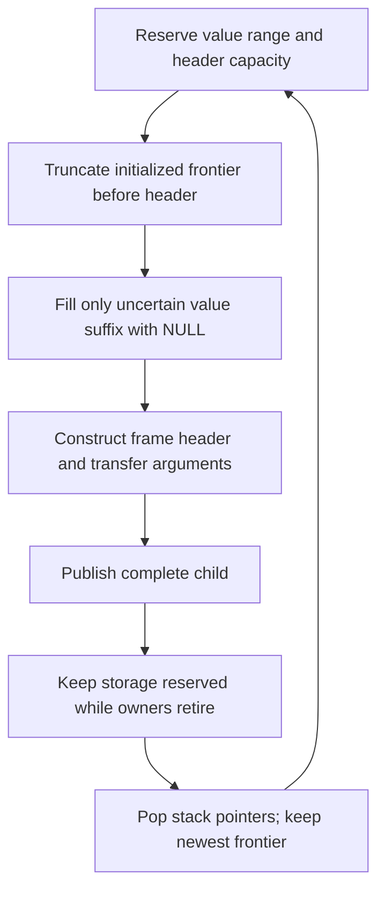

# Calls, frame homes and observation

This page defines frame ownership, call completion and observation in the
selected runtime. [Status](../STATUS.md) records qualification and limits.
The [active performance plan](../issues/interpreter-performance56/plan.md)
reviews the next value, ownership and call architecture; it does not change
this as-built ABI.

Frame ownership defines retention and cleanup responsibility. It does not
require a separate register-release instruction or make immediate finalization
a Python language rule. The selected RC runtime still needs bounded owning
storage and valid reentry phases. See [language/lifetime policy](lifetimes-and-language-semantics.md),
[register IR](register-ir.md) and the [observer contract](handler-and-observer-contract.md).

## One owning-frame ABI

A frame owns its executing code and function separately, plus bindings and
transfer temporaries in canonical PyValue homes. Code is a distinct lifetime
anchor because function.__code__ is mutable. Globals/builtins views, caller link,
base, storage checkpoint and real executable continuation complete the frame.
A borrowed mortal C view requires an owner; no ordinary borrowed frame-home bank
has been introduced.

### Fixed header and variable storage

The measured GIL header is 112 bytes, excluding owning homes. It is a record
on the thread arena's downward-growing header stack, not a separate allocation
for each ordinary call. Its fields serve these roles:

| State | Fixed representation and reason |
| --- | --- |
| Lifetime authority | Independent owning executing-code and function values; function.__code__ is mutable |
| Storage authority | Previous frame, home base, saved value-stack top and storage owner; overlap means base alone cannot restore the old top |
| Execution authority | Current semantic instruction, executing word base, result continuation and recipient; current and future PCs have different meanings |
| Hot derived caches | Globals, builtins and feedback bases; reconstructing these on use adds dependent loads |
| Dynamic bindings | Nullable owning locals mapping and pending-empty-kwargs index; NULL alone cannot distinguish a virtual binding from an unbound local |
| Observation | Nullable owning frame object and redirect/debug metadata; observer publication shares the same semantic frame |

Owning homes have variable capacity determined by code locals and scratch.
Thread headers and homes occupy opposing stacks in a shared chunk. Heap
generators/coroutines and escaped frame objects instead embed the header and a
variable home tail. Frame objects are optional for ordinary optimized calls;
class/module/exec locals mappings can be required by execution itself.

Round54 measured removing the feedback cache, the two environment caches and
the direct mapping owner, separately and together. The composed header really
shrinks to 80 bytes, but extra loads, mapping-record allocation and retirement
work lose elapsed performance. Those removals are rejected, not an alternate
selected ABI. See the [field census](../issues/frame-state54/field-inventory.md)
and [experiment report](../issues/frame-state54/report.md). A future header
change must account for the frequency of all readers, not just its setup size.

| Fact | Meaning | Representation |
| --- | --- | --- |
| Initialized | Bits can be safely inspected | Canonical PyValue or NULL throughout physical value storage |
| Owning | A counted edge must remain or be retired | Home contents and tag; NULL owns nothing |
| Future-read live | A later operation needs the current value | Compiler dataflow, distinct from owner occupancy |
| Pending empty kwargs | No Python object has been exposed yet | One compiler-proven local index, otherwise IR_NO_DST |

Locals remain observable even after their last program read. Dead-but-owned
temporaries can also survive until semantic consumption. The compiler's owner
occupancy constrains compaction and overlapping windows; future-read liveness
alone does not authorize dropping a GC edge or reading uninitialized memory.
GC traversal and frame copies inspect the physical homes. Unwind retires the
appropriate suffix and preserves handler-required anchors. Normal thread clear
is already local-only after asserting scratch owners NULL; generator/exposed
paths have their corresponding complete ownership handling.

NULL remains the empty-home authority. There is no parallel occupancy bitmap.
A bitmap replacing NULL would have to govern every physical-home read, move,
overlap, local mutation, callback, traversal, unwind, copy and suspension.
Static root maps at admitted GC stops do not establish RC ownership between
stops. A proved instruction refinement may omit an intermediate store within a
non-reentrant commit, but does not authorize persistent stale homes. Round54's
validated overwrite experiment demonstrates that proof boundary; it is not
selected after its performance evaluation.

## Initialized storage frontier

Thread chunks contain opposing value/header stacks. Each chunk has one
initialized frontier: below it, inactive value cells are NULL; live frame homes
have canonical values. The common reservation helper establishes capacity and
valid cells before a header is written. It truncates the frontier before a new
header overwrites value-capable storage, initializes only a newly exposed suffix,
then constructs the header and commits stack pointers without callbacks. Exact
calls select the final base and saved top, reserve once, and initialize one
header. Cold helpers fill an uncertain frontier suffix and transfer arguments
from a non-thread caller; neither allocates, releases owners or calls Python.

Fresh chunks start with frontier=data and do not assume a zeroing allocator.
Cached chunks retain their proved frontier. A nested finalizer can change it;
outer pop never restores an obsolete saved frontier. A departing frame remains
reserved through all decrefs, even after unlinking, and leaves reusable cells
NULL before pop. This covers ordinary/exceptional entry, overlap, recursion
failure and generator construction, through a common storage reservation
contract. Heap frames initialize once at actual construction; full ownership
copies write every destination home and clear every moved source.

## Known Python binding and generic providers

The caller owns argument evaluation and its contiguous call window until
non-reentrant commit. Exact Python calls transfer those owners directly.
A versioned `_PyFbCall` binding plan lets CALL_PY_GENERAL use the inline
`call_bind_known_python` primitive for supported positional shapes. Function
version/provider guards establish the plan; it checks supplied count, executable
and capacity, fills missing defaults, and installs empty variadic bindings.
Overlong defaults that cannot fit plan scalars decline the plan rather than
truncate. Defaults are duplicated from canonical tuple homes.
When positional defaults are needed, the hit also checks the current tuple's
count and required-argument coverage and confirms that its computed offset
matches the cached `default_start` before effects. A function created from the
same code can share its version while carrying a different default count;
that shape change must miss before the cached offset is used. Calls supplying
every positional parameter need no defaults-offset check. This guard is
implemented and its new native regression passes on release and debug.

CALL_KW_PY uses the same primitive for one to three fixed keywords, independently
of function arity. A union reuses the positional plan's six-byte payload for
three `uint16_t` parameter destinations; flags record keyword count and self
presence. The cache stores no names, tuple owners or argument values. Supported
shapes include positional prefixes, permutations, positional default holes and
keyword-only parameters when all are explicitly supplied. Variadics, omitted
keyword-only defaults, bound-method wrappers and unsupported frame/provider
shapes retain the generic path.

Release builds keep `_PyFrame_PushOverlapping` and `_PyFrame_Initialize`
visible to their optimized callers using the existing `Py_ALWAYS_INLINE`
policy. This preserves one reservation/initialization implementation as binding
plans grow. The compiler may still outline conditional constant-slot filling;
the policy does not promise an entirely call-free constructor. Compiled stack,
code-size and application effects must be reviewed with source changes.

Before effects, the keyword hit checks function/code version, standard provider,
executable and capacity, cached self/count shape, an exact keyword tuple and exact
Unicode entries. Each current name must be identical to the guarded code's name
at its cached destination. Destination bounds, positional-only exclusion,
positional-prefix exclusion and distinctness are checked before transfer. Equal
but nonidentical names use the generic provider's language equality handling.
Functions created from the same code can share a version while carrying different
defaults, so the binder also checks current default count and required-slot
coverage. Missing positional homes receive duplicates from those current
defaults. Explicitly supplied keyword-only values need no kwdefaults lookup or
dictionary-mutation guard.

The keyword transfer first moves its bounded suffix into at most three C-local
owners and NULLs their source homes and the detached names home. The unchanged
positional prefix then becomes the overlapping child's prefix. Saved owners
move into their cached destinations, missing defaults fill their homes, and the
parent's return recipient and continuation are published before the child
becomes current. Only then is the detached exact-string tuple closed. No
callback, fallible step or miss is allowed inside this transfer. It uses the
existing owning-frame ABI and cleanup rules without a per-frame binding flag.

| Resource | Before overlap commit | After commit |
| --- | --- | --- |
| Callable | Caller window owner | Child function owner; old cell NULL |
| Receiver and positional arguments | Caller window owners | Same physical cells owned as child bindings |
| Fixed keywords | Caller window owners | Child locals, moved through bounded C-local owners |
| Missing defaults | Defaults tuple owns sources | Child owns canonical duplicates |
| Empty varargs | Immortal singleton | Child's argument local |
| Empty kwargs | Prepared dict or virtual binding | Owning local or pending local index |
| Executable code | Function and explicit pin/guard | Child has its own code owner |

The child is fully clearable/current before any remaining callback-capable
retirement. Caller argument homes must not be blanket-cleared after overlap:
they have become child bindings. Other owners stay outside that transferred
window under the compiler's physical occupancy proof.

A pre-effect known-plan miss enters the existing out-of-line transaction of
the same call kind. Unsupported keyword shapes, EX, nonstandard providers,
instrumentation and unsupported owner/storage
shapes retain their complete handling. Generic preparation pins resources while
caller homes remain owning, performs monitoring once, and refreshes after
callbacks or fallible preparation. Its consuming binder can use copies when
required by that provider's ownership contract. No callback is replayed after
a miss, and no fallback begins after child commit. Errors retire the published
owner state. This is one ABI with guarded fast binding, not two frame models.

## Generator entry

Generator and coroutine creation moves the frame into its owning object. The
copy preserves all homes, including live scratch: generator-expression GET_ITER
can run before RETURN_GENERATOR and retain scratch ownership. The code owner
and all transferred values remain valid through the move.

## Deferred empty kwargs

For a statically eligible immutable kwargs binding, a frame records a pending
empty dict local while that physical cell remains NULL. It is not an unbound
Python variable. The compiler inserts MATERIALIZE_KWARGS before its first read,
including reads that register folding would otherwise absorb. Initial eligibility
excludes rebinding, clearing, deletion and capture hazards. Structural code
replacement must retain or re-establish the barrier proof; a public flag alone
cannot authorize reading a pending NULL home.

Frame-object publication materializes the binding before locals/debugger access,
including observation of an ancestor from child callbacks. The materializer
creates a fresh dictionary and commits it to the canonical local; allocation
failure follows the existing error protocol. Generic/unsupported binding is
eager. Unrelated local reads and stores acquire no per-home pending-class test.

## Result destinations and canonical transfer

A caller records a plain return_slot (local, temporary or IR_NO_DST) and a native
return_pc pointing at a real executable continuation. The frame's code owner pins
that pointer. Hidden entry and the two-operation init shim use real continuations
as well, beginning at their real word-zero continuation.

RETURN_VALUE takes a canonical owner from a real home, holds it in C across
child unlink/retirement, then gives it to the caller's recipient. The generator
checks its unchanged provenance chain and fails closed to ordinary publication
if that chain changes. Ordinary CALL completion stays inline; generator return
uses the cold semantic completion adapter. Discard closes the held owner instead
of writing an unused register. Local replacement retires the current displaced
owner, including observer mutations. The saved recipient and continuation fully
describe normal return.

Window-to-local moves likewise transfer already canonical home bits instead of
repeating exact-number publication checks. Tuple/list unpack has a separately
proved canonical source path; generic value-slot/native providers retain
publication unless their producer contract proves it. These bounded producer
chains do not authorize blanket removal of normalization from raw results.

Pure local duplication uses the same canonical final store. The generator
requires the exact local-index read and owned duplicate, with no input owner,
callback, result mutation or named cache. This applies to LOAD_FAST and
LOAD_FAST_BORROW by source proof, independently of their names. It removes
redundant publication checks while retaining the duplicate owner and the shared
local/temporary/discard destination protocol.

Four float arithmetic producers also transfer their final constructor result
without normalizing it again. The generator checks the direct canonical
constructor assignment, its exact error path and the full non-reentrant input
retirement chain. Named cache bindings, preprocessing, changed result identity
or unsupported suffixes prevent the optimization. Local, temporary and discard
destinations share one final-store implementation; only the value expression
differs. This proof does not move publication across callbacks. A separate
bounded proof covers guarded integer ADD and SUB: it validates both inline
input guards, the scaled overflow test, the boxed overflow result and error
path, and unchanged input retirement. Both success arms produce canonical
owners. This does not whitelist boxing as canonical at arbitrary call sites or
cover other arithmetic producers.

## Semantic iteration, delegation and input resume

| Outcome | Retained homes | Defined recipient | Retired homes |
| --- | --- | --- | --- |
| FOR_ITER body | Iterator B and updated cursor B+1 | Item A, unless discarded | Previous scratch item ownership as consumed by its operation |
| FOR_ITER exhaustion | Last named loop item remains | No item definition | B/B+1 |
| SEND yield | Receiver B and cursor B+1 | Yielded value B+2 | Sent input owner |
| SEND completion | Outer retained anchors | Completed value A, unless discarded | B/B+1/B+2 |
| CLEANUP_THROW completion | Outer retained anchors | Shared delegation result A | Its four-input window |

Frontend END_FOR/END_SEND stack shapes can remain compiler input, but covered
semantic operations encode their actual successor and recipient directly.
Standalone shared-owner/branch cleanup remains an unfinished separate category;
no claim is made that all POP_TOP/POP_ITER execution has disappeared.

The shared owning helper has explicit PRE/POST failure status. PRE observes
original receiver/window state; POST observes the committed outcome. Windows
are detached before their owners close, outputs and the real continuation are
published, and later supported redirects are preserved. Required outer exception
anchors survive. The encoded constructor proof checks actual handler reads,
nullable roles, fresh physical definitions and exceptional source callbacks;
implicit semantically unread RERAISE anchors can be NULL without discarding
saved locals that an enclosing handler restores.

Declared terminal branch observers publish their actual outputs before a
callback. FOR body publication writes the item at B+2 or moves it to a folded
local; an OR_POP drop writes an explicit NULL. Consumed inputs and displaced
local owners stay in C until the callback decision, then retire with the
callback exception preserved. The generated edge fact and constructor check
physical outputs separately from unavailable old input owners.

A yielded outgoing owner and the next incoming send recipient are different
roles. For IR_NO_DST input, VM SEND first detaches its source transfer cell,
commits the resumed child's frame/exception/recursion links, then closes the
held input owner. A last-owner finalizer therefore sees a valid running frame.
Native entry duplicates/transfers according to its provider contract and reaches
the same recipient protocol. Delegated suspension keeps the real receiver/home
relationship needed by yield-from inspection.

## Reentry, debugger redirects and observers

All callback phases publish a coherent current frame, compact PC, code owner,
valid homes and exception state. A C-local held result remains an explicit owner
while detached windows are NULL. A decline preserves its inputs; a committed
operation cannot replay a provider after effects.

The cold debugger recipe validates incoming owners/NULL requirements before
changing state. Bounded PRE and certified owner-neutral committed JUMP
transfers share a stopped-state view and restore saved named-local bindings
from surviving per-local LOAD_FAST_AND_CLEAR token chains, including a genuinely
unbound NULL. The committed view borrows the actual site's unchanged rows only
after checking the generated positive zero-IO contract, selected successor,
scoped generation and committed return PC. New committed cancellation needs
inherited handled context and an empty target scratch requirement; other
targets retain their prior strict proof. A target that reads such a local before
a guaranteed binding definition needs an actual unbound check or is refused.
An admitted ignored-result caller redirect while its VM child is active records
a pending target without touching the overlapping child-owned
window. Completion clears the flag, publishes the selected continuation and
retires surplus caller scratch only after child retirement. Exceptional child
retirement cancels the request, including one requested during cleanup. Broader
protected/suspended recipes remain work under review. A bounded backward replay
within a FOR body preserves its current iterator/cursor pair only after proving
all-path body-phase availability, target dominance and a cut-free path to the
current site. A matching static producer or non-NULL pair alone does not prove
dynamic identity. Nullable operands require a separate current-NULL proof; every
aliased read of the physical home must accept NULL.

The setter detaches all surplus owners before committing the target and closing
the detached values. Closing callbacks may redirect again; the outer setter
makes no later frame writes. Successful commits increment a cold frame-object
generation, including when the selected physical PC is unchanged. Observer
transactions use that generation alongside the PC before restoring cursors,
cached continuations or an old source-error recipe. Public line getters and
lazy frame-object creation do not express redirect intent. Warning reproof
captures scoped authority again before validating the Plan; it cannot upgrade
a deliberately unauthorized source-only target.

Other positively certified committed edges bind a request-owned copy of the
exact site's context, save-column and origin rows. The selected normal transfer
and shared old-owner cuts establish the stopped state; a replacement value or
NULL cannot revive a consumed origin. This path excludes token creation and
requires inherited context, empty stopped and target save columns, and no
incoming target scratch owner. It neither restores saved locals nor borrows a
PRE survivor proof or source-only target fallback. Warning reproof recaptures
the scope and rebuilds the view. PRE and neutral-JUMP support remain unchanged.

Source-only events use immutable edge metadata and a frame-object display cursor.
Scoped observer records bind a callback to its frame, site, edge, phase and
redirect generation. They prevent an unsupported hook from borrowing another
callback's authority. The setter uses bounded PRE plans, exact real LINE
identity and certified committed edge views. A Python tracing LINE can be a
legacy monitoring-JUMP callback; its public name does not select a PRE phase.
SOURCE_POST and yield-ready setter authority remain unimplemented.
Pending source errors belong to the evaluator activation, so nested finalizer
entry cannot replace the outer handler recipe even when no frame object could
be allocated. Cold LINE handoff has its own landing/previous-line/epoch fields;
public f_lineno remains display/cache state. Reconfiguration, redirects, error
selection and frame clearing invalidate that continuation state before callbacks.

## Canonical source and reader publication

`attr = IR_CANONICAL_HOME_DUP(found)` records a narrow producer fact on the
existing frozen publication contract. The checker accepts the direct,
unconditional assignment with one simple identifier argument and its matching
retirement marker; existing assignment, output, and suffix checks still
apply. The generator does not prove the C pointer provenance of `found`. The
shape-home writer audit establishes that premise, while the intrinsic's fatal
debug assertion checks `_PyValue_IsHome(found)` before duplication.

The internal `_PyObject_StoreInstanceValue` boundary now states and asserts
that its borrowed input is a canonical home value or NULL. In-tree object and
generic setter adapters canonicalize object inputs; specialized shape stores
transfer canonical frame-home owners. This writer chain is a manual source
proof supported by the fatal assertion, not a static pointer-provenance
checker. Rebuilt external callers of the internal API must satisfy the
explicit precondition.

Only the checked result's first temporary flush uses a direct canonical
store. It preserves the temporary NULL/same-value assertion and debug home
check. Folded locals still use `_PyValue_Publish` on final publication after
receiver retirement, so callbacks can mutate the local and success replaces
the current home. Error exits, result cleanup, refresh, companion outputs,
and other producers retain their previous paths. Native JIT recovery remains
future work.

## First-output publication phase

`IR_RETIRE_PUBLISHED_RESULT(attr, receiver)` declares one success-path fact
for the five specialized attribute producers. The generated
`_PyIRFormat.result_phase` is either
`_PyIR_RESULT_PHASE_NONE` or
`_PyIR_RESULT_PHASE_DST_TEMP_CANONICAL_BEFORE_RETIRE`. The latter describes
only the first output and only its temporary-home case: publication occurs
before the receiver is released. It is not a general root map, failure
protocol, effect summary, or proof that the full handler cannot run Python.

For a folded local, the old home remains owning until receiver retirement
begins; the new result remains owned by C and is installed only after
successful refresh. A finalizer or callback may mutate public locals during
retirement. If retirement/refresh fails, the handler does not install its new
result and preserves callback mutations; the helper closes the C-owned result.
On successful completion, the final store replaces the current home and retires
its actual displaced owner. For a temporary destination, the published home
owns the result; the unwinder handles it after an error. The final-store
omission applies only to the already-published temporary output.

Generic `IR_COMPLETE_ATTR_READER` has the same first-output phase through the
checked completion helper. `value_reader_complete()` and
`value_attribute_complete()` publish/store that result before closing the
receiver and refreshing state. Generic lookup may call Python before entering
that helper, so the phase does not claim publication before lookup or whole-
handler purity. The method form also publishes a second result, which this
phase intentionally does not describe. The checker accepts only its validated
producer sequence and effect-free, disjoint suffix; it rejects conditional or
ambiguous result assignments, reassignment, result escape, suffix overlap,
frame access, and releases before any later uop.

## Native JIT boundary

Machine registers, typed SSA, OSR and native deoptimization snapshots belong to
the future method/tracing tiers. They must recover this interpreter's owning
frame state rather than introduce a competing baseline ownership convention.
