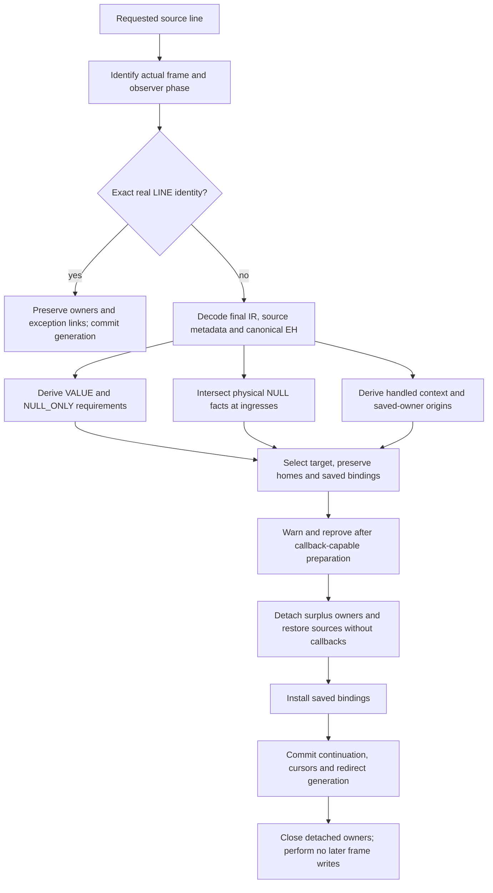

# Debugger entry and frame transfers

This describes the contract integrated at `4d666e1b482`. Full diagnostics report
the remaining transfer capabilities and tooling limits. See [status](../STATUS.md), the
[frame ABI](call-and-frame-lifetimes.md), [observer contract](handler-and-observer-contract.md)
and [repair evidence](../issues/frame-call-model-20261109/qualification-repairs.md).

Debugger requests are cold transactions over actual register frames. Python
does not require CPython's reference-release timing. Conversely, a requested
source position alone cannot create an iterator, restore a shadowed local or
select a handled exception. Such semantic state needs an explicit transfer plan.
Current implementation restrictions are admission limits, not Python language
prohibitions.

## Entry is an observer transaction

Private `sys._debugger_entry(frame, callback)` requires a complete strict active
ancestor of the current Python frame. The current frame is executing the native
entry call and may have C-held arguments; it cannot authorize its own ordinary
instruction-boundary recipe. Inactive frames are rejected before the callback.

The helper captures the real child, saves the existing observer frame/event and
suppresses recursive tracing. It invokes the value-native callback with a
private event discriminator outside the monitoring event domain. It restores
observer/tracing state on success or error. The helper itself does not change
frame owners, continuations or redirect generation; its callback may request a
separately proved redirect. Displaying a caller is separate from
proving a jump into it.

Bdb separates trace preparation from entry. It installs frame hooks before
calling the private transaction, activates tracing inside the suppressed
dispatch, and performs error/quit cleanup there. Its entry hook can reuse a
subclass's interaction hook without emitting an instruction event. Nested
`enterframe` scopes restore their previous value in `finally`. Doctest applies
its output redirection to entry as well as ordinary trace dispatch. Async Pdb
prepares its shim before interaction, enters explicitly on each interaction and
clears async state on all exits; await runs outside the suppressed transaction.

## One analysis and application path

`RegisterResumeAnalysis` owns request-local metadata. It uses the same raw EH
decoder and canonical validation as code construction: bounded marked varints,
sorted nonoverlapping ranges, real targets and valid unwind payload homes.
It indexes source records once and builds forward/reverse sparse edges for
normal flow, ordinary exceptions and source-callback errors. Reachability walks
use queues. Allocation products and analysis sizes are bounded before mutation.
No table is serialized, attached to a code object or consulted by dispatch.

Physical requirements use shared read/definition/nullable/outcome contracts.
Ordinary exception requirements come from the pre-success state and are joined
after normal definition kills. Source-callback errors use the actual normal
post-operation outcome. Exception/lasti writes also invalidate whole-code NULL
facts. Immutable constant homes are already available. A nullable operand cannot
authorize an aliased nonnullable reader.

For eligible ordinary PRE requests, a forward must-NULL matrix intersects
reachable ingress facts, including the initial-entry predecessor on a backedge.
The shared physical query reads COPY/SWAP sources simultaneously, certifies
STORE_FAST, completed-FOR and audited successful vector-CALL clearing. Named
scratch retirement clears its input and preserves other homes. It forgets
unsupported/error/child-tail facts. Constants are initialized values rather than NULL. Backward VALUE and
NULL_ONLY demands use the same graph, all-alias input checks and actual reader;
a NULL clear discharges only NULL_ONLY. The strict projection retains the old
ALL requirements and unions both new lanes. Facts are not owner identities.

A bounded NULL-only Plan requires inherited context, fresh real-LINE PRE, empty
current/target saved bindings, zero VALUE demands, ALL contained in NULL_ONLY,
and each needed home both proved and physically NULL at the stopped PC. It
preserves no missing owner. Warning reproof rebuilds the matrices and Plan.
The optional matrices have a checked aggregate cold-analysis budget, stricter
for large requests than the prior single lane. No matrix lives on a frame or
code object or runs during dispatch.

Handled context is derived separately. INHERITED can contain a caller's handled
exception. PUSH_EXC_INFO creates a caught node with its actual saved-previous
owner; matching POP_EXCEPT restores its parent. COPY and SWAP transport value
origins without inventing another dynamic generation. Conflicting ingress is
ambiguous. Ordinary and source-error edges participate in this analysis.

Saved named-local bindings have a separate column per actual LOCAL_MOVE index.
LOAD_FAST_AND_CLEAR creates a token for the saved binding, including genuine
NULL, with a parent from that same local's active chain. COPY duplicates origins
and SWAP transports them. A matching STORE_FAST restores only the youngest save
of its destination local. Different locals may restore in either order; normal
and error paths need not use the same order. Losing every known token home keeps
the obligation active. Ambiguous joins, lost origins and repeated active producers
cannot establish an empty column. Request allocation products are checked before
mutation. These facts come from actual words, not trusted compiler annotations.

`RegisterResumePlan` carries a preserve-home bitmap and saved-local restoration
actions. Its single application path detaches surplus scratch and displaced
local owners, installs bindings, commits state, then closes detached owners.
An actual restored NULL binding is admitted only when each read before a
guaranteed binding definition uses an unbound-binding check. A physical
nullable input is not such a check: NULL can mean deletion or absent optional
self in a handler ABI.
Warning callbacks can redirect the frame: generation detects that intent and
cancels the outer request. Otherwise non-OTHER scoped authority is captured
again before the full plan is reproved. A source-only target deliberately
selected without cancellation authority cannot gain it during reproof.
Closing callbacks never encounter subsequent writes from the old transaction.

A certified nonneutral committed edge binds a copied exact-site context,
save-column and origin row. The selected normal transfer applies once, then
shared old-owner cuts remove consumed origins even if the same home contains a
replacement value or NULL. Token-creating transfers are excluded before this
step because they update analysis parent tables. This request-owned row is not
the global meet at the landing. Warning reproof rebuilds the row from a fresh
scope and analysis.

## Current supported plans

| Phase or state | Current proof and behavior |
| --- | --- |
| Real LINE identity | Requested resolved line equals the actual current LINE wrapper's line; exact observed frame; no source/error, pending-child or suspended phase. Preserve current PC, all owners and exception links; commit generation. Earlier words sharing that line do not restart the expression or scope. |
| Cancellable PRE operation | A centralized phase factory proves the actual real LINE before its handler. Current expression inputs may be detached when the target needs none; proven saved named locals may be restored from per-local chains. Handled context and independently proved roots must survive. Source-only targets do not acquire this permission. |
| NULL-only PRE | Ordinary nonsuspending optimized entry, inherited context, empty saved columns, no VALUE requirement, and pathwise plus actual NULL for every NULL_ONLY input. Strict requirements remain included; no owner is invented. |
| Neutral committed JUMP | A generated positive terminal fact, zero physical IO, non-owning roles and exact selected successor prove the actual site's rows survive unchanged. Scope frame/event/generation, site PC and committed return PC must match. New cancellation/restoration requires inherited context, a save-empty target and no target scratch inputs. |
| Other certified committed edge | Exact scope, generated publication fact, physical geometry and selected normal successor prove a copied post-edge row. Cancellation requires inherited context, empty stopped and target save columns, and no incoming target scratch owner. It does not use a PRE survivor slice, restore saved bindings or select a source-only destination. |
| INHERITED context | Existing physical incoming-owner/NULL proof. Bounded FOR-body replay still requires an empty exception table. Ordinary protected try need not create a caught context. |
| Same CAUGHT context | Backward replay preserves actual saved-previous owners and every parent using its dominance/survival proof. Forward real-PRE transfer additionally requires empty saved columns and a normal-edge-only current-to-target slice. Both exclude preserved-root reads, replacement, pop, child overlap and reentry. Active exception links remain untouched. |
| Pending ignored Python call | Caller changes its continuation only; overlapping child owners remain intact until successful child completion. Used-result, external and protected child cases still need their own plans. |
| Other contexts/phases | Refuse before mutation until their owner and semantic actions are proved. |

Saved-previous owners must be actual None-or-exception values with surviving
origins. Equal producer PCs do not establish equal dynamic generations. A
same-caught transfer preserves both the target's exception and a callback-owned
exception. It does not implement caught exit.

## Remaining model work

The shared stopped-state view distinguishes disposable expression inputs from
saved-local obligations. PRE and certified neutral committed JUMP retain their
existing restoration and strict survivor proofs. Other certified committed
edges use the same Plan with the bounded copied post-edge row; consumed inputs
cannot be recovered through a PRE slice or source-only fallback. Public
callback names do not choose the stopped phase. Displaced owners retire after
the whole frame is valid.
Retained outer-with/loop roots need their own availability proof. Source POST,
protected source-only destinations, yield-before-suspension and an actually
suspended frame remain distinct phases with different owner contracts.

Declared terminal providers now commit FOR body and OR_POP outputs before their
callbacks. The constructor checks the generated per-edge physical mapping and
old-owner cuts. A fresh value at an old input's home does not restore its
provenance. This fact does not itself authorize setter SOURCE_POST. That transfer
needs a stopped-state proof of the provider edge, owner lineage and target
context; yield and suspended-frame transfers remain separate.

Caught exit needs the target's actual exception-restoration link. A Python
callback may hold the target's previous context in its own saved-previous cell;
assigning `tstate->exc_info` directly can overwrite the callback and later
restore the wrong target exception. Generator exception-state links add another
storage case. Resolve and prove the actual cell outside child overlap before
transferring an owner. Upstream's observed callback-clobbering behavior is not
the contract to reproduce.

The [active plan](../issues/frame-call-model-20261109/plan.md) owns these next
increments and their proposal, peer review, focused gates and integration.
