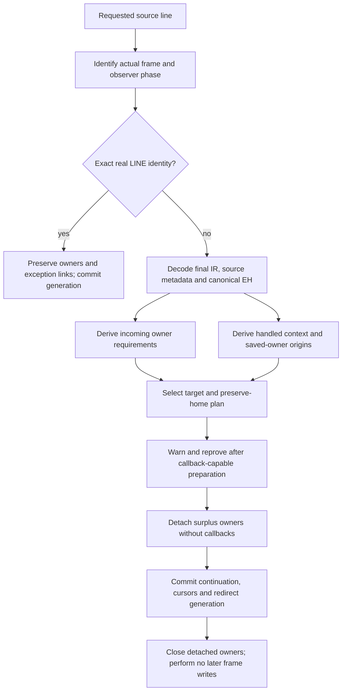

# Debugger entry and frame transfers

This describes engineering source `192cfbe8aa0` on
`pyjit/frame-call-model-20261109`. Focused checks pass; full qualification and
the broader transfer model remain open. See [status](../STATUS.md), the
[frame ABI](call-and-frame-lifetimes.md), [observer contract](handler-and-observer-contract.md)
and [repair evidence](../issues/frame-call-model-20261109/qualification-repairs.md).

Debugger requests are cold transactions over actual register frames. Python
does not require CPython's reference-release timing. Conversely, a requested
source position alone cannot create an iterator, restore a shadowed local or
select a handled exception. Such semantic state needs an explicit transfer plan.
Current implementation restrictions are admission limits, not Python language
prohibitions.

## Entry is an observer transaction

Private `sys._debugger_entry(frame, callback)` requires a complete strict active
ancestor of the current Python frame. The current frame is executing the native
entry call and may have C-held arguments; it cannot authorize its own ordinary
instruction-boundary recipe. Inactive frames are rejected before the callback.

The helper captures the real child, saves the existing observer frame/event and
suppresses recursive tracing. It invokes the value-native callback with a
private event discriminator outside the monitoring event domain. It restores
observer/tracing state on success or error. The helper itself does not change
frame owners, continuations or redirect generation; its callback may request a
separately proved redirect. Displaying a caller is separate from
proving a jump into it.

Bdb separates trace preparation from entry. It installs frame hooks before
calling the private transaction, activates tracing inside the suppressed
dispatch, and performs error/quit cleanup there. Its entry hook can reuse a
subclass's interaction hook without emitting an instruction event. Nested
`enterframe` scopes restore their previous value in `finally`. Doctest applies
its output redirection to entry as well as ordinary trace dispatch. Async Pdb
prepares its shim before interaction, enters explicitly on each interaction and
clears async state on all exits; await runs outside the suppressed transaction.

## One analysis and application path

`RegisterResumeAnalysis` owns request-local metadata. It uses the same raw EH
decoder and canonical validation as code construction: bounded marked varints,
sorted nonoverlapping ranges, real targets and valid unwind payload homes.
It indexes source records once and builds forward/reverse sparse edges for
normal flow, ordinary exceptions and source-callback errors. Reachability walks
use queues. Allocation products and analysis sizes are bounded before mutation.
No table is serialized, attached to a code object or consulted by dispatch.

Physical requirements use shared read/definition/nullable/outcome contracts.
Ordinary exception requirements come from the pre-success state and are joined
after normal definition kills. Source-callback errors use the actual normal
post-operation outcome. Exception/lasti writes also invalidate whole-code NULL
facts. Immutable constant homes are already available. A nullable operand cannot
authorize an aliased nonnullable reader.

Handled context is derived separately. INHERITED can contain a caller's handled
exception. PUSH_EXC_INFO creates a caught node with its actual saved-previous
owner; matching POP_EXCEPT restores its parent. COPY and SWAP transport value
origins without inventing another dynamic generation. Conflicting ingress is
ambiguous. Ordinary and source-error edges participate in this analysis.

`RegisterResumePlan` carries a preserve-home bitmap. Its single application path
detaches surplus scratch owners, commits state, then closes the detached owners.
Warning callbacks can redirect the frame: generation detects that intent and
cancels the outer request. Otherwise the plan is reproved against current state.
Closing callbacks never encounter subsequent writes from the old transaction.

## Current supported plans

| Phase or state | Current proof and behavior |
| --- | --- |
| Real LINE identity | First selected real target equals actual LINE wrapper; exact observed frame; no source/error, pending-child or suspended phase. Preserve all owners and exception links; commit generation. |
| INHERITED context | Existing physical incoming-owner/NULL proof. Bounded FOR-body replay still requires an empty exception table. Ordinary protected try need not create a caught context. |
| Same CAUGHT context | Backward replay preserves actual saved-previous owners and every parent; path/dominance proof excludes read, replacement, pop and reentry. Active exception links remain untouched. |
| Pending ignored Python call | Caller changes its continuation only; overlapping child owners remain intact until successful child completion. Used-result, external and protected child cases still need their own plans. |
| Other contexts/phases | Refuse before mutation until their owner and semantic actions are proved. |

Saved-previous owners must be actual None-or-exception values with surviving
origins. Equal producer PCs do not establish equal dynamic generations. A
same-caught transfer preserves both the target's exception and a callback-owned
exception. It does not implement caught exit.

## Remaining model work

Current incoming requirements still conservatively mix disposable expression
owners with protocol roots. A cancellable real LINE can often abandon an
expression and retire its owners if the target has no incoming requirements.
That does not authorize dropping a comprehension's saved outer-local value.
The next model must derive saved-local/with context and restoration actions,
then distinguish cancellation from preservation. It must also specify real
LINE, protected source-only destinations, source post-edge,
yield-before-suspension and already-suspended phases.

Caught exit needs the target's actual exception-restoration link. A Python
callback may hold the target's previous context in its own saved-previous cell;
assigning `tstate->exc_info` directly can overwrite the callback and later
restore the wrong target exception. Generator exception-state links add another
storage case. Resolve and prove the actual cell outside child overlap before
transferring an owner. Upstream's observed callback-clobbering behavior is not
the contract to reproduce.

The [active plan](../issues/frame-call-model-20261109/plan.md) owns these next
increments and their proposal, peer review, focused gates and integration.
