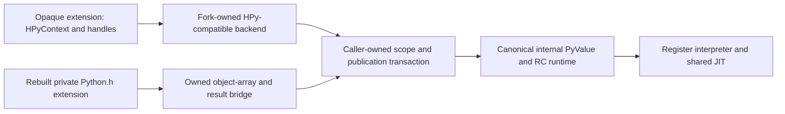

# Extension API

Canonical internal PyValue integration is complete in the RC runtime, including
rebuilt bundled extensions. Rebuilt `Python.h` source uses the fork's private
ABI and object bridges where needed. This does not establish compatibility
with arbitrary third-party extensions or old CPython binaries.

An opaque, HPy-compatible extension API remains the preferred public direction;
its backend is unimplemented. The proposal below must not be read as an existing
opaque backend or a prerequisite for completing the internal value runtime.
[Status](../STATUS.md) and the [current performance report](../issues/interpreter-performance56/report.md)
own runtime qualification and experiment results.

The [value API](value-api.md) makes `PyValue` the internal API and the
`PyObject *` API a compatibility layer of thunks over it. Rebuilt `Python.h`
extensions using object-form entry points pay for boxing when an inline value
must become a `PyObject *`; value-native entry points can retain PyValues.
The opaque HPy-compatible API on this page is the future public value
API. The value API fixes its conventions (borrowed arguments, owned results,
Dup and Close, NULL on error) so that a handle can be a `PyValue` word, as a
`JSValueRef` is a `JSValue` in JavaScriptCore on 64-bit platforms.

The user explicitly authorizes rebuilding and porting all extensions. Use
judgment to make migration possible and incremental; preserving old source or
binary compatibility is not an acceptance gate. Provide owned, fallible bridges
for ordinary ports, identify required source changes, and migrate affected core
and bundled callers. Do not retain an unsafe API or a second core representation
solely to avoid a compatibility break.

Reuse HPy's context API, declaration machinery and suitable tooling rather than publishing PyValue's representation or designing another complete public C API. HPy's current repository says it is no longer actively maintained, so adoption would require a maintained fork and a verified source pin. HPy 0.9.0 (`f6114734b4a5d03cfb9d24d3e8c71f77e8803881`) is the proposed evaluation baseline, not an installed or verified dependency. Its MIT notices must accompany reused code. Its CPython backend's pointer/array casts cannot implement this runtime's value storage. [HPy repository](https://github.com/hpyproject/hpy), [release](https://github.com/hpyproject/hpy/releases/tag/0.9.0), [license](https://github.com/hpyproject/hpy/blob/master/LICENSE).

The public handle is an opaque context-resolved reference, not PyValue bits or a borrowed scalar PyObject pointer. Follow HPy's ownership convention: inputs are borrowed, API results are owned, Dup adds an owner, Close releases it, and returning transfers one result owner. Fields and registered globals have separate persistent-reference contracts. V8's scope/escape conventions inform lifetime design; they introduce no V8 runtime or collector dependency. [HPy API](https://github.com/hpyproject/hpy/blob/master/docs/api.rst), [V8 embedding](https://v8.dev/docs/embed).

| Reference | Lifetime contract |
|---|---|
| Borrowed input handle | Caller owns its root through invocation; duplicate before retention |
| Owned local handle | Explicit close or result transfer; never put a local directly in a persistent field |
| HPyField | Owned extension payload, initialized and traversed; publish new owner before releasing old |
| HPyGlobal | Registered per-interpreter identity, retained until replacement/clear or interpreter teardown |
| Buffer lease | Exporter plus export record; pointer validity ends at release |
| Invocation object-array slot | Owns each boxed argument through caller result/error publication |
| Parser-local owner or buffer | Retain through last callee use and converter cleanup; may retire during coherent IN_CALL |
| Retired scalar result box | Held through actual caller-state publication, then released with cleanup status |

The backend must implement Field traversal/clear and Global isolation in the existing reference-counted runtime. There is no permanent scalar box cache, boxed core mode, or arbitrary lifetime extension. Extension-owned payload may be exposed through declared shapes; builtin container layouts remain private. [Fields](https://docs.hpyproject.org/en/latest/api-reference/hpy-field.html), [globals](https://docs.hpyproject.org/en/latest/api-reference/hpy-global.html), [type definitions](https://docs.hpyproject.org/en/latest/api-reference/hpy-type.html).

> **Superseded in part.** [native-boundary.md](native-boundary.md) replaces the
> explicit caller-owned scope and owner-scope rules in this section and the
> two that follow (through the parser-scope paragraph) with a per-thread borrow
> stack. Handwritten `PyArg_*` callers keep working unchanged.
> `PySequence_Fast_ITEMS` and `PySequence_Fast_GET_ITEM` are deleted. Read that
> design first; this text is kept until it is rewritten.

A call transaction publishes coherent IN_CALL state before any preparation can
allocate or call out: the call-site PC, numeric operand/destination offsets and
owning evaluated homes are valid. Method expansion, monitoring and expanded-call
iteration belong to this transaction. Refresh frame, execution words, feedback
and window after every preparation callback on success and error. Once an effect
can have occurred, never replay conversion, monitoring or the native body.

Preparation may replace a bound method with function/self homes or an iterable
with a tuple. Pin the original inputs before callbacks. Publish the final owning
homes nonallocatingly while retaining displaced originals; only then may obsolete
preparation locals retire. Refresh after that cleanup. A cleanup error prevents
invocation and follows real error publication. Drain preparation locals before
Python frame transfer; no pointer to a C-local record escapes inlined dispatch.

Every native invocation uses the same explicit caller-owned scope. The producer
supplies a stable owning final input window using pure `_PyValue_OwnArray`
promotion. Scope capture duplicates roots and stops depending on that window.
NOARGS/O uses bounded storage; variable arrays may allocate only while original
owning homes stay stable. A mutable container's raw array does not satisfy this
contract. There is no unbounded alloca or implicit TLS owner engine.

Two ownership roles share this transaction. Final invocation inputs and their
boxed views, the displaced destination and any staged scalar result box remain
owned through actual caller result/error publication. Callee-local parser boxes,
selected keyword owners, buffers and native locals remain owned through last use
and converter cleanup; they may retire while IN_CALL stays coherent. Ordinary
native bodies already release their local objects and reenter before returning.
This local rule does not permit early retirement of caller invocation inputs.

The native sequence is capture → box/parse → invoke → stage → publish → cleanup.
Stage consumes the owned object result with pure PrepareOwned and retains its
retired scalar box. Publish cannot allocate, release owners or fail: retain the
displaced destination, move the new canonical value, then publish actual frame,
PC and live-home state. Only afterward drain invocation inputs, displaced owner
and retired result box. Cleanup failure leaves the transferred result in its
published home for normal error handling. Abort leaves the destination unchanged,
publishes the error state and drains a staged owner once. Callee-local cleanup
must retain any implementation result until it finishes, preserve the primary
or first new error, and never return an object with an exception pending. An
absent C self/metadata uses an absence sentinel, never a language argument.

Parser scopes first pin an immutable canonical tuple and record its count.
Shared parser initialization/count/shape/error selection precedes allocating or
boxing accepted positional values. Reserve keyword owner slots before lookup;
retain selected owning GetItemRef results before exposing parser borrows. A
materialized object view remains stable through implementation/converter cleanup
and ends with its explicit callee-local scope. No canonical-array pointer cast
implements an object-array API. The first production constructor slice and exact
producer/caller boundaries are in the [reviewed design](../issues/pyvalue-rc-restoration/native-parsers/design.md).

This bridge can preserve many ordinary parser-based method bodies: generate one stable owned PyObject argument array and let parser outputs borrow from it through implementation and cleanup. Current getargs already has array parser entry points. Nested converters and keyword lookup results need the same owner context; raw value-array casts are invalid. Native-handle wrappers can parse handles directly and avoid boxing. Change Clinic producers and regenerate their products together. [HPy argument parsing](https://docs.hpyproject.org/en/latest/api-reference/argument-parsing.html).

Cleanup is a reentry boundary even on success. The VM caller must reuse the existing post-cleanup offset/epoch/frame revalidation and reload path before decoding the next handler or reusing cached frame/IR/feedback pointers. Publication before cleanup does not make stale pointers valid afterward.

The small-edit claim has limits. Borrowed scalar container getters cannot acquire container-length lifetime from a call-local arena; use owned GetItemRef plus cleanup or a scoped borrow promoted before escape. Unchecked GET_ITEM macros, direct builtin fields, raw value pointer identity and refcount inspection require edits. Void construction setters need a proven pre-reserved retirement budget; arbitrary unbounded setter loops require a checked API or bounded source changes. Advanced legacy custom types remain private hybrid until ported to opaque payload/Field APIs.

HPy's hybrid mode supports incremental legacy methods/slots but produces an interpreter-specific binary. Rebuilt bridge modules therefore carry the fork's private ABI identity. Do not advertise portable hpy0 loading before the context/slot protocol is implemented and tested. A loader can check declarations, not infer every indirect API call in a native body: initial private fixtures declare capabilities, and every exposed table slot must have defined callable behavior. [ABI modes](https://docs.hpyproject.org/en/latest/overview.html).

| Stage | Concrete implementation hypothesis |
|---|---|
| 1 | Shared scope/result engine and one real NOARGS/O Python→native→caller-publication fixture, including abort and cleanup failure |
| 2a | FASTCALL/keyword/METH_METHOD and Clinic owned-array parser consumers of the accepted engine |
| 2b | Verified HPy-compatible context/local-handle backend and opaque fixture consuming that same engine |
| 3 | Remaining VARARGS/init/new/getset/slot families, Field/Global/custom types/buffers, mapped bundled consumers and loader conformance |

Stage 1 names the actual route: `_CALL_NON_PY_GENERAL` and specialized `_CALL_BUILTIN_O` call an explicit-scope gateway derived from `cfunction_vectorcall_NOARGS` / `cfunction_vectorcall_O` semantics. The gateway invokes the registered native body and stages its result; the generated VM caller publishes live state and ends the scope. A synthetic C scope test is useful but is not evidence of that real route. Shared-file ownership and exact producer functions must be agreed before edits.

The first checks exercise canonical scalar/object results, displaced owners, callbacks during boxing, OOM, abort, pending exceptions and exact-once cleanup through both cold and warmed real dispatch. Later slices add field cycles, globals/subinterpreters, buffer leases and ABI rejection. Completing HPy ecosystem coverage is not a prerequisite for completing and measuring the internal universal-value interpreter checkpoint.

Restoration implementation records include the
[native caller experiment](../issues/pyvalue-rc-restoration/native-callers/status.md),
[owned dictionary bridge](../issues/pyvalue-rc-restoration/owned-dict-entry/status.md)
and [parser/registration work](../issues/pyvalue-rc-restoration/native-parsers/status.md).
These records retain component evidence; they do not establish an opaque
extension backend or arbitrary third-party conformance. The existing 660-path
consumer census remains the migration inventory.

Deallocators preserve the entry exception and report their own failures as
unraisable. Earlier invalid test injections and their correction remain in the
[experiment record](../issues/pyvalue-rc-restoration/deallocator-fixture-correction-20261102-v1.md);
no deallocator contract or debug assertion is relaxed.
