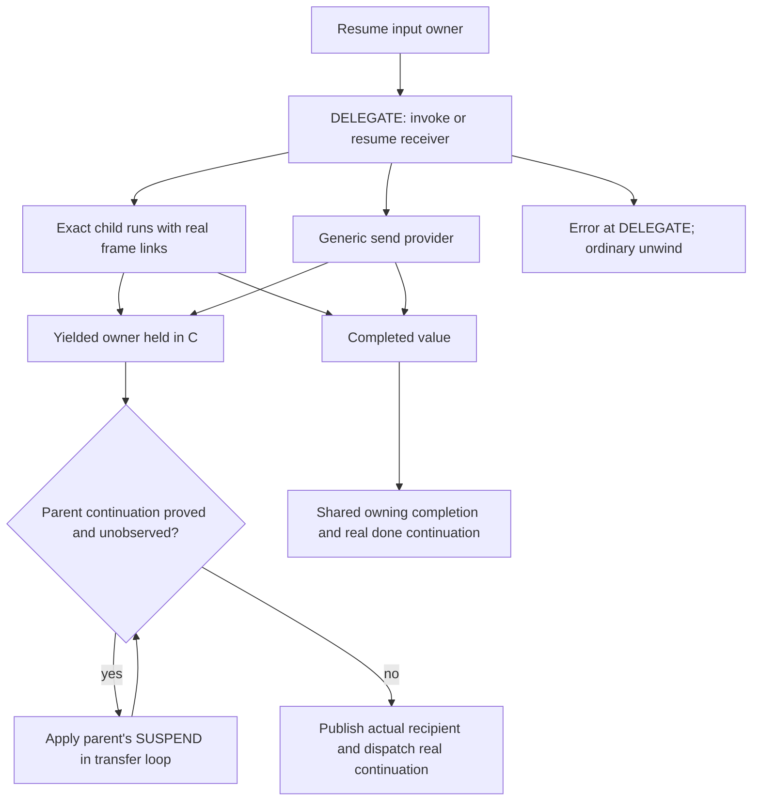

# Generator delegation and suspension

Round-52 architecture, implemented and rejected on performance; golden51
`0e5e61f4c6bc820f2dd1a5f9ee6f7f1768834254` remains selected. The initial
candidate `58f9ea6cfee` lost in six paired comparisons with golden51:
generators +4.37%, coroutines +4.66% and DeltaBlue +2.67%. Followup
`e851719` passes native inspection of wrapper-first entry placement, but its
six-pair confirmation loses generators +0.95%, coroutines +11.30% and
DeltaBlue +11.85%. Both candidates are rejected; see the
[final report](../issues/generator-delegation52/report.md). See the
[cold review](../issues/generator-delegation52/cold-review.md) and
[plan](../issues/generator-delegation52/plan.md). This design follows the
[frame ABI](call-and-frame-lifetimes.md), [register IR](register-ir.md) and
[observer contract](handler-and-observer-contract.md).

## Decision and first increment

Represent `yield from` and `await` as a suspendable call, **DELEGATE**, with
distinct yielded, completed and error outcomes. Represent every outward yield
as **SUSPEND**, whose outgoing value, incoming recipient and resume continuation
are separate semantic facts. Retain actual owning generator frames.

The first increment implements direct **yield-side propagation** through proved
delegating parents. When a child yields, DELEGATE's yielded outcome suspends its
parent directly, using the parent's real SUSPEND site. It avoids publishing and
reloading the yielded value in each intermediate parent's transfer cell and
avoids dispatching each intermediate SUSPEND. Normal resume targets DELEGATE
through an explicit resume continuation. It still enters and suspends each
actual frame and updates its exception, recursion and execution state.

This is more than replacing a backward jump: the IR declares that a yielded
child value is the parent's suspension outcome, rather than an ordinary body
result. That declaration permits propagation in one generated transfer loop.
Resume-side chain bypass is a later increment requiring additional proof; it
must not be claimed as a benefit of this first implementation.

Selected-image profiles rank SEND_GEN (27.41%), YIELD_VALUE (13.92%) and the
noninterrupting backward jump (5.11%) ahead of creation/completion cleanup.
Generators execute 1.414550 times upstream instructions and take 1.445513 times
upstream elapsed time. These shares and ratios are not removable budgets. SEND
already specializes exact generators; transfer values already have canonical
bits, and heap frames already persist across resumes. See the
[source assessment](../issues/interpreter-round51/next-plan-assessment.md).

## Real words, encoding and construction

Use three real words for an admitted delegation site. No instruction prefixes,
extra allocated site records, borrowed frame homes or universal runtime outcome
box are needed.

| Word | A | B | C | D |
| --- | --- | --- | --- | --- |
| DELEGATE | final completion destination, including IR_NO_DST | receiver-window base | existing scaled feedback offset | signed done displacement from next word |
| SUSPEND | next incoming recipient | outgoing value home | existing plain/delegated yield kind | zero |
| RESUME_DELEGATE | existing RESUME location/depth bits | zero | absolute DELEGATE target, low 12 bits | absolute target, high 12 bits |

DELEGATE retains SEND's three-home window: receiver at B, cursor/NULL at B+1,
incoming/outgoing transfer cell at B+2. Its immediately following SUSPEND has
A=B=DELEGATE.B+2 and delegated kind. Its following RESUME_DELEGATE names that
exact DELEGATE. This adjacency is a semantic construction invariant, independent
of source coordinates. DELEGATE's done edge retains existing signed-12 forward
geometry. For a far exit, put one real IR_JUMP after the complete triple and
set D=2, targeting that adapter from SUSPEND's address; the adapter's CD names
the final done word. RESUME_DELEGATE always jumps back, so normal resumption
cannot fall into the adapter. Completion and observation normalize this exact
shape through `_PyIR_DelegateDoneTarget(words, count, site, physical)`, an
exact-shape normalizer returning the semantic done offset. Physical completion
still dispatches the adapter. Its EH/source phase is completed, outside the
synthetic SUSPEND handler. Do not group the triple with `instr_length` or chase
arbitrary jumps: SUSPEND and RESUME_DELEGATE retain independent events/recipes.

RESUME_DELEGATE is a narrow continuation operation, not a family per resume
mode. It performs the existing instrumentation/version synchronization and
PY_RESUME work. Keep its real site and ordinary next-word cursor through every
fallible step; only success with unchanged PC and redirect generation selects
CD. An error retains that resume recipe; every redirect, including same-PC
intent, wins. Extend dispatched and skipped-resume paths together with the same
epoch/TLBC/Emscripten guards and hook ordering. The saved suspended
PC remains this real resume word, preserving a real previous SUSPEND word for
injected-error attribution. No new per-frame resume pointer or per-suspension
target store is introduced.

Native and exact-generator entry share `IR_FINISH_RESUME_ENTRY` after incoming
ownership, frame links, recursion and exception state are committed. It keeps
the real saved PC visible through DTrace and LLTrace, then honors PC/generation
redirects before considering a skip. An outer INSTRUCTION wrapper can precede
RESUME_DELEGATE's own version check, so a cold entry helper refreshes stale
instrumentation before that wrapper calls Python. It uses the immutable real
operation, preserves the winning resume site's next-word error cursor and
rechecks redirects after synchronization. Plain and inner instrumented resumes
already synchronize before their events and need no extra immutable decode.
Only a successful, nonredirected entry runs the existing guarded resume skip.
Fresh call-frame entry keeps its existing path. Source coordinates grant none
of this authority.

Plain yields use SUSPEND with the current YIELD_VALUE geometry and a following
ordinary RESUME. Initially this is a shared semantic implementation with a
producer port, not an extra plain-yield optimization. The compiler retains
frontend stack effects, synthetic exception blocks and END_SEND until register
allocation and existing completion lowering have consumed them. Register
lowering certifies the delegation triple and removes the old backward jump.
Do not recognize the triple by equal line/column or a runtime scan.

The constructor verifies window extents, slot ownership, exact adjacency,
resume target, delegated kind/recipient, final destination, EH recipes and all
incoming edges. Arbitrary entry to the middle of the triple is rejected except
the declared child-yield and normal-resume edges. `code.replace`, marshal and
malformed-word paths must establish these facts too; a flag is insufficient.
Update format version/magic and serialized feedback metadata as required by the
actual format change. Use existing optional unary feedback; exhaustion retains
a correct generic DELEGATE without mandatory private storage.

Construction also checks generator/coroutine flags and entry shape, but these
are not ownership authority. Before DELEGATE activation or dispatched SUSPEND,
require actual `FRAME_OWNED_BY_GENERATOR`; otherwise raise SystemError before
moving owners or converting the frame to a generator. Test malformed code with
changed flags, RETURN_GENERATOR, and normal/exceptional entry. No general
arbitrary-opcode mutation guarantee is added.

## Owners and transitions

DELEGATE describes a pending child while its parent remains logically executing.
The existing parent `return_slot=B+2`, `return_pc=SUSPEND` and actual DELEGATE
PC describe the child continuation. The receiver window pins the child object;
each frame separately owns code, function and its homes. A child holds no new
owning back-reference to its parent. Existing active `previous` links, exception
links and evaluator activation keep their current roles.

```mermaid
stateDiagram-v2
    Created --> Executing: legal initial input and entry commit
    SuspendedPlain --> Executing: install incoming owner; run RESUME
    SuspendedDelegate --> Executing: install incoming owner; RESUME_DELEGATE
    Executing --> WaitingChild: DELEGATE commits child links
    WaitingChild --> SuspendedDelegate: child yields; apply SUSPEND
    WaitingChild --> Executing: child completes; commit done destination
    WaitingChild --> Unwinding: child or provider error
    Executing --> SuspendedPlain: plain SUSPEND
    SuspendedDelegate --> Unwinding: injected exception at SUSPEND recipe
    Executing --> Cleared: return or escaping exception
    Unwinding --> Executing: matching Python handler
    Unwinding --> Cleared: no handler
```

`WaitingChild` is a semantic phase, not a new stored generator-state enum.
Admission retains exact-type/provider/PEP523 guards, initial non-None send
checks, executing-state exclusion and recursion entry. Resume detaches the
incoming parent transfer owner before publishing the complete child. Installing
or discarding that owner uses `_PyFrame_SetReturnValue`; an unused input is
closed only after the child is coherent and current.

On a leaf yield, detach its outgoing owner into C and apply existing suspension:
record the incoming recipient and real resume PC; publish current-frame,
exception and profiling links; leave recursion; detach `previous`; release-store
the suspended state. DTrace and debug hooks retain their ordering. The restored
caller is coherent before any further callback or retirement.

`can_propagate_delegate_yield` is a pure nonescaping predicate returning the
actual proved SUSPEND or failure. Check cheap actual generator ownership and
continuation first, then pending redirect, current executing-image/monitoring
epoch, every observer gate, and physical NULL B+2. Require all observation off:
LINE, INSTRUCTION, PY_YIELD, tracing/profile, source handoffs, DTrace and LLTrace.
It performs no synchronization, allocation, owner movement, mutation, general
decoder or source scan. Disable fusion in free-threaded builds until image/epoch
synchronization is proved. Recheck per parent after every retained hook. A hit
reuses the held canonical owner without taking B+2 again, in one iterative loop.

At an unproved, observed or redirected boundary, publish through the existing
recipient transaction, respecting pending redirects and displaced/discarded
owners. With the value in its real home and the actual continuation published,
the cold landing synchronizes stale instrumentation before dispatch. Failure
uses that physical landing's explicit owner/error recipe, never a fictitious
SUSPEND input or replayed provider. Generic, virtual and async-asend providers
use this route after their existing publication/retirement transaction. The
first candidate has one exact-generator specialization; SEND_VIRTUAL and
SEND_ASYNC_GEN become generic DELEGATE provider execution at converted sites.
This lost specialization is a measured cost. PEP523 uses the native provider
route; changes cannot reuse prior admission authority.

This saves intermediate yielded-value home traffic and suspension dispatch. It
does **not** save the per-level suspended-state publication, exception-link
detach/attach, recursion accounting, current-frame/profiling updates, admission
checks or resume-input transfer. New continuation-handler checks and changed
native code shape can outweigh the savings; measure them.

## Completion, throw, close and observation

Completed DELEGATE reuses `complete_step_impl`: retain the value owner, observe
PRE where required, detach the receiver/cursor/input window, install or discard
the final destination, commit done continuation, observe POST, then retire held
owners while preserving callback errors and redirects. Extend the immutable
caller-word decoder to DELEGATE with the actual saved physical continuation and
its verified far adapter. Do not make ordinary CALL pay this protocol. Define
the bounded logical-yield/fused-suspension contract below, rather than claiming
an ordinary physical B+2 output on the fused route.

Keep the compiler's two distinct exception contexts. Provider/send errors belong
to DELEGATE, outside the synthetic CLEANUP_THROW region. An injected throw/close
belongs to SUSPEND, inside it. Because the saved PC is RESUME_DELEGATE directly
after SUSPEND, native throw entry can retain its previous-word error recipe.
Constructor checks must prove that relation, not infer it from a source map.
CLEANUP_THROW consumes its existing four-home exception window and completes
into the same final destination/done edge. Preserve PEP479 handling and single
StopIteration event reporting.

`_PyGen_YieldFromRef` can retain its real `return_slot-2` receiver lookup because
delegated SUSPEND keeps the exact B+2 recipient. `gi_yieldfrom`/`cr_await`, close,
throw, frame inspection and recursive delegation must share that fact.
`gen_close` must recognize RESUME_DELEGATE and retain its existing depth-one,
no-unwind-tools shortcut. `_gen_throw` retains recursive protocol forwarding,
missing `throw`, GeneratorExit/close behavior, and its temporary visible frame
links. Receiver lookup/callback failures preserve the actual stopped state.
Closing a yielding delegate still produces the existing ignored-GeneratorExit
error. No direct chain shortcut applies to throw or close in this increment.

SUSPEND emits PY_YIELD before its non-raising ownership transfer, and
RESUME_DELEGATE emits PY_RESUME in the established order. A yield callback error
uses the SUSPEND recipe with owners still available. Before an observed parent,
leave direct propagation and materialize B+2, so callbacks see the same real
homes and can use existing error/redirect machinery. Gate direct propagation
on current instrumentation and tracing configuration, including observer-visible
entry/exit hooks; a stale uninstrumented handler must first synchronize. Retain
real INSTRUCTION events for the new actual words and LINE events for their
source spans; removed JUMP has no invented INSTRUCTION event. Source records
carry display only. Event offsets necessarily describe the new IR, while Python
event ordering and exception attribution remain contractual.

Observer mapping is fixed: DELEGATE completion owns STOP_ITERATION PRE and
BRANCH_LEFT POST; its yielded edge emits no completion branch. SUSPEND owns
PY_YIELD; RESUME_DELEGATE owns PY_RESUME and no added branch event. A far IR_JUMP
retains its real INSTRUCTION event while completion's branch target is the
normalized done word. The old noninterrupting backedge supplied no poll; the
new continuation must preserve innermost-generator interrupt handling rather
than adding a poll at every delegation level.

While a child runs, the parent's executable semantic PC is DELEGATE. Before an
observed yield it is SUSPEND; after actual suspension its saved continuation PC
is RESUME_DELEGATE. Normal provider errors select DELEGATE's exception recipe;
injected errors use the preceding real SUSPEND. A callback that commits a
redirect replaces the semantic PC and recovery authority according to the
existing generation protocol. Display/source cursors never select either
recipe.

Monitoring enabled by a child or callback, tool reuse/restart, frame publication
and same-PC redirects cannot retain stale shortcut authority. Recheck at every
parent boundary; do not cache a whole-chain permission. Existing unsupported
suspended-frame debugger jumps stay unsupported, with their documented limits;
this proposal grants no new setter capability. Ordinary frame/GC traversal,
copy and clear continue scanning actual canonical homes. No hidden yielded or
receiver owner lives in an untraversed chain cache.

## Shared interfaces and proof boundary

Generate `IR_SUSPEND(value, site, recipient, resume, kind)` with one canonical
owner already detached. Dispatched SUSPEND observes with B populated, then
takes/NULLs B; fused suspension starts with B+2 NULL and never takes it again.
Assign the explicit resume PC; do not increment the DELEGATE PC. Preserve heap
safety and every frame/link/recursion/state publication. Exactly one terminal
consumer publishes/discards the owner or performs documented error cleanup.
No allocation, retirement or fallible observer may run with SUSPEND recovery
selected and its required input absent. LLTRACE_RESUME_FRAME can query globals
and print objects; DTrace resolves names/lines. Treat them as escaping boundaries,
retain their order and coherent PCs, and reject/recheck fusion around them.
The normal observed route keeps the value in its real home until its transaction
takes it. No borrowed return, outcome allocation or new GC ledger is needed.
Exact-child admission continues
using the current entry primitive, with DELEGATE declared as its caller kind;
completion adds that literal kind to the existing owning step implementation.

Freeze these interfaces before splitting implementation: DELEGATE A/B/C/D and
triple/far-adapter shape; RESUME_DELEGATE A/CD; the terminal IR_SUSPEND ownership
signature; literal DELEGATE entry/completion kind; logical CFG edge and bounded
fusion proof; and the observer/error-PC mapping above. Producer and consumer
workers must not independently invent frame flags, alternate recipients or
site-record formats.

The intended physical final state retains the receiver and cursor, leaves B+2
NULL, sets incoming recipient B+2 and saved PC s+2, suspends the delegate,
detaches current/exception/previous links and holds one owner. Cold CFG
analysis may model a logical B+2 yielded edge followed by consuming SUSPEND;
that row is not physical POST state on the fused route. Actual stopped states
and callback-error recipes must describe the route taken.

The implemented mechanical checks bind the DSL canonical transfer producer and
the C eligibility predicate, with mutation negatives for those checks. The
terminal emitter is trusted compiler implementation: selective generated-output
checks, source and native review, tests and GDB evidence support it, but no
general emitter AST/token mutation gate validates all terminal state writes.
In particular, the stronger emitter-binding obligation in Astra finding 7 is
only partially met. Backend edits require peer and native qualification. A
bounded post-emission contract verification is future work, not an implemented
proof; it should check physical owner and continuation state and escaping
operations without introducing a general third-edge framework.

## Implementation boundaries and gates

1. **Producer and semantic proof:** `Python/codegen.c`, `flowgraph.c`,
   `regcfg.c`, `regcfg_passes.c`, `assemble.c`, internal register headers.
   Establish the triple, outcomes, allocation edges, far adapters and EH rules.
   Keep negative cases generic until proved; malformed public construction must
   reject, not silently execute a partial triple.
2. **Generated execution and transfer:** `Python/bytecodes.c`,
   `Tools/cases_generator/ir_generator.py`, metadata generators and generated
   products; `ceval.c`, `ceval_macros.h`, frame/gen headers and `genobject.c`.
   Share the suspension body, implement direct yield propagation, port completion,
   native entry, close/throw, and test all owner/callback exits.
3. **Observation and consumers:** `Objects/codeobject.c`, `frameobject.c`,
   `Python/instrumentation.c`, `ir.c`, `Lib/dis.py`, opcode metadata, remote/GDB
   readers and statistics. Audit hardcoded SEND/YIELD/RESUME consumers, source
   edge reconstruction, owner analyses, instrumentation removal/restart,
   disassembly and serialization together. No changing field roles only in the
   executing copy.

The [Astra review](../issues/generator-delegation52/astra-review.md) requires
ordinary semantics/consumers first, then fusion in the same unpromoted candidate.
These are dependent lanes; generated products belong to the coordinator.

Focused release/debug tests must cover plain yields; deep delegation; non-None
send/unused input; return values and discard; exhausted/reentrant receivers;
generic iterators and coroutine awaits; thrown StopIteration versus provider
error; missing/raising throw/close; GeneratorExit, finally and async cleanup;
GC cycles and escaped frames; last-owner finalizer reentry inspecting all frames;
allocation/recursion failure; monitoring changed during child execution; callback
error/redirect, same-PC intent and tool restart. Add constructor negatives for
changed recipient, resumed target, mid-triple ingress, EH context and far exits.
Distinguish provider failure, injected throw, and PY_RESUME failure/redirect;
exercise near/far adapters with LINE/INSTRUCTION and CLEANUP_THROW, aliased and
discarded destinations, and malformed actual frame ownership.
Use the existing contract tests to mutate producer tokens/AST and reject forged
canonical/continuation claims. Existing semantics tests alone cannot prove that
direct propagation is exercised: inspect emitted IR/native paths as evidence.

Then run the existing value API, focused qualification and observer suites and
full diagnostics at the coherent checkpoint. Preserve established debugger and
LLTrace failures explicitly. Measure unchanged generators/coroutines against
immutable round51 golden and upstream with the established GCC/affinity/hash/JIT
settings. Require repeated matched target improvement, then broad-29 screening
and longer DeltaBlue/logging/deepcopy/spectral guards. Retain every regression;
do not promote a dispatch-count win with worse elapsed behavior. PMU/native
inspection should establish whether home traffic and dispatch were actually
removed, without claiming a sample share as saved work.
Inspect a deep exact chain for iterative propagation and shallow/plain/FOR_ITER,
generator-expression/comprehension and native-provider cases for failed-check
overhead. Coroutine fibonacci typically returns without yielding: no fusion
gain is promised there. Retain the design/evidence if this candidate loses.

## Later resume-chain work

After this increment earns its cost, use explicit DELEGATE continuations to
walk a suspended exact-child chain in one entry loop. Each actual frame still
needs input ownership, executing-state/recursion admission and coherent links
before a leaf can call Python. Begin without persistent chain caches; mutation,
close/throw and observation then naturally stop at real frame boundaries.
Eliding per-level state writes requires a separately reviewed materialization
and logical-recursion contract for callbacks, introspection, GC and failures.
That is the concrete blocker to claiming leaf-only execution today. It is not
resolved by persistent frames, canonical values or a new opcode name.
