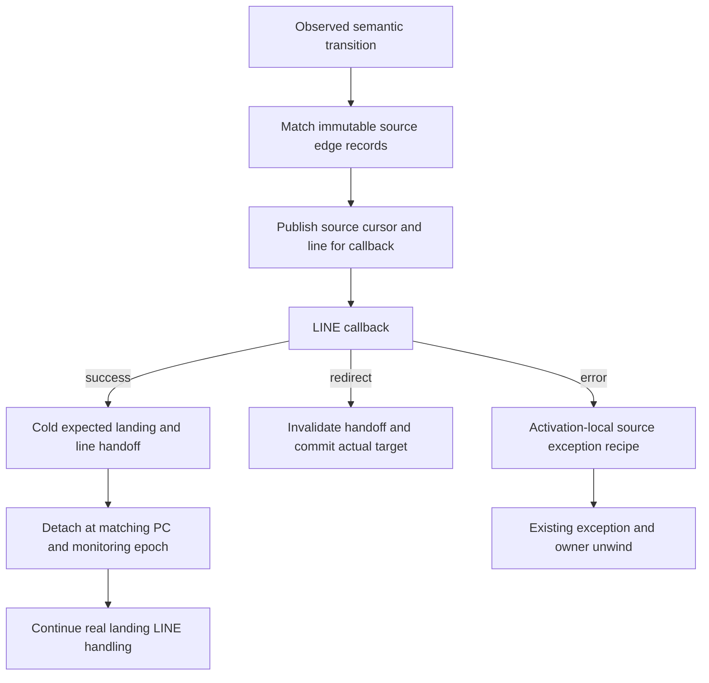

# Handler and observer contract

The active [interpreter](interpreter.md), [IR](register-ir.md) and
[frame ABI](call-and-frame-lifetimes.md) share one owning-home model. This page
describes the contract integrated at `d7abf803c60`, whose broad qualification
remains open. [Status](../STATUS.md) separates it from the immutable
qualified golden runtime. Release phases implement RC; they do not impose an
immediate-finalization guarantee on Python programs.

## Generated execution contract

`Python/bytecodes.c` defines semantic operations. The cases generators emit
handlers, operand layouts and effects; `Python/ceval.c` enters their musttail
dispatch domain. Pristine code is compiler-produced register IR. Execution
patches handler identities for specialization and observation without another
stack-bytecode compiler. GC, debugger, feedback, statistics, disassembly and
remote readers must cover the actual handler domain.

| Contract | Meaning |
| --- | --- |
| Field roles and extents | Encoded operands and frontend stack shape |
| Through prefix | Values remain in the same physical homes, not fresh definitions |
| output_kind | Actual register/window/first-result publication, or semantic outcome |
| result_phase | Checked first-result publication before input retirement |
| observer_outcome | Generated per-edge fact for a declared committed terminal callback |
| Effects | Conservative raises, escape, frame switch, suspension, polling and other capabilities |
| Events | Monitoring capabilities of the semantic handler or its wrapper |

Fold capability does not identify every output home. An ignored A on a window
producer cannot create an owner; a first window result moved to A does not move
its variable tail. Likewise, full frontend window reads can include untouched
holes; explicit source fields may point outside that window. Cold consumers
share ReadsHome/DefinesHome/NullableInputs and per-edge Outcome rather than
reconstruct these facts from one extent or guessed opcode range.
NullableHome checks every actual aliased read: a nullable deletion value cannot
authorize a required receiver to be NULL in the same physical cell.

Suspension metadata recognizes actual generator-state writes, not a comparison
against a child's FRAME_CREATED state. SEND can push/resume a Python child
without suspending its own generator. Static provider or ownership refinements
inherit only facts their actual path establishes.

## Publication, release and callbacks

A handler starts from valid canonical homes. Before an opaque callback it
publishes the actual frame, PC, executable, exception state and committed owner
phase. Detached inputs are NULL; an unpublished result remains an explicit C
owner. Decline paths preserve the generic path's inputs. Post-commit errors
retire the actual phase rather than replay a call or restore fictitious owners.

The specialized reader retirement markers publish a temporary result before
receiver retirement. A folded local instead keeps the result owned in C until
successful retirement/refresh, then replaces the current local and retires its
actual displaced owner. A failure closes the C owner and preserves observer
mutations. The checked first-output phase is narrower than whole-handler purity
or a general error root map. See [reader publication](call-and-frame-lifetimes.md#first-output-publication-phase).

Semantic FOR_ITER/SEND/THROW completion distinguishes PRE receiver observation
from POST committed-window observation. Destination definitions differ by edge.
One helper owns the held result and detached inputs through callbacks, publishes
the selected real continuation before closes, and honors later redirects.
Ordinary CALL return remains inline. Implicit StopIteration completion and real
error reporting must each produce their appropriate single monitoring event.

Declared terminal providers publish output homes and the saved continuation
before their callback. The actual PC remains the semantic owner site during
observation; the selected PC is published before deferred closes. Inputs and
displaced local owners remain in C until the callback decision, then close with
its error preserved. The generated edge fact
describes the physical result and the unavailable old input owner separately;
a fresh value or explicit NULL at an aliased home cannot restore that old owner.
The constructor checks the declared source-callback POST recipe and both compute
PRE and committed POST for an ordinary exception handler. A terminal fact does
not claim whole-handler purity or authorize a debugger transfer.

The positive marker takes reported source, physical next, event and an explicit
owner-edge literal. Its edge/destination proof drives both metadata and runtime;
public event direction is not ownership authority. POP_ITER owns fallthrough
while reporting BRANCH_RIGHT from a prior source; unconditional JUMP owns taken.
Both use their actual word for owner and exception state. No-output committed
transfers define no result. Deferred iterator retirement and backward polling
remain on their respective sides of the terminal barrier.

## Executable position and source context

`f_lasti`, branch targets, disassembly and INSTRUCTION events use compact real
word offsets. Eliminated source-only spans are immutable edge records in the
normalized co_linetable envelope. LINE callbacks temporarily expose their
source span through the observed frame object. Source-only records add LINE
context within the single executable-offset domain. Shared cleanup words still
present in this increment are an unfinished inventory.

RESUME owns entry synchronization and PY_START/PY_RESUME ordering. Source
records may describe its outgoing body edge; a source-only landing at RESUME
is invalid. Compiler-generated initial input disposal carries no source origin.
The constructor checks this barrier before admitting code.

An evaluator activation owns its pending source-error frame/record. Nested C
entry, including finalizers and instrumentation callbacks, links a fresh
activation and restores the parent on exit. The error recipe therefore survives
a nested error during outer result retirement. Frame-object allocation failure
can still record it. The optional frame-object source cursor supplies display
and traceback state; it is not the only copy of handler selection.

The activation also holds a synchronous observer record for the actual frame,
site, edge, phase, event and redirect generation. Callback entry saves and
replaces that record; exit restores it before closing a callback result.
Unsupported callbacks have no transfer authority. Nested activation lookup
requires the actual frame and event; a changed generation invalidates the old
outcome, so only a separately proved fresh PRE landing can authorize a jump.

Source delivery carries an immediate physical continuation and a publication
contract. Shared completion POST, declared terminal providers and completed
landing wrappers can supply SOURCE_POST; unproved legacy inline hooks supply
UNSUPPORTED while preserving event delivery, display and error routing. Source
`record.to` is the normalized landing, not necessarily that immediate pointer.
Only the exact assembler relaxation shape may relate them.

A separate cold frame-object record carries expected real LINE landing,
previous source line and monitoring epoch. Public f_lineno remains display/cache
state. Actual LINE mask, tool-identity or restart changes invalidate the old
handoff; unrelated INSTRUCTION changes preserve it. Consumption is
one-shot and occurs before callbacks. A stale configuration gets a fresh
landing event without retroactively replaying completed source events. Exact
assembler relaxation adapters normalize LINE landings while helper words retain
real INSTRUCTION callbacks. Exception selection, debugger redirection and frame
clear invalidate the record before callback-capable retirement.

Tool reuse is checked against the code's last successfully instrumented global
version, even when SetLocalEvents has refreshed its local version field. Reused
LINE bits pass through both removal and addition so old DISABLE decisions do
not transfer to a new identity. Callback replacement alone retains the existing
no-automatic-restart policy: later selected events use the new callback; an
explicit restart re-enables disabled events.

Debugger intent has its own cold frame-object generation. A successful setter
commit advances it even when the selected physical word is unchanged. Source,
jump and semantic-completion callback transactions compare both PC and generation
before returning a cached continuation or restoring source context. If a callback
commits a redirect and then raises, attribution uses the committed real PC;
otherwise the original source exception recipe remains valid. Frame-object
creation and public line-cache reads do not advance the generation. Ordinary
dispatch does not check it.

An identity request checks the actual phase as well as the resolved source line.
It requires the current real LINE wrapper to describe that line, the observed
frame itself and no source/error, suspended or pending-child phase.
It preserves every owner and exception link, including protected regions,
and keeps the current PC while committing redirect generation. An earlier word
sharing the line does not make identity restart a scope or expression.
Other protected transfers still need
their own context and owner proof.

## Boundaries and open work

Specialization guards receiver behavior, representation, type/shape version,
provider and descriptor precedence as needed. Opaque hooks and misses retain the
generic route. Names alone do not prove allocation-free or non-reentrant work;
canonical transfer requires an actual producer chain. Future method/tracing
JIT recovery maps remain separate from these baseline contracts.

Debugger owner recipes remain bounded: NULL requirements and actual iterator
generation must be proved before admitting a target. Remote layout is versioned
and target-described; remote/GDB active source-cursor display is a separate
consumer port still pending. Current setter authority covers bounded PRE
restoration, exact real LINE identity, certified owner-neutral committed JUMP
and bounded non-neutral committed outcomes. PRE and neutral JUMP borrow exact
site rows. The non-neutral view copies context, saved-binding and origin rows,
applies the selected normal transfer, and cuts consumed input origins without
treating replacement values as their old owners. Token-creating transfers are
excluded before that projection can change shared analysis state.

Every committed view validates the exact scope, actual site, selected edge,
physical successor and redirect generation. Non-neutral cancellation requires
inherited context, empty stopped and target saved-binding state and a real target
with no incoming scratch-owner requirement. It has no PRE survivor or source-only
fallback.
Warning reproof binds fresh rows; a changed generation can use only a separately
proved fresh PRE landing. Existing PRE and strict neutral FOR/caught recipes
retain their checks. SOURCE_POST and yield transfers need their own stopped-state
proof. Broad repair and parity remain open.
