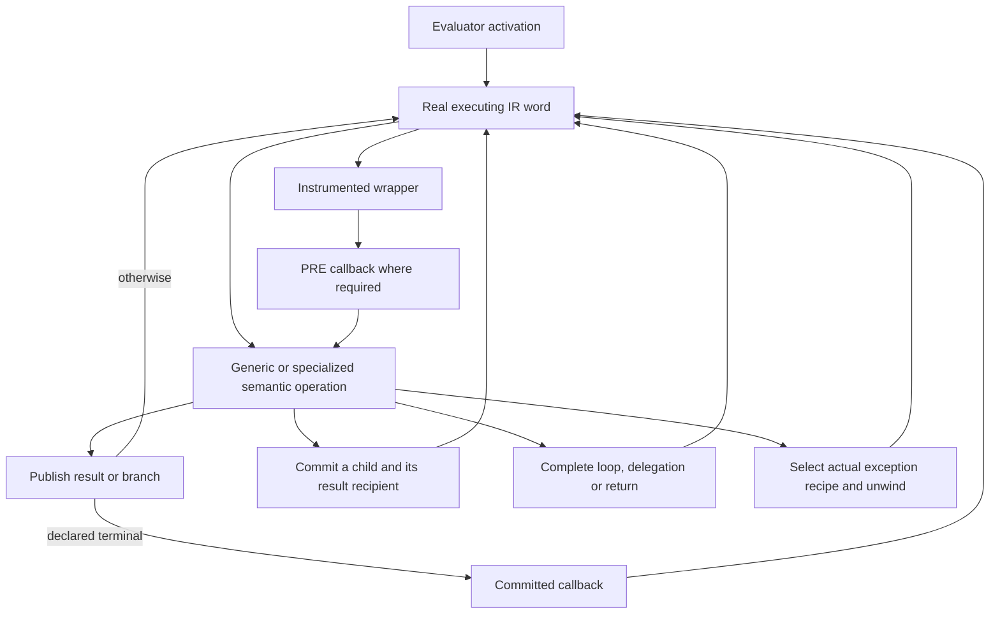
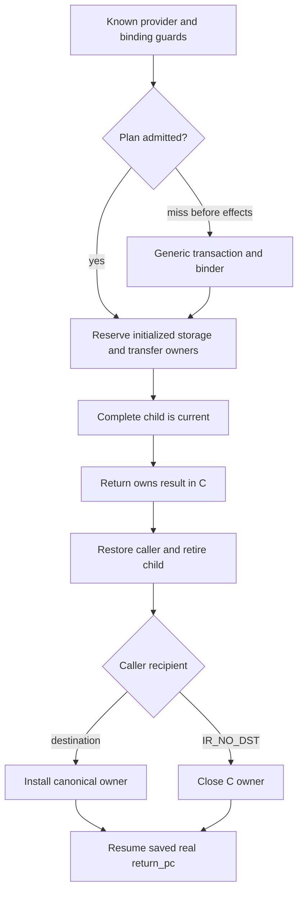

# Register interpreter: current contract

This page describes the register interpreter integrated at `c1424be11db4`.
Its bounded observer and debugger contracts still require broad qualification.
See [status](../STATUS.md), the
[active packet](../issues/frame-call-model-20261109/plan.md), and the immutable
[baseline report](../bench/results/interpreter-parity-20261108.md).

The [register encoding](register-ir.md), [frame ABI](call-and-frame-lifetimes.md)
and [observer contract](handler-and-observer-contract.md) describe the same
runtime. Its owning homes and release protocol implement RC; Python does not
require immediate finalization. [Lifetime policy](lifetimes-and-language-semantics.md)
separates language behavior from that implementation choice.
The [debugger transfer model](debugger-frame-transfers.md) defines explicit
entry, cold context/owner proofs and bounded saved-local restoration.

## Entry and dispatch

A code object holds pristine eight-byte IR words and feedback initialization.
`Python/ir.c:_PyCode_GetExec` lazily creates its shared mutable executing copy
and feedback vector. Running frames own the code and retain pointers into that
allocation. Specialization and instrumentation patch handler fields.

`Python/bytecodes.c` and the cases generators produce one `_TAIL_CALL_*` handler
domain, dispatch metadata and observer contracts. `Python/ceval.c` enters the
first handler; handlers transfer with GCC musttail dispatch. Execution consumes
register homes directly, without a runtime stack-bytecode translation stage.
IR registers are physical memory homes, not machine registers or optimizing SSA.

Source-only boundaries have no dispatched word. Shared cleanup instructions
that remain in the current compiler are an unfinished separate workstream;
there is no claim that every release-only word has been removed.

## Frame storage and ownership

Locals, cells, free variables, hidden scalar constant homes and temporaries
share one canonical PyValue array. A home contains NULL, an inline value, an
immortal, or an owning object edge. Mortal borrowed views are C-local and require
an owner; ordinary frame homes are not borrowed references.

Temporary future-read liveness is not owner occupancy. Cleanup must retain or
retire an initialized owner even if no later Python operation reads it. GC,
frame copying, unwind and debugger inspection share that invariant. Normal
thread retirement clears local homes after proving temporary homes NULL;
exceptional and escaped/generator paths retain their appropriate full handling.

Thread chunks have opposing header/value stacks and one initialized frontier.
Reservation establishes valid value cells before constructing a header, filling
only the uncertain suffix. A header truncates that frontier before overwriting
value-capable memory; pop never restores a saved frontier. All retirement and
reentry paths must leave reusable value cells NULL. Separate heap frames are
initialized once, while full ownership copies initialize their destination by
moving every home. See the [frame ABI](call-and-frame-lifetimes.md).

## Python calls and ordinary return

Exact calls guard their standard Python provider and transfer argument owners
into a child. A versioned known-call plan lets guarded CALL_PY_GENERAL bind
common positional calls directly through `call_bind_known_python`; no generic
transaction record is built on that hit. It fills defaults and empty variadic
bindings under the same owning-frame ABI. A pre-effect miss uses the existing
transaction/provider path. Keyword, extended, instrumented and unsupported
shapes retain their complete provider handling, not a second execution model.

Compiler-proven empty kwargs may remain a pending local until a materialization
barrier. Folded reads, cell/alias hazards and frame publication are covered by
the compiler/constructor proof and cold observation helper; unrelated local
loads have no pending-value class test. Excluded code eagerly creates its dict.

The caller saves `return_pc` as a real executable continuation and `return_slot`
as a plain local/temporary destination or IR_NO_DST. Return keeps its canonical
owned value in C across child unlinking and retirement. Ordinary CALL recipient
completion stays inline: publish into the destination, retiring its actual
replaced owner, or close the discarded C owner. No dormant POP lookup, tagged
recipient, historical result home or same-line restriction is involved.

Generic transactions still protect caller owners across preparation, callbacks,
monitoring and fallible binding. They pin the actual executing code and refresh
after effects; a completed callback is not replayed on a guard miss. Once
ownership commit begins, failure retires the published child instead of falling
back to a second call. Code remains a separate owner because function.__code__
can change while a child executes.

## Iteration, delegation and resume

FOR_ITER's body edge preserves its iterator/cursor and defines only the item
recipient. Exhaustion kills the pair and does not overwrite the last loop local.
SEND's yielded result goes to B+2; completed delegation kills its window and
publishes A, or discards at IR_NO_DST. CLEANUP_THROW completes into that same
recipient and its named real successor. Native and Python-generator routes use
the same owning completion primitive; ordinary CALL return does not pay a
universal generator transaction.

Completion separates fallible PRE observation while original owners exist from
POST observation after the semantic outcome is committed. It detaches windows,
publishes destinations and continuations before closing owners, and preserves
supported callback redirects. STOP_ITERATION, branch directions and source LINE
are independent observer capabilities. Real error StopIteration reporting and
implicit completion reporting must not emit duplicate exception events.

YIELD_VALUE separates its outgoing owner from the next resume input recipient.
For an unused input, IR_NO_DST closes the incoming owner only after the parent
transfer cell is detached and the resumed child's current-frame, exception and
recursion links are committed. Delegated suspension retains the actual receiver
lookup relationship. Initial generator construction uses the same explicit
recipient model. Hidden interpreter/initialization entry starts at its real word-zero
continuation.

## Errors and observation

`f_lasti`, disassembly and exception offsets remain compact executable indices.
Eliminated source LINE spans are edge metadata in the code's normalized source
container. Their callbacks publish an observer-only source cursor and line;
they do not invent an INSTRUCTION event or a virtual public offset.

The constructor's completion proof follows normal/error/source-callback edges,
tracks unavailable original homes and definite NULL, and rejects required reads
of retired owners. Generated terminal observer facts distinguish the committed
physical output from a retired old owner at the same home. A source-only
callback error uses the declared POST state; an ordinary exception recipe
covered by that word must work for both compute PRE and observer POST. Actual
exception/lasti definitions and fresh physical output locations matter;
frontend writes and pass-through shapes alone are insufficient.
Implicit RERAISE anchors may be semantically unread, while saved locals that a
handler restores remain required. This preserves the selected PEP479 and
inlined-comprehension error semantics without a second unwind engine.

Each C evaluator activation owns its pending source-error frame/record. Nested
Python entry during retirement has a separate activation, so its error cannot
replace the outer source handler. The frame-object cursor serves display; it
is not the sole error storage and need not exist on allocation failure.

A cold frame-object LINE handoff records expected real landing, previous source
line and monitoring epoch. It is separate from public f_lineno. Landing detaches
it before callbacks and accepts only matching continuation/configuration;
reconfiguration produces a fresh landing event without replaying old edges.
Exact relaxation adapters normalize LINE landings while their helper words keep
real INSTRUCTION events. Setter, exception and frame-clear paths invalidate the
handoff before callbacks. Broader event parity remains under qualification.

## Limits

The active interpreter uses the selected universal PyValue/RC representation
and rebuilt-source ABI. Native method/tracing JIT tiers, machine register
allocation, OSR and general native recovery maps are separate future work.
Source-level ownership review and a short parity screen do not replace full
functional qualification, broad regression repair or the matched parity gate.
