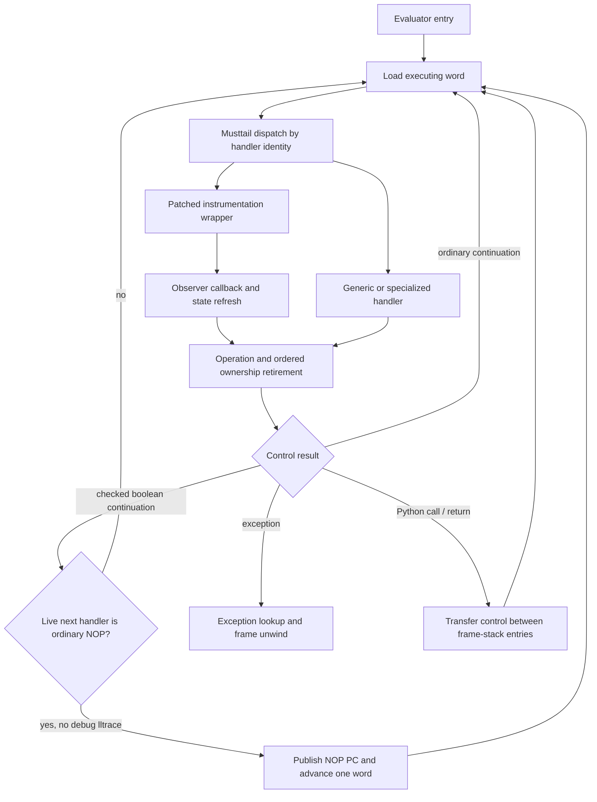
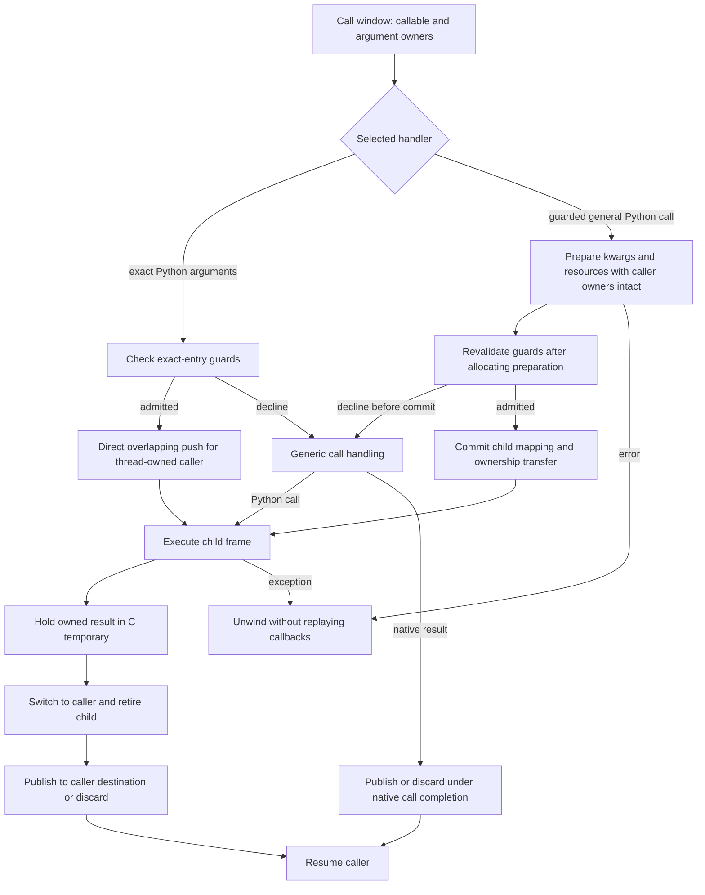

# Register interpreter: current contract

This page describes the interpreter in the canonical runtime checkout at
`/home/power/code/cpython/.worktrees/python-boil-the-ocean/build/worktrees/pyvalue-rc-universal`,
HEAD `0765e9be47f55d97ba5d31d2ae1c02a55ea2e5ae` (2026-11-08). It is an
as-built specification. Full-suite and performance qualification is identified
with `0267d428808`; the successor changes comments only. See the
[register IR specification](register-ir.md), [call/frame lifetimes](call-and-frame-lifetimes.md),
[handler/observer contract](handler-and-observer-contract.md), and the
[checkpoint report](../bench/results/interpreter-parity-20261108.md).

## Entry and dispatch

The code object holds immutable eight-byte IR words plus feedback-initializer
metadata. `Python/ir.c:_PyCode_GetExec` lazily creates one `_PyCodeExec` per code
object. Frames and threads share it; free-threaded builds publish it through
the code object's atomic pointer. Its contiguous allocation contains a mutable
instruction copy followed by feedback storage. A running frame keeps its code
alive, so its executing word pointer remains valid. Specialization and
instrumentation update handler fields in that shared executing copy.

`Python/generated_ir_cases.c.h` and `Python/ir_targets.h` are generated from
`Python/bytecodes.c` and IR metadata. Each handler is a function in the
`_TAIL_CALL_*` table. Handlers dispatch to the next handler with musttail
transfers; `Python/ceval.c` enters the first handler and does not select a
computed-goto backend. A handler loads operands from frame homes, performs
value operations, and publishes results or selects control flow. This is the
interpreter's execution path; it does not lower to upstream stack bytecode at
call time.

## Frame homes and ownership

A frame's value array is the single home store for locals, cells, free
variables, hidden constant homes and compiler temporaries. Each home contains
NULL or a valid `PyValue`; a mortal object value in a home owns its reference.
Inline values and immortal values follow their tag-specific no-count rules.
Borrowed object views exist only in C locals while a home or other owner keeps
them alive. No mortal borrowed frame slot is supported.

Temporary liveness and ownership are distinct. A value can remain an owner
that cleanup must release even after its last future read. Homes are initialized
so GC traversal, frame copying and exception unwinding can inspect the full
physical array. Normal thread-frame cleanup clears locals after asserting
compacted temporaries are NULL; exceptional and exposed/detached frame paths
retain their corresponding full handling.

Handlers that can allocate, call Python, release an owner or invoke an observer
must preserve valid ownership across re-entry. Generated reader paths use
borrow/consume helpers and temporary result ownership; successful completion
publishes the output at the declared phase, retires inputs in order, refreshes
state where required, and installs folded-local results only after successful
retirement. Decline paths preserve inputs and fall through to the original
reader; failure paths close temporary owners and leave cleanup to the
established unwinder. The detailed per-handler contracts are in the linked
observer and frame-lifetime pages.

## Effects, observations and PC

Handler metadata declares relevant properties such as whether an operation may
raise, escape into Python, read or write slots, branch, or be observed. The
register compiler uses these effects to constrain transformations such as copy
propagation and dead-store removal. A handler's fast specialization may decline
when a guard fails; decline is not a Python exception and must preserve the
state expected by its generic path.

The instruction position is measured in IR words. Line events, exception
ranges and monitoring recover the logical opcode/instruction from the current
word and metadata. Instrumentation rewrites the executing handler while
preserving the base operation and operand layout. Instrumented wrappers may
publish the original PC before calling observer code, then refresh execution
state after that code can re-enter. Fused handlers preserve their event mapping.

The NOP word can remain as a source-line/instrumentation anchor. Only the
checked `POP_JUMP_IF_FALSE_BOOL` continuation may execute one live NOP inline,
retaining
both the word and PC publication. Patched wrappers use their handler path, and
debug lltrace declines the inline continuation. This optimization does not turn
NOPs into metadata-only entries.

## Calls, returns and fallback

A call instruction names a contiguous operand window. The exact-argument
handler (`CALL_PY_EXACT_ARGS`) checks its entry guards, then calls
`_PyFrame_PushOverlapping` directly for thread-owned callers; generator-owned
callers use the non-overlap transfer. The callable and argument homes move into
the child mapping, and the caller saves its destination in
`frame->return_slot` (`_SAVE_RETURN_SLOT`). This path does not use the generic
call transaction runner.

`CALL_PY_GENERAL` uses a guarded call transaction. It performs allocating
preparation while caller homes remain owning, then rechecks callable, code,
vectorcall, hooks, defaults, stack capacity and argument offsets after kwargs
preparation before commit. A decline before commit runs the generic call
transaction; an error propagates through the exception path and does not replay
completed monitoring or callback work. Neither path falls back after commit. Instrumented, keyword/extended and other
shapes use their provider-specific handling; generator-owned callers use
non-overlap storage. The ownership table, guards and exclusions are detailed in
[call/frame lifetimes](call-and-frame-lifetimes.md).

A Python return keeps its owned `PyValue` in a C temporary, switches the
current frame to the caller, and retires the child with
`_PyEval_FrameClearAndPop`. Only then does `IR_STORE_RETURN` publish the result
to the caller home or close a discarded result. The saved `return_slot` belongs
to the caller. Child-cleanup finalizers can therefore run before that home
changes; the result remains owned across cleanup. `IR_NO_DST` is a discard
sentinel, never a writable home. Exception exits use the exception table and
release homes above the handler boundary while retaining the owners needed by
the handler.

## Current limits

This interpreter is the qualified baseline for the register IR. It is not a
native method/tracing JIT and does not yet provide general deoptimization,
OSR, machine-state recovery, or borrowed frame homes. Performance qualification
does not establish upstream parity. The checkpoint report and
[status](../STATUS.md) record the measured result and open design work.
