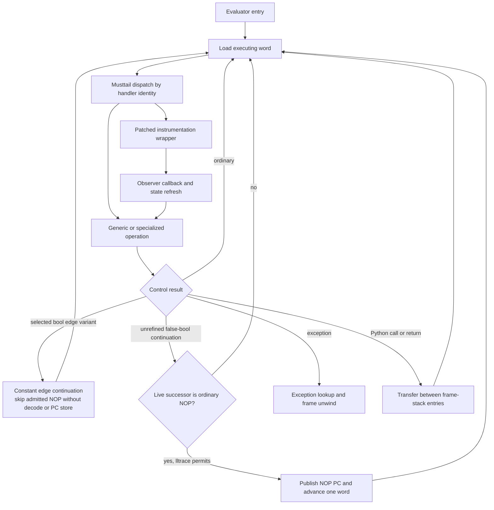
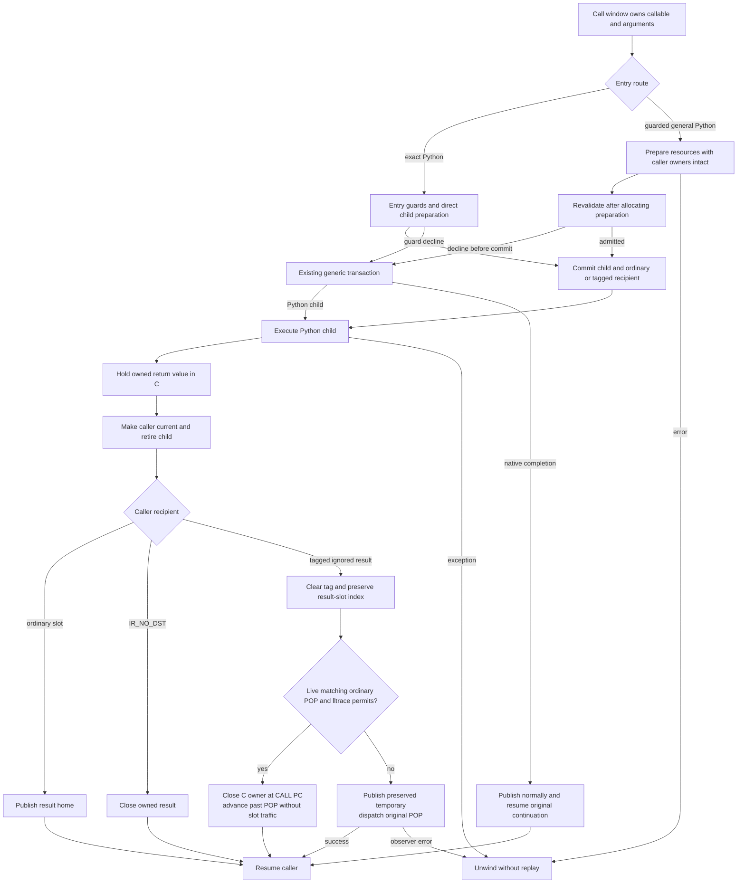

# Register interpreter: current contract

This page describes the active integration runtime at
`/home/power/code/cpython/.worktrees/python-boil-the-ocean/build/worktrees/execution-boundaries-20261108`:
integrated commit `4b3d739d867`, containing the operand, boolean-boundary and
discarded-result changes. Release and debug each passed 54,421 full-suite tests;
debug passed on retry after an unexplained profiling failure, retained in the
[investigation](../issues/execution-boundaries-20261108/profiling-investigation.md).
Performance promotion is withheld after repeated broad regressions; see the
[candidate report](../issues/execution-boundaries-20261108/report.md). The
immutable golden `0765e9be47f` remains qualified at functional `0267d428808`;
its [checkpoint report](../bench/results/interpreter-parity-20261108.md) is
baseline evidence, not qualification of the new code.

See the [register IR](register-ir.md), [call/frame lifetimes](call-and-frame-lifetimes.md)
and [handler/observer contract](handler-and-observer-contract.md). The selected
ownership and release points do not require a future implementation to preserve
immediate finalization; see [language and lifetime policy](lifetimes-and-language-semantics.md).

## Entry and dispatch

The code object holds immutable eight-byte IR words plus feedback-initializer
metadata. `Python/ir.c:_PyCode_GetExec` lazily creates one `_PyCodeExec` per code
object. Frames and threads share it; free-threaded builds publish it through
the code object's atomic pointer. Its contiguous allocation contains a mutable
instruction copy followed by feedback storage. A running frame keeps its code
alive, so its executing word pointer remains valid. Specialization and
instrumentation update handler fields in that shared executing copy.

`Python/generated_ir_cases.c.h` and `Python/ir_targets.h` are generated from
`Python/bytecodes.c` and IR metadata. Each handler is a function in the
`_TAIL_CALL_*` table. Handlers dispatch to the next handler with musttail
transfers; `Python/ceval.c` enters the first handler and does not select a
computed-goto backend. A handler loads operands from frame homes, performs
value operations, and publishes results or selects control flow. This is the
interpreter's execution path; it does not lower to upstream stack bytecode at
call time.

## Frame homes and ownership

A frame's value array is the single home store for locals, cells, free
variables, hidden constant homes and compiler temporaries. Each home contains
NULL or a valid `PyValue`; a mortal object value in a home owns its reference.
Inline values and immortal values follow their tag-specific no-count rules.
Borrowed object views exist only in C locals while a home or other owner keeps
them alive. No mortal borrowed frame slot is supported.

Temporary liveness and ownership are distinct. A value can remain an owner
that cleanup must release even after its last future read. Homes are initialized
so GC traversal, frame copying and exception unwinding can inspect the full
physical array. Normal thread-frame cleanup clears locals after asserting
compacted temporaries are NULL; exceptional and exposed/detached frame paths
retain their corresponding full handling.

Handlers that can allocate, call Python, release an owner or invoke an observer
must preserve valid ownership across re-entry. Generated reader paths use
borrow/consume helpers and temporary result ownership; successful completion
publishes the output at the declared phase, retires inputs in order, refreshes
state where required, and installs folded-local results only after successful
retirement. Decline paths preserve inputs and fall through to the original
reader; failure paths close temporary owners and leave cleanup to the
established unwinder. The detailed per-handler contracts are in the linked
observer and frame-lifetime pages.

## Effects, observations and PC

Handler metadata declares relevant properties such as whether an operation may
raise, escape into Python, read or write slots, branch, or be observed. The
register compiler uses these effects to constrain transformations such as copy
propagation and dead-store removal. A handler's fast specialization may decline
when a guard fails; decline is not a Python exception and must preserve the
state expected by its generic path.

The instruction position is measured in IR words. Line events, exception
ranges and monitoring recover the logical opcode/instruction from the current
word and metadata. Instrumentation rewrites the executing handler while
preserving the base operation and operand layout. Instrumented wrappers may
publish the original PC before calling observer code, then refresh execution
state after that code can re-enter. Fused handlers preserve their event mapping.

Six execution-only aliases refine existing specializations: one local-receiver /
temporary-result shape reader, three static bool edge continuations, and exact
and guarded-general ignored Python-call completions. Their conservative effects
and canonical deopt/instrumentation contracts are inherited. Opcode tables,
stats and stored feedback use canonical specialized opcodes; full handler
metadata covers physical aliases. Adaptive disassembly preserves specialized
names while the internal executing-IR view can report aliases.

The selected shape reader borrows its local receiver without consumption and
publishes its canonical result directly to its temporary. Other input/output
modes retain the ordinary handler and its retirement/refresh behavior.

The three bool variants skip one admitted NOP on taken, fallthrough or both
edges without a runtime NOP check or NOP PC store. Selection checks canonical
and live successors and generated `SAVES_IP` facts. The interval after a
successful bool guard has no callback or finalizing release; the next
handler publishes its own PC. Instrumentation invalidates dependent skips before
patching targets. Debug and free-threaded builds do not select these variants;
unrefined `POP_JUMP_IF_FALSE_BOOL` keeps its checked live-NOP path. Canonical anchors and all word
coordinates remain, so this is not physical code compaction.

## Calls, returns and fallback

A call instruction names a contiguous operand window. The exact-argument
handler (`CALL_PY_EXACT_ARGS`) checks its entry guards, then calls
`_PyFrame_PushOverlapping` directly for thread-owned callers; generator-owned
callers use the non-overlap transfer. The callable and argument homes move into
the child mapping, and the caller saves its destination in
`frame->return_slot` (`_SAVE_RETURN_SLOT`). This path does not use the generic
call transaction runner.

`CALL_PY_GENERAL` uses a guarded call transaction. It performs allocating
preparation while caller homes remain owning, then rechecks callable, code,
vectorcall, hooks, defaults, stack capacity and argument offsets after kwargs
preparation before commit. A decline before commit runs the generic call
transaction; an error propagates through the exception path and does not replay
completed monitoring or callback work. Neither path falls back after commit. Instrumented, keyword/extended and other
shapes use their provider-specific handling; generator-owned callers use
non-overlap storage. The ownership table, guards and exclusions are detailed in
[call/frame lifetimes](call-and-frame-lifetimes.md).

An exact or guarded-general discard alias is selected for a temporary result
followed by a matching same-line canonical POP. It excludes generator/coroutine
callers and callees, local destinations and native completion. Exact entry
marks the caller recipient at its existing save point. General entry keeps the
destination numeric through callbacks and fallback, then marks it only when a
Python child commits. A native fallback publishes normally and reaches the
original POP. Guarded resource and provider revalidation remains unchanged.

A Python return holds its owned `PyValue` in C, switches the current frame to
the caller, and retires the child with `_PyEval_FrameClearAndPop`. Only then
`IR_STORE_RETURN` completes the caller's saved recipient. Ordinary homes use the
shared publisher; `IR_NO_DST` closes the result. A tagged ignored result clears
the tag and checks the live next word: an ordinary matching POP with lltrace
permitting it lets completion close the C owner and continue after POP without
writing or clearing a result slot. Otherwise it publishes the original home
and dispatches the observer POP path. Child-cleanup callbacks can change the
live decision before completion. POP line/opcode observation active before the
completion guard materializes POP. If the result finalizer itself enables that
observation after the
guard, CALL disposal is already committed; observation begins at the next real
instruction, without a retroactive POP event.

Direct disposal is part of CALL, retaining CALL PC while a result finalizer can
run; selection requires the dormant POP to share its source line. This is an
explicit implementation-coordinate policy. A live POP line/opcode action materializes
its home and uses the original events and positioning. A successful f_lineno
write cancels a pending tag before changing PC, preserving the existing return
continuation. See the [lifetime policy](lifetimes-and-language-semantics.md) for
language requirements versus chosen compatibility. No extra frame owner or
borrowed home is introduced.

Exception exits use the exception table and release homes above the handler
boundary while retaining owners needed by the handler. A child exception has
no caller result owner to retire; ordinary unwind remains authoritative.

## Current limits

The active candidate extends the qualified golden register interpreter and
has passing release/debug full runs, with the unexplained earlier debug
failure retained. Performance promotion is withheld. Native method/tracing
compilation, general deoptimization, OSR, machine-state recovery and borrowed
frame homes remain later work. The candidate report and
[status](../STATUS.md) record the measured result and open design work.
