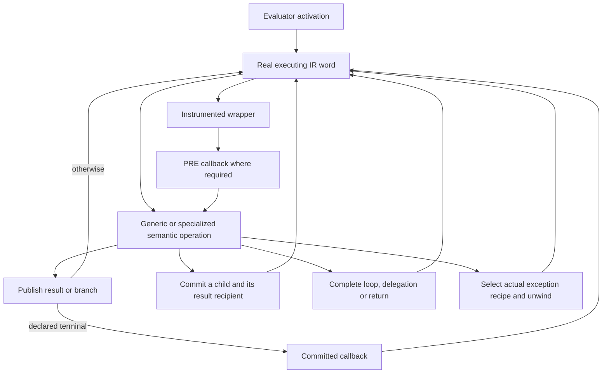
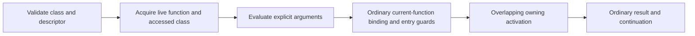
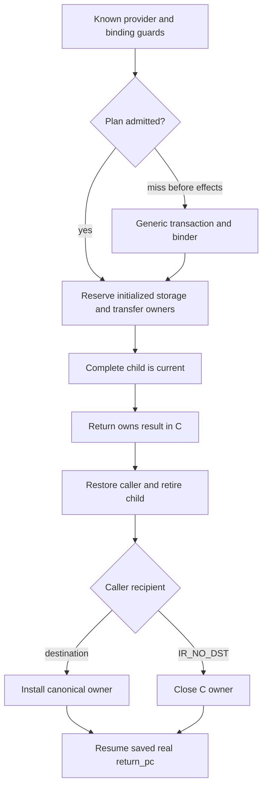
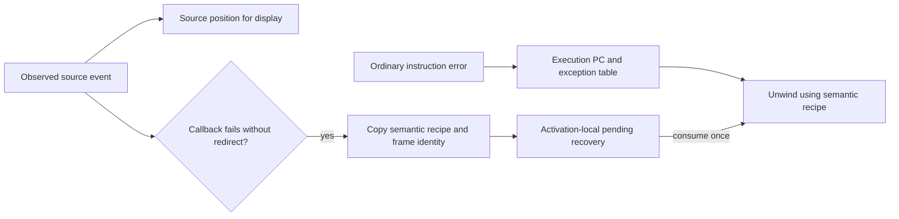
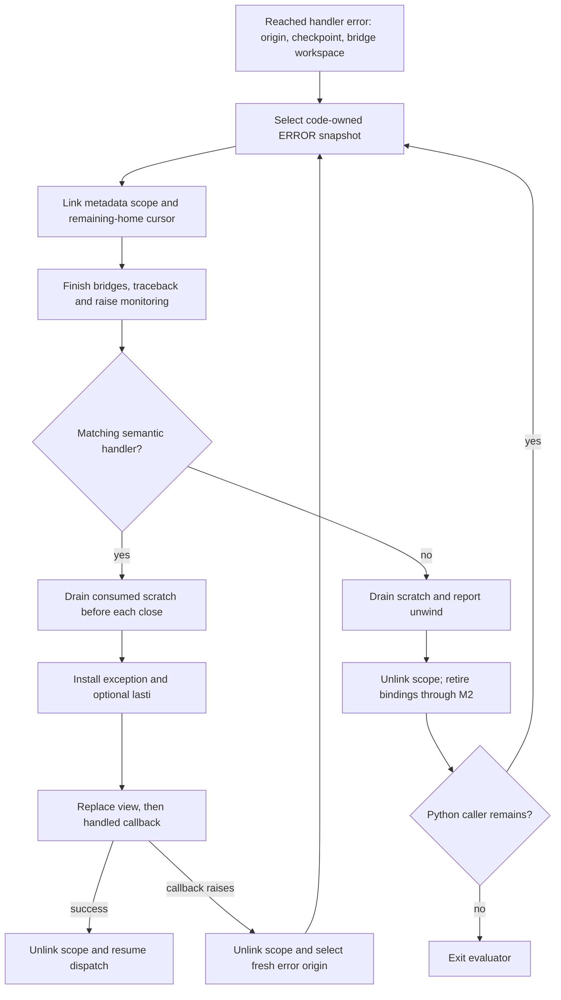

# Register interpreter: current contract

This page describes the selected register interpreter and its call paths.
[Status](../STATUS.md) records qualification, measurements and limits.
The [active performance plan](../issues/interpreter-performance56/plan.md)
reviews a combined architecture. Its proposed contracts do not change the
selected implementation described here.

The [register encoding](register-ir.md), [frame ABI](call-and-frame-lifetimes.md)
and [observer contract](handler-and-observer-contract.md) describe the same
runtime. Its owning homes and release protocol implement RC; Python does not
require immediate finalization. [Lifetime policy](lifetimes-and-language-semantics.md)
separates language behavior from that implementation choice.
The [debugger transfer model](debugger-frame-transfers.md) defines explicit
entry, cold context/owner proofs and bounded saved-local restoration.

The [combined performance proposal](proposals/interpreter-performance56.md)
and [critical audit](../issues/interpreter-performance56/review.md) describe
reviewed successor work; they do not upgrade the selected implementation.

## Entry and dispatch

A code object holds pristine eight-byte IR words and feedback initialization.
`Python/ir.c:_PyCode_GetExec` lazily creates its shared mutable executing copy
and feedback vector. Running frames own the code and retain pointers into that
allocation. Specialization and instrumentation patch handler fields.

`Python/bytecodes.c` and the cases generators produce one `_TAIL_CALL_*` handler
domain, dispatch metadata and observer contracts. `Python/ceval.c` enters the
first handler; handlers transfer with GCC musttail dispatch. Execution consumes
register homes directly, without a runtime stack-bytecode translation stage.
IR registers are physical memory homes, not machine registers or optimizing SSA.

Source-only boundaries have no dispatched word. Shared cleanup instructions
that remain in the current compiler are an unfinished separate workstream;
there is no claim that every release-only word has been removed.

## Frame storage and ownership

Locals, cells, free variables, hidden scalar constant homes and temporaries
share one canonical PyValue array. A home contains NULL, an inline value, an
immortal, or an owning object edge. Mortal borrowed views are C-local and require
an owner; ordinary frame homes are not borrowed references.

Pure local loads duplicate the canonical home's owner and reuse its value bits.
The generator proves the exact local-read/duplicate source before selecting the
shared canonical final store. Local, temporary and discarded destinations retain
the same ownership and displaced-owner handling; raw providers still publish
their results through the ordinary boundary.

Plain yield transfers an unchanged canonical input through the existing
canonical return sink. Specialized list indexing uses the canonical final store
only after the complete guard/bounds/duplicate/retirement chain is proved. Its
early temporary publication before retiring the list remains ordinary. Proofs
bind the original token structure to the AST actually emitted; altered bodies
fall back to ordinary publication. Instrumented yield keeps its full boundary.

Temporary future-read liveness is not owner occupancy. Cleanup must retain or
retire an initialized owner even if no later Python operation reads it. GC,
frame copying, unwind and debugger inspection share that invariant. Normal
thread retirement clears local homes after proving temporary homes NULL;
exceptional and escaped/generator paths retain their appropriate full handling.

Thread chunks have opposing header/value stacks and one initialized frontier.
Reservation establishes valid value cells before constructing a header, filling
only the uncertain suffix. A header truncates that frontier before overwriting
value-capable memory; pop never restores a saved frontier. All retirement and
reentry paths must leave reusable value cells NULL. Separate heap frames are
initialized once, while full ownership copies initialize their destination by
moving every home. See the [frame ABI](call-and-frame-lifetimes.md).

Guarded integer ADD and SUB use a whole-producer proof of canonical output
across their inline and boxed-overflow arms. The proof checks the guards,
overflow predicate, error path and input retirement; it does not generalize to
other arithmetic or arbitrary boxing calls.

## Guarded attribute values

Non-descriptor instance-load handlers support canonical inline class values.
Feedback stores `_PyValueGuarded` metadata, not a persistent
`PyValueBorrow` or an owning home. A hit checks the receiver type version and
its admitted layout, creates a transient borrow, then acquires an owned canonical
result. It publishes that result through the existing result-retirement
transaction before receiver retirement can run Python. Shape, instance-slot and
module reads use that same publication contract with their own storage guards.

The class-value path requires absence from shared instance keys and valid inline
values, or a type with no instance dictionary. Shared-key insertion invalidates
the owning type before publishing a new name; dictionary replacement invalidates
inline values. Type/MRO changes invalidate the class-value proof. Descriptor and
custom-hook classification remains unchanged. Polymorphic snapshots copy inert
metadata according to the recorded handler; they never turn stale payloads into
borrows or owners.

Direct class-object reads use the same guarded canonical payload for admitted
objects and inline scalars. The existing class/MRO version and, when required,
metaclass version protect it. Descriptor precedence and custom-provider
classification remain in specialization. The ordinary reader acquires a result
before receiver retirement through the same checked publication contract.

Guarded words occupy independent fields beside native-only pointer/shape
unions. Attribute feedback is 48 bytes; snapshot payloads are 16 bytes and the
four-row polymorphic record is 120. This satisfies the existing word/union API
rule without a checker exemption. Allocation, reset and accounting use actual
type sizes. Larger records reduce optional private feedback capacity; overflow
must retain generic execution. This footprint is a measured performance
tradeoff, not a change in value encoding or cache ownership.

## Classmethod capture

An eligible method-form class lookup supplies the ordinary owned
`(function, accessed_class)` pair. Its cache stores the exact builtin classmethod
descriptor, not its mutable wrapped function. A hit checks the builtin metaclass
and class version, reads the current exact Python function, acquires it, and
transfers the actual accessed class. No receiver retirement occurs in this split.
Inherited lookups bind the subclass. Attribute-form retrieval still produces a
bound method; unsupported receivers/descriptors retain generic lookup.

`classmethod.__init__` can replace its callable without invalidating the class
version. Capture therefore happens at lookup, before later arguments can mutate
the descriptor. CALL uses that captured pair and checks the function's current
code/default/provider facts; it never resolves the descriptor again.

### Canonical method capture

Guarded canonical capture covers the three ordinary method layouts.
After the existing lookup guards, it acquires the
descriptor owner and transfers a temporary receiver or duplicates a local one.
The generator proves each output is canonical and publishes it without numeric
recanonicalization. The cache word is non-owning metadata; a transient borrow
is valid only after the live guards. Canonicality does not prove that the
descriptor is a Python function.

## Python calls and ordinary return

Exact calls guard their standard Python provider, select the final base and
saved top, reserve initialized storage once and initialize one child header.
Cold helpers handle frontier growth and argument transfer from a non-thread
caller; owners transfer into the resulting child. A versioned known-call plan
lets guarded CALL_PY_GENERAL bind common positional calls directly through `call_bind_known_python`; no generic
transaction record is built on that hit. It fills defaults and empty variadic
bindings under the same owning-frame ABI. Fixed 1–3-keyword plans use that
same overlap primitive and move only their bounded suffix through C-local
owners. A pre-effect miss uses the existing transaction/provider path.
Extended, instrumented and unsupported shapes retain complete provider handling.

Compiler-proven empty kwargs may remain a pending local until a materialization
barrier. Folded reads, cell/alias hazards and frame publication are covered by
the compiler/constructor proof and cold observation helper; unrelated local
loads have no pending-value class test. Excluded code eagerly creates its dict.

The caller saves `return_pc` as a real executable continuation and `return_slot`
as a plain local/temporary destination or IR_NO_DST. Return keeps its canonical
owned value in C across child unlinking and retirement. Ordinary CALL recipient
completion stays inline: publish into the destination, retiring its actual
replaced owner, or close the discarded C owner. The saved recipient and
continuation fully describe normal return.

Generic transactions still protect caller owners across preparation, callbacks,
monitoring and fallible binding. They pin the actual executing code and refresh
after effects; a completed callback is not replayed on a guard miss. Once
ownership commit begins, failure retires the published child instead of falling
back to a second call. Code remains a separate owner because function.__code__
can change while a child executes.

## Iteration, delegation and resume

FOR_ITER's body edge preserves its iterator/cursor and defines only the item
recipient. Exhaustion kills the pair and does not overwrite the last loop local.
SEND's yielded result goes to B+2; completed delegation kills its window and
publishes A, or discards at IR_NO_DST. CLEANUP_THROW completes into that same
recipient and its named real successor. Native and Python-generator routes use
the same owning completion primitive; ordinary CALL return does not pay a
universal generator transaction.

A VM child's completed return reads the actual site's immutable SEND/FOR word.
The constructor proves its destination, window and signed exit geometry;
specialization and instrumentation preserve those operand fields. The saved
physical continuation plus the signed distance selects completion, including
an assembler-provided far-jump adapter. No general metadata decoder is needed
on this positively declared return path.

One C completion body serves all providers. Proved VM returns instantiate it
with a literal SEND/FOR kind and canonical input, letting the compiler remove
redundant publication and inapplicable owner checks. Native and THROW providers
use the same body with general publication. The existing observer adapter,
window detachment, destination installation and post-retirement PC reload are
shared; the specialization introduces no frame state or per-resume work.

Completion separates fallible PRE observation while original owners exist from
POST observation after the semantic outcome is committed. It detaches windows,
publishes destinations and continuations before closing owners, and preserves
supported callback redirects. STOP_ITERATION, branch directions and source LINE
are independent observer capabilities. Real error StopIteration reporting and
implicit completion reporting must not emit duplicate exception events.

Declared terminal providers commit output homes and the saved continuation
before observing. The actual PC remains their semantic owner site during the
callback, then the selected PC is published before deferred retirement. Errors
preserve the callback exception; close-time redirects retain the latest PC.
The backward JUMP poll remains before this barrier. POP_ITER holds its detached
iterator through observation and retires it afterward. Its reported branch
source and BRANCH_RIGHT event are distinct from its own fallthrough edge.

YIELD_VALUE separates its outgoing owner from the next resume input recipient.
For an unused input, IR_NO_DST closes the incoming owner only after the parent
transfer cell is detached and the resumed child's current-frame, exception and
recursion links are committed. Delegated suspension retains the actual receiver
lookup relationship. Initial generator construction uses the same explicit
recipient model. Hidden interpreter/initialization entry starts at its real word-zero
continuation.

## Errors and observation

`f_lasti`, disassembly and exception offsets remain compact executable indices.
Eliminated source LINE spans are stable recovery edges in the code's IRSC1
`co_exceptiontable`. Optional IRSM2 `co_linetable` positions join those edges
for location delivery. Their callbacks publish an observer-only source cursor and line;
they do not invent an INSTRUCTION event or a virtual public offset.

The constructor's completion proof follows normal/error/source-callback edges,
tracks unavailable original homes and definite NULL, and rejects required reads
of retired owners. Generated terminal observer facts distinguish the committed
physical output from a retired old owner at the same home. A source-only
callback error uses the declared POST state; an ordinary exception recipe
covered by that word must work for both compute PRE and observer POST. Actual
exception/lasti definitions and fresh physical output locations matter;
frontend writes and pass-through shapes alone are insufficient.
Implicit RERAISE anchors may be semantically unread, while saved locals that a
handler restores remain required. This preserves the selected PEP479 and
inlined-comprehension error semantics without a second unwind engine.

When a source observer fails, it copies the resolved semantic exception recipe
to the evaluator activation with its frame identity. The unwinder consumes and
clears that recipe for the matching frame without decoding positions.
Nested Python entry has a separate activation. The frame object's source ordinal
serves display independently and need not exist on allocation failure. Removing
optional positions leaves EH and recovery rows unchanged. Stable semantic row
IDs also index observer state when no position quad is present.

A PRE LINE or INSTRUCTION callback may raise even when the instruction body
cannot. Admission keeps that exceptional predecessor independently of ordinary
error-route metadata. Its checked wrapper can preserve incoming logical
absence below the handler's clear floor; it cannot establish initialization or
readability. If LINE redirects and then raises, the setter has already cleared
unrelated scratch and retained only matching exception-protocol origins, so
handler selection follows the normalized target rather than an old-PC view.

Observer scopes pair actual frame, site, physical continuation, event, owner
edge and redirect generation. Completed source providers grant SOURCE_POST;
legacy inline hooks with unfinished work deliver the same events under an
unsupported scope. Source records name normalized real landings, while the
scope retains an immediate relaxation continuation when present.

The setter shares one owner/restoration Plan across real PRE and certified
committed views. Neutral JUMP borrows its exact site state; a legacy LINE
callback emitted on a backward JUMP carries that JUMP's committed scope.
Non-neutral outcomes use a request-owned copy of the exact site rows with the
selected normal transfer applied. Retiring an old input cuts its provenance
even when a replacement value occupies that home. This path excludes transfers
that create context or saved-binding tokens.

Non-neutral cancellation requires an exact scope, physical successor and
generation, inherited handled context, empty stopped and target saved-binding
state and no incoming target scratch owners. It cannot reuse PRE survivor proofs
or source-only fallback. Warning callbacks require a fresh view and Plan; a newer redirect
discards old edge authority. Existing PRE restoration and strict neutral
protocol recipes retain their checks. General SOURCE_POST, yield and
suspended-frame transfers require separate capabilities.

A cold frame-object LINE handoff records expected real landing, previous source
line and monitoring epoch. It is separate from public f_lineno. Landing detaches
it before callbacks and accepts only matching continuation/configuration;
reconfiguration produces a fresh landing event without replaying old edges.
Exact relaxation adapters normalize LINE landings while their helper words keep
real INSTRUCTION events. Setter, exception and frame-clear paths invalidate the
handoff before callbacks. Broader event parity remains under qualification.

## Active model55 error processing

Candidate `dc6bad8a625` runs errors through `_PyEval_ProcessError`, an outlined
function in the evaluator translation unit. Golden54 remains unchanged; the
[report](../issues/call-model55/report.md) owns measured identities and limits.
The reached handler passes the immutable origin, emitted checkpoint and its
actual bridge workspace before bridge disposal can call Python. Successful
instructions gain no descriptor, lookup or handler argument.

The cold function links a metadata-only ERROR scope on the thread. Active
frame traversal owns its edges; external-root traversal skips this descriptor.
Its selected view and descending remaining-home cursor survive bridge cleanup,
traceback creation, monitoring and scratch release. Detach and advance before
each close. Named bindings stay dynamic, and the executing-code pin lasts
through the final selected-view use.

The first proved static snapshots cover GET_ANEXT's projection and native
failure routes. Missing proof selects explicit initialized-NULL control while
this migration is incomplete. Installing exception/lasti changes the shape;
the handled callback likewise uses control until that transform is certified.
The bitmap experiment selects its actual presence plane instead. Neither
checkpoint zero nor an instruction's normal program grants static readability.
The function loops over unwound Python frames and returns HANDLED or EXIT;
it does not add one recursive native unwinder call per Python frame.

## Limits

The active interpreter uses the selected universal PyValue/RC representation
and rebuilt-source ABI. Native method/tracing JIT tiers, machine register
allocation, OSR and general native recovery maps are separate future work.
Source-level ownership review and a short parity screen do not replace full
functional qualification, broad regression repair or the matched parity gate.
