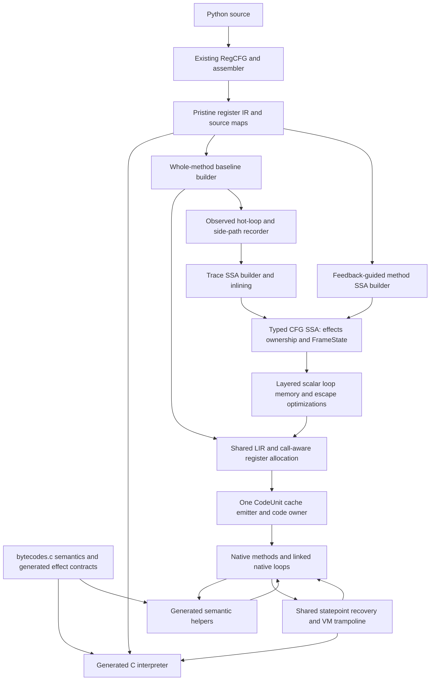
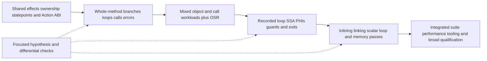

# One method and tracing JIT system

Selected system design, initially responding to Loom review36. Partial source
experiments exist; the [work board](../issues/README.md) owns implementation state
and assignments. The qualified interim RC images contain no new native tier.
The JIT is the chosen development direction; experiments select mechanisms and
optimization policies inside that system. They do not repeatedly ask whether
an unfinished arithmetic prototype proves that a JIT should exist.

## Design decision

Build a whole-method baseline compiler and one optimizing compiler with method
and trace frontends. They share semantic operation definitions, frame recovery,
ownership, feedback, code lifetime and a machine backend. The baseline lowers
straight to the common low-level IR; optimizing frontends construct typed CFG
SSA before lowering to that same backend. Tracing selects observed hot paths
and inlines across calls; it is not another arithmetic opcode implementation.

The earlier selected BINARY_OP head compiled several arithmetic operations, but
its region and exit contracts still restricted it to a tiny no-call interval.
That is useful backend bring-up, not an adequate architecture for amortizing
JIT boundaries across loops, calls and object operations. Its frozen source
passed source review and remains unexecuted. Its interrupted activation did not
take effect; there is no new runtime or performance result to accept or reject.

V8's Sparkplug demonstrates broad baseline coverage through bytecode compilation,
shared runtime operations and interpreter-compatible frames. Maglev demonstrates
a compact CFG-SSA pipeline with feedback, representation selection and recovery
state. We adopt those separations, not JavaScript ownership or published V8
speedups. [Sparkplug](https://v8.dev/blog/sparkplug),
[Maglev](https://v8.dev/blog/maglev).

LuaJIT separates observed recording, SSA optimization, snapshots and assembly.
Its loop optimizer reuses folding and forwarding through guarded loop peeling.
Those are useful models for keeping loop values and guards out of repeated
interpreter work. Python's arbitrary-precision integers, destructors and C API
require additional ownership and recovery rules.
[Recorder](https://github.com/LuaJIT/LuaJIT/blob/v2.1/src/lj_record.c),
[loop optimizer](https://github.com/LuaJIT/LuaJIT/blob/v2.1/src/lj_opt_loop.c).

## Separate the representations

The existing eight-byte executable IR names physical frame homes. It is a
reasonable baseline input and recovery format, not proof of an optimal
interpreter encoding or an optimizing SSA representation. RegCFG already has
region-local fresh temporaries, exceptional liveness and slot compaction; joins
use canonical homes without general PHIs. Those facts are explicit in
[pycore_regcfg.h](../../Include/internal/pycore_regcfg.h).

Initially decode the validated pristine CFG and version home writes into SSA,
adding merge and loop PHIs. Preserve original words and exceptional edges. A
later pre-compaction input can reduce reconstruction cost without changing the
optimizer's contract. Baseline homes are stable semantic locations; SSA values
are identities; physical registers/spills are backend choices. This separation
removes the previous assumption that every intermediate result must stay in a
frame slot. Interpreter density and dispatch remain measurable design choices,
without blocking the optimizing compiler on an interpreter rewrite.

The shared LIR supports integer and floating register classes, call clobbers,
fixed ABI operands, branches, relocations, parallel PHI moves, spills and
statepoints. Start with linear scan and interval splitting. Snapshot-only uses
extend liveness; raw numeric spills and owned tagged values are distinct. The
existing scalar encoder and spill tests are ingredients, not a complete
call-aware backend.

## Whole-method execution and calls

The baseline compiles complete pristine-word basic blocks and their native
branches/backedges. Decoding and instruction dispatch happen during compilation.
Common fast paths can become native instructions; generic operations initially
call generated semantic helpers. A helper returns to its compiled continuation,
not an interpreter opcode-dispatch loop.

Use `JitAction entry(JitContext *)` and
`JitAction op(JitContext *, const DecodedOp *)` as the common interface.
`JitContext` carries the real thread state, current Python frame, logical word
PC and typed transfer state. Actions distinguish Continue, Branch, EnterFrame,
Return, Raise, Yield and Deopt. Known branch targets become native jumps.

One VM trampoline switches real Python frames on calls/returns/unwind; it does
not recursively grow the C stack once per Python call. Reuse call-window
preparation, frame push/return slots, recursion checks and exception machinery.
Initially resolve a CodeUnit at frame transfers; versioned call links can later
bypass that lookup. C extension calls use existing conversion/vectorcall paths,
with published state before arbitrary reentry. Suspension retains canonical
Python-frame homes and a logical continuation, never a native stack address.
Argument/result ownership transfers and recursion accounting happen exactly
once per logical frame call or return, including error paths.

Extend the cases generators to emit callable semantic adapters from the same
operation source as the interpreter. Existing C bodies contain dispatch gotos,
frame switches and error labels; they are not already callable helpers.
Generated coverage must account for every valid pristine handler and classify
its normal, error and suspension outcomes. Unsupported compiled constructs have
an exact interpreter continuation. This bridge supplies broad semantics while
native fast paths grow; a permanent helper call for every simple operation is
not the intended final baseline.

## Recording, OSR and optimizing regions

Choose a true observed recorder, assisted by baseline execution. A selected hot
backedge enables bounded observation of actual operations, outcomes, branches
and frame transfers. Recording does not replay a Python operation to discover
its result. Abort discards compiler state while ordinary execution continues.
Recording pauses inside opaque extension callbacks: retain the call/outcome
boundary, without accidentally recording arbitrary reentry as an inline call.
Only explicitly supported Python-call transitions participate in inlining.
Hotness is measured at loops/call sites, with one automatic budget/cooldown and
cache policy, rather than another universal frame-entry arithmetic check.

At a hot loop header, import actual homes and guard needed representations.
Construct loop PHIs and keep the loop in native code across iterations. OSR
enters the current loop state after required periodic work; it does not rerun
function entry. Preserve interruptible and NO_INTERRUPT backedge semantics.
Every native loop and bounded long path services observation and pending work.

A failed trace guard initially reconstructs state and resumes baseline. A hot
side exit can record another trace using the same SSA/backend. Versioned links
and register/PHI adapters later connect compatible traces directly. Inlining
uses exact callee/version guards and logical inlined frame states. Method SSA
uses the same operations and passes for broader stable CFGs; traces specialize
observed paths through those methods. These are frontend/region policies over
one optimizer, not permanent competing implementations.

## State recovery and Python ownership

A shared `FrameState` names logical frames, original word PCs, exception context,
call/return destinations and every live home, including NULLs and owners kept
alive only for an error edge. Values may be in canonical homes, registers,
spills or constants; materialization recipes require an explicit failure path.
LuaJIT snapshots supply a concrete reference for mapping changed slots and
frame links to recovery state.
[Snapshot implementation](https://github.com/LuaJIT/LuaJIT/blob/v2.1/src/lj_snap.c).

Every statepoint identifies **before-effect**, **after-effect**, or **error**
continuation. A failed arithmetic guard can resume before that operation. An
exit after a completed call/store/destructor resumes after it and retains its
result or exception outcome. Reconstruction must never replay observable work.

Effects distinguish scalar purity, guarded reads, writes, allocation, exceptions,
callbacks, reference releases, suspension and observation. DECREF can execute
Python; a borrowed register is not an owner. Publish replacement homes before
releasing old owners, and invalidate affected facts after callbacks. Treat
snapshot liveness and ownership releases as real uses when eliminating code.

For bring-up, retain boxed owners in canonical homes at reentrant boundaries;
allow unboxed scalar chains only with reconstructible exits. This is a starting
invariant, not a permanent all-values-in-memory policy. General boxing and
inlined-frame materialization can allocate and fail. They must root intermediate
owners and specify OOM state; do not claim arbitrary deoptimization is
allocation-free. Preserve existing integer overflow, subclass/dunder, NaN,
signed-zero, identity, finalization and exception semantics.
Before an irreversible effect, materialize live values whose later recovery
could allocate, unless allocation-free installation or a defined safe recovery
path is proved. This includes storage needed for logical inlined frames.

Before opaque helpers, C calls, suspension and Python observation, publish valid
frames, homes, PC, return locations and exception state. Local/global monitoring,
trace/profile, eval-frame hooks and frame access invalidate links and recover at
defined statepoints. Merely adding a machine-PC map does not make an unpublished
Python frame safe to inspect. The early baseline publishes at each helper;
optimization removes publication only where the effect/recovery contract permits.

## Feedback, ownership of compiled code and tooling

A `CodeUnit` owns executable bytes, relocations, PC/state maps, dependencies,
entry adapters, links and tooling handles. Compile privately, validate source
and dependency epochs again, publish W→RX transactionally, then expose entry.
Invalidation unlinks future entry before retirement; active activations pin
executable bytes and required metadata until they cannot reach retired code.
Mutable dependencies use weak/versioned handles and invalidation, with a
lifetime check before dereference. Recording or caching must not retain an
arbitrary object beyond its semantic lifetime and thereby delay its finalizer.

Prefer owning-code constant indices initially. General retained functions/types
or constants require traversal/clear through a Python owner; invisible
code→artifact→function→code cycles are unacceptable. Detach entries before
reentrant reference release. Bound recording, compilation and code memory with
one policy. Existing publication/unwind code is reusable infrastructure; its
current `_Py_JIT` gating and frameless prototype metadata do not already satisfy
this ABI. Actual CFI, source maps and supported tooling precede adoption.

RC with cyclic collection stays selected. This design does not reopen GC or
require a new allocator to compile loops and calls.

### Executable Action and recovery interface

**Design contract, not present runtime code (2026-11-07).** The integrated
runtime has the register interpreter and `Python/perf_jit_trampoline.c`, but
no whole-method JIT, `JitContext`, native `JitAction` ABI or native recovery
implementation. The types below define the next executable boundary; they do
not turn a generated handler effect bit into a state map.

A `JitAction` returns one tagged outcome: `Continue(next_word)`,
`Branch(target_word)`, `EnterFrame(prepared_call)`,
`Return(owned_value, recipient_slot)`, `Raise(fault_word)`,
`Yield(owned_value, resume_word, recipient_slot)`, or
`Deopt(resume_word, statepoint_id)`. `Continue` and `Branch` require no
pending exception; `Raise` requires a raised exception and records its fault
word, not a selected handler or next word. `RERAISE` may update that fault
word before returning `Raise`. A shared unwinder performs raise monitoring,
traceback attribution and exception-table selection. Every action also names
the completed-effect prefix and a `before-effect`, `after-effect`, or `error`
statepoint; a guard failure after a callback, store or release cannot restart
the word. `JitContext` carries a **non-owning** current-frame handle, thread
state, executable epoch and logical word PC. The frame's existing `owner`
governs its storage lifetime. No raw frame/word/slot pointer survives an
allocation, helper or callback without revalidation and reload.

There is one transfer protocol, shared by interpreter and native entry.
Preparation may allocate, bind and decline while the parent call window
still owns its homes. `EnterFrame` carries a prepared transaction that owns
its private copies and any allocated child; it has not detached the parent
or changed `current_frame`. The trampoline invokes the shared commit routine
once: set the parent's `return_slot`, detach inputs, publish the fully
initialized child as current, then retire displaced owners. A failure before
commit cleans the private copies/child and leaves parent homes owning; after
commit there is no decline or replay. Existing
`call_transaction_overlap_python`/fallback already perform parts of this
commit, including changing `current_frame`; JIT adapters cannot call them
unchanged. Factoring their existing preparation and commit is a prerequisite
of native call actions, and must preserve the interpreter's sequence.
`Return` and `Yield` each transfer exactly one owned `PyValue` to the named
recipient home; the transfer routine consumes it on success or closes it on
failure. Return unlinks the dying frame before clearing it, then installs the
held result in the parent. Yield installs the held result for the caller,
sets the generator's send `return_slot` and logical resume word, moves its
handled-exception link, records suspension state and resumes the parent.
These transitions, recursion/monitoring events and cleanup run once in the
shared transfer routine; the trampoline routes its result and does not
repeat field mutations. `Yield` inherits the current no-raise contract.

Each recoverable native point has a `FrameState` with: logical frame chain;
executing/fault word and next semantic word separately; parent call's
`return_slot`; the pending raised exception separately from the
handled-exception stack; and **every physical frame home**, including
explicit NULLs. The handler target is chosen by the shared unwinder from
the fault position and current exception table, not frozen in a snapshot.
Mark each home as real or virtual. For each non-NULL value record its
location (canonical home, machine register, spill or constant),
representation and owner identity: exactly one owner per owned reference,
or a borrow naming a stable owning home, or an immortal. Two locations can
alias one owner but cannot each claim its count. Add owners kept only for an
error edge. A materialization recipe names its inputs, destination and
whether it can allocate, release or call Python. A statepoint records
`before-effect`, `after-effect` or `error`, the completed-effect prefix and
the corresponding resume/fault word. This is semantic state, not interpreter
`reads`/`through` extent or future-read liveness; a valid home may be needed
even if the next word never reads it. Optimizing SSA values and physical
register/spill locations map *to* these homes, without changing the baseline
64-bit word.

Recovery has two phases. First, while the current native activation still
owns its values, validate the code epoch and reserve/materialize everything
fallible **without destroying the old valid state**. An allocation or
release may itself call Python: publish valid frame homes and roots before
that call, then revalidate the actual current frame, executable words and
feedback, instrumentation and dependency versions afterward. Second,
atomically install canonical owned values and NULLs in real frame homes,
set `instr_ptr`/return slots and exception state, and transfer to the
interpreter or baseline continuation. No C-owned value may be both installed
and closed; no borrowed register owns an object or survives a callback
without a proven stable home. The first implementation retains canonical
homes at every helper/effect boundary and **prohibits** fallible
materialization after an irreversible effect. Later compiled regions may
allow it only with a specific post-effect OOM route: the completed operation
remains completed, the new error has a declared fault PC and precedence over
any prior pending error, and each original/intermediate owner has one
cleanup path. Otherwise reserve and materialize before the effect.
Callback/finalizer statepoints publish observer-visible locals and PC first,
then invalidate facts depending on mutable homes, instrumentation or code
identity. OSR imports the actual loop-header owner/NULL map after required
periodic work. Suspension publishes generator homes and a logical resume PC,
with no native-stack dependency.

The first **planned checker**, before any native backend claim, is a bounded
offline fixture over current pristine IR: decode one ordinary call with
success/raise/decline outcomes and one attribute-result retirement with a
callback using their actual word roles and generated contracts. Record
source-checked before/after/error home maps, NULLs, one owned result, a
borrow's named owner, fault/resume words and the parent return slot. Reject
duplicate owners, an unowned borrow, missing home/NULL, a before-effect
resume after a callback, and success with a pending exception. This validates
the contract *shape* only; existing `_PyIRFormat` effects are whole-handler
summaries and do not prove intra-handler order. Keep the fixture local to
this experiment, with no parallel opcode table. Admission of **native
recovery** later requires forced exits from an actual compiled slice and
differential comparison of frames, values, raised and handled exceptions,
finalizer order, call failure, post-effect guard, generator yield/resume and
OSR entry against the interpreter. No speedup is claimed from the checker.

## Optimization layers and concrete hypotheses

| Layer | Mechanism | Experiment answers |
| --- | --- | --- |
| Broad baseline | Predecoded native CFG, direct continuations, shared helpers; inline simple native paths progressively | How much dispatch/decode work is removed after helper, compilation and call-transfer costs? Include loops, branches, Python/C calls and mixed objects. |
| Scalar SSA | Folding, copies, CSE, DCE, checked arithmetic, representation selection and dominating guard elimination | Which repeated guards, boxing operations and home accesses disappear? Verify overflow/exits and snapshot-live values. |
| Loops and allocation | PHIs, ranges/narrowing, guard-aware peeling/LICM, call-aware register allocation | Do values remain in registers across iterations? Measure polls, spills, exit rate and warmup break-even. |
| Calls and paths | Callee guards, bounded inlining, side traces and direct links | Does reducing call/publication/exit traffic improve call-heavy and polymorphic work without churn or unbounded code? |
| Memory and ownership | Alias-aware forwarding/DSE, safe RC elision, escape analysis and scalar replacement | Which loads/allocations/refcount operations can be removed while preserving identity, callbacks, finalization and OOM behavior? |

Do not hoist effects because their inputs look constant. In particular, guard
and alias dependencies, exception order and last-reference releases constrain
loop motion. Optimization legality and recovery states are designed together.

## Implementation and gates

First deliver the shared helper/Action/ownership contract and a usable baseline
slice containing a loop that calls Python and C, plus branches, an error exit
and exact suspension fallback. Build the shared LIR and state-map verifier in
parallel. Next record a real loop with PHIs, guarded arithmetic, a side exit,
periodic polling and a call boundary. Then add linking/inlining and the next
optimization layer based on observed costs. The same statepoint and code-owner
interfaces remain in use throughout.

For each increment: state the hypothesis and scope; review the affected
contracts; implement; run focused differential, ownership, error and exit tests;
review actual behavior/emission; accept or change that mechanism. Cheap host
coverage checks and narrow correctness precede native diagnostics. Measure cold
compilation/startup and warmed execution separately, including real calls and
mixed work. Counters outside scored paths explain coverage and exits; they do
not manufacture hotness or replace elapsed evidence.

Run the full suite at meaningful integrated milestones and before adoption,
with expensive stress/ASan/stdlib/extension/tooling qualification late. Retain
regressions and failed hypotheses honestly. An incomplete component's loss
informs the next mechanism; it does not reject the JIT program. Conversely,
strategic confidence is not a speed claim or permission to integrate an
incorrect runtime.

Implementation file boundaries, peer findings and the next finite source slice
will be closed in the [active issue](../issues/jit-e2e-system/status.md). No speed,
completion date or implementation authorization is implied by this draft.

## Source boundaries

| Responsibility | Existing authority and proposed consumer |
| --- | --- |
| Semantics and adapters | `Python/bytecodes.c`, `Python/ceval_macros.h`, `Tools/cases_generator/ir_generator.py`; add a helper-generator consumer rather than hand-copy the interpreter |
| CFG and source state | `Python/regcfg.c`, `Python/regcfg_passes.c`, `Python/assemble.c`, `Python/ir.c`; decode pristine words for the first baseline/SSA builders |
| Frames and transitions | `Include/internal/pycore_interpframe*.h`, call/return/unwind operations in `bytecodes.c`; add shared JitContext/Action/state-map interfaces and one VM trampoline |
| Optimization | Add method/observed-trace graph builders and shared typed SSA, effects, ownership, FrameState and pass verifiers |
| Native backend and lifetime | Extend `Python/jit_x86.h` ingredients into shared LIR/allocation/emission and a CodeUnit owner; adapt `jit_publish.c`/`jit_unwind.c` for the actual calling convention |
| Observation and feedback | `Python/instrumentation.c`, `Python/specialize.c`, `Python/ir.c`, `pycore_feedback.h`; share versioned site identity and invalidate compiled assumptions |

New file names and the first source manifest are selected after integrated
review. These proposed consumers are not existing functionality. Retained
arithmetic experiments supply component tests and encoding lessons; their
fixed-size prefix owner and entry policy are not the system runtime.
