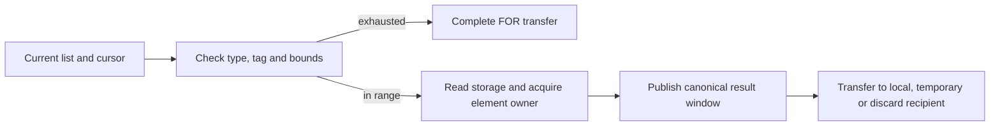

# Comprehension hot paths

Implemented candidate: `9ec291998f7395fedf21f456e5eb58c2187d2e23`.
The [workstream plan](../../issues/comprehensions57/plan.md) owns qualification
and selection. This document specifies the candidate; selected architecture
remains identified by [status](../../STATUS.md).
Selected57 adopts only the shared dictionary provider and lifetime repair from
this candidate. Method entry, list iteration and append remain rejected
experiments; the [report](../../issues/comprehensions57/report.md) records why.

The measured comprehension workload executes fewer IR words than upstream
bytecodes, but more native instructions. The change removes repeated admission,
conversion and call-boundary work from four common operations. It does not
specialize for the benchmark's classes, keys or iteration counts.

## Checked native method entry

`CALL_METHOD_DESCRIPTOR_FAST` already checks the exact descriptor, supported
calling convention, nonempty argument window and exact receiver type. Its
continuing arm invokes `_PyMethodDescr_CallFast` with these preconditions;
it no longer reenters general value-vectorcall dispatch.

The helper selects the value-native invocation or existing object FASTCALL
adapter. Fixed NOARGS/O forms retain their argument-count checks. Method
converters still validate their arguments, and invocation still enters and
leaves the recursion guard. The object adapter retains its boxes and borrow
scope. Keyword-capable descriptors keep their existing route.

The instruction retains its ordinary escaping-call contract: save observation
state, invoke, handle errors before consuming inputs, publish the result, retire
the callable, drain arguments and perform periodic checks. Admission does not
make a borrowed receiver immortal or prove an arbitrary native result canonical.

## Dictionary provider boundary

The internal value reader API validates the dictionary and language key.
The already-typed `dict.get` implementation enters below that validation.
Both use one implementation of hash/lookup/result acquisition, instead of
stacking general reader and known-hash reader scopes.

`dict_lookup_value` requires its caller to keep the dictionary and query alive
through equality callbacks. It acquires the found value before returning to any
input cleanup. `dict_get_value` supplies the necessary dictionary/query scope
for arbitrary hashing or equality. General lookup therefore retains a real
dictionary pin; removing nested wrappers does not justify removing that owner.

A cached exact-string hash does not prove that equality cannot run Python:
a GENERAL table can invoke a stored custom key's equality method. The
callback-free admission predicate requires a cached hash and a Unicode-only
table under the GIL. Mixed tables use the scoped route, reusing the cached hash.
Membership shares the same predicate. Free-threaded code does not inspect a
mutable keys-table kind through this unlocked fast admission.

This closes an inconsistency with the fork's existing internal reader behavior.
Borrowed callers retain their own lifetime obligations.

## Checked list acquisition and representation transport

List iteration uses the existing exact-container, index and bounds guards to
establish one uninterrupted storage-read interval. The internal read acquires
the element with XDUP before its list anchor can retire. It avoids the
out-of-line borrowed getter and the spills needed around that call. The general
borrowed getter remains unchanged. Exhaustion completes through the existing
FOR transfer before acquiring an element; the free-threaded specialization
takes the generic route.

The diagram groups existing operations; its boxes are not new IR instructions.

Window inputs have no fabricated scalar home-graph tokens. Within the checked
interval, their current generator `Local` identities bind element dependencies.
A separate `known_canonical` fact carries only the acquired value's
representation into ordinary Storage publication. Copies preserve that fact;
joins intersect it. Mutation, reload, address escape and callbacks invalidate
it. For/while revoke it before and after the loop, including the
zero-iteration path. A declaration cannot inherit an outer same-name value's
fact. Scalar tokens remain authoritative when present; an expired token cannot
recover authority from the boolean.

This fact grants no extra reference, non-NULL condition or readable frame home.
The owning acquisition and existing recipient/retirement protocol provide
those separate guarantees. Producer validation rejects binding/shadowing of
lowering interfaces and opaque preprocessor directives throughout the
instruction, including prefixes. Structured conditional directives remain
supported.

Native inspection finds three added kind/tag guard branches after partial CSE.
They are charged to this implementation. A follow-up can combine checking,
exhaustion and acquisition around a checked native list-pointer view to avoid
reclassifying a pointer already projected and checked. Removing the cursor-tag
test requires a shared iterator-pair protocol proof across producers, joins,
observation and constructed images; the current assertions do not supply it.

## Consuming append primitive

`_PyList_AppendTakeValue` consumes an owned canonical input. With spare capacity,
its inline path stores the value, checks the home and increments size. It needs
no new reference or normalization. When full, it calls
`_PyList_AppendTakeValueResize`, which consumes the input on both success and
failure. Existing locking obligations stay with callers. Ordinary append and
specialized append calls use the same primitive.

Header inlining affects other callers and their placement too. Native handler
size reductions do not establish a workload gain. Final measurement compares
the composition with frozen golden56 and upstream; the rejected uniform handler
alignment experiment is excluded from this design.
