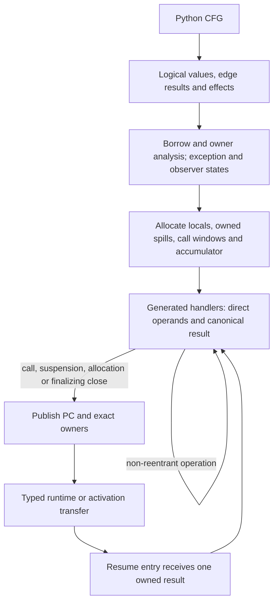

# Execution state: diagnosis and proposed replacement contract

Status: user-authorized direction, 2026-11-15. Source inspection and fresh
diagnostic profiles completed. The complete [layout unit](../../issues/register-semantics59/execution72-layout.md)
passed related behavior checks but lost its protected performance screen and
is closed. Two Sol 6.1 workers implement the reviewed
[accumulator/effect/activation contract](../../issues/register-semantics59/execution72-abi.md)
directly from selected57, dividing compiler/validation and runtime/generator work.
Selected57 remains golden. This does not restart the rejected experiments or
claim parity. Read the [current interpreter](../interpreter.md) for selected
behavior and the [trial report](../../issues/register-semantics59/report.md) for
previous results.

## Diagnosis

Our physical IR makes a temporary an owning, initialized memory home. The
compiler starts from a stack CFG, assigns registers, then compacts them subject
to stack-order ownership constraints. In selected57 `Python/regcfg.c:861`, a
new temporary must sit above every temporary held at its definition; canonical
temporaries retain stack-position slots. Exception suffix cleanup and contiguous
call windows depend on this. We have register addressing, forwarding and real
specialization, but not a general separation of logical values from their
physical owning locations.

This is not inherently incorrect: V8 also keeps virtual registers in frame
memory. Its useful contrasting choices are an accumulator, deliberately
generated handler machine code and a defined dispatch/runtime ABI. Register
bytecode alone supplies none of those advantages. See
[Ignition's architecture](https://github.com/v8/v8/blob/main/docs/interpreter/interpreter-ignition.md).
V8's tracing GC also makes copying a tagged value a different lifetime operation
from this runtime's reference-counted ownership transfer.

Three costs survive the opcode-count reduction:

1. Intermediate results repeatedly cross owning-home publication/consumption
   boundaries. Local/temporary/discard destinations and potential finalizers
   make a transfer more expensive than a value move.
2. Independent five-argument NCSR C handlers lose transient values at dispatch.
   Ordinary C calls require preserving VM state and rebuilding dispatch state.
   Cold effect paths influence hot register allocation. Neither tail calls nor
   computed goto alone solves this: the rejected monolithic core and compact
   execution island already demonstrate the opposing costs.
3. Resume/return retain general recipient handling. Selected SEND_GEN publishes
   the incoming value through `_PyFrame_SetReturnValue`; it checks redirect,
   discard and local replacement. YIELD_DELEGATED uses that same sink on the
   parent. Completed delegation additionally decodes the immutable parent word,
   detaches its window and enters the completion transaction. Upstream's ordinary
   yield writes to its known vacant stack top. Upstream still pays frame links,
   exception links, state checks and recursion bookkeeping; those are not unique
   regressions introduced by us.

Exact calls already overlap arguments. Slots are already compacted. PyValue
porting is complete. Feedback already uses a cached base plus encoded offset.
These are not missing optimizations. A smaller header or more aggressive slot
reuse cannot by itself eliminate the costs above.

## Fresh evidence

Evidence directory:
`/home/power/code/cpython/.worktrees/python-boil-the-ocean/build/pyjit-link-wave1/register-semantics59/architecture-diagnosis72-fresh`.
Its sibling `architecture-diagnosis72-driver.py` records the diagnostic commands.
Four warmed FIFO-controlled cycles profiles compare immutable selected57
`0dcba75bb3df` and upstream `3a440b656956`, CPU15, JIT off, hash0. Both cases use
identical kernels and hot loop counts across roles. Source, ELF, configuration,
module and kernel hashes are stable before/after; all four runs succeed and
report zero lost samples. This is one sample per case/role, not a balanced timing
campaign or a new selection result. The old all29 capture wrapper first refused
changed historical host-harness inputs; its validation was not weakened. The
fresh driver records new identities and reuses the sealed hot-interval protocol.

| Selected57 workload | Exclusive sampled cycle share |
| --- | ---: |
| generators: SEND_GEN | 30.62% |
| generators: YIELD_DELEGATED | 14.62% |
| coroutines: exact Python call | 9.48% |
| coroutines: CompleteGeneratorReturn | 7.76% |
| coroutines: SEND_GEN | 6.27% |
| coroutines: ClearGenerator | 5.88% |
| coroutines: MakeCoro / CopyCreatedGenerator | 5.58% / 2.39% |

Allocation and destruction add further substantial coroutine samples. Upstream
attributes 51.98% of coroutine and 70.70% of generator samples to its monolithic
evaluator; these cannot be compared to individual fork handlers as equivalent
units. Full physical-symbol reports and SEND/YIELD annotations are retained.
Sampling skid prevents assigning latency to an individual annotated instruction.

The coroutine kernel recursively awaits Fibonacci computations without an
outward suspension. It stresses creation, synchronous entry and completion.
The generator kernel traverses a tree through nested delegation and repeatedly
crosses SEND/yield boundaries. They require different activation optimizations.

Earlier matched counters establish extra instructions versus upstream:
comprehensions 43.64%, DeltaBlue 36.14%, coroutines 30.78%. These do not apportion
the excess among the mechanisms. Earlier logging diagnostics found fewer or
unchanged instructions with more cycles. Cache, fetch, layout and dependency
effects remain hypotheses, not an established explanation. Repeatedly rejecting
those regressions without isolating their cause left a major uncertainty in
subsequent selection decisions.

## Fixed design recommendation

Adopt a value-oriented compiler IR and a register-plus-accumulator execution ABI.
Keep real Python activations and reference counting. Replace the physical
contracts below together; adding another guarded wrapper around the existing
transport does not implement this design.

1. **Separate values from homes before allocation.** Give definitions and edge
   results logical identities. Track representation, owning versus borrowed
   use, anchor lifetime and effects independently. Borrow only while the anchor
   remains live and no intervening mutation/reentry invalidates it. Acquire or
   spill before that boundary. Generate cleanup maps from this analysis rather
   than relying on stack-shaped slot order. Existing forwarding is retained;
   this is not a claim that borrowing is entirely absent today.

2. **Carry one canonical owned result through execution.** An accumulator is
   part of the handler ABI, and supplies ordinary CALL, RETURN, resume and yield
   results. It has one owner, no local/temporary/discard class. A consumer moves,
   reads or closes it. Generate common store/branch/discard consumption into
   the continuation without another dispatched instruction. This is different
   from rejected70's compulsory B0 store followed by caller operations. A live
   accumulator is rooted before any GC/reentry boundary; replacing it must
   account for its old owner. Machine-register allocation is a native acceptance
   condition, not guaranteed by naming a C parameter `accumulator`.

3. **Make effects an execution ABI.** Semantic primitives declare non-reentrant,
   allocating, Python-calling, finalizing-close and suspending effects. Generate
   their owner transfers and checkpoints from one definition. Pure hot bodies
   tail-transfer to effect entries; arbitrary returning C slow paths must not
   force all hot handlers to retain their state. The effect adapter owns the
   spill/root/resume protocol. It must replace existing transitions, not add
   another interpreter island. Keep GCC; this is an execution-contract change,
   not a compiler/flag search. An accumulator added to today's ABI without this
   lowering can simply add spills and lose.

4. **Separate persistent bindings from transient ownership logically.** Named
   locals/cells keep their observable bindings; scratch holds only materialized
   owned spills and contiguous outgoing call windows. Preserve argument overlap.
   Use static owner maps for scratch at supported checkpoints, with explicit
   states for partial operations, suspension and unwind. Dynamic locals retain
   their unbound/value tags. An occupancy bitmap is an optional encoding of
   dynamic state, not a per-write tax or a substitute for lifetime analysis.
   No stale scratch may be read by traversal, copying, unwind or observers.
   This requires porting all such readers before removing NULL initialization.

5. **Make activation entry and result transfer uniform.** Retain a real frame
   per Python invocation. Its execution continuation receives the accumulator;
   its observer cursor is separate. Resume and yield transfer that owner without
   general destination replacement. A suspended frame saves the live owned
   state and a typed resume entry; throw/close/monitoring use explicit effect
   entries. Compiler-certified generative entry should bind directly into final
   heap storage, executing cell/closure/iterator setup exactly once there.
   Public frame constructors and unproved entry shapes retain complete handling.
   This removes construction/copy work but does not eliminate allocation or
   justify a predicted coroutine speedup. Retained delegation-chain shortcuts
   are deferred until ordinary transfers are cheap and the shared ABI is proven.

## Acceptance and limits

First implement a complete producer-to-consumer vertical slice, including
arithmetic, one ordinary call and one SEND/yield cycle, with actual machine
register/spill receipts. Do not score only a smaller handler. Charge all extra
dispatches, checkpoint materialization, helpers, consumers and cold exits.
Observing Python, GC, finalizers and callbacks must see consistent owner/control
state. Maps cannot assume that a failed operation reached its normal output.
The initial scope is GIL execution; free-threaded and remote-reader contracts
need explicit closure before broader qualification.

The initialized-layout unit is rejected: hot8 GM 1.003934, spectral_norm 1.070835
and logging 1.014417. Its bounded scalar relocation produced identical words
and extents in all three native probes and was removed before timing. The
first accumulator slice retains existing homes, windows, NULL initialization
and compaction, and materializes before effects. Both source owners confirmed
it needs no changed EH map. It therefore starts directly from selected57;
the rejected unit is neither retried nor imported. Physical repacking remains
deferred until it demonstrates useful placement. The complete accumulator
composition must earn existing improvement and protection gates before
replacing golden.

Compare unchanged comp/Delta/coroutine/generator workloads and logging before
generalizing. Preserve the existing broad protection rules. A new accumulator,
map or frame layout is not itself evidence of improvement. The design attacks
identified repeated costs, but no measured parity budget or guaranteed speedup
exists yet. Its largest risk is replacing home traffic with ABI spill traffic;
the complete native slice must settle that before a bulk port.
