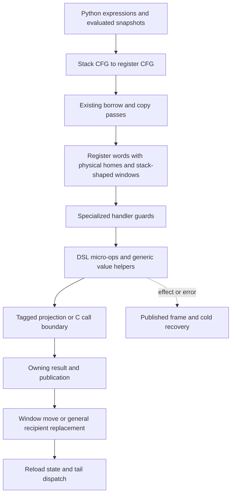
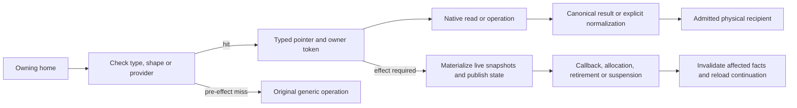
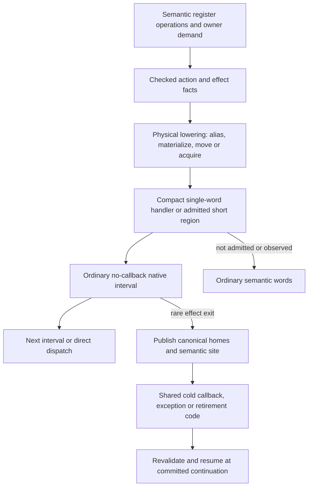
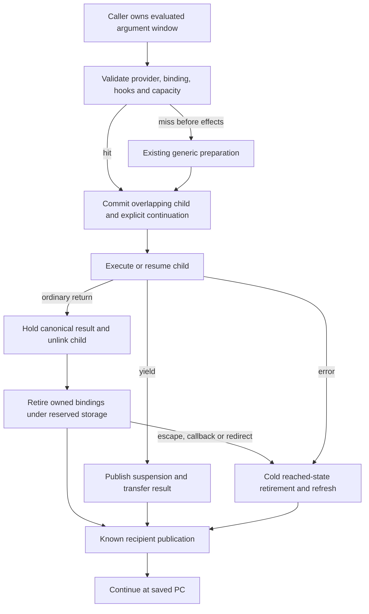

# Interpreter parity: compile ownership and effects into ordinary execution

Status: **architectural proposal**, reviewed against selected57 on 2026-11-14.
This document changes no runtime and claims no new performance result. The
[research ledger](../../issues/interpreter-parity58/research.md) supplies source,
generated-C and native anchors. [Selected57](../../issues/comprehensions57/report.md)
remains the execution baseline; the coordinator owns implementation admission,
integration and measurement.

## Conclusion

The register IR has reduced dispatches without consistently reducing the work
between them. Its physical execution still often follows the stack operation's
owning inputs, intermediate window, publication and cleanup sequence. The C
generator then forgets some facts that justified specialization: a checked
object becomes a tagged value again, a canonical container element passes
through general publication, and a known recipient passes through general
replacement. Ordinary native calls also interrupt the handler's register state.
These costs repeat across iteration, calls, attributes, arithmetic and resumes.

This is an implementation and lowering problem with architectural roots, not
evidence that register interpreters are inherently slower. Nor is it evidence
that all 43.64% extra instructions are redundant. Python still requires lookup,
hash/equality behavior, mutations, result ownership, binding, recursion checks,
exception state and valid observation. Our canonical values also have different
tagging costs and numeric benefits from upstream's object-oriented StackRefs.

Adopt four connected techniques:

1. Separate semantic values and owners from physical temporary homes. Extend
   existing copy propagation with demanded materialization, not borrowed frame
   cells or a second GC protocol.
2. Compile checked operations as typed, effect-bounded intervals. Keep the
   guarded pointer, result representation, ownership token and recipient form
   through their last valid use instead of reconstructing them from raw words.
3. Use those contracts to generate compact execution paths, with cold effect
   exits and a small number of profitable cross-word regions. Treat helper
   boundaries, spills, dispatch and code size as one native lowering decision.
4. Apply the same admission/materialization/completion model to calls and
   resumes, preserving overlapping windows and direct returns while selecting
   ordinary recipient and retirement forms before transfer.

The unit of improvement is a complete path from evaluated inputs to its next
observable/effect boundary. An isolated faster getter is insufficient. The
proposal extends model56's direction but requires native cost closure across
that path; it does not declare its unfinished global storage experiments ready.
Within-one-word cleanup alone is not a credible explanation for closing the
remaining gap: the rejected composition already tested substantial parts of it.
The larger hypothesis is removing physical home/owner and dispatch boundaries
across ordinary operations, while making common activation/provider boundaries
consume the facts that remain. If their measured frequency is insufficient,
this proposal has not demonstrated parity and must say so.

Parity is plausible as a research objective, particularly because numeric and
silent-logging workloads already beat upstream. It is **not established for
comprehensions or generators**, and the evidence cannot support a promised 2×
gain. Approximately 84,620 instructions per comprehension tray must disappear
to match upstream's instruction count. No measured, selectable composition yet
accounts for that budget.

## What the evidence says

Selected57 is `0dcba75bb3df40c32137db453b001f7e8f101de0`; pinned upstream is
`3a440b65695615e9fd9912342b79cdd54fced0d2`. Canonical C sources in this checkout
are stale. Actual source is `build/worktrees/call55-integrated` beneath the
python-boil-the-ocean checkout. The ledger defines full paths and native hashes.

| Unchanged workload | Native instructions / upstream | User cycles / upstream | Fraction of candidate instructions to remove for equal count | Fraction of candidate cycles to remove for equal cycles |
| --- | ---: | ---: | ---: | ---: |
| Comprehensions | 1.436416 | 1.333179 | 30.38% | 24.99% |
| DeltaBlue | 1.361424 | 1.118423 | 26.55% | 10.59% |
| Coroutines | 1.307831 | 1.267788 | 23.54% | 21.12% |

The columns are separate objectives, calculated as `1 - 1/ratio`. Instructions
per cycle already differ: the relative cycles/instruction ratios are about
.928, .822 and .969 respectively. Removing a cold or parallelizable instruction
does not save its proportional share of elapsed time. Equality of instruction
counts neither guarantees nor is necessary for elapsed parity.

The observed all29 elapsed mean is 1.127137/upstream, with two pairs and opposing
XML outliers; it is not a precise global gap. Comprehensions' direct elapsed
ratio is 1.335003; generators' is 1.372523. The latter would require about 27.14%
of candidate elapsed time to disappear, but lacks selected57 matched native
instruction accounting in this campaign. Do not infer it from coroutine PMU.

Round57's rejected four-lane composition reduced comprehension instructions
4.8% versus golden56, yet logging lost 13.2%, coroutines 4.6%, and all29 was
flat. Logging and coroutine instruction counts were unchanged. Uniform handler
alignment and interpreter-local append also lost. The minimal correctness-only
dictionary repair retained regressions with almost unchanged instruction counts.
The frontend-event capture failed with all counters not counted; a cache or
layout explanation remains unproved. The selected dictionary-only subset
removes nested lookup/pin layers and repairs lifetime. It excludes the rejected
checked method entry and list changes.

Our previous approach got two things wrong. It treated a list of obvious
source-level inefficiencies as a sufficient parity strategy, and it lacked a
quantified account of the much larger residual native work. The broad gates
correctly rejected the losing composition. The next design must retain those
gates while changing the granularity of optimization, rather than restore the
same helpers under a new name or search alignment seeds.

## Current execution and where facts disappear

The following paths are observed in selected source/generated C/native code,
not just inferred from flat profiles:

| Representative path | Useful work that remains | Avoidable or potentially avoidable work |
| --- | --- | --- |
| `id_to_widget.get(dwid)` | Capture method and evaluated arguments; validate callable/self semantics; hash, probe/equality; acquire result; retire inputs | Specialized descriptor guards lead back through generic value-vectorcall and descriptor argument checks. The dictionary reader itself is now shared and must not be counted as the old nested-reader path. |
| `FOR_ITER_LIST` → local item → body → `LIST_APPEND` | Exact-list/iterator admission, current bounds, item owner if it escapes, list growth, size update, old-local retirement | Getter C call and spills; repeated tagged projections; generic publication of both known cursor and canonical element; window store/move/clear before final local; unconditional append helper call on spare capacity. |
| Small exact Python predicate call → return | Function/code lifetime, exact binding, recursion, child lifetime, local cleanup, result transfer | Runtime operand/recipient classification; hot header/state maintenance and general completion where a narrower form is known. Argument overlap, initialized frontier and inline return already exist. |
| `w.derived_widget_ids` / DeltaBlue field read | Version and shape guard, field load, result lifetime if needed | LOCAL_TEMP already borrows receiver and stores canonical result directly. Remaining opportunity is eliminating an unnecessary result snapshot into a compatible consumer, not adding another canonicalization fix. |
| `SEND_GEN` / `FOR_ITER_GEN` → `YIELD_VALUE` | Running-state protection, handled-exception linkage, recursion, suspension, continuation and result ownership | General return-recipient branching on each transfer; resume/yield home traffic and repeated state publication. Direct child entry, canonical yield transport and literal completion entries already exist. |

One comprehension tray has 108 `dict.get`, 162 append, 54 dictionary subscription,
42 predicate call and 18 generator creations. The inner dictionary loop executes
six register words versus eight upstream bytecodes. Its extra instructions
therefore cannot be explained by too many dispatches alone. The selected
FOR_ITER_LIST native body contains a getter call, three spills/reloads and
numeric-publication paths despite canonical storage. Conversely the SHAPE local
reader has no helper call or receiver incref/decref on its ordinary path. These
are positive and negative controls for the same proposed lowering.

Upstream is not a simplistic unspecialized stack machine: its list iterator
also uses a list/cursor pair, checked descriptor calls enter a narrow helper,
list spare-capacity append is inline, and its optimized call paths enter Python
frames directly. Its exact call copies arguments; ours already avoids that copy
for thread-owned callers. Upstream's return/yield puts the value on its known
stack top; ours supports a general local, temporary or discarded recipient.
Compare complete equivalent sequences, including upstream STORE_FAST, POP_TOP,
RESUME and cleanup, before declaring that generality pure overhead.

## 1. Semantic values, explicit owners, late temporary materialization

The first model56 census already found **zero eligible surviving callback-free
COPY webs in 21 files/426 CFGs**. Do not implement that pass again. The next
census must distinguish surviving local snapshots, multi-use/CFG equivalences,
producer-to-consumer home traffic and call-window acquisitions; absent a
positive count, skip the corresponding transform. Cross-word producer/consumer
transport can matter even when no COPY word survives, but its frequency has
not yet been established.

The first distinct morphology to count is an **acyclic snapshot merge**: two
predecessor arms each evaluate the same unchanged local anchor, their semantic
temporary merges at a join, and a callback-free read consumes it there. Every
incoming edge must prove the same anchor/version; the region has no intervening
write, effect, exceptional survivor or source-event requirement. The source
shape `(x if flag else x) is needle` illustrates this candidate, not a claimed
surviving compiled example. Evaluate `flag` before establishing the aliases;
its truth method may call Python. A compiler may already erase this example.
Count actual post-pass load/home transfers and their dynamic executions, then
require positive net savings after edge materialization. A second form lets
that merged alias serve multiple callback-free reads before its anchor changes.
This extends predecessor/join identity, rather than searching again for a
single-block COPY web. If neither survives at useful frequency, demote the
borrowing lane; packet6 can still use explicit materialization rules without
implementing a no-op alias pass.

Pinned upstream also has a stronger dynamic borrowing protocol: LOAD_FAST_BORROW
sets a StackRef borrow bit; DUP/CLOSE need not touch the object's count for that
reference, and borrowed arguments can enter Python-frame locals. Its compiler
proves anchor lifetime, displaced `f_locals` owners are retained, and heap
escape/return/yield makes references strong. Our ordinary homes are owners;
unfolded LOAD_FAST_BORROW acquires an owner, while folded local views already
avoid the home and acquisition. Therefore upstream can retain a borrowing
advantage at some call boundaries that a callback-free local pass cannot erase.
Count those cases explicitly. Required acquisition of a list/dict/attribute
result that must outlive its container is useful work on both runtimes.

Keep the current register CFG, eight-byte word format and owning homes. Add a
bounded compiler fact to its existing value identities: an equivalence class,
an owning anchor/version, and whether a physical snapshot is demanded. Initial
scope is a straight-line region with existing line/EH restrictions, followed
by acyclic joins whose predecessors agree. This is not a general SSA rewrite.

The distinction is:

| Entity | Meaning and authority |
| --- | --- |
| Semantic value | The value evaluated at a source/semantic point, independent of its eventual slot |
| Owner token | Exactly one lifetime responsibility, anchored in an owning home or an existing supported C-owner scope |
| Physical home | A canonical owner or initialized NULL; never a persistent borrow |
| Virtual alias | Compile-time name for an unchanged live owner, with no extra home, root or runtime descriptor |
| Materialization | DUP into a real home when a second owner is needed, or TAKE/move when the existing owner may transfer |

Extend current `_PyRegPass_CopyProp` beyond one popped consumer only where all
uses can read the same live anchor. Intersect facts at joins; materialize on
ambiguous predecessors. Keep named Python bindings physical in the first stage.
Do not eliminate a result owner merely because it has one use: reading an
attribute/container through a callback can invalidate the container's owner.
Initial virtual values are aliases of stable frame owners; extending to
container-element borrows requires a checked no-mutation/no-callback interval.

Before an anchor overwrite, potentially finalizing close, unknown native call,
Python callback, allocation that can collect, observer entry, loop poll or
suspension, give every demanded evaluated snapshot a valid owning home. A local
that a callback may rebind is not a stable snapshot. An owner can move directly
to an escaping container or call window only once; multiple escapes need DUPs.
Never defer all releases until frame return or retain dead graphs across loops.

This requires no bitmap or stale frame cells. Removed snapshots leave the
existing slots NULL, and GC sees the original owner. C-local intermediate owners
may exist only within an interval with no callback/collection; before an effect
they enter the existing published-home or supported owner-scope contract.
The initial cross-word region must have **zero unpublished owners at every
effect exit**. That restriction deliberately avoids a new root enumeration
protocol. Full M4 is not a prerequisite. Allocation across non-prefix exception
survivors would require the unfinished IRSC2 authority and stays out of scope.

Source-line barriers remain until the observer can reconstruct evaluated
snapshots and current bindings at every affected event. Positions being separate
from recovery does not itself supply that reconstruction proof.

A broad borrowed-frame encoding would change clear/traverse, escape, debugger,
generator and caller/child lifetime authority. Reject it as the first increment,
not as a logically impossible design. If census later shows surviving call
acquisitions dominate the unclosed budget, compare one explicitly anchored
borrowed-argument activation rival against the owner-only ABI, including its
materialization/readers cost, before promising that owner-only transport can
reach parity. This is a decision gate, not permission to insert borrowed bits
into current homes or defer qualification to a future GC rewrite.
That rival is a competing ownership experiment with separate reader admission;
it is excluded from the default owning-home rollout and its no-new-root-protocol
contract.

## 2. One typed fact chain through the native interval

Extend the existing `IRStack`/Storage action graph and `HelperEffect`, rather
than add a runtime proof interpreter. A token needs a small set of independent
facts: canonical-or-unknown representation; owning/borrowed/moved state; exact
object projection; protecting anchor; nullable/read role; and invalidating
effects. A checked internal list/cursor pair additionally carries protocol
provenance. A specialization adds guarded facts after its real guards; feedback
alone is never a static type proof.

For list iteration the concrete target is one C interval:

1. Admit the list/cursor protocol and project `PyListObject *` once.
2. Compare the current index with the current size; handle exhaustion separately.
3. Read current item storage under the GIL and acquire the required owner.
4. Advance the internal cursor without language-value normalization.
5. Publish the canonical item directly to its admitted recipient form.
6. Retire the actual displaced local owner; leave the interval before any
   callback-capable retirement and reload only the affected state afterward.

The pointer and bounds fact do not survive mutation, reentry or a GIL release.
Do not cache the item array across loop iterations. A dictionary query of an
inline integer can still meet an arbitrary stored key's equality method; exact
query type alone does not admit a callback-free lookup. Keep selected57's pins
unless an actual table/probe contract proves their lifetime unnecessary.

The narrow native method entry consumes already-established descriptor/self
facts, but retains recursion, arity/keyword rules and any needed object adapter.
Its result contract explicitly says whether the output is canonical. This is
only one consumer of the shared contract. Reintroducing the rejected entry by
itself is not a newly justified performance experiment.

Generated code should carry `PyListObject *`, `PyFunctionObject *` and current
canonical tokens in ordinary C locals. It should not repeatedly call checked
conversion accessors after establishing their preconditions. The generator
validates use and invalidation; debug assertions remain diagnostics, not release
proofs. A second spelling of the same tagged value must inherit provenance,
not trigger a new fatal-not-object branch. No broad `canonical=true` annotation
may imply non-NULL, initialized, owned or safe through callbacks.

## 3. Native lowering and bounded cross-word regions

There are two distinct levels; neither should be called an implemented JIT:

**Within one word**, the current DSL already combines micro-ops such as guards,
iteration and publication. Change their physical lowering so a fact and pointer
remain live across that entire word. Split generated hot success from rare
miss/error/observer/finalizing-retirement exits. Inline a primitive when it removes
a real ABI crossing without duplicating a large slow path. Keep growth, general
binding and callback machinery outlined. Require native evidence: redundant
checks gone, spill traffic reduced, hot path shorter. Fewer generated C lines
or smaller total symbol size alone is insufficient.

**Across words**, add only a small catalog of statically generated two-to-four
operation handlers for recurring paths with positive dynamic frequency. The
first candidates are a checked field read into a simple test/compare and an
owned result into a consuming store/append. Exact pattern selection follows the
post-pass census; already-fused comparisons and already-folded loads do not
count again. Do not fuse an entire comprehension or synthesize machine code per
function. Keep generic words as semantic sites, and use an internal executing
entry plus immutable region description that names original sites, operands,
exit edges and recovery points. No per-step metadata interpreter is allowed.

A region retains a computed value in a C local across internal micro-ops and
can remove its store/reload/NULL, repeated decode, phase reset and dispatch.
It may skip an acquisition only if the remaining owner and effect proof permit
it. A call inside the conceptual sequence ends the borrow interval; its input
snapshots must be owning. Post-call facts start afresh. Merely branching between
two existing handler functions does not preserve CPU values or eliminate homes
and is not this optimization.

Region admission requires no external entry into an elided interior, complete
normal/error transfers and an unfused route for instrumentation. Initially do
not fuse across a source event, EH change, poll, suspend, arbitrary call or
potentially finalizing release. At a rare effect branch, materialize to the
original homes and continue at the **first unexecuted** semantic operation.
Never replay a completed call or mutation. Metadata allocation failure, cache
exhaustion, constructed images without proof and invalidation keep or restore
ordinary words. Public images cannot inject learned region handlers.

Monitoring activation must split a region before an interior event can become
observable. An observer installed by a nested callback sees a fully materialized
boundary, because no borrow interval crosses that callback. Preserve original
instruction/source identities for monitoring and exception attribution. This
may require a format/schema change for new immutable metadata; update all
constructors, marshal, tools and readers together. A format change is not needed
for the first within-word lowering experiment.

The minimum proposed region schema and its consumers are concrete:

| Record | Minimum information | Readers and authority |
| --- | --- | --- |
| Immutable plan row | Entry word, span, generated pattern ID; original semantic-site offsets; operand/home mapping; exits naming first unexecuted site, materialization recipe and existing recovery row | Assembler, image verifier, region emitter, exception attribution and disassembler. Operand mappings may use the original words; their fetch/decode cost is included in the experiment. |
| Executing region row | Plan-row ID, enabled state and installation/instrumentation generation; dependencies on existing feedback sites/handler selections | Specializer, instrumentation patcher and execution-image teardown. Existing type/function/shape guards still validate current data; the row is not an owning cache. |
| Reverse site index | For each covered semantic site, its region entry, or none; initially no overlapping regions | Interior-site specialization/deoptimization, monitoring changes, debugger transfer and executing-image inspection. No search of all regions on ordinary dispatch. |

Install only under the GIL after the whole plan and dependency set validate.
Patch the entry last. Before patching an interior handler or changing its
specialization contract, disable the containing entry using the reverse index,
then patch the ordinary site. A data-version change need not rewrite every
region: its existing runtime guard misses and invalidates the entry before
generic execution. Updating a selected handler or operand contract cannot rely
only on those data guards. Instrumentation changes disable every affected entry
before installing interior wrappers or reusing tool state. The initial region
has no callback/GIL release internally, so mutation cannot interleave with its
unpublished interval. Guard miss materializes and resumes at the actual
unexecuted site; it cannot invoke a stale captured interior handler.

Admission excludes branch targets, exception-handler entries, resume entries
and other known incoming transfers inside the span. Public constructors/marshal
admit only ordinary semantic words and build this eligibility anew; no serialized
claim of trusted interior safety is accepted. A later debugger jump request
first disables the target region, then uses the existing ordinary target/owner
proof; defusion does not grant a new jump permission. The code object's pristine
words remain intact, and disabling changes only the executing entry, so the
interior is available as an ordinary site. Error attribution uses the original
subsite only after its required homes are materialized. Async readers keep their
current valid frame/phase contract; do not remove PC/state publication needed by
those readers merely because synchronous tracing is disabled. Statistics and
disassembly must distinguish a physical region entry from its original semantic
sites. Shared-image lifetime remains protected by the executing code pin.

The native backend remains GCC15.2 with the established configuration. Current
musttail handlers pass frame, slots, tstate, PC and word; C helpers can force
state moves and spills. They already use `no_callee_saved_registers` under GCC
and `preserve_none` where supported. The normal-ABI `enter_handlers` shim works
around the documented GCC15.2 entry miscompile; it is not called on ordinary
dispatch. FOR_ITER_LIST saves RBP for its native frame and spills across the
getter, but does not save/restore r12–r15 at every handler entry. Do not charge
ordinary SysV callee-save overhead to this ABI. Nor assume it explains the gap: the
already-good SHAPE reader has no ordinary helper call, while FOR_ITER_LIST
does. First shorten live ranges and remove trivial crossings. If broad cycles
still regress with verified work removal, one bounded same-compiler alternate
dispatch lowering may be justified by identified per-dispatch/ABI costs. It is
not a prerequisite, and no padding sweep or second-compiler campaign is proposed.

Short regions are a bounded first test of retaining values across words, not a
claim that all hot loops fit them. Calls, finalizing retirement and source/EH
boundaries may leave too few eligible edges. Compare alternatives using the
same materialization and native-work ledger:

| Execution choice | Advantage / cost | Decision and trigger |
| --- | --- | --- |
| Small generated region catalog | Removes intermediate owner/home traffic, decode and dispatch without a new global frame-root protocol; may have low coverage and grow text | Default first cross-word experiment. Expand only when the census finds recurring eligible edges and native savings survive broad cycles. |
| One resident operand/accumulator cache | Could keep a value across many ordinary handlers without a catalog explosion; needs an extra handler ABI value plus identity/location state, C-call preservation and a spill rule on every effect/observer/entry | Defer. Reconsider if significant removable store/reload traffic lies across diverse callback-free edges that a small catalog cannot cover. Prefer a nonowning cache of an existing home initially; it removes loads but cannot erase the owner's home or invent an unscanned owner. An owning cache requires its own complete spill/root admission. |
| Anchored borrowed-argument activation | Can remove RC pairs that persist at callback-capable Python-call boundaries where short regions necessarily stop; changes frame readers, escape and anchor retirement | Separate competing experiment only if measured boundary acquisitions dominate the residual budget. It is outside the selected owner-only ABI and initial rollout. |
| Larger generated basic blocks / alternate dispatch backend | Can amortize state movement and decode over more operations; introduces interior entry, precise state and code-size costs, and effects still end virtual-value lifetime | Defer until short regions show useful per-edge gains but insufficient breadth, or native accounting shows dispatch/state ABI dominates after home cleanup. Compare one same-compiler backend over the same semantic operations; no assembly rewrite or second compiler assumed. |

If the census says even removing all eligible short-region traffic covers only a
small fraction of the remaining 84.6k instructions/tray, stop calling the catalog
a parity strategy. Choose the rival that addresses the measured remainder, or
report that parity is unsupported under the current ownership/effect constraints.
Native provider specialization and activation completion still apply whichever
physical execution choice wins; their owner/effect contracts are shared.

## 4. One activation protocol, statically selected ordinary forms

Exact calls already transfer argument owners in overlapping homes in one arena.
Their warm reservation uses an initialized frontier; they do not clear every
callee slot per call. `call_transaction_begin` contains a debug home-check loop,
but `_PyValue_RecheckHome` is a release no-op and the native exact-call body has
no such loop. Any diagnosis charging that loop as ordinary release work is
incorrect. CALL_EX probing, guarded binding, direct return and generator
completion entries are also already implemented.

The remaining design target is the complete entry/return pair. Select a few
ordinary forms from existing geometry: thread-owned overlapping exact entry;
fresh temporary recipient; local replacement; discarded result; generator
yield/send recipient. Keep the semantic recipient plain and explicit. Encode
the selected completion form in a validated existing or small added continuation
field/entry, not a heap continuation object or a runtime general descriptor.
Do not reinstate tagged postcall POP decoding. A frame code pin independently
protects executing code even if `function.__code__` changes.

Fresh temporary completion need not classify local-versus-temp or load an old
binding, but it still must respect a callback that redirected the waiting parent.
A local recipient must retire the actual current displaced value after child
cleanup/observer activity, not a cached pre-call owner. A discard must close the
result; that close may run Python. Resume must retain running-state, recursion
and handled-exception linkage. The checked recipient on generator entry already
exists; the proposed work is carrying that fact into completion instead of
reclassifying it. If adding completion state or an indirect jump costs more than
the removed branches, retain the present inline path.

The GIL frame header is already 112 bytes before owned slots. Frame objects and
much observer state are lazy/cold. Do not create another cold allocation on every
call. The earlier frame-state54 experiment reached an 80-byte header and lost;
matching upstream's header size is not a fresh performance hypothesis. Audit
hot writes first: init-at-creation, entry publication, actual phase
change, wait continuation, escape and retirement. Remove a repeated phase-zero
store only when the current action graph proves no intervening writer; move a
cold field only when all its readers and initialization semantics move with it.
Retain globals/builtins and execution-image caches unless removing them reduces
total dependent loads. Smaller `sizeof(frame)` alone is not the goal.

For cold retirement, preserve the current reached owner set, reserved overlap,
external result root and callback refresh. A path with empty scratch can keep
its existing local-only retirement; broad scratch-map/bitmap work remains a
separate experiment. Direct construction of generator frames may be revisited
only if measured copy cost is large enough; previous failed construction trials
are not erased by this proposal.

## Ranked implementation and delegation order

The coordinator first freezes the interfaces below. Separate workers may then
own compiler demand, generator facts/lowering and activation completion, with
independent peers. They must integrate into one runtime and one native campaign;
component improvements are not additive speedups.

| Rank / packet | Concrete change and boundary | Minimum correctness and evidence gate |
| --- | --- | --- |
| 1. Costed path census | Count surviving words, operand/recipient forms, materializations, effect exits and helper crossings on cmp/DeltaBlue/coro/gen; annotate retained native paths. Diagnostic counters run separately from timing. | Exact source/ELF identity, unchanged workload counts; distinguish executed hot branches from static cold code; a removable-work estimate per proposed packet. No infrastructure framework. |
| 2. Typed single-word lowering | Extend existing Storage/helper facts for exact pointer and internal cursor provenance; lower list iteration end-to-end and use SHAPE_LOCAL_TEMP as unchanged negative control. | Producer rejection tests for changed guards/effects, constructed-image protocol rejection, mutation/exhaustion/finalizer/error cases; release native removes getter ABI traffic and inappropriate publication. Two bounded revisions maximum. |
| 3. Demand-based aliases, only after positive census | Extend CopyProp to demonstrated surviving multiple-use/CFG cases and late owning materialization; update verifier and compaction together. The already-zero callback-free COPY morphology is closed. | Rebinding through locals, anchor deletion, multiple escape, destructor, exception and aliasing tests; post-pass and native counts show net removed work after inserted snapshots. |
| 4. Effect exits and checked providers | Generate compact hot bodies and shared cold completion from the same facts; use method and consuming container paths to exercise the contract. | Reentrant hash/equality, changing callable/code/defaults, recursion, keywords and result-aliasing tests; callback exactly once, miss before effects; broad cycle screen before selecting any restored optimization. |
| 5. Call and resume completion forms | Carry admitted recipient form through exact entry, return and yield; audit actual hot header/phase writes; preserve existing overlap and frontier. | Recursion/PEP523, child code mutation, generator send/throw/close, parent redirect, frame escape, finalizer and tracing tests; count complete entry/return or resume/yield pairs, not one opcode. |
| 6. Short physical regions | Add one catalog pattern with high census frequency, complete exits and no new root protocol; use existing words as semantic reference. | Differential values/exceptions/events on generic versus region execution; instrumentation enabled before and during nested calls; invalidation and public-code admission tests. Require store/dispatch/guard removal in native. |
| 7. Observer-aware extension | Only after packet6, extend aliases/regions through supported source transitions or acyclic joins with reconstruction. | Exact source/LINE/INSTRUCTION/exception behavior, stripped positions, malformed metadata and debugger recipes; keep unsupported boundaries materialized. IRSC2 only if actual retained-set freedom is required. |
| 8. Coherent checkpoint | Integrate compatible packets, re-evaluate remaining work budget, run full release/debug diagnostics and all29 direct campaigns. | No new correctness failures; only established six debugger errors and GDB PrettyPrintTests quarantine. Preserve cmp/Delta/coro/gen gains and logging/ray/spectral/nqueens sentinels. |

Packets2 and3 are bounded foundations, not a mandate to finish a new optimizer
before measuring. Packet4 can use packet2 without waiting for cross-line work.
Packet5 shares facts with both and can be developed independently after the
continuation contract is frozen. Packet6 requires packet3's materialization
rules and packet4's effect exits. Root owns generated products and native jobs;
workers must not build or mutate a tree during its timing campaign.

## Budget, discriminating experiments and stopping rules

At roughly 278,517 versus 193,897 retired instructions/tray, the excess is about
84,620. Across the 384 listed high-level events that is roughly 220 excess
instructions/event if attributed entirely to them. That division is an
illustration of the scale, **not** an attribution: it omits other operations
and some listed events nest. A 20-instruction saving at each of 162 appends
would remove only 3,240 instructions, about 3.8% of the gap. Even making one
small handler free cannot establish parity.

Use a non-overlapping ledger: count native work removed by the final composition
in input/ownership transport, useful provider operation, activation transfer,
and dispatch/completion. Charge a helper's instructions once, not again to its
caller. Model56 flat samples identify places to look; they are neither exclusive
time fractions nor a savings budget. Credit no rejected result as selected work.

| Question | Bounded experiment | Result that changes the design |
| --- | --- | --- |
| Are lost facts causing native inflation? | One typed list interval with existing word/dispatch and no wider fusion; compare emitted instructions, spills and dynamic counts against selected57. | If native checks survive, fix the fact/codegen interface before expanding coverage. If they vanish but time loses broadly, do not call this a throughput win. |
| Is temporary ownership avoidable at meaningful frequency? | Multi-use aliases in current safe regions, count inserted snapshots as well as removed DUP/CLOSE/store/NULL. | A near-zero net delta means the existing passes already cover the opportunity; do not launch cross-line work on that premise. |
| Is helper ABI traffic or useful provider work dominant? | Compare one typed whole interval with its outlined provider form, keeping ownership and semantic work identical. | Spills/calls removed without significant native/cycle change demotes ABI work; provider hashing/comparison may dominate that family. |
| Does direct recipient selection pay? | One fresh-temp exact return and one send/yield pair, same cleanup semantics, no frame-layout rewrite. | Added continuation load/jump or register pressure cancels removed checks: retain inline general completion. |
| Are dispatch/home boundaries the residual cost? | One cross-word region after single-word cleanup; separately record removed dispatches, home transfers and guard checks. | No substantial additional work removal rejects fusion for that pattern. Loss in logging or coroutines blocks broad selection. |
| Why do unrelated cycles change? | Valid small PMU event groups and matching native/profile paths on one candidate; measure cycles, branch behavior and supported frontend/backend events separately. | A failed/not-counted event proves nothing. Unchanged instructions with losses remains real regression; absent causal evidence, reject rather than tune layout seeds. |

Set native-work milestones as decision points, not forecasts: comprehension
instruction ratios 1.30, 1.15 and 1.00 would require about 26.5k, 55.5k and 84.6k
total removal from selected57. After the first coherent composition, publish
which native paths account for actual removal and what budget remains. If the
identified remaining avoidable paths cannot cover it, explicitly lower the
parity claim or reconsider physical execution granularity. Do not promise that
future JITs will rescue an interpreter-only claim.

Every semantic increment gets focused tests. A new ownership/region/activation
protocol gets full release/debug diagnostics at a coherent checkpoint, including
bootstrap/generated-product checks and relevant readers. For throughput, use
the established fixed affinity/hash/JIT-off/configuration and immutable controls:
small balanced screen, then six-pair confirmation of promising compositions,
then all29 direct selected57/upstream comparisons. Keep per-case ratios and
ranges, with no deletion of losing samples. Full-suite success and performance
selection are separate gates.

Proposed abort rules: any new lifetime/observer failure stops performance work
on that packet; no native work removal after two bounded revisions closes its
mechanism; a repeatable >2% hot-set/sentinel loss blocks ordinary promotion
unless root explicitly records a justified tradeoff; broad mean alone cannot
hide a large case regression. Smaller effects with ranges across one are
inconclusive. Do not keep adding lanes to average away a losing composition.

These techniques apply to ordinary object code because their criteria concern
owner demand, checked providers, effect boundaries and activation geometry.
No rule names the benchmark, a user function or its data. The unresolved issue
is quantitative coverage: the design can express the needed work elimination,
but only integrated native and elapsed evidence can show that enough of it
occurs on real workloads.
