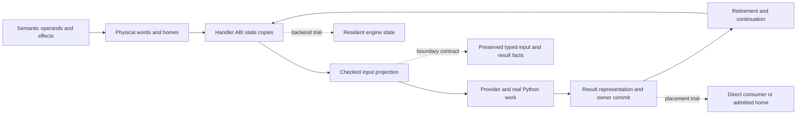
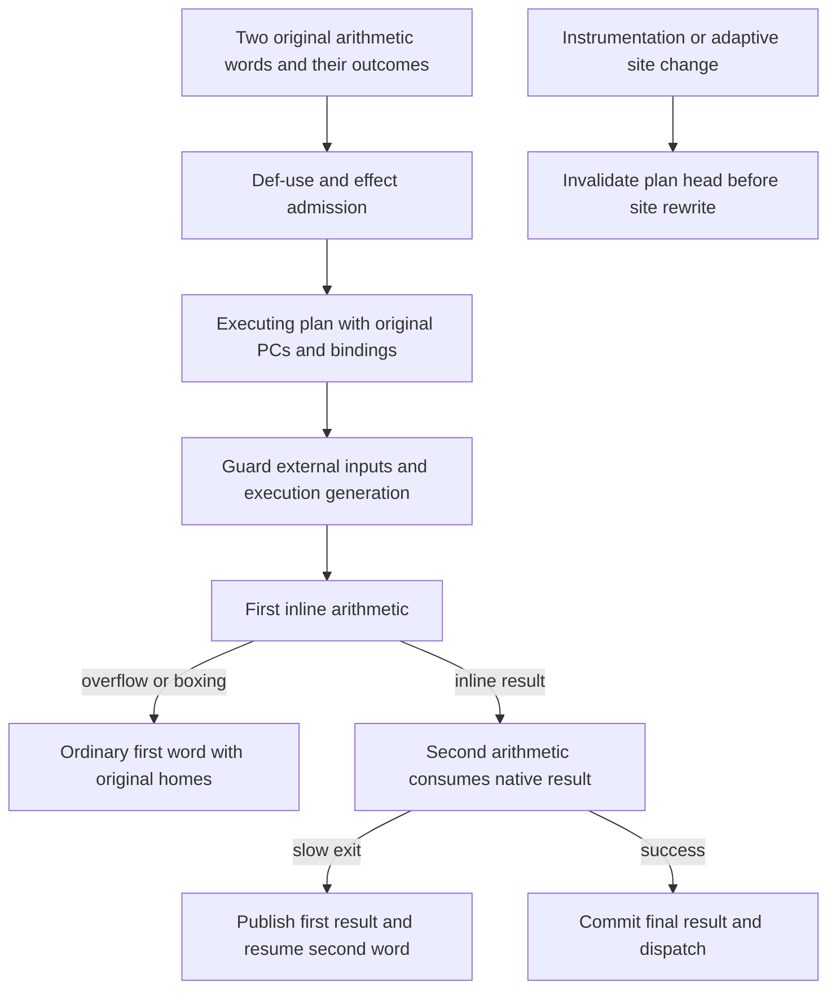

# Interpreter parity60: change execution costs at their full boundaries

Status: grouped architectural review frozen, 2026-11-14. Selected57
`0dcba75bb3df40c32137db453b001f7e8f101de0` remains the control. All five
round59 executable screens rejected their candidates. No runtime change or new
performance result is produced by this document. The
[review ledger](../../issues/register-semantics59/review-next.md) owns source
anchors and evidence distinctions.

## What the completed trials changed

The register interpreter does fewer dispatches in the comprehension inner loop
but still retires substantially more native instructions. Round59 demonstrates
that even correct removals of output staging, fictitious builder homes and a
duplicate argument-clear pass are too small, or too poorly placed in native
execution, to justify selection. The builder+Invoke composition really reduces
the FAST handler's native stack reservation from 64 to 48 bytes, yet loses
DeltaBlue, logging and spectral_norm while comprehensions remain near flat.
Do not count that removal as an available speedup.

| Round59 executable | Disposition versus selected57 |
| --- | --- |
| Final output binding f61 | Reject: coroutines +8.7%, spectral norm +31.5%, comprehensions near flat |
| Builder placement d458 | Reject: DeltaBlue +3.4%, logging +8.9% |
| Builder + Invoke 582 | Reject: DeltaBlue +5.8%, logging +12.8%, spectral norm +11.2%, comprehensions near flat |
| Isolated Invoke 5c60 | Reject: comprehensions −3.1%, but coroutines +8.1%, logging +12.6%, spectral norm +14.2% |
| Continuation recipient 14bf4eb | Reject: comprehensions −2.7%, but DeltaBlue +15.5%, logging +11.5%, spectral norm +10.1% |

Isolated Invoke passes both 117/79 builds and 66 focused methods per role;
its actual FAST/NOSELF handlers retain the composition's 1,553/1,473-byte
sizes, 48-byte frames and removed duplicate clearing. That does not explain
the broad elapsed regressions. In particular, losses in other workloads cannot
be inferred from the removed source work alone. Layout, frontend or cache
attribution remains unproved; do not redesign normalization or code placement
from elapsed ratios alone.

The next program must price whole execution boundaries:

1. Persistent interpreter state between semantic operations.
2. Value representation and ownership actions from checked input through the
   native provider to committed result.
3. Call/resume/return transitions, including work moved from receiver to sender.
4. Physical instruction and value placement, chosen after those contracts.

The measured upstream build uses one computed-goto evaluator; our selected
build uses separate tail-called handler functions. This is a real confound in
the current register-versus-stack comparison. Both also use different value
representations and borrowed-reference protocols. Therefore neither fewer IR
words nor more source-level register operations predicts the native gap.

## Coverage now constrains the choice

The [all-word census](../../issues/register-semantics59/resident-coverage.md)
counts monitored semantic entries, weighted by their pre-monitor warmed labels.
It does not count natural specialized successes, all library work, native
instructions or cycles. Its finite, nonoverlapping pilot packing gives:

| Workload | Boundary words¹ | Dispatches potentially removed by the pilot motifs | Share of recorded visits |
| --- | ---: | ---: | ---: |
| Comprehensions | 12.90% | 216,000 | 1.58% |
| DeltaBlue | 22.40% | 129,780 | 0.88% |
| Coroutines | 40.00% | 0 | 0 |
| Generators | 56.51% | 0 | 0 |
| Logging | 28.17% | 0 | 0 |
| Nqueens | 17.62% | 449,064 | 4.36% |
| Raytrace | 20.27% | 3,361,380 | 11.99% |
| Spectral norm | 8.75% | 1,352,260 | 8.65% |

¹ CALL, SEND, YIELD, FOR_ITER_GEN, GET_AWAITABLE and RETURN families. A boundary
word is not wholly avoidable work.

These are structural ceilings for that particular packing, with actual
successful executions possibly zero. They are not ceilings for every possible
resident region. The pilot's same-line filter is conservative: source lines
are observer mappings, not semantic effects. Wider callback-free regions may
cross lines if they retain original PCs and support instrumentation/redirect
defusion. Local assignments can also join a region when the displaced owner's
retirement is proved nonreentrant; a scratch-only pilot does not exhaust that
opportunity. Error, ownership, suspension and actual observer boundaries still
need their complete contracts.

Even so, the first two-SHAPE/compare template runs only 18 times per
comprehension tray. A hypothetical 20 instructions saved per run is 360, about
0.43% of the 84,620-instruction excess. The present motifs do not address the
large coroutine/generator transition population. Generators additionally spend
24.87% of recorded visits on JUMP_BACKWARD_NO_INTERRUPT. A wider execution
strategy is justified before building a large catalogue of small templates.

## Actual costs versus upstream

| Path | Selected common path and unavoidable work | Avoidable candidate cost and limit |
| --- | --- | --- |
| Dispatch | Decode next word and indirect transfer; several handlers copy four incoming state parameters and three outgoing ones | A resident engine can avoid some ABI repacking/prologues. Upstream pays its normal prologue once. Getter/provider spills and decode are separate and must not be credited twice |
| Iteration | Guard exact container, current bound, acquire item owner, advance cursor; both runtimes do this | Selected list getter is an out-of-line 13-byte accessor with caller spills; generic tagged publication and protocol decoding remain. Rejected57 already tried getter/canonical transport changes, so their reappearance is not a new win |
| Append | 162 LIST_APPEND operations per comprehension tray consume one item owner and may resize | Selected calls `_PyList_AppendTakeValue`; upstream's spare-capacity path is inline. These are direct append-helper entries, not generic Vectorcall calls. Rejected inline append remains rejected |
| dict.get | 108 method-provider calls/tray; real hashing, equality, lookup, result acquisition and callback-safe lifetime | Selected value dispatch repeats descriptor/self/convention work before Clinic and implementation. There is no ordinary object-array boxing adapter on this METH_VALUE route. Upstream specialized descriptor call enters its known provider directly |
| Exact Python call | Binding, recursion/space checks, frame initialization and code/function lifetime remain | Selected already overlaps arguments and returns inline. Upstream still copies arguments in its exact-call producer. The opportunity is complete transition work and state residency, not inventing another no-copy call |
| Return/resume | Preserve exception state, live owners, continuation and external observation | Moving recipient classification into binding adds masks/branches and sender work. Trial4 is rejected despite a comprehension improvement: DeltaBlue +15.5%, logging +11.5%, spectral norm +10.1% |
| Attribute/scalar | SHAPE guards and result ownership; inline arithmetic overflow/error semantics | SHAPE_LOCAL_TEMP already has no ordinary getter call and little state repacking. It is a negative control. Other typed paths may lose facts at publication/helper boundaries; charge only surviving native work |

PyValue integration is complete. Ordinary frame/container/field homes are
canonical eight-byte owners. C-local borrows have no independent lifetime.
Pinned upstream can carry borrowed StackRefs through admitted uses, so its DUP
and CLOSE sometimes avoid refcounts that our unfolded owning homes require.
Our folded local reads already remove many such operations; the zero closed
COPY-web census prevents assigning a broad borrowing saving without a new
surviving consumer. Necessary item/result acquisition is not transport tax.

The value-native API is also not synonymous with a private numeric box:
`PyValue_FromObjectSteal` and object-slot result adapters canonicalize numeric
results, while existing checked scalar/container producers already carry
canonical receipts. General C-local values can still require publication
normalization. Establish the actual producer contract before omitting it.

## Ordered execution changes

### 1. Compare a same-GCC resident engine before more narrow result rewrites

Implement the closed computed-goto rival from the
[native/backend audit](../../issues/register-semantics59/resident-value-proposal.md).
Keep the generated semantic bodies, eight-byte words, owning homes, provider
APIs and selected57 behavior fixed for this experiment. This is experimental
isolation, not a requirement that those representations remain forever.

Place handlers in one `run_handlers` function with function-local targets.
Keep the outer evaluator as activation owner and debugger symbol. `frame`,
`slots`, `tstate`, PC and the decoded word become resident C state rather than
five parameters reconstituted at every handler transfer. Dispatch still loads
the next word, extracts the handler and jumps; those costs do not disappear.
Cold error/frame-switch entries reload exactly the state the existing
continuation returns. Bridge owners are finished before error/global-label
transfer, and external interpreter exit returns once through outer cleanup.

Source closure: `ceval_macros.h` TARGET/LABEL/dispatch/error/prediction macros;
`ceval.c` engine entry, activation and exit; generator target/global-label/table
emission, including UNKNOWN_OPCODE and removed function prototypes. Labels
precede fresh braced handler scopes. Only engine state persists: `this_instr`,
opcode, value boxes, value owners and `value_temps` initialize on every target
entry. Audit VLA/alloca lifetimes rather than assuming function and block scope
are interchangeable.

Dispatch finishes bridges before loading the next instruction. Error transfer
must consume the lexical handler's `value_temps` before leaving its scope,
preserve the original error site, and reload state only on a handled result;
global labels have NULL temps. Failed bridge finish at an inline frame switch
must clear its staged child. Prediction resets `next_instr` to `this_instr`
and preserves the decoded word; SAME_OPARG reloads only the replacement handler
while preserving the original operands. PRE_DISPATCH, LLTrace and stats retain
their current semantics. Ordinary engine entry selects start-frame or throw;
terminal exit returns through the existing activation cleanup exactly once.

Keep semantic metadata identical. Preserve the outer evaluator's debugger
symbol and replace handler-symbol diagnostics with truthful label mappings.
Audit existing free-threaded source paths; qualify the supported GIL build.
Record the changed backend in configuration/preflight and retire candidate-only
musttail/NCSR assertions. Use the same GCC, hardening and other flags. The
immutable selected checkout supplies the control; an experimental branch does
not need a permanent dual-backend API.

Native acceptance requires broad reduction of the audited incoming/outgoing
state moves and repeated frame setup, after charging any new spills and larger
function frame. Some selected handlers already have zero repacking, so a
uniform ten-instruction credit per word is invalid. A monolithic function may
increase register pressure, cold-path liveness and tail merging; rejection is
an informative result, not a reason for padding or compiler searches.

Run focused error/observer/frame/bridge gates, both native builds and the eight
hot/sentinel screens. At a winning coherent checkpoint run all29 and the full
diagnostic suite. Capture matched instructions and cycles for comprehensions,
DeltaBlue, coroutines and generators alongside elapsed results. This first
experiment answers a broad causal question while changing no semantic IR.

### 2. Close the provider retry; admit a cross-word scalar consumer instead

The checked METH_VALUE entry and direct append-helper changes have no new
materially different consumer in this review. Close that implementation lane.
Do not restore rejected57 helpers behind a new contract name. Their end-to-end
route remains a diagnosed cost and a negative control for future designs.

After the backend experiment, the next proposed implementation is one common
cross-word scalar binding, first instantiated as ADD_INT → MULTIPLY_INT in
`eval_A` words 5–6. Its 676,000 monitored pairs establish an actual consumer.
The same mechanism's second admission is MULTIPLY_FLOAT → ADD_FLOAT in
`part_A_times_u` and `part_At_times_u` words 15–16, 338,000 pairs each. These
are execution regions spanning separate semantic words, not the existing DSL
micro-ops already emitted inside one handler. They are a mechanism trial with
known workload limits, not a comprehension parity strategy.

For the first integer path, guard the original external inputs as inline ints.
Compute the add in its existing scaled representation. If it overflows, execute
the ordinary first word with its original owners and PC. Otherwise bind that
native result directly to the multiply's consuming operand. Do not publish,
reload, recheck the integer tag or decode a second handler for the intermediate.
If the second operation must leave the inline path, materialize the completed
first result into its original destination and execute the ordinary second
word at its own PC. Never replay an already committed operation. Final result
publication follows the existing destination and local-retirement contract.
The first admission uses scratch intermediates and no interior entry; extending
local destinations requires a proved nonfinalizing old owner.
The intermediate's last use must be inside the region. Its physical destination
must be a consumed inline input home or positively proved vacant; a compiler
NO_HOME annotation alone does not prove physical NULL in a constructed image.
Defusion emits the original first word's complete committed state, including
input vacates, rather than just writing its result. Guarded inline inputs have
no heap owner to retire, so this first consumer needs no new frame root protocol.

Float admission must preserve two separately rounded Python operations: no
FMA contraction. Preserve the mixed inline-int/float input rules. A NaN result
can require boxing, so leave the resident path before that allocation with the
correct semantic inputs, or publish a completed first result before entering
the second ordinary operation. Do not retain an unrooted allocated intermediate.
Use existing arithmetic bodies and scalar receipts as the source of operations;
the new lowering changes cross-word placement and fact lifetime.

The minimum executing-plan schema is `sites[]` (original PC and expected
handler/version), `bindings[]` (producer output index → consumer input index),
`native_kind` (scaled int or double), `exits[]` (resume PC, completed sites and
home materializations), and admitted entry/observer generation. Original
operands, value IDs and outcomes remain authoritative; do not create a second
value identity merely to bind an output. The plan lives with the executing
code's adaptive state, not in a new frame header. Generation composes existing
`ScalarStorageGraph` actions and checked arithmetic facts across words; it must
not fabricate proofs by concatenating opaque C strings.

Concrete consumers are `Python/regcfg.c`/passes for def-use and last-use proof,
`Tools/cases_generator/ir_generator.py` for cross-site storage/fact composition,
executing-code/specialization for installation, and instrumentation/code-image
admission for invalidation and entry checks. The first plan uses existing words
plus a variable-length execution descriptor: semantic IR is not restricted to
one eight-byte physical word, but a new public encoding is unnecessary for
this consumer. Constructed images obtain a plan only after the same proofs;
unproved images execute ordinary words.

Installation needs a reverse site→plan index, retained original head handler,
and an execution/monitoring generation stamped into each plan. Changing a
covered handler or required adaptive payload first removes the plan's head
entry, then changes the site. Route instrumentation's `instrument`,
`instrument_line`, `instrument_per_instruction` and de-instrumentation paths,
plus specialization writers, through that invalidation. The first GIL-only,
callback-free plan checks its generation at entry; no concurrent Python
instrumentation callback can run in its inline arithmetic interior. Every
slow path materializes and exits before allocation/callback. A later plan
containing a poll or callback must recheck after it. Original interior words
remain executable with ordinary homes; no region-only entry may be installed
there without its own entry proof.

Before implementation, peer-check these exact exit and admission rules. After
implementation, require a native path without intermediate home store/load,
consumer retag check and second dispatch, after charging plan loads and guards.
Compare the same engine with and without plans. If extra descriptor/guard/spill
work consumes the saving, reject this mechanism before expanding its catalogue.
Minimal correctness cases cover first/second overflow or guard failure, aliases,
large ints, mixed numeric types, NaN/infinity/signed zero, observation at each
site, interior debugger/EH entry and instrumentation changes. Run all eight
screens, because even a spectral improvement cannot justify broad regressions.

## Architectural rivals and their reopening rules

Use semantic value IDs, use modes, outcomes and effects independently of stack
shape. Existing calls already have fresh output IDs; existing FOR/SEND/RETURN
already have explicit outcomes. The remaining constraints are physical window
placement, home materialization and separate native bodies. Builder freedom
was a real example, but its rejected executable is not a selected foundation.

If trial 2 removes native work and passes broad screens, extend its common
lowering to maximal admitted arithmetic/projection runs selected from the full
graph. Do not expand an opcode catalogue before that result. Allow source-line
crossings with original-PC observation maps; allow local scalar updates with
proved nonfinalizing retirement. Keep an owned value or anchored borrow in C
until an actual effect/entry boundary. Preserve the existing owning-home
protocol at callbacks, dispatch to an ordinary handler, suspension and external
entry. Materialize values into admitted homes before those boundaries; abandon
invalidated container projections afterward. No global bitmap/M4 rollout is
implied.

Three physical choices remain distinct: a generated region body, one/two
resident operands shared by the engine, and explicit operands in a wider
instruction/descriptor. A resident cache reaches more
sequences but consumes registers and spills at effects; regions restrict code
growth but pay guards/materialization; a wider form can remove artificial
window moves but adds fetch/decode work. Keep eight-byte words only where they
are cheapest. Native argument arrays remain at real array ABIs, not as the
definition of a language call.

For a direct-operand native call, a new physical form is useful only if it
avoids actual preparation/transport. Local argument snapshots must acquire
owners before a callback can rebind them; ordinary frame observers must still
see admitted semantic state. Persistent borrowed callee homes would require a
different frame/GC/escape protocol and are a separate rival, not an incidental
encoding change. Exact Python argument overlap is already a useful lowering.

Executing-region plans require original site PCs, admitted entries, guard/cache
dependencies, effect exits and owner materializations. Instrumentation and
specialization must invalidate every overlapping plan before changed interior
behavior becomes executable. At a callback/poll publish state and revalidate
before another site. Debugger/EH entry into an interior original word must
execute a materialized ordinary state or a proved entry adapter, never inherit
an absent predecessor value. Update assembler, image admission, executing-code,
instrumentation, generator and all offset readers together if format changes.

### Activation transitions need a different consumer

Coroutines and generators require a boundary consumer, not permission to run
a callback-free region through suspension. Compare call→return and
send→yield/resume→completion as cycles. Keep current overlap, direct completion,
exception-state exchange, recursion, frame state and checked recipients. Use
the selected engine's resident state through a switch where possible; materialize
the suspended frame before it becomes externally observable.

Trial4 is an important counterexample to premature caching: its generic bind
grows from three to twelve native instructions, while scratch publication pays
three action branches and local publication four. Known SEND scratch binding
does avoid classification, but the child's separate incoming recipient still
needs its own action. Its screen at 14bf4eb rejects it: comprehensions 0.972637,
DeltaBlue 1.154853, coroutines 0.996981, generators 1.054556, logging 1.115302,
raytrace 1.004560 (mixed pairs), spectral norm 1.101446 and nqueens 1.019988
versus selected57. Do not count the disappearing receiver code/nlocals load
without charging sender work, and do not rescue this trial by changing tag
layout or retiming.

If a new cycle specialization is justified, bind the action from an existing
static caller/semantic outcome or exact execution variant, rather than eagerly
reclassifying every dynamic recipient. A redirect must install the new action
before use. Frame header size is not the objective; the prior shrink lost.
Any cold/hot split must include every ordinary field reader and external frame
copy/remote-debugging consumer. Debug-only home scans remain absent from the
release budget.

These are reopening rules, not additional scheduled implementation trials:

| Rival | Concrete reason to reopen | Contract and present disposition |
| --- | --- | --- |
| Resident operand cache across ordinary words | A winning resident engine still shows repeated value loads/projections on hot sequences that region admission splits, and the native cache saves more than tag/validity/spill costs | First use a home-backed nonowning cache, invalidate on aliasing writes and every callback/frame switch. Virtual owners need the stronger materialization protocol above. Defer until an actual surviving sequence is named |
| Direct-operand native call / wider physical format | Surviving argument preparation copies dominate a named call family after existing folded local reads and array ABI requirements are subtracted | Logical BORROW/TAKE/ACQUIRE and independent result identity precede encoding. Acquire local snapshots before reentrant providers. Update allocator, image admission, generator and offset readers together. No measured eligible transport web yet |
| Borrowed Python argument ABI | Mortal argument acquisition/retirement survives at high frequency and outweighs caller-anchor/escape checks | Competes with selected owning callee homes; requires separate frame GC, locals mutation, frame escape and remote-reader admission. It is not part of the no-new-root-protocol rollout |
| Provider/value bridge redesign | A different consumer removes end-to-end work beyond the rejected checked-entry and append paths, or measured object-adapter frequency reveals another dominant family | Preserve recursion, key callbacks, error ownership and canonical-result facts. Generic METH_VALUE is not a boxed object array. Existing retries closed |
| Continuation specialization | Existing static outcomes remove complete-cycle work without trial4's generic sender classification | Keep suspension/exception/observer state; price both sender and receiver. Trial4 rejected; no header shrink or unconditional tagged-recipient retry |
| New physical word packing | An admitted semantic consumer needs operands/outcomes that current words cannot express cheaply | Permit wider/variable descriptors where they eliminate real moves; measure fetch/decode and all readers. Eight-byte format is a choice, not a semantic invariant |

## Work budget, selection and next review

Instruction parity and elapsed parity are separate goals. At the retained
interval, comprehensions needs about **30.38% of candidate instructions** or
**24.99% of candidate cycles** removed to match upstream. DeltaBlue needs 26.55%
and 10.59%; coroutines needs 23.54% and 21.12%. The 43.6% instruction excess is
relative to upstream, not the fraction to remove from the candidate.

Comprehensions has approximately 278,517 versus 193,897 instructions per tray,
an 84,620 deficit. The monitored kernel has about 2,279 word visits per tray.
Even a hypothetical uniform ten instructions removed at every such visit is
22,790, only 26.9% of the excess, and several handlers have no such cost.
Likewise 20 instructions at each of 108 dict.get provider calls and 162 direct
append entries gives only 5,400, 6.4% of the excess. Neither worksheet is a
measured upper bound. Their scopes can overlap; do not add them to region or
ABI savings. The successful path through both proposed trials may still leave
a large comprehension and coroutine gap.

Parity is plausible as an engineering objective because there is repeated
native work absent from upstream and inline values can avoid real Python
numeric allocations. This evidence does **not** establish a sufficient savings
budget or promise parity from these two trials. The 29-case observed 1.127137
upstream ratio also contains opposing XML outliers and is not a precise global
parity gap. Treat actual broad measurement, including instruction/cycle counts,
as the stopping criterion. No 2× claim is supported.

The coordinator should execute the following order:

1. Keep every rejected round59 packet out of the round60 control; all five
   screens are closed and selected57 remains the baseline.
2. Implement and source-peer the resident engine with the complete closure
   above; validate generated metadata, ownership/error/observer/frame paths,
   then native ABI/state movement. Abort before timing on closure failure.
3. Run matched comprehensions, DeltaBlue, coroutine/generator and logging,
   raytrace, spectral norm, nqueens screens. Reject reproducible sentinel debt
   or a flat aggregate with substantial individual losses. No alignment/flag
   sweep. If it wins, run all29 and a coherent full diagnostic checkpoint;
   record known debugger/GDB exclusions separately.
4. Admit the concrete cross-word integer consumer, then float consumer only
   after its guard/exit proof. Price on the winning engine or unchanged
   selected57 if the engine loses. Verify native savings before broad timing;
   require broad screens and full validation at the next coherent winner.
5. Recompute the remaining native-work deficit from winners only. The next
   grouped review selects a rival only when its named consumer and surviving
   cost satisfy the reopening rule. Do not convert unresolved costs into an
   automatically approved framework project.
