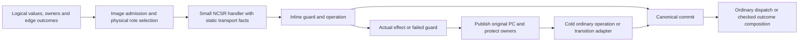
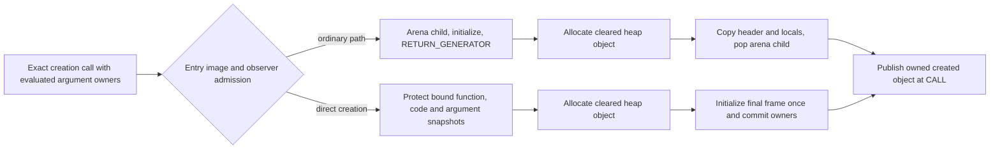

# Interpreter parity61: specialize execution contracts, compose real transitions

Status: grouped review, 2026-11-14. The selected runtime remains
`0dcba75bb3df40c32137db453b001f7e8f101de0`. All five round59 executable
trials and the round60 computed-goto engine lost their broad screens. The
cross-word scalar proposal is deferred, not a measured saving. This document
proposes no runtime change by itself. The [review ledger](../../issues/register-semantics59/review61.md)
separates source, retained native evidence, monitored traffic and hypotheses.

## The correction to the architecture

Use a small generated execution dialect whose operands already say whether
they borrow a local or consume a scratch owner, whose results say whether they
are canonical and where they commit, and whose effects say when state must be
published. Preserve these contracts through native lowering. Compose complete
creation and suspension transitions when their intermediate state has no
independent consumer. Keep small NCSR handlers and ordinary owning homes at
observable boundaries.

This differs from replacing the dispatch syntax or removing another temporary
store. Round60's monolithic engine produced a 4,472-byte native frame, repeated
stack-backed interpreter-state loads, one tail-merged indirect dispatch and
55,424 additional bytes of ELF text. Every measured workload lost, by 18.6%
to 60.0%. The result establishes that this compilation did not deliver resident
state. It does not establish the compiler's precise spill cause, or a universal
rule against computed goto. No flag, padding or second-compiler rescue follows.

Our current semantic model has useful value IDs, edge results and continuation
outcomes. The problem is that executable lowering often rediscovers immutable
operand roles and forgets producer representation facts. In other places it
implements a logical transition through an unnecessary intermediate activation.
Those are different costs; both need direct consumers, not a new universal IR
framework before any code can benefit.

## What upstream avoids, and what remains real Python work

| Path | Selected release work | Pinned upstream / implication |
| --- | --- | --- |
| Common constants | DUP ownership test; local/scratch/discard selection; exact-number normalization checks | Upstream uses `PyStackRef_DupImmortal`. Selected initialization already immortalizes and canonically constructs this table. The checks can be removed by a valid producer and destination contract |
| Inline integer add | Guards and arithmetic, then runtime input-locality comparisons and destination classification | Native selected ADD_INT retains those home-role branches. Input CLOSE operations are already optimized away on the inline path; do not charge them again |
| Surviving LOAD_FAST_BORROW | Acquires an owning snapshot, publishes canonical bits, then dispatches | Upstream carries borrowed StackRefs through admitted calls and materializes at escape. Our folded local reads already remove many loads; surviving call-window preparation is a separate consumer |
| Exact Python call from a normal thread frame | Overlapping arguments, inline frame setup/return | Already a good selected path. Do not propose no-copy calls as missing |
| Exact coroutine/generator creation from a heap frame | Copies arguments to an arena child, enters RETURN_GENERATOR, allocates the real object, copies header/locals into its heap frame, clears source and pops arena child | Upstream also uses an initial frame and RETURN_GENERATOR. Direct final-frame construction can remove work from both models, rather than merely catch up |
| Delegated yield | Transfers an owner into a parent scratch result, dispatches parent YIELD_DELEGATED, then takes/clears the same owner again | The intermediate publication is an execution choice when the parent immediately delegates the result. Each frame's exception, recursion and suspension state still must change |
| dict.get / append | Value-native descriptor checks and lookup; direct consuming append helper | 108 dict.get provider calls and 162 direct append operations per comprehension tray. dict.get is METH_VALUE, without ordinary object-array boxing. Rejected57 provider/append rewrites remain rejected |

Necessary acquisitions are not tax: an element leaving a container needs an
owner unless a valid anchor survives; an escaping return/yield needs an owner;
hash/equality, descriptors, allocation and finalization may run Python. The
goal is to remove redundant transport and classification around this work.
SHAPE_LOCAL_TEMP already carries a local borrow, canonical field result and
temporary destination. It is a negative control, not a candidate for another
universal wrapper.

## The execution contract

Keep semantic values distinct from owner tokens and physical locations. The
minimal facts consumed by the proposed changes are:

```text
input use:    BORROW_LOCAL | TAKE_HOME | RETAIN_PROTOCOL
result rep:   CANONICAL_OWNER | CANONICAL_NOCOUNT | NEEDS_PUBLICATION
destination:  TEMP | LOCAL | DISCARD | EXISTING_PROTOCOL_RECIPIENT
effect:       INLINE_NO_CALLBACK | ALLOCATING | CALLBACK | SUSPEND
transition:   ordinary result | CREATE_SUSPENDABLE | DELEGATE_YIELD
```

These are proposed meanings, not a demand for six new runtime fields. Reuse
existing format roles, owner programs, scalar receipts, outcomes and effect
metadata. Add a generator-side fact only with a generated consumer. Select
physical variants at compiler finalization or executing-image admission; do
not load a new per-word descriptor merely to rediscover a TEMP destination.
Ordinary words remain the semantic/source identity and fallback. The eight-byte
encoding is not a semantic law; wider descriptors are justified only by a real
consumer that outgrows the cheaper form.

Bound code growth. First add one TEMP flavor plus the existing general path
for each admitted producer, rather than the Cartesian product of input types,
input homes, destination modes and observer states. Share cold exits. Add a
second input-role flavor only where an actual hot operand pattern and native
comparison justify it. Source specialization must remove checks from the
generated hot body, not hide them in another helper.

Observers do not need to force generic execution at every instruction. The
ordinary committed owning homes remain valid. A variant with no callbacks can
execute under its admitted instrumentation state; an instrumented entry uses
the ordinary semantic operation. An allocating or reentrant transition must
publish its original semantic site, protect every owner and support redirect
before invoking the effect. An unknown final owner release is such an effect.
Error exits retire or materialize each uncommitted owner once. No invisible
borrow may cross a callback merely because the original value was canonical.



## Ordered executable packets

### 1. Canonical producer receipts and static temporary destinations

First consumer: the complete LOAD_COMMON_CONSTANT producer. The independently
reviewed [common-constant packet](../../issues/register-semantics59/common-constant-proposal.md)
has a qualified producer-only increment whose broad screen loses DeltaBlue
and logging; it is not selected. Its first increment uses a getter tied
to the initialized interpreter table, the existing typed current-result receipt
and the ordinary destination writer. `pylifecycle.c` marks all common objects
immortal and constructs their canonical values. Inline constants also own no
reference. Preserve that invariant as a no-count copy and canonical publication.
The TEMP destination flavor is a separate increment: a known scratch destination
needs neither the `nlocalsplus` comparison nor local retirement/discard branches.
Both TEMP builds pass, but native checks exposed a scratch-owner admission
regression in the shared normal-map consumer. Correct that rejection before
debug qualification or timing; retain the failing evidence and selected57 control.

The actual selected native handler at `0x35d080` retains the ownership mask,
destination comparison at `0x35d0d7`, and the temporary arm's pointer/type tests
at `0x35d1a3–0x35d1e6`. These are release instructions, unlike debug home scans.
The no-count contract covers the initialized common table, not arbitrary
`co_consts` or every value obtained from a native helper. Interpreter teardown
ordering and all table writers must preserve the contract.

Consumers: `bytecodes.c` producer declaration; shared typed helper/result receipts
and destination lowering; generated handler/family/base-op mappings; compiler
or executing-image installation; constructor operand admission; specialization
and instrumentation reset. Public images retain the ordinary semantic handler;
the TEMP flavor is execution-only and selected from admitted scratch geometry.
Public images cannot forge the refinement, and executing-copy selection cannot
apply it to a local or discard destination. It introduces no new vacancy
assumption and retains the ordinary home write. The generic fallback serves
other destination roles and instrumentation, not malformed images.

Native gates: the first producer increment removes the ownership test and
numeric normalization. The separately admitted TEMP hot path also has no
destination-locality branch or finalizer path. Charge any new selector, ABI
movement and text growth. Then extend the same mechanism to LOAD_FAST_BORROW
and admitted canonical scalar producers, keeping their necessary acquisition
and guard work. For ADD_INT, select only observed input-role combinations;
the current native `0x3673fb–0x36743d` has two input-home comparisons and output
locality/discard tests. It has already eliminated inline input decrefs.

Minimal checks: all common entries, TEMP/local/discard, loop reuse, constructed
bad operands, monitoring/debug redirect, subinterpreter initialization and
teardown. Run the broad hot set, not a constant-only benchmark. A correct
shorter producer that regresses unrelated workloads is still rejected.

### 2. Construct exact generators/coroutines in their final heap frame

The [source proposal](../../issues/register-semantics59/created-generator-proposal.md)
closes the first heap-caller consumer; source post-review and native gates remain.

This is the first whole-call transformation. Introduce the semantic creation
outcome `CREATE_SUSPENDABLE(function, bound arguments) -> owned object` and
lower it directly into the final object's embedded frame. It is a creation
call, not execution of the generator body. Do not allocate a temporary arena
activation merely to run RETURN_GENERATOR and copy it again.

First admission: exact Python function/version; exact positional arity;
CO_COROUTINE, then CO_GENERATOR; no bound-method expansion, defaults, keywords,
varargs or closure/cell initialization in the first packet. Require the actual
first executing semantic word to be RETURN_GENERATOR with the admitted created
outcome, the existing ALL_CREATED_EMPTY proof and a supported resume recipient.
Do not infer the entry shape from code flags alone. Async generators, alternate
constructed entry images, PEP523, active creation instrumentation/LLTrace/DTrace
and nonzero coroutine-origin tracking initially take the ordinary path.

The result is still a real coroutine/generator object with its complete real
heap frame, FRAME_CREATED state, function/code owners and initialized homes.
There is no lazy frame, borrowed persistent cell, hidden coroutine or new GC
protocol. Generalize defaults/closures only with a separate complete binding
consumer; this first packet is not an incomplete replacement for generic CALL.

Protect the bound code, function and every argument snapshot before allocation.
The existing evaluated call-window owners cannot be treated as callback-current
locals, and a local source must be acquired before a callback can rebind it.
Reuse `_PyTransitionRoots` and the current call-transition refresh/redirect
machinery; do not add a second root list. The allocation can trigger GC, callbacks
or function/code mutation. Snapshot binding identity once and retain it. Source
ownership commitment and final heap-frame publication are separate decisions:
selected already moves scratch arguments into the arena child before allocation.
The direct path may instead move them into an existing external staged-root
prefix before allocation, acquiring local snapshots once and retiring staged
owners on failure. It need not duplicate every scratch owner until allocation
succeeds. The source peer must choose and close this ordering against the CALL
error/observer contract; any required duplicate owners count against the win.
Never reselect a mutated function's code after binding. Preserve the current
object-allocation order:
make_gen allocates and tracks an object in FRAME_CLEARED with f_executable NULL
before filling its real frame; traversal must remain safe in that partial
state. Names and qualname are currently read after allocation; retain that
ordering instead of freezing unrelated metadata with the binding snapshot.
Failure retires or retains inputs according to the admitted call commitment;
it must not restore consumed owners indiscriminately. No stale pointer into a
moved arena may survive. Python behavior and the explicit ownership model are
the constraints, not an incidental destructor schedule.

Initialize the final frame header once, transfer arguments once, fill constant
slots and remaining NULL homes, set the created phase and exact post-
RETURN_GENERATOR resume PC/recipient, then publish the ordinary owned result.
Retain the semantic recursion guard initially even though the temporary
enter/leave pair disappears. Observe the caller at the original CALL site;
the skipped incomplete frame must not introduce or remove a visible traceback
frame or creation event. On redirect, commit/discard through the existing
call result contract. Handle allocation failure in whichever staged ownership
state was chosen and test traceback attribution against the selected path.

Source closure: exact-call admission/specialization and generated call outcome;
`genobject.c`'s make_gen/_Py_MakeCoro allocation; frame initialization and
created-state helpers in `pycore_interpframe.h`/`frame.c`; transition roots,
CALL errors/observers and constructed-image admission. Keep mutable function
code and defaults guards with the existing call family. The ordinary generator
creation path remains the fallback for every excluded shape.



Native hypothesis: remove the arena child reservation/initialization,
RETURN_GENERATOR handler entry, header/local
copy and source clear, arena pop and intermediate return publication. Keep the
actual object allocation, final NULL initialization and one set of owned roots.
Compare the entire call→created-object path, including new staging, rather than
the direct constructor alone. A separate EXTERNAL snapshot buffer still needs
window→buffer→heap moves: two per argument, matching the current heap-caller
path and adding a move for overlapping thread callers. Do not credit an argument
transfer saving to that implementation. Reusing the original window instead
would need its own proved authority-transfer contract. Reject if staging
reconstructs the same temporary frame or costs more than the eliminated path.

Minimal checks: plain exact generators and coroutines from thread and generator
callers; unused/discarded objects; first send, completion, throw/close, recursion
boundary, GC/finalizer reentry during allocation, function/code mutation,
f_locals changes and redirect, origins/hooks fallback, allocation failure and
constructed noninitial RETURN_GENERATOR. Broad screens must include coroutine,
generator, comprehensions and logging. Do not infer an elapsed gain from a
smaller header-copy count.

### 3. Compose delegated-yield ascent without bouncing the result through homes

The [source proposal](../../issues/register-semantics59/ascent-proposal.md)
separates dynamic eligibility from cold image/runtime invariants and has root
proposal GO. The actual source diff has root peer GO; native qualification
remains pending.

First consumer is the existing `YIELD_DELEGATED` outcome when its parent
continuation is another ordinary YIELD_DELEGATED consuming exactly the saved
scratch recipient. The selected path stores the outgoing owner in that parent
home, dispatches, reloads it and clears it. Carry the same canonical owner in a
C local through a bounded ascent loop instead. Preserve every real frame.

Admission on each hop: ordinary uninstrumented expected successor; exact
parent generator/coroutine ownership and live previous linkage; saved recipient
is the successor's consumed scratch input and is vacant; no pending redirect;
no active hook requiring the intermediate handler boundary. Original words and
PCs remain authoritative. Stop at the first mismatch and perform the existing
publication plus ordinary dispatch. Do not infer vacancy from a slot number:
derive it from the admitted SEND/recipient transition and reject unproved
constructed images. The first packet does not bypass a local or discard
recipient, custom iterator, throw/close path or generic SEND.

For each composed hop perform the existing last home/header commits, original
resume-PC update, exception-state unlink, recursion leave, previous-frame
detach, remote-profile-anchor update, delegated phase publication and release
store of suspended state. Only result transport and dispatch disappear. The
outgoing owner is never duplicated, dropped or present as an owner in two
homes. At the final receiver, use the existing publication contract once.
No allocation, Python callback, unknown decref or periodic poll may occur while
the intermediate owner is unmaterialized; if one is required, stop and publish.

The source peer must close the active/suspended reader interval explicitly:
each frame's published phase must describe its committed homes, and no reader
may mistake the C-carried result for an owned home. Reuse the ordinary handler's
C-owner rule only if it covers the entire ascent. If remote observation or a
required safepoint needs a root, use the existing transition result root once
for the ascent, disarm it on final publication, and charge that cost. A new
root walker or an unproved asynchronous exclusion is not admitted.

The first implementation can use a checked continuation helper/emitter shared
with `suspend_delegated`, not a global region descriptor or a new frame field.
Read the actual next handler before composing; instrumentation at that site
therefore fails admission. Keep the original interior instruction executable
for debugger/exception entry. Bound the loop and fall back periodically if
required by the existing observation/scheduling contract; do not silently add
or remove interrupt handling from the no-interrupt delegation path.

Native gate: compare two and longer hops, charging eligibility checks against
the removed parent publication/take/clear and handler transfer. No claim follows
from merely removing one IR word. Minimal cases cover nested yield-from/await,
send values, completion and exceptions, aliased yielded values, abandoned
generators, close/throw, introspection and tracing changes at suspension,
reentrant finalizers outside the admitted interior, remote readers and malformed
recipient/source images. Downward SEND/resume is unchanged in this first packet.

## Pending scalar work and remaining ownership choice

The scalar experiment may use a fixed two-word variant with original words,
expected-successor checks and ordinary defusion. Do not require allocated
descriptors, reverse indexes or a universal new effect graph before proving
that its removed intermediate transport exceeds guard/decode costs. No scalar
result is selected or credited in this budget. It is subordinate to the broader
creation and suspension consumers above, not a parity prerequisite.

The remaining LOAD_FAST_BORROW population is real, but owning snapshots and
borrowed references are different contracts. Upstream admits borrowed arguments
in callee locals, retains old f_locals bindings for their anchors, and makes
RETURN/YIELD/escaped frames heap-safe. Selected PyValue bit 0 means immortal;
simply reusing it for a mortal borrow would violate canonical home readers.
A borrowed-frame ABI therefore requires explicit frame-cell representation,
anchor, overwrite, traversal, copy, locals proxy and escape readers. It is not
an opcode substitution or an assumed benefit from the zero COPY-web census.

Before that larger ABI change, the concrete surviving preparation consumer is
comprehension words 45→46: LOAD_FAST_BORROW A19←local4 followed by the one-argument
descriptor call, 648,000 monitored visits. An economical two-word preparation-
and-call variant can acquire the snapshot directly into the existing argument
home and continue the original CALL body, removing one dispatch and generic
destination classification while preserving all owners. This is a bounded
follow-on to the execution dialect, not a new checked dict provider. It must
retain original CALL error/observer state, materialize before callback and
fallback to the original words when the successor changes. It does not remove
the argument's necessary acquisition/retirement or claim a borrowing saving.

Persistent borrowed arguments remain a larger alternative if measured mortal
argument transport is still dominant after these packets. Its first consumer
would be exact positional Python calls, with an explicit activation-anchor and
frame-escape materializer. Do not mandate a global bitmap or reuse immutable
PyValue payload bits without closing every reader. The present executable
packets deliberately retain the existing owning frame protocol.

## Coverage, budget and selection

The retained all-word census supplies frequencies, not natural specialized-hit
rates. Monitoring reset adaptive labels; the report assigns visits to their
pre-monitor labels. Creation before RESUME can be absent entirely. These counts
therefore establish consumers but cannot supply a native-work saving:

| Case | All word visits | Common constants | Remaining LOAD_FAST_BORROW | YIELD_DELEGATED |
| --- | ---: | ---: | ---: | ---: |
| comprehensions | 13,674,014 | 342,002 | 1,236,002 | 0 |
| DeltaBlue | 14,679,757 | 627,451 | 455,491 | 0 |
| coroutines | 9,711,441 | 971,142 | 2 | 0 |
| generators | 11,813,690 | 400,000 | 2 | 2,937,892 |
| logging | 8,520,033 | 600,003 | 600,003 | 0 |
| raytrace | 28,032,312 | 1,062,813 | 1,496,800 | 0 |
| spectral_norm | 15,638,484 | 2 | 2,054,343 | 0 |
| nqueens | 10,307,053 | 344,395 | 673,193 | 0 |

Coroutines execute 971,141 words labeled CALL_NO_SELF_PY_EXACT_ARGS; the inspected
recursive fibonacci image starts with RETURN_GENERATOR. Its zero monitored
entry visits do not make creation free. This is the first creation consumer,
subject to actual argument/image admission. The comprehension genexpr inspected
here starts with RESUME rather than RETURN_GENERATOR; its 18 creations per tray
are **not** automatically eligible. Generator-tree delegation has 2,937,892
YIELD_DELEGATED visits and 200,000 leaf YIELD_VALUE visits, roughly 14.7 delegation
hops per leaf. The ratio motivates ascent composition; it does not prove that
every hop satisfies the recipient/observer guards.

The scale requirement remains large:

| Selected57 / upstream measured interval | Instruction ratio | Candidate instructions to remove for parity | Cycle ratio | Candidate cycles to remove for parity |
| --- | ---: | ---: | ---: | ---: |
| comprehensions | 1.436416 | 30.38% | 1.333179 | 24.99% |
| DeltaBlue | 1.361424 | 26.55% | 1.118423 | 10.59% |
| coroutines | 1.307831 | 23.54% | 1.267788 | 21.12% |

Comprehensions retire about 278,517 instructions per tray against upstream's
193,897: 84,620 excess. There are only 57 common-constant visits per tray.
Even a hypothetical 20 removed instructions each would explain 1.35% of that
excess. The 108 call-preparation pairs per tray at a hypothetical 20 each would
explain another 2.55%, before overlap and new guards. These are worksheets,
not predicted savings or upper bounds. The rejected57 collection removed about
4.8% of candidate56 comprehension instructions while its broad elapsed screen
lost. Neither opcode counts nor source-store counts establish a cycle budget.

The dialect generalizes across the hot set because operand roles and producer
facts recur across families. Creation and ascent remove whole transitions in
the coroutine/generator cases, where tiny scalar motifs have little coverage.
This is a stronger next cycle than another three-store patch. It is **not yet
a demonstrated path to the entire comprehension or DeltaBlue deficit**. Do not
promise parity from these packets or add their hypothetical savings together.
If the native deltas are small, another grouped review must target the residual
measured work, including argument ownership and call boundaries, rather than
expanding variants without a consumer. Parity remains a plausible objective,
not a conclusion supported by the present budget.

Implement and admit in this order:

1. Finish the common-table producer receipt already underway. Inspect release
   C and native code; run focused ownership/observer checks and the eight-case
   screen. TEMP refinement is independently admitted and screened afterward.
2. In parallel with that bounded producer work, source-peer direct creation's
   complete binding/root/partial-object/entry-image contract. Implement the
   coroutine consumer first; require before/after native accounting for the
   entire creation path, then focused failure/observer tests and the same broad
   screen. Expand the admitted generator shape only after this consumer works.
3. Source-peer delegated ascent's phase/root/recipient interval, implement its
   checked loop, and measure actual admitted hop lengths as separate diagnostic
   evidence. Screen against selected57 and any selected packet combination.
   Do not carry a losing creation or producer patch into its control.

Each change must demonstrate its intended native removal without replacing it
with comparable staging, branches or spills. Reject unsafe image admission,
unclosed observer ownership, broad elapsed regressions or unexplained large
text growth. Retain exact source/build/ELF identities and alternate selected57
controls; root owns serialized native jobs. Use comprehensions, DeltaBlue,
coroutines and generators as the hot core, with logging, raytrace,
spectral_norm and nqueens as mandatory sentinels. At a coherent winning checkpoint
run the full benchmark set and full supported regression suite, including the
known debugger-jump debt and existing GDB PrettyPrintTests quarantine without
silently broadening it. Focused passes alone do not qualify a new golden runtime.

There is no new full-system result for this proposal. Preserve all rejected
experiments and selected57. The producer-only screen is recorded and rejected;
TEMP, creation and ascent have no qualified performance result yet.
