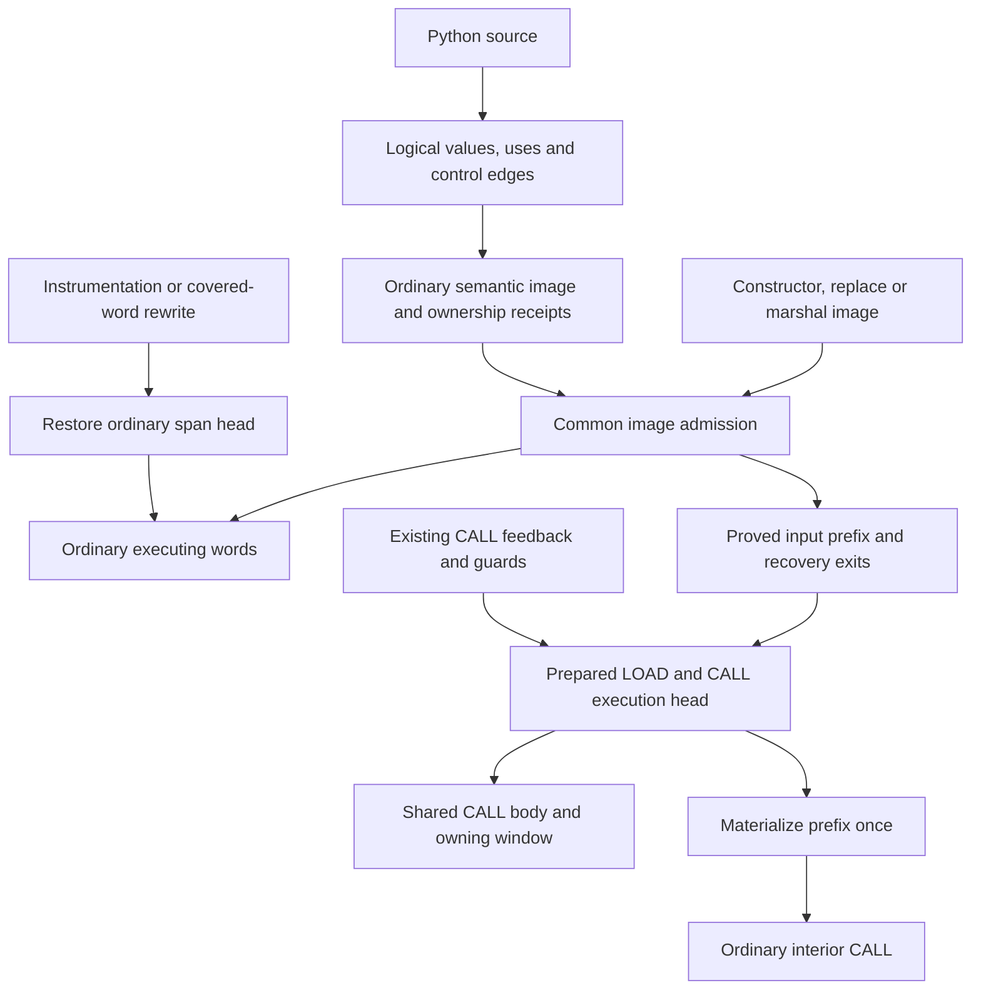
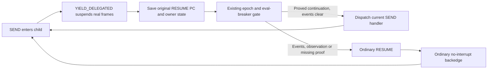

# Interpreter parity62: execute prepared calls and semantic continuations

Status: frozen grouped architecture review, 2026-11-14. Selected57 remains
`0dcba75bb3df40c32137db453b001f7e8f101de0`. All round61 executables, including
direct creation, are rejected by their broad screens. The
[review ledger](../../issues/register-semantics59/review62.md) records source,
retained evidence and limits. These are ordered implementation proposals, not
selected runtime contracts.

Component contracts: [allocation-only creation](../../issues/register-semantics59/creation-allocation62.md),
[prepared CALL](../../issues/register-semantics59/prepared-call62.md),
[method-to-exact CALL](../../issues/register-semantics59/method-call62.md), and
[delegated resume](../../issues/register-semantics59/delegated-resume62.md).
The [trial report](../../issues/register-semantics59/report.md) owns actual
qualification and measured dispositions.

## Decision

Make physical execution units express complete input preparation and semantic
continuations. Stop treating every admitted logical operation as requiring a
separate native handler entry. Preserve the ordinary semantic image for
observation, exceptions and arbitrary supported entry. Generate the faster
execution from the same ownership/effect contracts as that ordinary image.

The first consumers are precise allocation effects in direct creation, a
prepared CALL and a delegated resume that targets SEND directly. They address
both ordinary object workloads and suspension workloads. Only then reconsider
multi-frame ascent using a checked delegation outcome. A small scalar span is
a separate later consumer, with its own modest coverage budget. No component
requires a losing round59–61 packet.

This changes the execution model without changing canonical PyValue homes or
requiring a monolithic evaluator. Keep the selected small NCSR handlers. The
physical unit may span two or more eight-byte semantic words; eight bytes is
not a limit on an execution contract. An eventual wider execution record is
acceptable when it replaces repeated decode or transport for a measured
consumer. Do not allocate an independent per-word descriptor, reverse map or
second ownership analysis merely to represent these first consumers.

## What the failed cycle teaches

The common producer removed actual count/normalization work; its TEMP version
became a 69-byte handler with no owner or destination branches. Both lost broad
screens. This disproves using source elegance, smaller handlers or fewer
native instructions as selection criteria. It does not prove a cache/layout
cause and does not authorize padding, flag or compiler searches.

Ascent removed real intermediate result publication, dispatch and take/clear.
It also grew YIELD_DELEGATED from 556 to 1,076 bytes, doubled its stack
reservation and introduced four operand stack stores and six reloads on the
admitted guard path. Generators lost 7.90% while coroutines improved 4.82%.
Do not repair that loop by shaving individual guards whose proof is still
dynamic. Change where the continuation proof is established and consumed.

Round59's recipient action moved destination classification into every bind
and replaced publication checks with action decoding. Its generic exact-call
binder grew from three to twelve native instructions. The next continuation
contract must remove a whole intermediate execution step; another destination
tag is insufficient. Likewise, the rejected isolated Invoke already removed
duplicate clear work and still lost broadly. Prepared CALL must remove the
preparation boundary and reuse the existing CALL body, not repeat Invoke's
cleanup patch or the rejected descriptor-provider rewrite.

Direct creation passed both 117/79 builds and 525 focused methods per role, but
logging lost 30.17% and DeltaBlue 8.87% in both screen pairs. Logging does not
execute that creation helper. Shared owned-code initialization changed ordinary
GENERAL/binder native scheduling slightly, without new calls, guards, spills
or frame growth. Matched whole-process instructions were nearly flat while
cycles rose substantially. This does not explain the full loss; do not charge
the helper's staging cost to logging or claim a layout cause. The next native
review must cover ordinary consumers of any shared initializer/result change.

## One contract, three kinds of fact

| Fact | Establish it | Consume it |
| --- | --- | --- |
| Immutable input roles, aliases, prefix poststate and semantic successors | Common admitted-image analysis using generated read/owner/effect receipts; compiler value IDs may nominate candidates | Execution selection and generated prefix/exit commits |
| Adaptive callable/shape/arithmetic assumptions | Existing CALL, ATTR and BINARY feedback and their version rules | Current operation's existing specialization guards |
| Observer state, redirects, live links and callback effects | Existing instrumentation/eval-breaker and transition protocols at execution boundaries | Span entry, effect publication, resume and optional ascent |

Never turn the first category into a repeated hot proof of slot arithmetic.
Never promote the second or third into an immutable fact. A cached target
function's version does not validate current tracing, and cold SEND geometry
does not establish a parent's current receiver identity after arbitrary code.

The common generated contract names original semantic sites, input reads and
consumption, current canonical-result facts, full prefix poststates, reached
effects, and yielded/completed/error continuations. It supplies exactly the
consumer being added. Existing ScalarStorageGraph, normal/error replay and
CALL_ROLE_FAMILIES remain its producers; there is no handwritten list of
opcodes declared safe outside those contracts. A source contract change must
invalidate the derived variant or fail generation.

Cold selection must apply to compiler-created, constructor, replace and marshal
images through the same admission rules. Invalid images still reject. Valid
images without a proof execute their ordinary operations. No absence-of-owner
fact becomes a physical NULL claim. Keep the round61 SAME_VALUE and known
scratch-owner collision regressions in the common admission coverage.

## 0. Correct allocation effects before adding more staging

The round61 review's premise that GC object allocation can itself run a Python
GC callback was too broad for this selected runtime. Actual GIL `gc_alloc` and
`_PyObject_GC_NewVar` allocate and link; `_PyObject_GC_Link` sets the GC eval
breaker, not a collection call. `pycore_object_alloc.h` calls PyObject_Malloc;
`obmalloc.c` wraps the allocator with the existing release contract.
`pycore_object.h:111–117` explicitly requires allocator hooks and reference
tracers never to run Python or raise. Inventing a reentrant allocator to keep
the conservative proof would contradict this supported runtime contract.

Distinguish `MAY_ALLOCATE`, `MAY_FAIL`, and scheduling a later collection from
`MAY_RUN_PYTHON`, polling and unknown-owner release. Use the actual helper
call chain in generated effect receipts. This is not a global claim that all
allocation-capable operations are callback-free: descriptor/provider calls,
explicit collection, instrumentation, origin computation and finalizers need
their own reached summaries.

The first concrete consumer is the already admitted exact generator/coroutine
creation with origin depth zero, no observer hooks and the GIL. The staged
creation measurement is closed and losing. Make a separately reviewed
allocation-only creation variant keep callable and arguments in their existing
owning CALL homes through allocation and initialize the final heap frame from
those homes directly. It removes the stack/heap owner buffer, EXTERNAL prefix
push/pop and the extra argument move, rather than just changing a helper flag.
Reuse the shared final initializer and canonical owner transport. The retained
staged helper is 2,475 bytes with 328 bytes of explicit native stack adjustment;
its new call handlers are 380/412 bytes. This is a concrete whole-path cost,
not a projected saving. Known code/generator objects also still traverse
numeric-normalization tests in its native wrapping paths. Bind their existing
known-object canonical constructors to the owned result receipts in this same
consumer, preserving one owner; do not add another standalone constant variant.

Pin the bound code independently before allocation. On successful allocation,
transfer the required bound-code and function
owners, move each input once and clear its original home, finish every header
and local, then publish the completed object. No unowned input crosses an
effect. A partially initialized tracked generator remains cleared with no
executable frame, as in make_gen, until initialization is complete. Preserve
scheduled-GC delivery at the existing next poll; do not introduce a poll in
the uncommitted interval.

The successful prepublication path needs no refresh for an allocation-time
Python callback and no combined input/result EXTERNAL prefix. Remove those
costs. Retain only the existing result-root facility needed while the consuming
writer handles a possible redirect/reentrant cleanup, then the refresh after
an actual callback boundary. Do not move failure-only protection back onto
every successful creation. The shared writer must consume/clear that result
owner before publishing it or releasing an old binding.

On allocation failure the ordinary CALL homes still own their inputs. Route to
the shared error path for that exact prestate; do not reuse an EXTERNAL-prefix
cleanup that assumes the homes are empty. Error cleanup can finalize and must
publish the correct reached state before closing owners. Destination-local
replacement and discard can also finalize **after** successful initialization:
use the shared consuming result writer, commit root/home ownership before that
release, and refresh for any real redirect. Keep origin tracking nonzero on
the ordinary path. In this admitted allocation-only interval no Python code
can enable it mid-allocation, so that hypothetical callback is not a fixture
requirement or reason for a second argument snapshot.

Source closure: `_PyEval_CanCreateGenerator`, `generator_creation_context` and
`call_create_generator_exact`; make_gen/make_coro; helper effects in the
generator; CALL owner/error replay and the shared initializer/result writer.
Review tracemalloc/debug wrappers and object reference tracing under the same
documented contract. Do not change the allocator ABI or weaken its contract.
Tests distinguish allocation failure, scheduled GC delivered later, ordinary
origin fallback and real publication-time finalizers. The native gate is one
window→heap argument move, no successful-path external-prefix/buffer machinery,
and all required ownership/error/observer work retained. Measure the complete
creation path and broad screen; neither this correction nor a lower copy count
predicts a win.

## 1. Prepared CALL: the first comp/Delta consumer

Implement one local-argument preparation followed immediately by its CALL as
one generated executing span. The first source geometry is the final
`LOAD_FAST_BORROW` into a vacant call argument home, immediately followed by a
CALL that consumes that home. Support exact Python and value descriptor calls
first. The next member uses the same preparation with CALL_PY_GENERAL; it is
an explicit logging consumer, not an unrelated cleanup.

Retained monitored traffic gives useful scale: comprehensions has 648,000
adjacent descriptor pairs and 258,000 exact-call pairs; DeltaBlue has 64,350
descriptor and 183,360 exact pairs. Logging has 600,000 general-call pairs.
These are adjacency counts, not certified hits. Some exact pairs populate self
rather than an argument; exclude those from the first argument-only admission.
The compiler must not recognize workload names.

### Representation and consumers

Start with an executing head at the original LOAD site and the unchanged
ordinary CALL at the next semantic site. The head carries the load's local
source and target home; it reads the following CALL operands once and uses the
existing CALL feedback. Generate the head body by composing the checked load
receipt with that CALL's actual body. The ordinary interior CALL remains an
executable entry. Do not add a frame field, global map, allocated plan or a new
provider ABI for this first pair.

Unlike a wrapper that prepares then tail-dispatches to CALL, the successful
variant executes the CALL body in the same native handler. That removes the
intermediate handler transfer and general load-destination writer. It still
decodes the CALL operands, acquires the required snapshot and writes its owning
argument home. It must not claim a refcount or argument-copy saving.

Select the span only when the common image consumer proves the source local is
readable, target is a valid vacant scratch argument, no intervening semantic
effect exists, and the two original receipts compose. Source lines and columns
are not admission, ownership or execution proofs: disabled observation permits
the span across different positions. Preserve each original site's failure PC
and recovery recipe. A first implementation may decline a semantic recovery
combination it cannot emit correctly, but must name that missing exit contract,
not substitute source-position equality. Do not infer uniqueness from register
number alone. Independent valid entry into the ordinary interior CALL
need not be forbidden: that entry continues to require its ordinary prestate.

`Python/regcfg_passes.c` may nominate the surviving LOAD instead of deleting it;
`Objects/codeobject.c` admission/normal replay supplies the common encoded-image
proof. `ir_generator.py` supplies the prepared prefix, source identities and
CALL-family consumers. `Python/specialize.c` installs only supported members.
`Python/instrumentation.c`, public handler admission and generated base/twin
maps must restore the original two sites together.

Use the bounded span length to make invalidation concrete: before rewriting a
covered executing word, the common writer checks that site and at most the two
preceding sites for an installed head whose extent includes it, and restores
that head's ordinary identity before applying the rewrite. Generate head kind
and extent from the same span declaration. Route specialization,
instrumentation and wrapper-restoration writers through this operation; audit
direct word stores too. This avoids a reverse index and a per-hit successor
guard. It is a proposed writer contract, not a claim that existing writers
already perform it. If any mutable writer escapes this closure, the span is not
admitted. Original interior entries stay executable; operand-changing
replacement constructs a new admitted image instead of mutating a live proof.

### Ownership, errors and observation

1. Before any call guard that can run code, acquire one snapshot from the local
   and publish it to the original argument home. All other call inputs retain
   their ordinary owners. A callback may now replace the local safely.
2. Advance semantic attribution to CALL only after that complete prefix
   poststate exists. A CALL specialization miss enters ordinary CALL once;
   it must never repeat LOAD or acquire a second snapshot.
3. Allocation, provider invocation, recursion failure, argument cleanup and
   result publication use the ordinary CALL's reached owner/error protocol.
   Preserve self holes, discard/local results, exact frame overlap and the
   late old-owner release. Bound function/code ownership remains unchanged.
4. Instrumentation enabled for either original site must remove the executing
   head before an event can be skipped. Audit existing whole-code rewrite and
   wrapper restoration paths; installation-time checks alone are insufficient.
   If a cheap existing epoch check is required, state and measure it. There is
   no callback between prefix acquisition and the CALL's published state.
   Different original lines/columns are supported; enabling observation restores
   each site's events and original positions rather than forbidding the span.

This is a common call-input ABI in the compiler/generator, while its runtime
boundary still presents ordinary owned windows. It permits later multiple-local
or noncontiguous input preparation without changing provider semantics. Extend
only after the single-argument complete path wins. Persistent borrowed callee
cells are a separate architecture change: they require anchors, f_locals
replacement, traversal, frame escape and heap-safe return/yield readers. Do not
reuse PyValue's immortal bit or omit those readers to obtain an apparent win.

Native gate: one integrated handler body, no intermediate LOAD→CALL dispatch,
no generic destination classification for the prepared home, one required
acquisition, ordinary CALL guard/provider count, and no doubled cleanup on any
deopt. Charge next-word decode, instrumentation guard, spills, text growth and
any changes in ordinary CALL bodies. Stop if this is just a preparation wrapper
followed by the original dispatch or a second handwritten CALL implementation.

Minimum cases: local rebound in provider/GC/finalizer, sole-owner arguments,
aliases and holes, all CALL miss/error exits, recursion failure, local/discard
results, interior entry, all public image routes, and monitoring/trace enable
after installation at each site. Screen the eight workloads. An exact-only
winner may proceed to the general-call member; a loser is not its prerequisite.

### The next call consumer: select the method and invoke it

The final-local pair is the smallest prefix/exit implementation, not the whole
ordinary-workload strategy. Implement the larger `SELECT_METHOD → PREPARE →
INVOKE` consumer next, starting with METHOD_WITH_VALUES immediately followed by
an exact zero-explicit-argument Python call. DeltaBlue's `Plan.execute` has
364,800 such monitored pairs; `EqualityConstraint.execute` has two sites with
306,000 each. This consumer can start independently if the last-local variant
loses; it must not inherit a losing native layout or handler family.

Initially require a local receiver and the ordinary distinct scratch
callable/self window, matching those examples. Common admitted-image replay
must establish the output vacancies and CALL's actual consumption. Do not
generalize to scratch receiver/output aliases until their composed receipts
are explicit. On success the bypassed callable home remains physically NULL.

Its source contract is `bytecodes.c:4079–4097`: existing type and managed-values
guards, guarded cached method acquisition, canonical method/self results.
Compose that receipt with the existing exact CALL recipe. Retain the ATTR cache
and CALL function version independently: a type version does not validate a
function's current code. Do not create a third combined PIC, cache a borrowed
function past a callback, or redo dictionary/provider implementation.

The first zero-argument consumer carries the acquired method owner directly
to the shared exact frame initializer instead of publishing, reloading and
clearing the caller's callable home. Bind that source explicitly in the
generated call-input receipt; do not write a second initializer. Publish the
receiver into the existing overlapping callee argument home, or use the
ordinary heap-caller transfer as required. The callable still needs the
callee's strong function reference; the receiver still needs an argument
owner. An overlapping thread argument home is already the final callee home,
so that store stays. Selected method results are already canonical and use
TEMP stores: there is no generic normalization/destination check to remove
there. The removal is the intervening dispatch and specific transient callable
home traffic, charged against the larger handler and guard/operand decoding.

A method-guard miss executes ordinary LOAD_ATTR on untouched inputs. A later
CALL guard miss materializes the complete method result and preparation
prefix, then enters ordinary CALL once. Publish the original CALL before any
allocation, error or callback. Retain method-shadowing, type/version mutation,
managed-dict materialization, function-code replacement, recursion, PEP523 and
observer fallbacks. No Python callback occurs inside the admitted method-read
prefix; a generic descriptor is an exit, not permission to cross effects.

After zero-argument exact calls, compose the one-local preparation for the
comprehension `_add_widgets` method→local→CALL sites, then GENERAL for logging.
The fixed upper bound is three original sites initially. A wider physical
record carrying both existing feedback offsets and operand roles is acceptable
if it saves repeated decode; preserve ordinary semantic words, shared admission
and direct interior entries. Do not require every interpreter operation to use
that record. The first representation can still read the original adjacent
words and must charge those reads.

The retained method-plus-simple-preparation census is 1,491,570 Delta visits,
804,000 comprehension visits and 600,003 logging visits. The dominant Delta
member is exact Python calls (1,390,590); these counts overlap the final-local
census and cannot be added. Require actual admitted native hits, no duplicate
ATTR/CALL guards introduced by composition, and a whole-span improvement before
expansion. This gives call/borrow/cache unification a larger direct consumer
without making persistent borrowed cells or scalar-region machinery a gate.

## 2. Delegated resume outcome: remove the suspension backedge

The actual Tree.__iter__ cycle is SEND → YIELD_DELEGATED → RESUME →
JUMP_BACKWARD_NO_INTERRUPT → SEND. The two backedges execute 2,937,892 monitored
times. Selected `IR_SKIP_RESUME` already skips a no-op RESUME under an
eval-breaker/instrumentation equality check; it then dispatches the backedge.
Make the admitted ordinary resume outcome target SEND directly under that
same observation gate.

First consumer: one generated executing RESUME refinement with a cold-proved
direct target. Its semantic identity remains the original RESUME. Unused
physical operand capacity can hold the target if the shared writer/readers
support it; otherwise use a bounded execution extension at this site. Do not
put an outcome tag in every frame recipient or query a sparse global plan on
every resume. The ordinary suspended frame still records its original resume
PC, recipient and phase. The direct target is an execution choice made when
resuming, not a fabricated suspended PC.

Admission proves the preceding delegated suspension and resume relationship,
the exact no-interrupt jump, target SEND and original home/recovery state.
Do not bypass an interrupting backedge, changed resume argument, callback,
protected transition or observer event. The initial target can be generic SEND;
its current adaptive handler and guards remain authoritative.

Consume the refinement in `IR_SKIP_RESUME` and the generated RESUME handling,
using the existing epoch/eval-breaker decision. Publish the original RESUME and
then the ordinary jump's semantic attribution before entering SEND, so readers
and errors see the correct reached state. On pending events, instrumentation or
redirect, run the ordinary RESUME and backedge. A fresh observer enabled while
the generator is suspended must get both ordinary event opportunities; clearing
observers must not resurrect an invalid saved refinement.

No value is duplicated, taken or skipped. SEND still enters one real child,
checks state and recursion, publishes its result recipient and manages
exceptions. Resume-input disposal remains a possible finalizer boundary; do not
read a cached outcome across it without refreshing state. Preserve Emscripten,
TLBC and DTrace behavior by keeping their existing admission or ordinary path;
the initial qualification remains GIL release/debug as specified by root.

Native gate: on the admitted existing no-op RESUME path, replace the extra
backedge handler transfer with a decoded target and direct dispatch to current
SEND. No new parent-geometry loop, frame field or ordinary-call classification
is needed. Keep the existing ordinary RESUME success path first; admitting a
delegated variant must not make every ordinary call load an outcome descriptor.
Compare ordinary-call entry as well as the complete resume-to-SEND path, not
only the deleted jump symbol. Test monitoring while suspended, send/throw/close, exception state,
traceback/lasti, nested/custom iterators, redirect and malformed images.

This consumer is independent of rejected ascent. It gives the semantic outcome
model an immediate generator use before paying for multi-frame composition.

## 3. Delegation and creation as activation outcomes

Only after the resume consumer is executable, implement a generated
`DELEGATE(child, yielded-recipient, completed-edge, resumed-edge)` contract.
Its immutable geometry belongs to admitted SEND/YIELD/RESUME semantics. A
specialized SEND entry consumes it when linking the child. Carry a compact
capability for that actual activation, not a general destination action that
all calls must bind and all returns must decode.

The minimal implementation proposal must choose a concrete storage location:
an existing SEND-specific execution operand/cache can nominate geometry, while
the active parent needs either a checked continuation kind already recoverable
from its saved execution site or an explicitly priced field. Do not claim
parent identity, vacancy or instrumentation validity from the cache alone.
Adding a frame field is allowed if the complete downward/upward cycle pays for
it; hiding its initialization, copying and observer-reader cost is not.

At ascent, the carried outcome should replace round61's repeated decoding of
two words and three operand relationships. Mutable parent/child linkage,
receiver identity, pending redirect and instrumentation validity still need a
proof or live guard. An epoch mismatch falls back before any unmaterialized
owner interval. Since arbitrary child code ran since SEND, installation is
not a proof that monitoring remains off. Keep the bounded loop and every real
exception/recursion/profile/phase/suspended-state commit.

This is a reopening gate, not permission to cherry-pick round61 ascent. A peer
must show the actual entry bind plus each hop, including resets on completion,
error, unwind, close, copy and redirect. Require removal of the four-store/six-
reload operand staging and a lower complete two-hop native cost. Actual depth,
bound, custom-iterator and profiling probes remain required. Optional old GDB
guard-visit counters are invalid and must not be reused as rejection counts.

Creation's `CREATE_SUSPENDABLE` belongs to the same outcome vocabulary, but its
staged round61 executable is rejected. Its source moved
immutable image checks/tool scans cold and keeps mutable context checks hot.
Reuse its existing CALL cache union and shared final-frame initializer only
with native review of every affected ordinary call path. Do not add outcome
fields to rescue it without identifying removed complete-path work. Two
argument moves still match the
selected heap-caller path; removing the arena/header copy is the claimed change.
Thread-frame exact calls already overlap arguments and are not a missing-copy
optimization. Origin tracking and function-code mutation matter at reached
Python callbacks; the allocation-only interval in section 0 does not introduce
one. The existing staged packet's defensive handling is not evidence that such
a callback executes there.

## 4. Scalar facts: consume a prefix, not a descriptor framework

After the first call and resume screens, implement the previously specified
fixed ADD_INT→MULTIPLY_INT consumer if its shared source receipt is economical.
It is a test of prefix materialization and fact transport, not the comp/Delta
parity strategy. Reuse the same semantic-site/span machinery only where the
actual contracts match; CALL's owning window is not a scalar last-use proof.

The selected scalar fact/receipt implementation is already real. Extend it so
an inline arithmetic result remains a native value through the next admitted
operation, with ordinary first-poststate materialization on a second guard or
overflow miss. Use the exact alias/read/kill proof in the retained
[scalar proposal](../../issues/register-semantics59/scalar-proposal.md). No
allocated descriptor hierarchy or opcode-name safety list. Keep physical
NULL vacates and separately rounded float operations if float follows.

SHAPE_LOCAL_TEMP already consumes local-borrow and canonical-result facts.
COMPARE_OP_JUMP already combines comparison and branch. Do not rediscover
either as missing optimization. The old finite motif ceiling is only 1.58% of
comprehension and .88% of Delta semantic dispatches. Scalar work cannot be
credited with closing their 30% candidate-instruction deficit.

## Execution order and selection

1. Round61 is closed with no winner. Peer allocation-only creation, prepared
   CALL and delegated resume contracts; they start independently from selected57.
   Reuse reviewed source contracts without importing a losing executable as
   a prerequisite.
2. Implement and screen prepared CALL exact/descriptor and its method-selection
   consumer, then GENERAL independently or as a winning extension. Implement
   and screen delegated resume separately. Root owns serialized generation/native jobs.
3. Compose only winners. Confirm hot-set and sentinel behavior, then all29,
   matched upstream/PMU and full supported diagnostics at the coherent checkpoint.
4. If parity remains unmet, use those actual native paths to decide the
   activation-outcome and scalar consumers. Neither is gated on selecting a
   losing preliminary packet. Return to grouped architecture review after the
   coherent cycle; do not spend successive turns polishing a local loser.

Each source peer must supply an owner/exit table, exact writer/invalidation
closure and native accounting target before implementation. Every measured
candidate reports actual admission separately from instrumented traffic. Keep
the unchanged four hot workloads and four sentinels. Stable repeated losses
are evidence against selection even when the intended instructions disappear.
Only root can accept an explicit measured tradeoff; this proposal does not
waive logging or generator losses.

No complete parity budget is established. Comprehensions still needs 30.38%
of selected57's matched native instructions removed to equal upstream's count;
throughput additionally depends on cycles per instruction. Necessary object
lookup, acquisitions, Python calls, allocation, exception links and observer
work remain. This plan removes specific avoidable transport with immediate
consumers and falsifiable complete-path gates.
