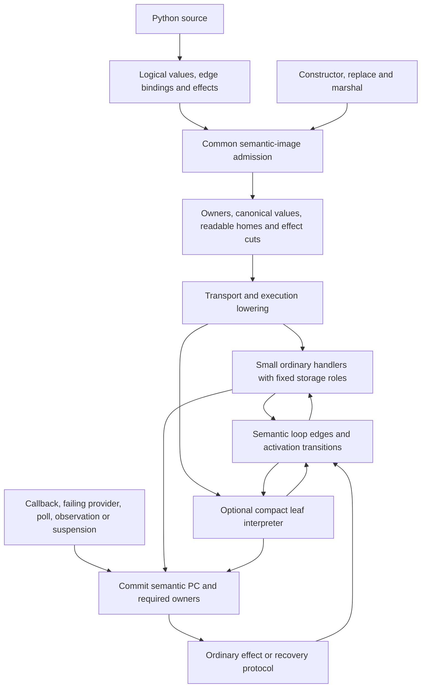
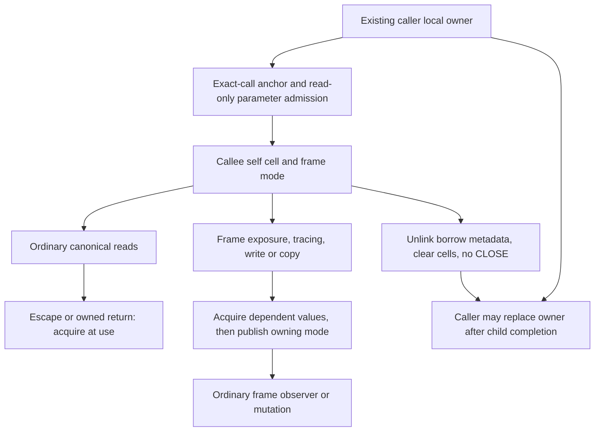

# Interpreter parity63: lower transport and activation costs together

Status: grouped architecture proposal, 2026-11-14; final after the method62
trial. This is not a selected runtime contract. Selected57 is
`0dcba75bb3df40c32137db453b001f7e8f101de0`. The
[review ledger](../../issues/register-semantics59/review63.md) identifies the
source, native evidence and limits. The coordinator owns implementation,
qualification and selection. No runtime was changed or executed for this review.

## Decision and order

Use one logical value/effect model to lower ordinary storage traffic and to
describe complete activation cycles. First implement broad, proof-directed
transport lowering in the existing small handlers. In parallel architectural
work, specify an exact immediate-await activation that delays coroutine-object
allocation until suspension or observation. Admit its first runtime consumer
only after its promotion and exception protocols are complete. A compact
effect-bounded interpreter is the larger execution option if ordinary lowering
leaves a substantial, demonstrated dispatch/state budget. A retained delegation
spine and borrowed parameters remain separate, lower-ranked options; neither
is a shortcut around ownership.

This order addresses two real constraints. The current interpreter repeatedly
classifies storage whose role is immutable, but its existing local borrowing,
copy propagation, canonical producers, exact-call overlap and inline returns
already remove much of the obvious work. The remaining comprehension deficit
is too large for another pair of fused words. At the same time, expanding
handlers has repeatedly reduced instructions while worsening unrelated elapsed
time. The new lowering must reduce hot state and duplicate code as well as
operations. No cache explanation has been proved.

| Rank | Architecture option | First complete unit | Why this rank |
| --- | --- | --- | --- |
| 1 | Proof-directed transport lowering with explicit effect exits | Ordinary scalar producer/consumer paths across the existing hot CFGs, with generated local/fresh/consumed roles and shared slow exits | Uses established proofs and NCSR execution; reaches more than adjacent motifs; lowest new runtime-state burden |
| 2 | Deferred exact-coroutine await activation | A unique CALL→GET_AWAITABLE→None→SEND value path, executed in a thread-backed activation until an object is needed | Can eliminate the repeated allocation/copy/create-return/reenter cycle; actual Fibonacci paths have strong structural coverage |
| 3 | Compact interpreter for effect-bounded CFG paths | One small leaf execution domain carrying a value across branches and loop edges, returning to ordinary execution at effects | Offers broader dispatch/state removal; must earn admission by coverage and compiled register residence, unlike round60 |
| 4 | Delegation spine for a complete suspension cycle | Exact generator delegation: descend, yield to the external recipient, resume the retained leaf, and retire completed links | Directly attacks the dominant generator cycle; much larger potential than bypassing one backedge, with greater semantic obligations |
| 5 | Anchored borrowed self | A read-only self parameter of a synchronous exact method call, with complete promotion and frame-reader support | Removes an owner pair only when an existing caller local survives; little benefit for inline coroutine arguments |

Ranks describe preference, not a five-packet bundle. Start rank 1; prepare rank 2
as the independent activation lane. Rank 3 is conditional on the cost gate
below, not a prerequisite for either. Do not integrate a losing round62 binary
to obtain its source machinery.

The component source review has now refined rank 2's unresolved relocation
proposal: the [deferred-await unit](../../issues/register-semantics59/deferred-await63.md)
is authoritative for implementation. Observation materializes an object view
without moving the active frame. Storage moves only at a terminal suspension
within the owning evaluator segment. This replaces the mid-activation
promotion wording below; complete reader ports remain an implementation gate.
The [fixed-role unit](../../issues/register-semantics59/role-lowering63.md)
specifies rank 1's phase-one source packet. Both units have root and independent
source approval; neither has native qualification or measured results yet.

## Shared logical and physical model

The selected register CFG already has fresh single-definition temporaries,
canonical stack-position temporaries at joins, and implicit unwind uses. Extend
that representation only where a consumer needs more information: value
identity across a CFG edge, its current owner, canonical representation, and
the next effect that requires a readable home. An edge binding names the same
logical value on both sides; a physical slot is assigned afterward. A local
binding, a borrowed view, an owned temporary and a persistent argument borrow
are different states even if their bits match.

Common image admission must reconstruct sufficient facts for compiler output,
constructor, replace and marshal routes. Compiler nominations are hints.
Existing reached generator receipts establish producer/consumer semantics;
names, annotations and source positions do not. The public semantic words and
their recovery identities remain the observation coordinates. Execution may
have fewer transitions or a different storage choice, with an explicit mapping
back at every supported exit.

This is an interpreter design. It emits no native code at runtime and cannot
use the unfinished JIT as a hidden dependency. A wider execution record is an
option only when a concrete consumer removes more decode/state work than its
extra loads and footprint. There is no new universal per-word descriptor,
owning feedback cache, or independent proof interpreter.

## Cost scale and acceptance

The selected57 matched kernel PMU ratios are comp instructions **1.436416**,
cycles **1.333179**; Delta **1.361424/1.118423**; coroutines
**1.307831/1.267788**. Generator elapsed **1.372523** is a separate measurement.
Comprehensions must remove **30.38% of its own native instructions** merely to
equal upstream's count. That is not an elapsed prediction.

The first retained matched pair has approximately 278,531 selected and 193,880
upstream instructions per comprehension tray: a deficit of 84,651. The separate
monitored census records 2,279 semantic-word visits per tray. Thus a uniform
removal would need about **37 native instructions per visited word**. Those
different runs provide scale, not a joint attribution. A hypothetical 20
instructions saved at each of 108 dict.get calls removes 2,160, only 2.6% of
the deficit. Saving 20 at each of 162 direct append operations removes 3,240,
only 3.8%. Neither saving is measured, and overlapping changes cannot be added.

For each complete path use:

`net work = removed decode + storage + count operations + state publication + dispatch - new admission-hit work - spills - materialization - continuation maintenance`.

Weight *actual accepted paths and unobserved hits*, not warmed opcode names.
Separate inline scalar, immortal and mortal values: deleting a DUP does not
necessarily delete a refcount update. Count entry, exit, miss, polling and
retirement, not just the inner success sequence. Text size and branches are
separate costs; their effects require measurement.

The following are engineering stop gates, not speedup promises:

- Rank 1 has the bounded consumer set and structural counts below. Its first
  packet cannot plausibly supply the full comprehension deficit. Keep an
  actual broad winner as an increment; do not expand its scope merely to
  satisfy a percentage target.
- Rank 2 must eliminate allocation and the create-return/reenter cycle for
  actual completed awaits. Price promotion, extra arena state and ordinary
  effect-boundary checks. Direct creation alone already failed its screen.
- Rank 3 must show that repeated transport/state/dispatch outside effects has
  a material remaining budget after rank 1, with entry/exit costs charged.
  The old finite motifs cover only 1.58% of comp semantic dispatches and do
  not meet this gate. No framework implementation precedes a concrete complete
  execution-domain proposal and coverage calculation.
- Rank 4 must remove repeated work over the whole delegation depth. A new
  field or one fewer indirect branch per resume is insufficient. Compare one
  complete external next/send through yield or completion, including first
  construction and invalidation of the retained chain.

These gates may reject any approach as currently formulated. There is
no evidence-backed additive 30.38% budget yet. A review must state that gap
rather than assign invented percentages to architecture labels.

## 1. Lower immutable storage roles before changing the engine

Today `IR_CONSUME_INPUT` distinguishes local borrow from scratch take using
`IR_IS_LOCAL`; `IR_TAKE` selects acquisition versus transfer; result publication
can test local, discard and scratch, classify canonical representation, replace
an old local, and defer possible finalization. Several canonical/TEMP variants
already eliminate parts of this. The proposed unit is the remaining complete
producer-to-consumer transport, including its error and retirement paths.

Attach fixed input ownership and output publication choices to the *admitted
executing form*. For an input proved to be a current local view, emit its read
without a scratch-take branch. For a consumed scratch owner, emit the reached
take/clear directly. For a proved canonical fresh result into a positively
owner-free destination, emit the canonical store without an old-slot read,
normalization or local/discard decision. Keep the physical clear required by a
later ordinary reader. Do not use NO_HOME as a proof of initialized bits.

This extends common scalar facts; it does not require finishing bitmap readers
or IRSC2. Initialized NULL storage stays the control at unsupported joins and
lifecycle boundaries. Full static storage authority is a separate task. In
particular, no missing normal transfer may be guessed from a call's consuming
shape, and no current canonical declaration may substitute for the actual
reached acquire/transfer receipt.

Avoid a Cartesian product of every operation and ownership mode. Generate only
the used storage signatures for this complete path class, share unchanged
guards/providers, and move uncommon effect exits out of hot bodies with explicit
arguments. Existing SHAPE_LOCAL_TEMP is already in the selected baseline and
earns zero new credit. The first packet covers list iteration, method receiver
preparation, append consumption, class reads and attribute stores through the
same lowering, as specified below. Local replacement that
can finalize remains an effect, even if the produced value is an inline scalar.

The compiler's existing COPY propagation already folds local reads into
borrowable fields. It cannot express CALL's owning window, and it ends at
callbacks and local mutation. Do not repeat that pass. The new target is
runtime rediscovery of fixed roles in *surviving* execution, plus unnecessary
publication of a fresh value before its next proved use where rank 3 can carry
it. Source-position restrictions may be replaced only by actual event/recovery
materialization, never simply deleted.

Files: common admission in `Objects/codeobject.c`; reached ownership and
storage lowering in `Tools/cases_generator/ir_generator.py`; generated metadata
and execution selection in `Python/ir.c`; existing `ceval_macros.h` primitives.
No frame layout change in this first packet. All ordinary mutation and observer
writers must preserve or revoke the executing form centrally.

### First source packet: five storage-role consumers

The following is the complete initial set. Roles choose lowering only after
the actual producer, take, publish and effect receipts pass; the family names
are not proofs. `L` means an ordinary local, `T` a scratch home, and `A=B`
means the current input is consumed before the same home receives its result.

| Family and selected signature | Required source action and removal | Retained work |
| --- | --- | --- |
| List iteration, A=L, B=iterator window | Recognize exact-list guard/bounds/read/XDUP as the canonical item acquisition. Publish that owning item directly at the local body-edge recipient, without generic item normalization or a transient B+2 store/clear where incoming physical state permits | Item DUP, list bounds and state guards, cursor normalization until a separate actual cursor proof exists, old-local retirement, exhaustion/error protocols |
| Managed-values and no-dict method selection, receiver B=L, A/A+1=T | Use the existing guarded class-value DUP/receiver TAKE receipt and canonical outputs. Lower receiver TAKE to local DUP without a local/scratch acquisition decision | Both owners and output stores; all lookup/version guards; method62's transfer saving is not counted again |
| List append, list A=T, item B=T | Lower the actual consumed scratch input directly to its owning take/clear and pass it to the same consuming append helper | Provider call, capacity/resize work, error path and semantic state; no local-item variant or new inline append implementation |
| Class read, nonmethod form, A=B=T | Take the scratch class receiver, acquire the existing canonical cached result, publish once into the vacated same home, then retire the receiver | Type/version guards and callback-capable receiver retirement; no local/discard branch and no second result publication on the ordinary success path |
| Shape store, receiver A=L, value B=T | Lower the existing value TAKE to a scratch transfer and receiver OWNER to no temporary owner; retire only the displaced attribute value | Shape/version guards, the owning store, last-owner callback and post-callback reload; no new borrowed stored value |

These cover words 43, 44 and 47 of the actual comprehension inner mapping
loop. The LOAD argument, descriptor CALL and loop backedge remain ordinary.
Other retained paths supply the class-read/store use in Delta. Existing
SHAPE_LOCAL_TEMP and SHAPE_POLY_LOCAL_TEMP already have their local/TEMP
lowering; list/tuple subscription and ADD/SUB already have canonical-result
proofs. They are controls, not new members. Existing method canonical outputs
also earn no normalization saving.

Extend `ExecutionVariant` and its validation in `ir_generator.py:168–245,2362`
for this finite set. `local_fields` already lowers a current local input in
`IRStack.consume`; `temp_fields` currently names destinations only. Add an
explicit consumed-input field tuple and a local-result choice rather than
pretend those existing fields cover inputs or local outputs. Extend
`SlotLayout` and `IRStack.consume/store` to consume those choices. Reuse the
reached canonical owner in the class-read retirement emitter, including its
actual post-callback state. Unknown/redirection exits retain the ordinary
materialized protocol, with no stale native result alias.

FOR needs a bounded window body-edge recipe at the generated window move
(`ir_generator.py:6495`), because current variant validation rejects windows
and `canonical_output_sources` rejects them too. The recipe must recognize the
actual exact-list guard, bounds arm, element getter/XDUP, untouched iterator
and existing completion terminal. It grants canonicality only to the acquired
item token. It does not declare the whole window canonical or remove the
cursor's conversion by assertion. Extend the body-edge commit to establish
the named local and retain the displaced owner before any callback. Ordinary
exhaustion must never commit an item. Scratch-output or arbitrary window
generalization is outside this packet.

Common replay nominates these forms at its final fixed point. A fresh output
needs positive absence/no-owner; an in-place output instead needs the reached
take of the readable input followed by its canonical publication. Never demand
incoming absence at `LOAD_ATTR_CLASS A=B`, and never infer absence just because
the destination number is temporary. Replay checks each method output and the
FOR interior B+2 home separately; the direct item route leaves B+2 physically
safe for later ordinary readers. Keep the ordinary clear if positive incoming
NULL/readability is insufficient to omit it.

Representation: reserve a bounded set of private IDs in `ir_numbers.txt` after
the coordinator's occupied IDs. Static append can select its active ID at
executing-copy creation. Adaptive families use private pending aliases whose
dispatch entries point to their ordinary handlers, carrying the cold
nomination in the handler ID. Generate each alias/active form's ordinary base
and allowed transition; no new per-word payload or per-hit mode lookup. During
specialization, the central `_PyIR_ReplaceHandler` selects the supported form
from the retained nomination plus current family member. Instrumentation,
unsupported quickening and restoration drop it and restore the ordinary base.
Alias IDs are not accepted in public images or stored in byte-sized wrapper
opcodes. Port the round62 central-writer mechanism as source infrastructure if
needed; do not inherit its unused heads or losing executable. The baseline
SHAPE selector in `specialize.c:670` becomes another user of the same role
selection interface, not a competing raw writer. Ordinary paths remain valid
without a nomination. FT retains ordinary execution initially.

Retained structural weights, applying these exact operand shapes to the
pre-monitor labels (visible-local cutoff, not full semantic admission):

| Signature | comp visits / 6,000 trays | Delta visits / 30 loops |
| --- | ---: | ---: |
| List iteration to local | 1,686,000 | 0 |
| Method from local | 912,000 | 1,451,610 |
| Append consumed scratch | 864,000 | 0 |
| Class read in-place scratch | 0 | 942,090 |
| Shape store local/scratch | 6,000 | 91,530 |
| Disjoint word total | 3,468,000 | 2,485,230 |

These are 25.4% and 16.9% of the respective monitored semantic visits, not
accepted hits or instruction savings. Hidden constant homes, actual common
replay, loop fixed points and callback exits still decide admission. There is
no dispatch removal in this packet. For scale, even an illustrative removal
of 30 instructions per list step, eight per method/append and twelve per store
would yield only about 10,810 instructions per tray before added costs:
3.9% of selected instructions and 12.8% of the deficit. These numbers are an
explicit hypothetical, not disassembly counts or an upper bound. The native
review must replace them with whole-path counts; lowering cannot be sold as a
10% whole-program saving on this evidence.

Implement list iteration/append first, then the attribute/method consumers
against the same role contract, with separate qualification/readback of each.
Focus controls must include local/scratch and alias negatives, unknown/owner-live
joins, actual acquire mutation, callback retirement and redirects, all public
construction routes, specialization and observation restoration, and ordinary
generated receipt equivalence. Count accepted sites and actual hits after root
generation. If an individual signature cannot retain its exact effects or
source receipt, leave it ordinary and report the lost coverage; do not weaken
the shared contract.

**Falsifiers:** no broad accepted coverage; unchanged native classification;
an added mode load/branch for each removed test; hot spills or provider hops;
large duplicate handler bodies; or a repeated logging/ray/spectral/nq loss.
The 69-byte constant/TEMP failure proves that a smaller individual body is
insufficient. Compare aggregate hot text and whole reached paths before timing.

## 2. Defer the object for an immediately awaited exact coroutine

The retained `fibonacci` image contains two complete paths: words 8–11 and
17–20 each perform exact no-self CALL, GET_AWAITABLE, None input and SEND.
Each has 485,568 monitored visits over four workload loops. Their delegated
yield words 12 and 21 each have zero visits. This establishes structural
opportunity for **971,136 immediately completed awaits**, not unobserved
admission or specialized hit counts. The selected path first enters a thread
frame, creates/copies a heap coroutine at RETURN_GENERATOR, returns the object,
then enters its heap frame through SEND. Allocation62 removed staging inside
creation but retained an object and that broader protocol.

The first source design unit is a new *await activation*, interpreted by the
ordinary operation bodies, with delayed object materialization. It is specific
to an exact native coroutine function whose result has the single admitted
await use. It is not a generic virtual-object system or native JIT inlining.

### Admission and source interval

Common image replay must prove the actual CALL result feeds GET_AWAITABLE,
the latter feeds SEND's receiver, the intervening value is None, the SEND
result/complete edge is the original one, and no other read, alias, branch,
exception ingress or observable effect consumes that intermediate object.
Match value identities and effects, not fixed opcode adjacency or source lines.
Begin with the actual four-word, no-self, positional exact-arity path. Each
interior word remains a legal ordinary entry with an ordinary object prestate;
only entry through the admitted head can create the private activation.
Unknown public images remain ordinary. All public construction routes use this
same replay.

At the head keep the current PEP523, function/code-version, arity, stack and
recursion checks; require exact coroutine code, origin tracking disabled, and
no active tracing/profiling/monitor event or LLTrace. Ordinary semantic CALL,
GET_AWAITABLE and SEND PCs remain distinct for guards, errors and later
observation. Unsupported current state falls back before taking owners. Use
the central multiword writer to revoke the head if any covered word changes.
Do not cache mutable tracing/origin state as an immutable image fact.

### Private state and successful execution

Reserve the child in the thread arena with **disjoint child homes** first.
Transfer the already owned positional argument once and clear the parent's
consumed call window. The original parent SEND receiver/input slots stay valid
NULL; no special non-object PyValue is published there. Disjoint storage avoids
silently reinterpreting a callee argument as the parent's sent-value slot and
keeps ordinary parent root scans truthful. Charge this move; do not claim the
selected overlapping exact-call copy saving again.

Use a distinct thread-backed await owner mode and an await-only record adjacent
to that frame's fixed header in the **header side** of its arena reservation.
Value homes still grow from the chunk's value side; raw record fields are
never inside the initialized-NULL suffix scanned by `_PyThreadState_PopFrame`.
The record holds an
actual `_PyErr_StackItem`, the parent, original call/await/send PCs and the
normal/exception completion targets. Its address is derived from the new
owner mode and reserved layout; ordinary frames acquire no pointer or larger
header. Reserve/account the additional arena extent explicitly. `saved_top`
continues to describe the value top to restore; the owner mode supplies the
extended header extent for pop/chunk restoration. `_PyThreadState_PopChunk`'s
first-header assertion must use that same extent. Function and code retain
their ordinary strong owners; argument homes retain their actual owners.

Initialize the coroutine's logical exception state in the record and link it
through `tstate->exc_info` before entering the body after its creation prefix.
Account one active Python recursion level, maintain current/previous frame
links, and publish the parent at the semantic SEND suspension boundary with
an explicit private await-receiver state in the activation record. A reader
needing the ordinary receiver requests promotion; it must not find fake bits
or infer a coroutine from a NULL slot. Existing canonical PyValue homes never
hold the private activation token.

Separate **storage residence** from **activation kind** at existing readers.
A central thread-resident predicate admits ordinary thread and await frames
for arena reservation, argument overlap in subsequent ordinary calls, copying
and pop. Generator-backed predicates still require an actual heap generator.
Do not leave `owner != THREAD` branches to treat the new mode as a heap caller.
The coroutine code flag can distinguish return handling for this new mode
without an extra universal synchronous-return branch. Price all changed native
paths; a source predicate is not itself free.

If the body returns without an exposing effect, retire the thread-backed child
through its owning frame protocol and publish the owned result directly at the
original SEND completion recipient/PC. The completion consumes the private
activation rather than nonexistent receiver/coroutine owners. Error completion
preserves exception state and attribution at the original await and uses an
explicit corresponding unwind edge. Neither path replays CALL, GET_AWAITABLE
or SEND. This removes object allocation, heap-frame copying, the creation
return and subsequent heap-frame entry; it retains body work and required
frame initialization/retirement.

### Promotion and reader closure

Before the first real suspension, frame/generator exposure, tracing/monitor
event, debugger redirection, or native effect that requires ordinary
frames, materialize the affected active await chain. Allocate the real
coroutine objects and heap frames, initialize names/code/origin semantics,
move owned homes and exception values, and install each original parent
receiver/continuation. Repair `current_frame`, child `previous`, exception
`previous_item`, `tstate->exc_info`, active await links and profiler/frame
associations before any callback or collector observes the new chain. A
partially promoted chain remains under explicit transition roots; allocation
failure unwinds through that published state, never an unrooted C array.

Promotion is a transaction: prepare allocations while the old thread records
still own everything, then commit nonfailing owner moves and pointer repairs.
Nested records remain allocated until their links and saved stack extents are
safe to retire. If an ordinary thread child is still above a promoted await
frame, retain the cleared old arena reservation as a retirement record until
the child pops; then reclaim it in the arena pop protocol. It is not a live
Python frame or an owner, and GC does not scan its raw header payload. The
peer design must close this deferred reclamation and all live C-frame aliases;
it may not free a middle arena allocation or leave a stale C pointer usable.
Materialization on an interior-frame query promotes enough of
the chain to make all reachable frame/generator relations ordinary. Early
return can keep ordinary owned result transport; no immediate destruction or
incidental allocation/GC-count equivalence to CPython is required.

The source port includes generated reached effect boundaries, stack growth/
pop, code/function/frame ownership helpers, error unwinding, recursion, GC,
`PyFrame_GetGenerator`/`frame.f_generator`, locals/frame exposure, debugger,
monitoring and profiler readers. In particular `_PyGen_GetGeneratorFromFrame`
cannot cast a thread await frame as an embedded heap generator. Root scanning
must visit the record's real exception owner and owning child homes, while the
absent receiver contributes no reference. GC traversal must consume these real
roots directly, without allocating or recursively promoting during collection.
A pre-collection observation hook that requires an ordinary coroutine must
promote before entering collection; ordinary collection alone is not such an
observation. No collector may use an unmodified embedded-generator cast for
this owner mode.

Ordinary nested Python calls, including recursive immediate awaits, do **not**
promote merely because Python runs: their arguments and the await record's
exception/frame roots are already real. Promotion triggers are an actual
request for an observable coroutine/frame relation, real suspension, an event
requiring ordinary observed state, or a reached native/collector reader whose
contract cannot consume the private activation. A generic family name cannot
make a whole body callback-free or force unconditional promotion of every
recursive call. Reached guarded successes keep their real effect contracts.
Hook existing publication and observation paths, not a mode test at every
value read. A reader that retains raw frame pointers across a possible
promotion needs an explicit refresh/stability rule before admission. This
includes another thread's `PyThreadState_GetFrame`/`sys._current_frames` while
the target has released the GIL inside a native call. GIL-only execution does
not make those suspended native aliases disappear. Either the completed port
provides safe relocation and refresh for every supported retained alias, or
that state needs a stable-frame materialization design before this lane can be
implemented. Merely repairing `current_frame` is insufficient. Charge
added ordinary-handler checks; they are a real logging risk. Existing exposed
frames or unsupported preexisting observation can conservatively deny entry.

Files: common use/def admission and execution selection; `ir_generator.py`
CALL/entry/return/error recipes; `pycore_interpframe_structs.h` owner enum and
await-only record layout; arena/frame helpers; `genobject.c`, `frame.c`, `gc.c`,
`frameobject.c`, monitoring/debug/profiler adapters. The bounded peer proposal
must give a reader/writer table and a promotion state machine before runtime
implementation. It cannot stop at the new CALL head.

The minimum source closure for that peer unit is concrete:

| Reader or transition | Required await-mode contract |
| --- | --- |
| `_PyFrame_ReserveForCall`, `_PyFrame_PushOverlapping` and exact-call lowering | Test thread residence separately from coroutine identity; preserve ordinary nested-call overlap while the await's own initial homes remain disjoint |
| `_PyThreadState_PushFrame`, `_PyThreadState_PopFrame`, `_PyThreadState_PopChunk` | Reserve and restore the extended header extent; never scan the raw record as PyValues; drain deferred cleared reservations in stack order |
| `_PyFrame_GetHomeView`, `_PyFrame_Traverse`, `_PyGC_VisitFrameStack` | Admit the private active phase with truthful NULL-controlled homes and actual exception roots; allocate nothing during traversal |
| `_PyFrame_TryClearExceptCode` and general/error clear continuations | Choose extent from actual storage/phase, close each owner once, preserve transition roots across finalizers, then retire the record |
| `_PyFrame_GetFrameObject`, `_PyFrame_MakeAndSetFrameObject`, thread-frame queries and locals proxies | Complete promotion before observable publication; account for cross-thread queries and native aliases, not just the current interpreter handler |
| `_PyGen_GetGeneratorFromFrame`, `frame.f_generator`, `PyFrame_GetGenerator`, frame clear/line redirection | Require a real generator-backed owner or request completed promotion; never reinterpret the private header as an embedded object |
| Generated RETURN/YIELD/SEND/error paths | Distinguish direct private completion, first true suspension and already promoted execution; preserve semantic recipients, exception links and recursion on each transition |
| Monitoring, profiling, debug and executable-word writers | Deny or revoke admission at entry; promote active affected frames before an observer requires ordinary state; preserve all four semantic PCs |

The table bounds the source design work; it is not a claim that these ports or
the native-alias proof already exist. In particular, mid-activation relocation
is the largest unresolved feasibility obligation, and can reject this layout.

**Falsifiers:** no accepted natural hits; allocating a coroutine on every hit
anyway; a second owning argument snapshot; lost exception owner/recursion level;
common guards that always promote; unbounded native stack storage; or a broad
sentinel loss. Measure the complete immediate-await cycle, ordinary calls and
promotion controls, including nested awaits that really yield, frame queries,
GC/error injection and observers enabled from a child. This lane has much
larger source work to remove than direct creation, but no speedup is assumed.

## 3. A small effect-bounded execution domain

If rank 1 leaves a large boundary cost, lower admitted CFG paths to one small
interpreter that handles only their checked leaf operations. Reuse the parsed
operation bodies and receipts. Carry one canonical value plus its statically
known owner/home relation across internal edges; retain it across a loop edge
only when both edges agree and the poll boundary has materialized it. This
changes physical allocation and execution, not just opcode count.

Use a fixed small set of native locals: frame, slots, thread, semantic/executing
PC, current word, one cached value and its finite mode. The mode is fixed by an
execution entry/edge, not dynamically searched in a map. Do not embed the
ordinary call, exception, bridge or monitoring engines in the same C function.
The selected small NCSR handlers handle effects and unsupported paths. A miss
materializes the exact semantic prestate and transfers once; a completed
operation exits at its successor, never replays a side effect.

The first complete domain must include forward branches and a loop edge;
restricting it to two arithmetic words fails the coverage gate. Begin with
canonical scalar operations and guarded value reads whose admitted success
cannot invoke Python or retire an unknown last owner. A list-item acquisition
still takes its required owner. Dictionary lookup is an effect unless the
specific key/table contract proves otherwise. No type/shape assumption survives
a callback just because the local value identity survives it.

Concrete first consumer: the admitted list-iteration/method/argument/append
loop, including `_add_widgets` words 43–48. Private entry IDs share one leaf
interpreter body, generated from rank 1's actual role receipts. Execution after
the ordinary descriptor CALL reenters at append, then follows the backedge,
the next list step, method selection and final argument preparation before
transferring to the next ordinary CALL. Exhaustion and method/list guard misses
leave through their exact semantic exits. Thus the domain covers a repeated
CFG cycle with a real call cut; it is not a named two-word motif. General
eligible loops use the same operation/edge rules, with no benchmark recognition.

The existing consuming append helper can remain a C call inside the domain
only after its success/failure effect closure is proved from source. Its
allocation-only success is different from an error cleanup that may release
a last owner. Publish the exact append prestate and transfer the item owner
before that reached effect; charge the C-call spills. Otherwise append is
another ordinary cut and its extra entry/exit cost is included. List getter
and append are not inlined merely to repeat the losing round57 bundle.

Do not call every METH_VALUE provider a leaf. The convention establishes value
transport, not absence of Python callbacks. The dictionary key may hash or
compare against a user key in a mixed table; no numeric-homogeneous-table proof
exists in the selected source. A later trusted native entry could consume
already checked callable/self/arity facts and avoid redispatch, but still
requires the provider's actual effect boundary. The selected first-probe
dictionary helper has a bounded noncallback result path; that fact does not
authorize replacing the whole dict.get CALL. Keep CALL ordinary in the first
domain. This explicitly limits its potential and distinguishes it from the
rejected provider rewrite.

Existing words are the initial execution input. Add edge bindings in admission
only where they replace canonical join stores/loads; do not allocate a per-word
runtime plan. A semantic-PC map is consulted on entry/exit, not every leaf
step. Source-only observation requires restoring ordinary execution before
the event. Polls occur at the existing semantic points, with complete roots.

**Native gate before broad implementation:** compile one complete generated
domain with the same GCC. Persistent state must actually remain in registers
on its ordinary leaf cycle; no address-taken value array, bridge union, or
monolithic fallback may spill it. Set a proposal-specific cap of 128 bytes for
the native frame and 16 KiB for the first domain's hot text, and report every
spill. Those are reject limits, not a tuning sweep or an assertion that code
under them is fast. Charge all dispatch, operand decode and entry/exit work.
Reject if the new domain merely moves the old frame memory traffic to native
stack traffic. Round60's 4,472-byte stack frame and 336,799-byte engine are the
specific failure to avoid through source scope, not compiler flags.

This option depends on rank 1's storage/effect contracts, not on a winning
rank 1 executable. It remains conditional because callback boundaries may
leave too little useful comp coverage; the larger arithmetic coverage in
spectral/ray is not evidence about the comprehension gap.

## 4. Retain the delegated activation chain

The selected generator repeatedly descends through SEND, links exception and
frame state, publishes resume input, yields through parents, and executes the
delegation backedge on the next entry. Round62 removed one backedge dispatch;
round61 ascent removed intermediate result traffic but rebuilt immutable
geometry during every hop. The larger unit is the chain between an external
recipient and the currently suspended leaf.

Build a delegation spine during an ordinary successful descent through exact
generator/coroutine delegation. Its links identify the parent/child, original
SEND and suspension PCs, existing receiver owner, yield recipient and completed
return edge. Immutable geometry comes from common admission; current identity
and state come from the successful descent. The root retains the leaf and
depth through the existing strong receiver chain. A new independently owning
leaf reference is unnecessary if that reachability is proved; otherwise charge
the explicit owner. This is an activation record for one protocol, not a
general continuation-action descriptor on every call.

First fast consumer: resuming an exact, still-valid delegated chain with None,
under the existing unobserved GIL protocol. Enter the retained leaf directly;
deliver a yielded owner once to the external recipient. Preserve every
parent's original semantic suspended PC. Completing a child resumes its parent
at the normal SEND completion edge; arbitrary throw/close/custom-send and
changed observation use the ordinary protocol after explicit materialization.
Creation and ordinary nondelegating coroutine calls remain independent costs.

The essential contract is *effective activation state*. Skipping parents cannot
leave `gi_running`, recursion accounting, `current_frame`, `previous`, or
`exc_info` lying to callbacks. An active-spine marker and retained links must
define those states, and every corresponding reader must either use that
definition or materialize the ordinary chain before exposure. Account recursion
depth for the whole active chain before entry and restore it on every exit.
Exception links must represent the correct nearest active handler; where the
retained chain cannot establish that, run ordinary descent. Directly resuming
or closing an interior generator revokes the containing spine before mutation.
An epoch alone is not a lifetime or running-state proof.

Instrumenting any member while suspended, tracing/profiling activation, frame
exposure, debugger redirects, asynchronous exception delivery and finalizer
reentry all require supported transitions. A deoptimization must materialize
states without executing Python code twice or replaying yielded results. The
outer owner pins the chain until this transition is complete. GC follows real
owner edges and must not count a borrowed spine link as another refcounted
edge. Error/close retirement must not dereference links after releasing their
owning receiver. All raw frame/generator-state readers are in the port scope.

Files: `pycore_interpframe_structs.h`, `pycore_interpframe.h`, `genobject.c`,
`frame.c`, `gc.c`, frame-object/debug/monitor readers, and shared generated
SEND/yield/return lowering. The first packet is not source-ready until those
readers and invalidations are enumerated and peer-reviewed. Reuse the actual
round61/62 ownership lessons; do not inherit either losing executable.

Bound the next peer design to GIL exact generators, None resumes, a maximum
of 64 delegation links, and ordinary fallback for throw/close/custom send.
One root-owned native record holds the links and an active marker; member
backlinks identify the record for interior access and invalidation. An added
generator-object backlink has a real size/initialization cost even for an
ordinary object; compare that cost explicitly before adopting this layout.
Each link borrows through the existing receiver-owner chain. Invalidation or
root destruction clears all backlinks before freeing the record or releasing
receivers. There is no borrowed pointer to an already freed root. The record
is not an owning GC edge or a general continuation descriptor.

The peer unit must specify three complete transitions: construct on ordinary
descent; direct resume/yield with effective running/exception/recursion state;
and revoke/materialize on interior access, changed observation or completion.
Its reader table covers generator running/awaiting properties, frame exposure,
direct send/throw/close, exception traversal and finalization. A partial SEND/
YIELD patch cannot implement those transitions. The cap bounds the first
representation; it is not a parameter search, and deeper chains run ordinary.

**Budget and falsifier:** the retained generator run has 3,137,890 SEND,
2,937,892 delegated yield and 2,937,892 delegation-backedge visits. They overlap
one activation cycle and are not additive saved costs. Price external resume
through yield at depths 1, 8 and 40, charging construction and invalidation.
If every resumption still walks all parents to recheck geometry, rewrite flags,
or rebuild exception links, the proposed asymptotic removal has failed. Stop;
do not rename that loop a spine. Observable semantics can make the direct-leaf
subset too small, which is a legitimate rejection. Neither lazy creation nor
frame clear alone is claimed to explain the coroutine deficit.

## 5. Borrow self from a stable caller anchor

The current owning call window is a strong snapshot across callbacks. Exact
thread calls already overlap that window with callee arguments. Consequently
an extra snapshot object/window followed by borrowed callee cells saves no
owner. This proposal borrows only from an *existing* caller local owner that
remains stable until the synchronous child completes.

First scope: exact thread-to-thread method calls with zero explicit arguments;
the single self parameter is a statically read-only, non-cell parameter, and
the receiver comes from an ordinary owning caller local. Exclude generators,
coroutines, varargs/kwargs, existing exposed frames and a borrowed caller anchor.
Keep callable/code owners and ordinary arity/version/recursion guards. Common
image admission establishes the immutable read-only parameter mask; for this
first consumer it is just bit zero. Calls use either that complete borrow mode
or the ordinary owning mode, not arbitrary mixed dynamic masks.

Use one frame mode bit, with no per-read ownership test or per-argument anchor
array. The selected `visited` bit has no C readers and only five zero-setting
sites (initialization, copying and interpreter/thread sentinels); a complete
port can rename and use that bit after confirming all readers in the target
source. This preserves the 112-byte frame header and existing zero initialization
on ordinary frames. Do not use the apparently spare phase_state bit: ordinary
phase resets would erase ownership. Copies promote before resetting the mode.
The code mask plus frame mode selects the borrowed cells once in clear/traverse;
ordinary local reads already borrow. This remains a complete experimental frame
ABI, not permission to write borrowed bits into today's owning cells.

Reads can use canonical bits directly. Return, container store or other escape
acquires an owner at that actual use. Native providers borrow only for their
documented scope and acquire anything they retain. A nested call whose source
local is this borrowed self takes an ordinary owning snapshot in the first
scope. That bounds anchor lifetime without adding dependent anchor arrays.

Before exposing a borrowed frame or an anchor frame for writable observation,
promote all dependent parameters by acquiring their current values *before*
any observer can replace an anchor. Already exposed anchor frames are ineligible.
The first implementation promotes the whole active borrowed chain on frame
exposure, tracing/monitor activation, debugger mutation or a frame escape. This
is cold but real work, not free invalidation. Direct frame-local APIs must take
the same path. Static read-only admission removes ordinary parameter-write
checks; externally requested writes promote first. Mere arbitrary Python
execution need not promote only if all ways to expose/mutate the anchor are
closed by this protocol. Otherwise acquisition must happen before that callback,
which may erase the benefit.

GC distinguishes borrowed cells from owned edges while traversing the real
anchor owners. Clear/unwind skips CLOSE for borrowed cells but clears their bits
and removes borrow metadata before any callback can resume a parent. Frame
copy, traceback attachment, suspension, interpreter exit, error roots and
debug validators must promote or understand the mode. A returned frame object
cannot retain pointers into a popped caller arena. No background stack reader
may see a partially promoted mode. First scope is GIL only; no FT claim.
The current locals proxy retains replaced mortal values in
`f_overwritten_fast_locals` (`frameobject.c:277–354`), but that is not a complete
proof for every writer. Promotion must precede the proxy lookup itself when
key comparison could run Python, not merely the eventual slot store.

**Price it:** per admitted mortal self compare the removed preparation DUP and
retirement CLOSE against mode setup, conditional clear/traversal, promotion
probability times promoted DUPs, and owning nested calls. The retained local
method→zero-explicit-argument exact pairs have 1,280,190 Delta visits over 30
loops and 1,026,471 ray visits; comp/logging have zero in this first shape.
Those counts do not prove the callees' read-only masks or actual eligibility.
At a hypothetical 20 instructions removed per admitted Delta pair, the gross
budget is about 853,460 instructions per workload loop, only 6.1% of its
14,072,504-instruction first-pair deficit, before new costs. Inline integers
and immortals save classification at most. Coroutine Fibonacci does not benefit.
Reject if the anchor needs a replacement owner, if common callbacks
force promotion, or if frame/GC bookkeeping exceeds the removed pair. Complete
all reader ports before any timing claim; unfinished bitmap support is not a
borrowed-cell implementation.

## Prevent another unpriced broad regression

Prepared62 removes real work, has actual admitted/executed comp and Delta
sites, and leaves nine inspected ordinary handlers instruction-identical after
address normalization. It still loses logging about 18% in its hot screen.
The follow-up whole-process diagnostic finds logging instructions 1.000317,
cycles 1.147451 and branch misses .996456. Aggregate extra branch misses do
not explain that run. Exploratory multiplexed fetch counters do not isolate
the loss either. None of this proves code layout, cache capacity, branch-target
aliasing or a particular backend stall as the cause.

The source remedy is to bound new hot work and duplicated state: explicit
effect exits, shared complete providers, no expanded universal handler state,
and no cross-product of specializations. Verify native text, live registers,
spills, calls and ordinary shared consumers for each packet. A smaller hot
footprint is a testable architectural hypothesis, not a promised cure. Do not
change alignment, padding, compiler, flags or benchmark inputs to obtain a win.

The final method62 trial reinforces this constraint. Its valid acquired owner
goes directly into `f_funcobj`; it removes the callable store/load/final clear
and intermediate dispatch, and all eight inspected ordinary bodies remain
address-normalized identical. Its active head is 1,151 bytes with a 64-byte
native frame; ELF text grows 3,264 bytes. Yet the stable two-pair screen gives
Delta **1.032009** and logging **1.228535** against selected57. Comp **.965035**
does not rescue it; the coordinator rejected the executable. Generic local
classification, next-word/feedback decode and an early heap test remain in
the new head, but their presence does not explain logging's loss. This is
further evidence against treating a valid local ownership saving as a broad
performance result. No round62 executable becomes the next baseline.

The unchanged hot eight is an early rejection gate. A coherent winner proceeds
to confirmation, all29, direct upstream and supported full diagnostics under
the coordinator's measurement rules. Reject a failing executable even if its
target improves. Preserve useful source/evidence independently. Selection is
an elapsed-and-correctness decision; native work removal is necessary evidence
about the mechanism, not a substitute.
