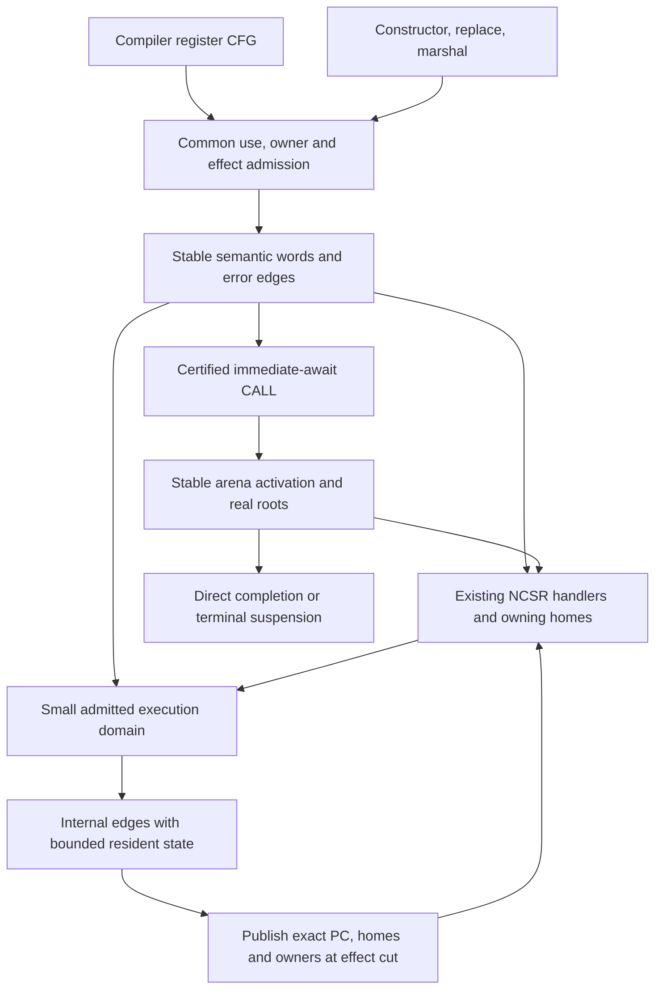
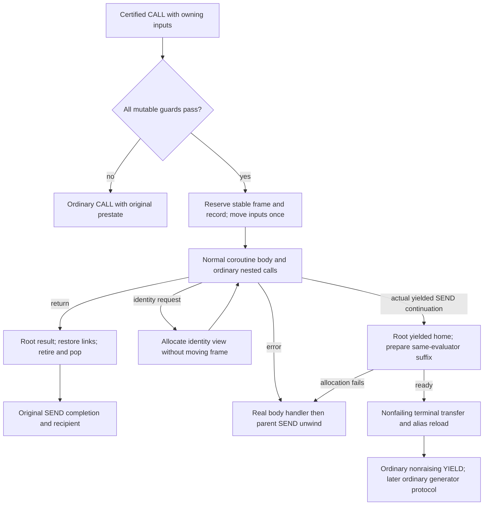

# Interpreter parity64: change the execution boundary

Status: grouped architectural review, 2026-11-14. Proposed, not implemented or
selected. Selected57 remains `0dcba75bb3df40c32137db453b001f7e8f101de0`.
The [review ledger](../../issues/register-semantics59/review64.md) records actual
source/native reads, retained measurements and their limits. Root owns source
integration, generation, native qualification, measurement and selection.

## Decision

Stop adding isolated fixed-role or adjacent-word specializations as the main
parity strategy. Both role63 implementations worked and qualified; both lost
their broad screens. Their proof machinery can inform a new consumer, but
neither executable nor another combination of their heads is a prerequisite.

Order one bounded compact-domain attempt alongside the independent deferred
await unit. The first changes how several ordinary operations execute between
effects. The second removes a complete creation/entry cycle. Keep at most two
source units active, with independent Sol peers and serialized root native work.
Neither has a demonstrated parity budget. A failed source or native gate ends
that attempt; it does not authorize a larger framework or tuning campaign.

| Order | Specific option | Decision and change from round63 |
| --- | --- | --- |
| 1 | One small interpreter domain for admitted list/method/argument paths across a loop edge, with ordinary CALL cuts | Promote old rank 3 to a bounded attempt. Carry state across operations instead of emitting another NCSR function for each role or adjacent pair. Keep generic CALL/recovery outside and publish precise state at every effect cut. |
| 2 | Deferred exact immediate await with stable active frames and terminal storage transfer | **Change/continue** one complete attempt. Preserve the corrected unit's representation; add an explicit common-path and ordinary-generator cost gate before enabling the head. No mandatory continuation after a failed gate. |
| 3 | Retained exact delegation spine for None resume through external yield | Move old rank 4 to rank 3, but defer implementation until one slot is free and effective-state readers have a complete design. Whole-depth removal is the justification; a faster parent loop is not. |
| 4 | Native-call result continuation with a checked value-descriptor entry | Conditional alternative after the compact-domain result. Replace the whole provider-to-consumer boundary; reject a standalone redispatch or repeated-clear cleanup retry. |
| 5 | Read-only self borrowed from an existing caller local | Do not implement this round. Its small eligible owner budget does not justify another frame mode and observer-promotion protocol while await is unfinished. |

Ranks are not a five-packet integration plan. Implement options 1 and 2 from
selected57 independently, reconcile shared generator/exit interfaces before
editing them, and screen each complete candidate. Combine only independently
credible changes, then qualify the combination. Continue the grouped
review → ordered Sol changes → qualification → selection cycle if parity is
still absent. A completed review or a passing mechanism gate is not selection.

## What the comparison actually says

Selected57/upstream matched kernel counters are comp instructions/cycles
**1.436416/1.333179**, Delta **1.361424/1.118423**, and coroutines
**1.307831/1.267788**. Generator elapsed **1.372523** has no new matched
generator PMU attribution. All29's observed **1.127137** includes only two
pairs and large opposing XML iterparse outliers. Comp needs **30.38% of its
own instructions removed** just to equal upstream's count; that is not a
throughput target derived from instructions.

The selected [handler ABI][i-macros] carries frame, slots, thread, PC and word
between separate NCSR functions. Leaf operations decode fields and rebuild the
next call's register arguments. Generic home access also distinguishes local
borrows, owned scratch and discarded results. A canonical eight-byte value
does not remove those ownership and storage decisions. Out-of-line helpers
can spill this state even when their useful body is tiny.

The selected [six-word mapping loop][i-generated-for] performs list iteration,
method selection, argument snapshot, descriptor CALL, append and backedge.
Upstream uses eight words in the retained disassembly, but its stack operands
and checked native descriptor helper avoid some selected transport and
redispatch. This is a source/native explanation of *specific additional work*,
not an attribution of the entire measured gap to the ABI.

In particular, the selected [descriptor CALL][i-generated-call] checks the
descriptor and receiver, then calls the [general value dispatcher][i-valuecall].
That dispatcher finds the value-vectorcall slot; the [descriptor wrapper][i-descr]
checks receiver/arguments again. Result publication can normalize a private
numeric result, then cleanup closes arguments and performs another NULL sweep.
Upstream's [checked descriptor path][u-descriptor] calls its narrow helper.
That helper still converts StackRefs to its object argument vector and cleans
the bridge. Selected `dict.get` is METH_VALUE and does **not** take an object-array
boxing adapter. Credit its existing value-native transport in this comparison.
**The repeated sweep is not a new discovery to implement:** rejected Invoke59
already removed it, shrank FAST's stack from 64 to 48 bytes, and still lost
logging/coroutines/spectral. The earlier checked-provider work also lost.

Exact Python calls already overlap argument homes and enter children inline;
ordinary return already completes inline. Local borrowing, copy propagation,
frontier initialization, canonical container values, SHAPE local variants and
PICs are selected. `IR_FB` already indexes a frame-cached feedback base.
None earns new savings here. The larger call/await opportunity is avoiding
allocation, frame copying, creation return and heap-frame reentry together,
not claiming those existing optimizations again.

The role63 native removals are established, but their broad outcomes are
negative: list/FOR+append logging **1.083074**; attributes logging **1.222917**,
spectral **1.063393**, generators **1.017802**. Prepared62's whole-process
diagnostic has logging instructions **1.000317**, cycles **1.147451**, branches
**1.000491**, misses **.996456**. Both pairs have fewer misses. No exclusive
branch, cache, layout or flags explanation follows. Reducing duplicate code
and live state is an engineering constraint, not a proved cure for these losses.

## Shared IR, ownership and execution contract

Keep semantic words, exception edges and observation identities authoritative.
Common image admission derives value uses, actual acquire/take receipts,
physical initialized homes and effect boundaries for compiler, constructor,
replace and marshal paths alike. A source annotation or helper name cannot
grant a no-callback, canonical-result or consumed-owner fact.

Represent a physical location as one of: an owning canonical home; a native
owner with an explicit root at an effect; or a borrowed mirror of a live home.
Do not turn logical NO_HOME into readable NULL, place borrowed bits in an
owning cell, or add an independent proof interpreter. Unsupported control-flow
joins retain ordinary homes and initialized NULL control. New edge information
must have a named consumer and cold validation, not a universal runtime record.

Admission and invalidation must agree. Supported live-word writers include
specialization, deopt, instrumentation wrappers and restoration, LLTrace,
execution-copy rebuilding and debugger redirects. Execution-only IDs are never
public image inputs. Unsupported source recipes omit nomination; they do not
weaken ordinary image validation. Root checks generated semantic metadata and
actual execution targets, not just source declarations.

## 1. Compact domain: a bounded change to physical execution

**Change.** Generate one small ordinary-C domain function under a single NCSR
entry/exit adapter, with internal dispatch over existing executing words,
beside the ordinary effect handlers.
It consumes the same parsed semantic bodies and reached ownership receipts.
Do not include generic CALL, exception handling, object bridges, monitoring,
Python frame entry or suspension in this C function. Do not emit a function per
role, a function per path, or a per-code native plan. Ordinary handlers remain
the fallback, so some leaf text duplication remains and must be counted.

The first closed operation set is exact-list FOR body, managed-values/no-dict
method selection, canonical local-to-owning-argument snapshot, consuming append,
forward jump and backward jump with the existing poll. Each uses only the
proved storage signatures it needs; type misses and unsupported destinations
leave before consuming inputs. This is an interpreter over admitted edges,
not recognition of a benchmark, a function name, source positions or a fixed
six-word string. Other eligible CFGs use the same rules. Do not add arithmetic,
Python CALL or shape stores to make the first result look broader.

One adapter function does not imply one metadata format. Define a finite set of
execution-only entry aliases for the admitted FOR local/window, method scratch
pair (each method family), local-to-scratch argument, consuming append and jump
signatures. Each retains its ordinary field layout, semantic base, shadow,
error contract and observer mapping; their dispatch pointers may share the
adapter function. Public images reject these aliases. Cold admission selects
them; entry does not search for a proof. Exact IDs belong to the bounded Sol
unit and registry peer, not to a new heterogeneous word format.

The concrete path to price is append → backedge → list step → method selection
→ argument preparation → **ordinary descriptor CALL** → append. The first
iteration may enter at the list step. Exhaustion branches to ordinary FOR
completion. A separate forward-edge fixture is required. The CALL, argument
owners, dictionary work and append provider remain real costs. There is no
claim that this closes the comp deficit or accelerates Delta's Python calls.

**Physical state.** The adapter receives the selected five-value ABI. The
ordinary-C function receives thread, frame and semantic PC, derives slots once,
and holds that state plus at most one canonical borrowed mirror and its bounded
validity state. Ordinary C permits GCC to use callee-saved registers across the
getter and append calls, with saves paid once per domain segment. This is the
specific ABI hypothesis: reduce VM-state spill/reload around real helpers as
well as repacking between words. It is unproved until compiled; no fixed/global
registers, handwritten calling convention or compiler switch is proposed.
The mirror refers to an already published local; it is not a second owner.
First scope does not keep
unhomed owners across branches, effects or native calls. A list body still
acquires and publishes its item owner. Its subsequent argument snapshot may
read the mirror only on the proved callback-free path; it still acquires and
writes the owning CALL argument. Method/self owners and their two stores remain.
This conservative ownership model avoids importing bitmap/IRSC2 work.

The first implementation may conservatively drop the mirror at an edge whose
identity is not established. It must then charge the resulting load. It may
not invent a dynamic home cache/search or add runtime pointer comparisons that
cost as much as the saved load. Use a cold, bounded producer/use certificate
only for that concrete carry. Ordinary semantic homes stay current even if
the certificate is revoked. All other internal edges need only current word
admission; no cross-edge owner map is introduced.

**Effects and exits.** Internal operations do not publish `frame->instr_ptr`
merely to cross another C handler ABI. Publish it before any reached effect or
exit that needs it. Monitoring/profiling/LLTrace deny domain entry and restore
ordinary word execution. Remote sampling and debugger readers must retain a
valid semantic checkpoint; no executing PC may point into private native data.
If their existing contract requires more frequent publication, retain those
stores and debit the budget rather than weakening observation.

| Boundary | Producer, consumer and owner contract | Error/observer rule |
| --- | --- | --- |
| Entry | Admitted current word; all owners already in ordinary readable homes; empty mirror | Instrumented or changed executing form transfers to ordinary current word |
| List body | Actual list getter/XDUP creates one canonical owner; publish cursor and local exactly once; required B+2 NULL control remains | Before doing work, leave to ordinary FOR if displaced-local retirement may execute Python; exhaustion leaves with ordinary FOR prestate. Do not replay an acquired item or incremented cursor |
| Method and argument | Existing type/version/inline-value guards; acquire callable/self and final argument owners once into CALL homes | Guard failure before consumption goes to ordinary current word. Mirror is invalidated by any intervening mutation/effect |
| Append | Clear/take the scratch item once; unchanged `_PyList_AppendTakeValue` consumes it on success and error; no carry is live across the C call | Publish actual append PC before call. Failure uses actual append error ingress with item already consumed; never re-execute append |
| Backedge | Same target and poll semantics; no unhomed owner at poll | Pending work exits before the ordinary JUMP_BACKWARD executes its poll. Cold entry/epoch guards also run after every real callback |
| CALL cut | Complete ordinary owning window and semantic CALL PC; empty mirror; tail-transfer once to existing CALL handler | CALL retains its guards, callbacks, normalization, cleanup, poll and result commit. No private continuation is added to ordinary frames |

The append success path in [listobject.c][i-append] stores the item or resizes;
allocation alone is not a Python callback. Its error path closes the item and
can finalize. Retain the effect cut there. The list getter remains out of line
in the first attempt; its C-call spills are charged. No inline append/provider
rewrite is bundled. The local-retirement precheck must use a positively live
home and the actual nonfinalization contract, not a guessed incoming value.

**Source boundaries and shared APIs.** `Tools/cases_generator/ir_generator.py`
owns domain emission and storage/effect receipts, using `IRStack.consume/store`
and the actual window-body recipe. `Objects/codeobject.c` owns common admission;
`Python/ir.c` and the central handler writers own executing-word selection and
revocation. `Python/ceval_macros.h` retains the ordinary ABI. The proposed adapter
takes exactly `TAIL_CALL_PARAMS`; the C executor returns only semantic word index and
an exit kind (ordinary dispatch or reached append error), with no owner in that
return record. Require a two-machine-word register return in the native gate,
not an address-taken VM-state structure. The adapter resolves the index against
the pinned frame's current executing base and reloads slots/word, then
tail-transfers or invokes the existing reached error processor. Callback-capable
append failure must use the existing refresh/error-origin protocol before
resolution; a stale pre-call PC pointer is not an exit certificate. There is no
recursive domain call or native-stack
growth at an internal loop edge. Charge adapter saves, C entry/return and
reentry at every CALL cut. No new public format, frame field, feedback owner or
call action is required. Any carry certificate
must be invalidated by every writer of a covered word before publication.

The exit kind distinguishes ordinary dispatch at the returned index from the
reached append error. For ordinary dispatch, the adapter explicitly unwraps
any private entry alias to its corresponding ordinary handler using the finite
generated mapping, then tail-transfers with the original fields. It must never
look up the still-private word and recursively re-enter itself on a miss, poll
or exhaustion exit. The index plus exit kind suffices; no hidden owner or
address-taken state is added. Mutation/restore tests include this no-reentry
property for every entry signature.

Agree source APIs with the await worker first: an effect exit receives a real
semantic word and existing owner receipts; it cannot assume all thread-resident
frames are ordinary THREAD frames. The domain neither activates awaits nor
handles their terminal transfer. Await changes to shared generator readers
must not silently widen domain admission.

**Bounded acceptance.** The first Sol slice is the finite emitter, admission,
writer closure and focused fixtures for this domain, not a general region
framework. Peer the complete generated path and a cost worksheet before root's
first native build. Reuse old role receipts only after rechecking their actual
producer; do not import the rejected executable heads.

The retained inner loop supplies 3,348,000 candidate non-CALL word visits out
of 13,674,014 comp visits (24.48%); CALL supplies another 648,000 and is excluded.
Those are monitored opportunities, not admitted hits or removable instructions.
The five ordinary word-to-word NCSR transitions become internal transitions plus
one exit to CALL; internal dispatch is still work. Count its branches, operand
decode and entry/exit costs. Do not claim four fewer indirect jumps merely
because four C tail transfers disappeared. Source only predicts removals of
ABI repacking, some PC publication, fixed-role choices and one redundant local
reload when the mirror survives. Required owners/stores and provider work stay.

Root's first same-GCC native artifact is a hard gate: at most **128 bytes native
frame** and **16 KiB hot domain text**, including compiler-created fragments;
report saved-register space separately and every persistent-state spill. No
address-taken state array, bridge union or generic fallback body belongs inside
the domain. Reject if its normal internal cycle repeatedly spills frame, slots,
PC or carry, or if complete entry-to-CALL/append-to-CALL paths fail to remove net
native work. Include the adapter's simultaneously live frame and saved registers
in the 128-byte budget. C-provider call spills are reported separately, not hidden.
A merged internal dispatch alone proves neither success nor failure. No compiler,
flags, padding, alignment, second engine or expanded opcode roster rescue follows.

Minimal checks: a loop with forward branch and both FOR outcomes; local last-owner
finalization that forces the ordinary path; aliasing method/self/argument owners;
append resize and failure with reentry; guard miss at each interior operation;
poll/monitor enable and debugger redirect at a cut; all public image routes;
private-ID denial and each covered-word mutation; source-recipe mutation that
loses a TAKE/canonical/effect fact. Root then proves actual unobserved native
entry and prices the full cycle, followed by the unchanged hot8 screen. Stop
on a repeated sentinel loss. No bulk suite or all29 is owed to a loser.

## 2. Deferred await: change/continue, with a whole-cycle gate

The [deferred-await63 unit](../../issues/register-semantics59/deferred-await63.md)
is authoritative. Continue its corrected representation for one complete
attempt because it can remove an operation cycle rather than a few checks.
The frozen terminal2 patch has useful source-only lifecycle work, but no active
head, complete admission/writer closure or native qualification. Its existence
does not establish object elimination. Do not reintroduce observation-time
relocation or a middle-reservation tombstone design.

**Required change to the work order:** freeze a common-path ledger and ordinary
reader census before enabling entry. Name every additional test/select on
ordinary generators, every record initialization/retirement store, and every
allocation/copy removed on a synchronous private await. Integrate entry only
with all exits and observers. Root/peers resolve remaining component feedback;
this grouped review does not approve the moving worktree as a completed patch.

| Contract | Required implementation |
| --- | --- |
| Producer/admission | Common four-word use/def proof CALL→GET_AWAITABLE→None→SEND, sole uses and actual SEND completion; positive home facts; all covered writers revoke it. Exact positional coroutine, no defaults/cells/self/FT; hooks/origin/observation and mutable function guards remain |
| Storage/owners | Stable 112-byte fixed frame plus 96-byte header-side record; disjoint args move once. Actual code/function/home, exception, name/qualname and optional identity owners; no fake coroutine PyValue or duplicate root edges |
| Synchronous consumer | Run normal body; direct original SEND result completion after result-rooted retirement. Restore exception links and recursion; preserve redirect and local displacement order |
| Body error | Real body handler first, then parent's actual await/SEND edge. Traceback frame may survive without allocating a coroutine |
| Observer | Generic frame/proxy exposure preserves active address without making a coroutine. Actual identity getter materializes a real view with active-frame pointer. Executing ancestors remain EXECUTING and `cr_await` is None |
| Suspension | Prepare after the reached SEND yielded owner is in B+2. SEND_GEN must prove actual SEND continuation kind; a FOR_ITER child is not an await suspension. Allocate all identities/capacity first, then nonfailing transfer of only the contiguous same-evaluator suffix, retarget views and pop in stack order |
| Failure/aliases | Preparation failure stays at the parent's real SEND, leaves homes in place and unwinds normally. YIELD remains nonraising. No active/C alias relocation; reload all frame/slot/exception aliases after terminal success; never cross evaluator sentinel |

Callee admission must also prove reachable suspension closure. A valid
constructor image can set CO_COROUTINE yet contain a bare YIELD outside the
supported SEND handoff. Decline that callee before private entry unless its
actual semantic graph proves every reachable suspension uses the supported
continuation. Flags, a compiler-origin assumption and a caller's four-word
certificate do not supply this callee proof.

Shared boundaries are `_PyFrame_IsThreadResident`, `_PyGen_Frame`,
`_PyGen_ExceptionState`, `_PyAwait_PrepareObservation`,
`_PyAwait_PrepareSuspend`, residence-specific pop/clear, and generated reached
CALL/SEND/return recipes. These are proposed/partial APIs in W, not selected57
APIs. The source scope includes frame/gen objects, arena, GC/exception roots,
instrumentation, debugger offsets, remote readers and private C readers; see
the authoritative unit's complete table. All supported aliases spanning a
callout must retain a stable object and reload its frame or be covered by the
owning evaluator boundary. A required reader that cannot satisfy this blocks
entry, regardless of host test success.

**Budget.** Remove `_Py_MakeCoro`, created-frame copy/pop, object return,
GET_AWAITABLE and immediate heap reentry on truly synchronous admitted awaits.
Retain normal body, guards, code/function owners, recursion, exception linking,
local clearing and result retirement. Add 96 bytes per live private await,
disjoint argument moves, two name-owner acquisitions/releases, four-word entry
decode and ordinary generator active-frame selection; an exposed identity
reserves full eventual embedded capacity too. Suspension copies and observer
preparation are cold only if actual workloads establish that. The first scope
must not add a mode branch to every ordinary opcode or promote for an ordinary
nested call. No per-call saving is assigned to inline integer refcounts.

The retained 971,136 structural await cycles with zero corresponding delegated
yields are a strong opportunity, not natural admission. To explain all of the
first-pair coroutine instruction deficit would require about 375 instructions
net per structural cycle after scaling that separate run; this is a scale
check, not measured savings. Complete-cycle native counts and real materialization
rates must decide whether enough work disappeared. Do not reuse allocation62's
4.4% coroutine gain as an additive budget.

Smallest meaningful runtime set includes synchronous recursive completion,
zero/many args, ordinary nested calls, body/await exceptions and recursion limit;
real generic SEND and SEND_GEN suspension plus FOR_ITER-child negative control;
OOM at entry/identity/preparation with try/except/finally; frame-only exposure,
identity exposure and executing-ancestor `cr_await`; GC cycles and eventual
retirement; native alias retained during remote frame query/GIL release;
monitor/profile enable, origin changes and debugger redirect; traceback-owned
frame and ordinary generator/async-generator controls. Source mutation and
four-image-route tests precede runtime entry. No partial-protocol native run.

Stop this unit if complete source closure needs arbitrary active relocation,
every successful await allocates an object, normal nested calls promote, owners
are duplicated, the suffix crosses C reentry, ordinary opcodes gain pervasive
mode tests, or complete-path native savings vanish after record/reader costs.
If it qualifies but repeats broad losses, reject it without rescue campaigns.
The reason to continue now is its distinct removable cycle and corrected stable
address design, not investment already spent.

## 3. Retained delegation spine: next representation option

The selected [SEND/yield protocol][i-send] relinks frames/exceptions, publishes
resume/yield values and visits parents on every external step. Resume62 saved
one dispatch; ascent61 still walked parents and added spills. A spine must
retain the relation between root recipient and leaf over suspension, so a
None-resume can enter the leaf and deliver a yield once to the external owner.
The 3,137,890 SEND, 2,937,892 delegated-yield and 2,937,892 backedge visits in
the retained generator run describe overlapping parts of that cycle.

First representation: one root-owned record for at most 64 exact delegation
links, borrowing parent/child pointers through existing receiver owners;
member backlinks permit invalidation before interior send/throw/close. Construct
links during real ordinary descent, with original SEND, suspend and completion
PCs. No global map and no independently owning leaf if the root chain already
owns it. Clear backlinks before releasing any receiver or freeing the record.
Custom iterators, non-None input, throw/close and changed observation use ordinary
materialized protocol. No runtime work starts until every reader is accounted for.

The producer is successful ordinary descent, the consumer direct leaf resume;
the owner is the root's real receiver chain. Every parent is effectively running
while the leaf runs, recursion depth is charged for the full chain, and current
frame/previous/exception semantics must be truthful to callbacks. Ordinary
`gi_running`, `cr_await`, frame/exception traversal, direct interior APIs,
debuggers and finalization must consult effective state or materialize before
exposure. OOM while constructing leaves the ordinary chain valid. Completion
revokes the completed suffix before retiring its owners; errors preserve the
actual inner handler and unwind order.

Source scope: `pycore_interpframe_structs.h`, generator/frame accessors,
`Objects/genobject.c`, `Python/{frame,gc,ceval}.c`, generated SEND/yield/return,
monitor/debug/remote readers. Reuse stable accessors from a selected await unit
if it wins; do not depend on an unselected await layout. Peer a complete reader
and invalidation table first. Minimum tests are depths 1/8/40, interior APIs,
callbacks inspecting every parent, handled exception across yields, recursion
limit, custom iterator split, tracing enable, close/error/finalizer and root
collection. Root must prove full-cycle removed work including construction.
If ordinary resume still walks parents to rewrite flags, check geometry or
rebuild exception links, reject the claimed depth-saving representation.

## 4. Native result continuation: conditional, not another Invoke

Reconsider the native boundary only with a new end-to-end consumer: an admitted
native call result immediately consumed by a canonical operation, with no
intervening observation, alias or exceptional ingress. Replace the existing
descriptor call lowering for that contract; do not add a copied CALL body for
each argument/consumer combination. The provider entry would accept already
checked descriptor, self, arity and owning argument homes; preserve recursion
and call the METH_VALUE implementation once. Unsupported flag/arity cases
remain ordinary. METH_VALUE proves transport, not absence of Python callbacks.

The distinct consumer is a **result exit**, not an argument-preparation head:
the owned result stays in an explicit transition root while the real input
owners retire once, then moves to a proved consuming append or ordinary result
publication. No temporary B0 result store/load/clear is credited unless that
actual path disappears. Result normalization remains unless the particular
producer supplies a reached canonical receipt. Dictionary equality/hash may
execute Python, including mixed-key tables; preserve all snapshots and pins.

This requires a shared generated result-exit contract in `ir_generator.py`,
checked invocation in `pycore_value_call.h`/`Objects/descrobject.c`, and existing
transition roots/refresh in `Python/ceval.c`. The result owner cannot disappear
between provider return, callback-capable input retirement and consumer entry.
On provider failure use CALL's real prestate; on cleanup redirect hand the
rooted result to existing ordinary completion/redirect handling, never append
after a redirect. Observer
activation revokes the consumer before it runs. Consumed-interval receipts
must survive actual writes/effects; a global `window_taken` assertion is not proof.

Before implementation, compare against **both** selected57 and rejected
Invoke59/checked-provider source: list new removals, new root pushes/pops,
spills, guards and code duplication. If the only differences are bypassed
redispatch or the already-tested NULL sweep, stop. At 108 mapping calls per tray,
a hypothetical 20 instructions each covers only 2.6% of comp's first-pair
deficit. Thus this cannot substitute for the wider execution budget.
Minimum tests cover both self roles, flag/arity errors, result/input alias,
mixed-key callback, cleanup finalizer, observer/redirect, all image routes and
actual consumer hit. Native acceptance requires full provider-to-consumer
savings after root/retirement costs; the ordinary hot8 gate is unchanged.

## 5. Anchored read-only self: defer

The only useful first scope borrows self from an **existing** stable caller
local for a synchronous exact zero-explicit-argument method, with a read-only,
non-cell callee parameter. A new snapshot owner would cancel the saving.
Keep callable/code owners and exact-call overlap. A frame mode distinguishes
the borrowed cell during clear/traverse; ordinary reads remain unchanged and
escape/nested owning call acquires at use. No borrowed bits enter today's
owning ABI without that complete port.

Common admission proves read-only self. Exposure of either dependent frame or
anchor, tracing/debug mutation, copy or escape acquires the dependent owners
before mutation; already exposed anchors are ineligible. Clear skips CLOSE
only in the admitted mode, erases the borrow before callbacks and cannot outlive
the anchor. GC does not count borrowed edges. Frame/proxy writers, unwind,
traceback and private C readers all need the same protocol. The unused selected
`visited` bit is a possible mode location, not proof that this port is free.

Source boundaries are code admission, exact-call initialization, frame
clear/traverse/copy and frame-object writers. Tests would require mortal self
identity/lifetime, escaping return/container, nested calls, anchor mutation,
GC/error unwind and observer promotion. No implementation is ordered: the
structural Delta opportunity is 1,280,190 pairs over 30 loops before read-only
eligibility. A hypothetical 20 instructions per pair is only 6.1% of the
first-pair Delta deficit before added costs; comp/logging have zero in this
shape. Resume whole-cycle work ranks higher. Reopen only with an actual eligible
callee census and a positive net budget including promotion and ordinary readers.

## Qualification and selection

Each chosen unit follows source contract → independent actual-diff peer → root
generation/product review → both release/debug builds and focused tests → native
mechanism and actual-hit gate → unchanged balanced hot8. Cover compiler,
constructor, replace and marshal admission, metadata/error receipts, all writers
and ordinary controls. Preserve NCSR/compiler/flags, affinity/hash, workload and
immutable selected/upstream identities. Natural first hits prove entry, not
frequency; monitored labels do not prove natural admission.

Report removed work, retained work, added work, complete native paths, stacks,
text/rodata and ordinary-path changes separately. Do not sum overlapping await,
delegation, dispatch and owner savings. The compact-domain budget is local;
the await budget is coroutine-specific; no combined parity budget is established.
Only a winning coherent integration advances to confirmation, explicit all29,
matched upstream and full supported diagnostics. Retain GIL-only limits and
existing debugger exceptions. Reject losing packets, keep selected57, and repeat
the broad review with the resulting evidence. Do not repeat timing, PMU, padding
or compiler searches to rescue a loser.

[i-macros]: /home/power/code/cpython/.worktrees/python-boil-the-ocean/build/worktrees/call55-integrated/Python/ceval_macros.h:43
[i-generated-for]: /home/power/code/cpython/.worktrees/python-boil-the-ocean/build/worktrees/call55-integrated/Python/generated_ir_cases.c.h:14766
[i-generated-call]: /home/power/code/cpython/.worktrees/python-boil-the-ocean/build/worktrees/call55-integrated/Python/generated_ir_cases.c.h:8479
[i-valuecall]: /home/power/code/cpython/.worktrees/python-boil-the-ocean/build/worktrees/call55-integrated/Include/internal/pycore_value_call.h:108
[i-descr]: /home/power/code/cpython/.worktrees/python-boil-the-ocean/build/worktrees/call55-integrated/Objects/descrobject.c:572
[u-descriptor]: /home/power/code/cpython/.worktrees/python-boil-the-ocean/build/worktrees/upstream-3a440b6/Python/bytecodes.c:5268
[i-append]: /home/power/code/cpython/.worktrees/python-boil-the-ocean/build/worktrees/call55-integrated/Objects/listobject.c:420
[i-send]: /home/power/code/cpython/.worktrees/python-boil-the-ocean/build/worktrees/call55-integrated/Python/bytecodes.c:1599
