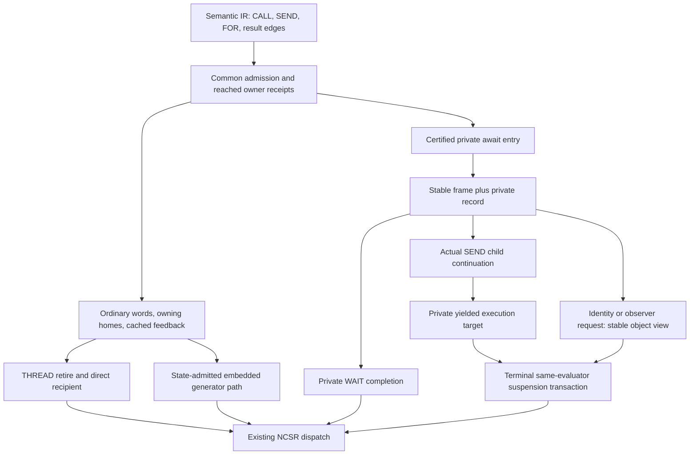
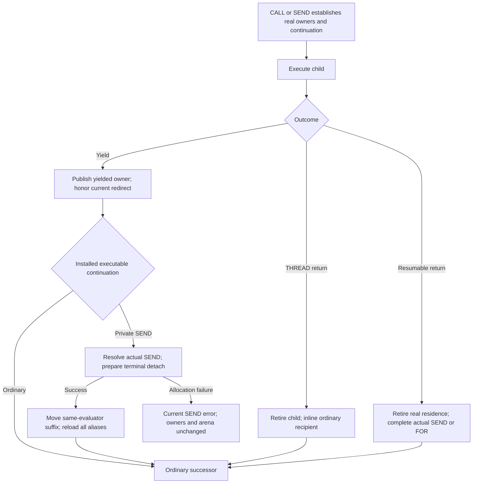

# Interpreter parity65: pay for activation kinds at their boundaries

Status: completed experimental design, unselected. A qualifies but loses its
screen; B passes focused runtime checks but fails the native cost gate after one
reviewed correction. B has no performance screen. The
[trial report](../../issues/register-semantics59/report.md) records the outcomes;
[review65](../../issues/register-semantics59/review65.md) retains the architectural
review against selected57 and await9. Read the canonical
[goal](../../GOAL.md), [plan](../../issues/interpreter-performance56/plan.md) and
[await contract](../../issues/register-semantics59/deferred-await63.md).

**CHANGE and continue the complete await mechanism in two bounded units. STOP
its standalone executable and the compact64 domain.** First separate ordinary
retirement and admitted embedded-generator access from private residence work.
Then move the private SEND-child yield handoff into an activation-selected
executable continuation. Preserve the existing complete observation, error,
identity and terminal-movement protocol. Neither unit earns selection from
smaller symbols or passing tests. No new general interpreter framework is ordered.

The reason to retain await is new evidence: natural private entry through
identity-free retirement is observed, and unchanged coroutines improve 42.9%.
That is a qualitatively larger removal than the losing creation-only or
adjacent-word packets. Logging loses 27.7% and generators 5.2%, so the current
executable cannot be the baseline for broad integration. Selected57 stays selected.

## Evidence that changes the design

Await9's fixed header is **112 B** and its private record **72 B**, total **184 B**
before homes. The previous 96-byte estimate is obsolete. Disjoint argument
movement, two creation-time name references, an independent code owner,
exception linking, recursion, RESUME, retirement and possible identity/copy
work remain. Generic CALL/CALL_NO_SELF are relocation-normalized equal to
selected57. Exact/general/binder bodies have equal counts and sizes, with
THREAD tests broadened to THREAD-or-AWAIT. The ordinary RETURN, SEND, YIELD,
accessor and traversal changes are real. They are not a proven explanation of
logging's elapsed regression. [Native evidence][await-native]

Compact64 passes its 112 B simultaneous stack and 1,665 B hot-text gates but
fails complete-path work: 173→227, 234→280 and 38→128 instructions. Its five
internal envelopes save 47, while entry/exit add 93. Provider interiors are
excluded equally; their unchanged calls remain counted. Retaining VM state in
callee-saved registers did not eliminate the three FOR-local getter spill pairs.
Do not extend the roster, cross the CALL cut, add mirrors, or change compiler,
flags or padding to rescue this packet. [Native evidence][compact-native]

Selected57 still needs about **30.38% of its own comprehension instructions**
removed merely to equal upstream's count. The measured selected/upstream ratios
are comp instructions 1.436416/cycles 1.333179, Delta 1.361424/1.118423 and
coroutines 1.307831/1.267788. Generator elapsed is 1.372523 without a fresh
matched generator PMU result. Those old baselines cannot be multiplied by
await9's selected-relative ratios to manufacture a new upstream result.

## Why fewer IR words still perform more native work

The actual comprehension loop is list iteration → method selection of dict.get
→ argument snapshot → ordinary native CALL → append → backedge: six selected
words versus eight upstream words. Its native path still decodes operand roles,
acquires canonical owners, publishes method/self/argument homes, crosses ordinary
C ABIs, stages a native result, retires inputs and then dispatches. A word count
omits all of that. Selected `IR_FB` already uses the frame-cached feedback base;
exact Python calls already overlap arguments and return inline. Neither is a
new optimization. [Selected handlers][i-call] [Operand/dispatch ABI][i-macros]

The descriptor hit validates method shape, then enters general value dispatch.
METH_VALUE dict.get does **not** box an object argument array. It still needs
receiver/query ownership and may call Python for equality/hash. Upstream's checked
descriptor route avoids some redispatch but still has its StackRef-to-object
bridge and cleanup. Both runtimes must preserve input/result lifetimes. The
selected B0 result staging and repeated argument vacating are distinct costs;
Invoke59 already removed the latter and lost its screen. A wrapper around that
same removal is not a new architecture. [Selected provider][i-provider]
[Upstream call][u-call] [Invoke record](../../issues/register-semantics59/native-invoke-proposal.md)

The activation ABI adds another dimension. Selected frames separately retain
semantic PC, executing-image/feedback bases, recipient and future PC. Upstream
RETURN restores its caller stack and return offset; YIELD uses the fixed SEND/FOR
successor convention. Selected completion instead reconstructs the actual SEND
or FOR outcome from immutable operands and supports arbitrary recipients,
overlap, observers and redirects. Await9 adds a private residence and private
WAIT/ordinary SEND_CHILD distinctions to those shared boundaries. The required
semantics are useful; repeatedly rediscovering a representation already proved
at entry is avoidable. [Selected frame][i-layout] [Candidate completion][g-complete]
[Upstream return/yield][u-return]

V8's Ignition uses explicit dispatch parameters, an accumulator and generated
machine-level handlers; its assembler explicitly publishes offsets around calls.
This is evidence for making register/result and callout contracts explicit, not
for assuming an accumulator removes Python ownership or that another compiler
would fix this runtime. [V8 design](https://v8.dev/blog/ignition-interpreter)
[V8 assembler](https://raw.githubusercontent.com/v8/v8/main/src/interpreter/interpreter-assembler.cc)

LuaJIT's x64 source gives PC, dispatch and constant base fixed registers, changes
BASE at CALL, and uses frame markers to select standard versus exceptional return
machinery. It also saves state around C calls and moves/fills results. Its compact
frame protocol is inseparable from those consumers. Python's independent code
owner, callbacks during decref and supported observation prevent copying that
layout wholesale. The useful inference is to select exceptional activation
machinery at a real boundary, retaining a cheap ordinary path. This is no
cross-language performance comparison. [LuaJIT source](https://raw.githubusercontent.com/LuaJIT/LuaJIT/v2.1/src/vm_x64.dasc)

## Five options, re-ranked

| Rank | Concrete change | Decision and bounded falsifier |
| --- | --- | --- |
| 1 | Residence-specific retirement and embedded-only APIs after state admission | **GO as unit A**, on await9. Ordinary THREAD return must lose the extra classification work; admitted generator entry must contain zero active-view selections. Whole paths and unchanged controls decide, not helper names. |
| 2 | Private SEND yielded continuation selected when the parent installs its child return target | **CHANGE to unit B**, after A's interface is frozen. Remove await parent/phase tests from ordinary YIELD without a mode test on every dispatch. One private continuation, no universal descriptor bank. Reject if semantic-PC/redirect closure needs a hot universal resolver. |
| 3 | Retain an exact delegation chain across external None-resumes | **DEFER**, below the smaller boundary change. A real spine must remove depth-proportional resume/yield work, including observer/exception state costs; saving the backedge is already rejected. |
| 4 | Explicit owned native-result region through input retirement to a consuming edge | **DEFER with a new whole-region gate**, above borrowed self. Must remove B0 transport and a real consumer boundary beyond Invoke/provider59; new root/spill costs must be included. |
| 5 | Caller-anchored read-only argument view for exact synchronous calls | **STOP as a round65 implementation**, retain a narrowly bounded admission alternative. At least one actual eligible mortal anchor and a positive full call/return budget are required; the old structural pair count is insufficient. |

Compact64 drops out entirely. The old result-continuation idea is split: unit B
changes the **activation's executable continuation**, while option 4 changes a
**native result's owner location**. They must not share an unproved authority.
A retained delegation spine is demoted because await9 demonstrates how an
otherwise correct extra representation can tax ordinary generators. Borrowed
self still has a small known opportunity and the broadest mutation/reader burden.

## Unit A: ordinary residence is a complete fast contract

Base this unit on the frozen await9 implementation, not on stale canonical
runtime files or a composition of rejected packets. Keep the header, 72-byte
record, private admission and all completed lifecycle machinery.

1. Change the existing checked RETURN recipes themselves. Take the result and
   unlink exactly once, then branch on the dying frame's THREAD residence.
   The THREAD arm calls the existing thread retirement primitive and publishes
   through the existing inline recipient/redirect contract. It must not first
   construct `owner == GENERATOR || owner == AWAIT` and preserve that boolean
   across a helper call. The non-THREAD arm takes the already-owned result and
   unlinked frame into one bounded resumable-return helper, which composes
   existing clear and completion primitives. There is no replay of RETURN,
   second result take or second cleanup engine.

   Do not add ordinary/resumable per-code return aliases or a classification
   pass for this unit. Public PyFrame_New/PyGen_New-style construction can wrap
   an ordinary code independently of function flags; a shared code image does
   not prove THREAD residence. Retaining that guard in new aliases would remove
   no work beyond the same partition in existing recipes. Code admission still
   owns actual terminal/owner certificates, including changed flags and public
   image routes; it does not gain a new speculative return-kind certificate.
   No new opcode, per-frame mode or execution-image mirror is needed for A.
2. Make the same THREAD-first partition in shared clear/pop dispatch. Preserve
   error unwind's actual reason and complete initialized extent. This does not
   authorize local-only clearing on a general RETURN or eager removal of real
   owners. `_PyEval_FrameClearAndPopGeneralWithResult` already has a THREAD fast
   branch; do not count that existing branch as a new saving.
3. Add explicit embedded-only frame/exception accessors, with debug assertions,
   and use them **after** the successful CREATED/SUSPENDED state claim in
   `gen_send_value_ex` and the corresponding admitted yield-from reader. The
   current source already asserts `gi_active_frame == NULL` there, but release
   ELF still performs two pointer selections. Port the callers' state proof,
   not just the assertions. Keep checked view accessors for generic identity,
   code/frame attributes, traversal and remote readers.
4. In checked ordinary YIELD recipes use the embedded frame-to-generator cast
   only when the whole admission/suspension closure proves GENERATOR residence.
   A private coroutine must already have detached before executing YIELD.
   Bare/private YIELD and external ingress remain denied by the existing
   certificate. Retain the parent SEND_CHILD handoff until unit B replaces it.

**Producer/consumer contract.** The taken canonical result is the producer;
retirement owns it through callbacks, and the actual parent recipient consumes
it once. The parent becomes current before child clearing. The dying frame's
residence selects its retirement extent; it never selects whether the parent
was SEND or FOR. WAIT is consumed only by the private completion receipt;
SEND_CHILD remains an actual object-backed SEND. The child code/function,
record names/exception/identity and retained frame-object owners are real.
No callback may observe a reclaimed reservation or a double-rooted result.

**Errors and observers.** Thread cleanup retains its existing transition roots
at the first possible reentry. Resumable cleanup retains await9's complete roots,
identity detachment, source error state and finalizer-sensitive WAIT handling.
Observer installation or a debugger redirect during clearing wins over saved
state. Do not restore an old phase or old return PC after a callback. Embedded
entry relies on the acquired state claim; arbitrary frame getters do not.

**Source boundaries and shared APIs.** Change the parsed RETURN recipes in
`Python/bytecodes.c` and `Tools/cases_generator/ir_generator.py` together with
`Python/ceval.c` retirement/completion. Port their existing complete terminal
certificate consumers and generated metadata together; keep common admission
in `Objects/codeobject.c` and the existing writer closure truthful. Add the
proved embedded accessors in
`Include/internal/pycore_genobject.h`; port `Objects/genobject.c` callers and
checked YIELD generation. Names such as `ReturnResumable` and `EmbeddedFrame`
are suggested API roles, not new facts supplied by spelling. Keep the existing
`_PyFrame_SetReturnValue`, transition roots and `complete_step_impl` semantics.
Actual anchors: [RETURN][g-return], [clear helpers][g-clear], [entry][g-genentry],
[accessors][g-accessors], [generator terminal emission][g-emitter].

**Smallest meaningful gates.** Independent source peer must inspect every
residence branch and the acquired-state callers. Generator peer checks ordinary,
empty, instrumented RETURN and both YIELD forms, including source mutation
negatives, changed flags and a public generator constructed from an ordinary
body. Runtime tests cover mortal result/local alias and finalizer redirect,
ordinary exact/general/native nested calls, generator send/throw/close,
exception state across yield, exposed private identity, unexposed completion,
true suspension and reservation OOM. Reuse all sixteen await lifecycle methods;
do not replace them with only new microtests. Reader and ordinary runtime
controls remain part of the coherent gate.

**Native falsifiers.** Compare complete ordinary THREAD return to selected57
for scratch/local/discard recipients, nonfinal mortal cleanup, and the reentry
exit. Common THREAD instruction count and simultaneous stack must not grow;
any new indirect call is a failure. The admitted `gen_send_value_ex` path must
have zero active-frame/exception selections and no larger local reservation
than selected's 32 B. Count the full ordinary generator return, including the
new helper's entry/exit; it must not cost more than await9. Keep generic CALL
normalized equal and exact/general/binder at their retained counts/stacks.
At most 2 KiB additional total text versus await9 for this partition; no
alignment directives or cold-section placement experiment. Caps are proposal
limits, not claims that a compiler has met them.

## Unit B: private work belongs to the installed SEND continuation

This is the second complete unit, not a universal replacement of every CALL
frame or an instruction-pair fusion. `return_pc` is already an executable
target, separate from `instr_ptr`. Use that distinction to stop asking every
ordinary child YIELD whether its parent is a private await frame.

**Representation.** Add one internal executable word/target,
`AWAIT_SEND_YIELDED` (provisional name), using the existing NCSR signature.
It is not a public IR instruction or a new semantic word index. A private
AWAIT parent entering an actual object-backed SEND child installs that target
as its yielded continuation. Save its real SEND site/next semantic indices and
an armed state in its private record. Budget at most **16 additional record
bytes** (72→at most 88; header remains 112), zero new ordinary-frame fields,
zero per-code word mirrors and no universal per-site continuation allocation.
Keep ordinary `return_pc` values unchanged.

The private target does not replace `frame->ir_words` or its feedback base,
publish its own address as `instr_ptr`, or use a trampoline-word error map.
Its checked error transition takes the saved, validated actual SEND index.
Generated SAVE_STACK, instruction attribution, lltrace and debug image bounds
must never receive the synthetic target as a semantic instruction. The private
target needs a checked terminal recipe, not the generic opcode entry prologue.

The saved target must be installed by the actual checked SEND/PUSH recipe,
including transparent instrumentation, not by recognizing the child type or
any private parent. FOR_ITER yielding is different. The ordinary YIELD terminal
publishes its owner through the existing recipient and dispatches the selected
return PC. It no longer captures or tests parent owner/SEND_CHILD around
publication. The private target executes only after that publication, consumes
its armed continuation, restores the actual SEND attribution and invokes the
existing terminal suspension transaction. Generic SEND's immediate yielded
outcome reaches the same target after B+2 publication; a private-residence test
at this actual SEND outcome may remain. No mode check is added to ordinary
opcode dispatch. Preserve normal-return completion as a separate outcome.

**The required reader port is substantial.** A synthetic target cannot be fed
to `_PyFrame_InstrOffset`, `return_pc + IR_DS(word)`, or `instr_ptr = return_pc`.
Introduce one logical-continuation resolver for cold observation/completion
readers and one setter/canceller for redirect and suspension transitions. The
resolver obtains saved semantic indices only for an armed private record;
ordinary execution keeps direct pointers. Port frame-copy/escape, frame line
queries and setters, pending redirect, completion, debugger readers and
terminal detachment together. In particular,
[CompleteGeneratorReturn][g-complete], [CompleteRedirect][g-redirect] and
[frame line handling][g-framelines] currently assume an in-image return PC.
Use the existing interpreter-entry trampoline as an executable-target precedent,
not as proof that these readers already support this new target.

The clean-G [continuation census][continuation-census] inventories these actual
consumers; it does not prove B is supported. Remote frame/async graph readers
read `instr_ptr` and `ir_words`, and the debug-offset descriptor does not export
`return_pc`. Keep their semantic location invariant and retain their controls;
B does not require a remote-layout change merely because its executable return
target changes. Port a remote reader only if an actual affected dependency is
identified. This does not relax the direct return-PC reader/writer closure.

**No stale receipt.** Output publication can clear a phase or invoke a finalizer.
The continuation's armed state is private control, never a home-read receipt.
A redirect writer cancels/replaces it before publishing the redirect; a child
normal return cancels it before ordinary SEND completion. An observer may
materialize an identity without cancelling the needed terminal detach. Resolve
semantic PCs for readers without moving active frames or silently removing the
execution target. First detach copies only semantic state into the heap frame
and clears the armed record before the arena record disappears. A callback's
newer target must never be overwritten by a saved target.

**Completion consumes the reached retirement proof.** The shared
`CompleteGeneratorReturn` algorithm needs the parent's semantic continuation
after retirement callbacks. Keep `ReturnResumable`'s three-argument interface
and the single completion algorithm. After clearing the dying frame, reload the
live current parent: the AWAIT branch requires its existing disarmed proof and
reads its raw `return_pc`; the GENERATOR branch performs the full
`_PyFrame_TakeLogicalReturnPC`, including cancellation. Pass that real
continuation as a fourth argument to the common consumer. Do not cache a
pre-callback PC or mode, read the dying frame after clear, repeat Take in the
consumer, or add a frame field, alias or completion engine. The consumer keeps
its exact existing WAIT/SEND/FOR logic; its interpreter-sentinel arm publishes
with `SetReturnValue` and then returns the live `return_pc`, since publication
may run callbacks.

This is a bounded source correction to B, not a new architecture or selection.
The initial B executable remains native NO-GO. The correction passes both
117/79 builds and 48 focused methods per role, but the final native review
rejects its instrumented EMPTY completion cost under the unchanged cap.
No B performance screen follows. See the
[trial report](../../issues/register-semantics59/report.md#round65-send-yield-continuation-runtime-checks-pass-native-reject)
for qualification evidence. B remains unselected, and selected57 remains the
runtime baseline.

**Owners/errors.** No PyValue points to the target or record. The yielded owner
is in real B+2 before entry; it is not copied into a new C result buffer.
Preparation allocates all identities/capacity before the nonfailing same-evaluator
suffix move. On failure, no storage moves and the error belongs to that current
SEND, never the already suspended child's YIELD. Reload every frame/home/exception
alias after success. Executing ancestors remain EXECUTING with cr_await None;
active identity observation never relocates arbitrary C aliases.

**Shared source boundary.** Extend only the checked SEND/PUSH and terminal
recipes in `ir_generator.py`, private metadata/ID denial in `ir_metadata_generator.py`,
`Objects/codeobject.c` and `Python/{ir,instrumentation,specialize}.c`, and the
record/continuation APIs in `pycore_interpframe*`, `Python/{frame,ceval}.c`.
The enum registry and table contain one private target. Port the actual reader
census above, including `Objects/frameobject.c`; verify unchanged remote-reader
invariants without forcing unrelated source/layout edits. No arbitrary
raw-C matcher or hand-copied SEND family grants ownership authority.

**Peer/generation tests.** Prove actual SEND versus FOR, normal-return versus
yield, independently legal SEND backedge, preserved compatible quickening,
revocation on incompatible rewrite, public constructor/replace/marshal denial,
and unchanged semantic indices. Test both generic SEND and SEND_GEN suspension,
private-parent FOR yielding, nested evaluator boundary, finalizer/monitor enable
during output publication, pending redirect, frame copy/line queries while armed,
body error and two-level terminal OOM. Include a retained native alias across
foreign observation. A supported debugger behavior that now needs a fallible
YIELD, arbitrary active relocation, or a hot universal PC resolver is a **source
NO-GO**, not a reason to weaken admission or tests.

**Native gate.** Ordinary YIELD_VALUE/DELEGATED must contain zero await-parent
or SEND_CHILD checks and no new stack/spills versus selected57. Count their
complete ordinary path, not only the removed branch. Count private arm→child
yield→publication→target→prepare and the corresponding normal-return cancellation;
ordinary SEND-entry, child-yield and exit work together must strictly decrease
against await9 and not exceed selected57. This includes any new ordinary
entry branch, not just the shorter YIELD body. Private first suspension may
pay at most 64 extra fixed instructions per moved frame for arm/target/resolution,
excluding the unchanged allocation/copy work. That cold-path allowance is a
prospective cap, not a claim of rarity or amortization. Synchronous private
completion must gain no new call/owner move
and at most four native instructions. Cap new target plus non-shared resolver
text at 1 KiB, added rodata at 128 B, and total text after A+B at no more than
await9+2 KiB. Reject on nonpositive ordinary whole-cycle saving, even if all
caps pass. Report the private lifecycle delta separately; the screen must pay
for its frequency rather than silently subtract it from ordinary savings.
This is a bounded tradeoff: ordinary full-cycle work cannot grow, synchronous
private work has the four-instruction cap, and first suspension has the fixed
per-frame cap. No dynamic weights are invented. The .65 coroutine and broad
screen gates below decide whether the actual invocation mix pays those costs.

## Deferred options and what would make them worth implementing

**3. Retained delegation spine.** Build a root-owned record during actual exact
delegation descent, cap it at 64 links, and retain the receiver-owned parent/child
chain across suspension. The consumer is external `send(None)`/iternext; it
enters the leaf and returns its yield once. No independent owning leaf duplicates
the receiver chain. Interior send/throw/close, non-None input, observer enable,
frame mutation and completion invalidate before any receiver release. OOM leaves
ordinary descent valid. Effective running/current-frame/exception state must be
truthful to callbacks at every depth; a fast flag that makes parent frames lie
is not admissible. A member backlink or root lookup has an ordinary cost and
must be specified, not hidden in an accessor.

Scope is gen/frame structs and readers, `genobject.c`, SEND/YIELD/RETURN recipes,
`ceval.c`, GC, monitor and remote tools. Minimal tests: depths 1/8/40, direct
interior APIs, handled exception, recursive observation, recursion limit,
custom-iterator split, close/finalization and root collection. Before a head,
peer the full invalidation table. Native acceptance requires **constant work in
chain depth** on repeated None-resume/yield without observation, and at least 25%
fewer complete instructions at depth 8 including construction amortized over 100
yields. Any per-step parent walk to rebuild state defeats this option; stop.
The historical 2.94 million delegated yields are coverage, not savings. Do not
reuse rejected resume62 as the implementation or require await's object layout.

**4. Native-result ownership region.** Give RegCFG's existing result edge an
explicit C-owned lifetime from provider success, through ordered input retirement,
to a proved consuming operation or final recipient. First finite scope is the
actual descriptor-value call and consuming append, with the ordinary result
edge as fallback. The change must remove B0 store/reload/clear and the consumer's
transport boundary; it is not another removal of the argument NULL sweep or
another checked-provider wrapper. A result root across reentrant cleanup is
mandatory. Provider error uses CALL prestate; consumer error uses the actual
consumer word; redirect cancels consumption and hands the owner to ordinary
completion. Mixed-table equality/hash and finalizers retain their real snapshots.

Use the existing generator owner graph/transition roots, `pycore_value_call.h`,
`descrobject.c` and `ceval.c` completion, with common-image producer/consumer
admission. No benchmark names or source positions. Test aliasing, both self roles,
wrong flags/arity, mixed-key callbacks, consumer failure, instrumentation and
redirect, plus constructor/replace/marshal. Reject before timing unless the
**entire provider-to-consumer path is at least 10% shorter in native instructions**
than selected and has positive savings against the rejected Invoke/provider
versions after rooting/spills. Require no ordinary native CALL growth. A
hypothetical 20 instructions per 108 calls removes only 2.6% of comp's first-pair
deficit; this is not a parity-sized budget. This option ranks below A/B until
that new end-to-end removal exists.

**5. Anchored argument view.** The bounded alternative remains one read-only,
non-cell self parameter of an exact synchronous zero-explicit-argument call,
borrowed from an existing unexposed caller local. Keep function/code owners and
ordinary overlap. A newly created snapshot owner cancels the purpose. The
producer is the proved stable caller anchor; the callee may read but not own
that cell. Return/container/nested owning use acquires at escape. Caller-local
mutation, either frame's exposure, tracing/debug write, copy and exceptional
unwind must promote or clear the dependent view before the anchor changes.
GC reports the owner once; no borrowed bits enter an unported owning-home reader.

Scope is code admission, exact CALL, clear/traverse/copy and every local/proxy
writer. Tests must include mortal self, aliasing caller mutation from a callback,
frame exposure, escaping return, GC cycle and unwind. Reopen only with an actual
eligible-callee census and at least 15% fewer whole exact-call/return instructions
for the admitted shape, zero extra work in non-admitted ordinary calls and no
new universal frame field. The structural 1,280,190 pairs/30 Delta loops do not
prove eligibility. Twenty hypothetical saved instructions/pair cover only 6.1%
of its first-pair deficit before promotion costs; comp/log have zero in this
shape. That price keeps it out of round65 implementation.

## Order, selection and remaining budget

Freeze A's producer/consumer interfaces first. Sol may develop B's complete
source contract in parallel, but integrate shared generator/frame edits in order
**A then B**. At most two units; no spine/result/borrow implementation concurrently.
Each unit must be independently correct and peer reviewed with private heads
closed over every exit. Root owns generation, both 117/79 builds, actual ELF/path
review and native receipts. A's native gate precedes B integration; do not use B
to excuse an A path that already fails its own count/stack gate.

Give **A its own unchanged hot8 screen** after its source/native gates. If A
is an incremental winner, advance it through root's confirmation/all 29/upstream
and full-diagnostic selection gates; B is not a prerequisite for selecting it.
A native/path failure stops A. An A broad-screen loss permits only the already
reviewed B isolation attempt after B independently passes its complete gates;
it does not authorize another rescue search. Measure the resulting A+B
integration independently, retaining A's result as evidence.

Proposed screen falsifiers against immutable selected57 for either integration:
coroutine ratio at most **.65 in each pair**, retaining about 81.7% of await9's
elapsed reduction; logging and
generators no more than **1.02 in either pair**; no other sentinel over 1.02 in
both pairs. These are advancement thresholds, not permission to select a 2%
regression or claims of significance. Root then confirms a winner, measures
all 29 and upstream directly, and runs full supported diagnostics before selection.
A losing screen is closed without all 29, PMU fishing or repeated rescue timing.

This design directly attacks added ordinary RETURN/generator-boundary work and
retains a demonstrated coroutine mechanism. It does **not** establish how much
of logging's loss those paths caused. Nor does it cover the remaining comp or
Delta instruction deficit: ordinary return work can improve them, but neither
new natural frequency nor a sufficient native budget has been measured. Options
4 and 5 name bounded attempts for those workloads; they must earn their gates
rather than fill the deficit on paper. If neither A nor A+B wins, retain
selected57 and the qualified await source, stop this isolation attempt, and commission the next
grouped review with the new whole-path evidence. M4, bitmap and IRSC2 stay
independent unfinished gates. No selected architecture or sealed evidence is
rewritten by this proposal.

[await-native]: /home/power/code/cpython/.worktrees/python-boil-the-ocean/build/pyjit-link-wave1/register-semantics59/parity64-await9-native/native-review.md
[compact-native]: /home/power/code/cpython/.worktrees/python-boil-the-ocean/build/pyjit-link-wave1/register-semantics59/parity64-compact2-native/native-review.md
[i-call]: /home/power/code/cpython/.worktrees/python-boil-the-ocean/build/worktrees/call55-integrated/Python/generated_ir_cases.c.h:8479
[i-macros]: /home/power/code/cpython/.worktrees/python-boil-the-ocean/build/worktrees/call55-integrated/Python/ceval_macros.h:43
[i-provider]: /home/power/code/cpython/.worktrees/python-boil-the-ocean/build/worktrees/call55-integrated/Include/internal/pycore_value_call.h:108
[i-layout]: /home/power/code/cpython/.worktrees/python-boil-the-ocean/build/worktrees/call55-integrated/Include/internal/pycore_interpframe_structs.h:29
[u-call]: /home/power/code/cpython/.worktrees/python-boil-the-ocean/build/worktrees/upstream-3a440b6/Python/bytecodes.c:5290
[u-return]: /home/power/code/cpython/.worktrees/python-boil-the-ocean/build/worktrees/upstream-3a440b6/Python/bytecodes.c:1574
[g-complete]: /home/power/code/cpython/.worktrees/python-boil-the-ocean/build/worktrees/call55-gc/Python/ceval.c:3732
[g-return]: /home/power/code/cpython/.worktrees/python-boil-the-ocean/build/worktrees/call55-gc/Python/bytecodes.c:1467
[g-clear]: /home/power/code/cpython/.worktrees/python-boil-the-ocean/build/worktrees/call55-gc/Python/ceval.c:3530
[g-genentry]: /home/power/code/cpython/.worktrees/python-boil-the-ocean/build/worktrees/call55-gc/Objects/genobject.c:298
[g-accessors]: /home/power/code/cpython/.worktrees/python-boil-the-ocean/build/worktrees/call55-gc/Include/internal/pycore_genobject.h:18
[g-emitter]: /home/power/code/cpython/.worktrees/python-boil-the-ocean/build/worktrees/call55-gc/Tools/cases_generator/ir_generator.py:3674
[g-redirect]: /home/power/code/cpython/.worktrees/python-boil-the-ocean/build/worktrees/call55-gc/Python/frame.c:397
[g-framelines]: /home/power/code/cpython/.worktrees/python-boil-the-ocean/build/worktrees/call55-gc/Objects/frameobject.c:3574
[continuation-census]: /home/power/code/cpython/.worktrees/python-boil-the-ocean/build/pyjit-link-wave1/register-semantics59/boundary65-source-host/continuation-reader-census.md
