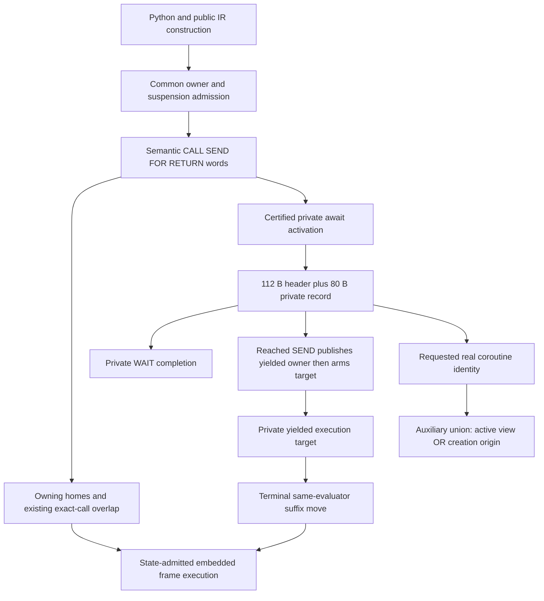
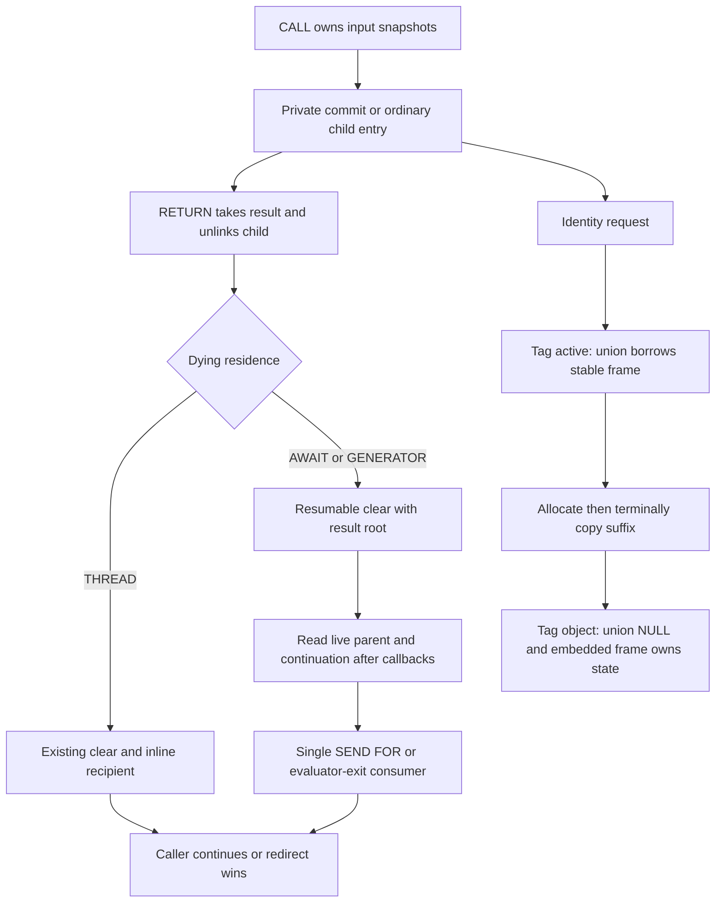

# Interpreter parity66: qualify complete boundaries, isolate identity storage

Status: grouped proposal, not runtime admission. Based on canonical closure
`2125567df336d8fdd9f621d17f3a4ce815c0bdab`. [Review66](../../issues/register-semantics59/review66.md)
pins source, retained evidence and limits; [report](../../issues/register-semantics59/report.md)
preserves round65's rejection. Selected57 remains selected.

**GO for a new, unchanged-source qualification and one screen of final B.
CHANGE the next representation attempt to an explicit identity/origin union.
STOP further round65 instruction-scheduling repairs.** These are at most two
units, with the second conditional on the first disposition below. No new
return aliases, opcode-role families, compiler experiments or execution engine.

The purpose is to retain the demonstrated removal of immediate-await object
creation/reentry while taking private continuation and identity costs out of
ordinary execution and storage. This is not a claim to close the comprehension
or DeltaBlue gap. Their remaining work needs a separate successful boundary
change, not a fraction of the coroutine gain assigned to them.

## What the evidence permits

Await9 improves unchanged coroutines by 42.9%, but loses logging 27.7% and
generators 5.2%. Round65 A retains a 39.3% coroutine gain, with logging 16.2%
and generators 5.5% slower. Both are qualified mechanisms and rejected
executables. B has source/products, both builds and 48 focused methods per role,
but **no screen**. Its final native rejection is the +5 instrumented EMPTY
return against a contractual +4 allowance. Remaining qualification is incomplete.

B removes private-parent/phase tests from all four inspected YIELD forms.
Whole ordinary SEND_GEN/yield/exit is 157 instructions against selected57's
160 and await9's 176; generic SEND's corresponding path is 185 against 187/201.
Its common completion is back to 93 instructions. ReturnResumable now transports
the live post-clear semantic continuation, adding five instructions against A,
without another call, owner movement or spill on the compared path. These are
**static complete-path facts**, not frequencies, cycles or a B performance win.
The record is 80 B plus the unchanged 112 B header; text grows 1,664 B and
rodata 96 B against await9. [Native review][b-native]

The selected/upstream matched three-pair instruction/cycle ratios are
comp 1.436416/1.333179, Delta 1.361424/1.118423 and coro 1.307831/1.267788.
Comp needs 30.38% of its own instructions removed just to equal upstream's
count. Generator elapsed is 1.372523 without fresh matched generator PMU.
No multiplication of these old results by candidate/selected ratios creates
a new upstream result. Flat samples and monitored opcode visits are not an
additive saving budget.

## Why this interpreter can execute fewer words and more work

The actual comp loop is list step, method selection, argument snapshot, native
CALL, append, backedge: six words versus upstream's eight. Selected CALL still
establishes a transaction, guards descriptor/receiver/arity, redispatches through
value-vectorcall, roots its result in B0, retires input owners, polls, publishes
the final recipient and dispatches. Generic locals/scratch/discard rules and
five NCSR VM arguments also have physical costs at helper boundaries.
[Actual selected CALL][i-call] [Dispatch/operand ABI][i-macros]

METH_VALUE dict.get has no object-array boxing adapter. Upstream's checked
descriptor helper still converts StackRefs. Python equality/hash can reenter
either runtime, so bypassing a guard does not remove the required argument
snapshots. Invoke59 already removed the duplicate argument NULL sweep and lost;
provider59 also lost. Neither becomes a new unit by adding a wrapper.
[Upstream checked helper][u-helper]

Exact Python calls already overlap homes and return inline. General fallback
binding is different: selected `call_transaction_push_python_fallback` copies
arguments into a small/allocated array, lets the consuming binder move them,
then detaches and retires the still-owning parent window. That source path has
real intermediate storage and two ownership populations, but its natural
coverage after adaptive direct/keyword plans is unmeasured. The selected binder
already has direct plans; replacing them is not a new saving. [Binding][i-bind]

Upstream RETURN restores caller stack/return offset; SEND_GEN directly uses
the embedded frame and exception record. Selected completion also handles
arbitrary destination homes, immutable SEND/FOR geometry, private WAIT, observer
redirects and evaluator exits. B moves one private execution choice to the
producer that knows it; it does not eliminate those semantics. Its semantic PC
must remain a real image word. [Upstream terminals][u-terminal] [B consumer][g-return]

Canonical PyValues, local borrowing/copy propagation, frontier clearing,
adaptive PICs and frame-cached feedback-base indexing are already selected.
Independent code ownership cannot simply disappear: function code is mutable.
No option below credits these existing optimizations or requires unfinished
bitmap/M4/IRSC2 work as a universal prerequisite.

## Five distinct options

The rank is prospective scope of removable work across workloads, not confidence
or implementation order. No unknown coverage is assigned a frequency.

| Potential rank | Concrete producer → consumer change | Removed work, retained/added cost, disposition |
| --- | --- | --- |
| 1 | One ordinary-C native callout/retirement activation with a canonical owned-result consumer edge | Replace repeated crossings between the five-argument NCSR handler and provider/retirement helpers with one complete callout boundary. Keep the existing B0 result root through callbacks; a reached semantic consuming edge can consume it directly. Targets actual comp dict.get→append, and general native CALL families; Delta eligibility is not established. **DEFER to the next broad unit:** whole-path entry/exit, spills, roots, observers and consumer costs must beat selected57 and the rejected Invoke/provider packets. Details below distinguish this from another cleanup wrapper. |
| 2 | Carry a caller-local anchor into a read-only exact method parameter, with promotion before exposure/mutation | Removes a real mortal self acquire/retire pair; exact-call argument movement is already removed. Adds activation mode, anchor dependency and promotion ports in clear/traverse/copy/proxy writers. Structural zero-explicit-argument pairs exist in Delta/ray, but read-only eligible mortal hits are not established and comp/logging have none in that shape. **DEFER:** a new snapshot owner defeats this proposal; no frame ABI implementation without an eligible reached pair and a net complete-call budget. |
| 3 | Retain an exact-generator delegation spine across external None resumes | Removes depth-proportional descent/yield visits, unlike rejected backedge-only resume62. Build links during actual descent; root receiver ownership anchors them; invalidate before interior API use, observation, receiver mutation, throw/close or completion. Recursion and effective executing/exception state must stay truthful. **DEFER:** at most 64 links in a first unit; reject if resume still walks all parents to validate geometry, rewrite flags or relink exceptions. No universal header backlink tax justified yet. |
| 4 | Complete B's activation-selected private SEND yielded continuation | Removes private classification from ordinary YIELD; retains the complete suspension transaction and live post-clear completion transport. Costs: 8 B more private record, reader/cancellation complexity, +5 private return instructions versus A. **GO first**, unchanged, under the prospective policy below. The strongest retained throughput mechanism is here, despite narrower scope. |
| 5 | Store active coroutine view and creation origin in mutually exclusive typed auxiliary storage | Removes the universal 8 B active pointer; replaces its initialization/selection with a discriminator and cold union-aware readers. No owner or active address is removed, and no net initialization saving is assumed. **CHANGE/GO second conditionally:** structural storage improvement, not a proved allocator-class or logging fix. |

**Rank1's concrete replacement:** the CALL lowering in `bytecodes.c` and
`ir_generator.py` emits an owned-result edge (ordinary store/discard, or one
proved consuming successor) into a shared native-callout contract in `ceval.c`.
The first bounded consumer is append, with ordinary publication as the exit.
The normal-C activation spans checked provider invocation, canonical result
publication into the existing B0 root, complete input retirement, periodic work
and the consuming edge. Return to NCSR once, with actual next semantic PC and
exit/error status. Reuse current transaction refresh and owner programs; do not
create a second root or another owner interpreter. Callee-saved VM state may
survive its internal C calls; that is a compiler hypothesis to price, not a
claimed saving. Selected comp's A=B=17 already avoids a final B0-to-A move:
credit no removal there. The distinct proposed removal is repeated callout/
dispatch/operand setup and VM-state preservation across the *whole* boundary.

The producer owns exactly one canonical result. B0 retains it through provider
and retirement callbacks; the consumer takes it once after retirement and poll.
The common IR graph must prove the result-use edge and no independent ingress,
not identify a benchmark or source position. Python-capable equality/hash
remains legal: no no-Python inference from METH_VALUE. If observers, redirects
or reinstrumentation invalidate consumption, resume ordinary semantic CALL
completion/append with the still-owned result; never replay the provider.
Publish the actual append PC before its effect and error attribution. Retain
receiver/query owners, recursion, displaced-local retirement and supported
observer events. Carry canonical facts from a real provider contract; do not
trust a helper name or add another normalization just to cross the new API.

This is a later replacement of native CALL's complete physical boundary, not
another provider59/Invoke59 packet or compact64 roster extension. Those losers
show why removing redispatch or a NULL sweep alone is insufficient, not why
every callout convention must fail. A future bounded attempt must remove at
least one additional complete VM-state/consumer boundary and show positive net
work on the reached comp edge after all entry/exit costs; stop if it only moves
spills into a helper or clones handlers by role. Keep one provider family/one
consumer initially and independently check generic publication/error exits.
No new native savings or parity budget are established by this source proposal.

The general vector/keyword fallback binder drops below these five. A borrowed
input cursor could remove intermediate storage, but adaptive direct plans
already bypass it and comp's native call never enters it. Its first source
falsifier is whether callback-safe snapshots merely reappear in a new buffer.
Do not replace the higher-reached callout option with that unmeasured coverage.

| Option | Reached hotset evidence | Excluded or unproved coverage |
| --- | --- | --- |
| Native callout/result edge | Selected comp's ordinary dict.get→append and retained native CALL costs | Proposed edge admission and net saving; Delta/native-family benefit not yet established |
| Anchored parameter | Structural Delta/ray exact zero-argument method pairs | Read-only mortal eligibility; no comp/logging pairs in this shape |
| Delegation spine | Monitored generator SEND/delegated-yield cycles | Natural spine admission, effective-state cost; no comp/Delta benefit |
| B continuation | Actual await mechanism and inspected ordinary generator cycles | B throughput; no direct comp/Delta removal beyond retained ordinary terminals |
| Auxiliary union | All ordinary generator-family requests and actual active-view readers | No direct comp/Delta/logging throughput mechanism; request bytes are not cycles |

Implementation order deliberately differs from potential rank. Unit 1 can answer
an unresolved tradeoff around a measured 39–43% structural coroutine gain without
another source patch. Unit 2 removes known representation redundancy with no
new lifetime mode in interpreter homes. The larger options need new owner or
effective-state protocols, while their eligible coverage/net cost remains open.
This buys a finite decision, not another indefinite coroutine-only campaign.
If the two units stop, the next grouped review must choose a complete call/
lifetime or delegation change from the retained evidence; no third frame-word
repair is authorized here. Comp/Delta remain explicit unsolved targets.
Do not substitute the binder or borrowed-self ABI for unit2 now: their reached
eligibility is weaker and they introduce home-lifetime changes. Rank1 is the
preferred broader successor; its full owner/observer contract needs a separate
unit peer, not implementation hidden inside66. This priority decision does not
delay the unchanged B experiment and authorizes no third lane.

## Prospective cost and evidence policy

Round65's +4 failure remains a failure of that experiment. Do not edit its
contract or call B qualified. A separate round66 experiment may decide that
the unresolved tradeoff is worth one measurement. Setting a new +5 universal
cap would repeat the mistake.

**Hard gates:** Python behavior, explicit single ownership, current-frame and
exception links, callback-safe live control, stable native aliases, supported
observation, error word/recipient, OOM recovery, actual ABI and artifact identity.
No speedup pays for a failure. No pointer tagging disguised as a PyValue, synthetic
semantic PC, arbitrary active relocation, unbounded per-frame allocation or
depth-dependent C recursion is admitted.

**Predictive evidence:** instructions, stack, text, rodata, request size and
first-suspension cost. Account for whole producer-to-consumer paths, including
entry, error/observer transitions, spills, root work and dispatch. Use a small
representative path matrix; do not enumerate every branch to one-instruction
precision before a screen. Instrumented paths are mandatory correctness paths,
but their invocation frequency is unknown, not assumed rare. Report their cost
separately rather than pretending it predicts uninstrumented hot4 throughput.

For frozen B, replace the old +4 return, 64-instruction first-suspension and
1 KiB aggregate resolver cutoffs with reported tradeoffs. Inspect the complete
first-suspension and resolver call graph for ownership/ABI and linear work per
transferred frame. Record approximate complete path/stack/size totals once;
an off-by-one count cannot stop this experiment. The one-target/no new ordinary
header architecture is a scope gate. No per-dispatch universal resolver, new
ordinary helper call, new heap allocation on ordinary SEND/YIELD, or second
owner engine is allowed. These would contradict the claimed removal.

For avoidance of a second gate dispute, the complete 65-to66 disposition is:

| Old predictive gate | Round66 unit1 disposition |
| --- | --- |
| Private return at most +4 instructions | Replace with reported whole-path tradeoff and elapsed screen |
| First suspension at most +64 instructions/frame | Replace with reported cost; retain linear per-frame transfer and complete failure/alias closure |
| Target plus unshared resolvers at most 1 KiB | Replace with reported size/call graph; retain one target and no universal resolver |
| Text at most +2 KiB, rodata at most +128 B | Report actual growth; no independent size rejection |
| No new native spills | Report actual stack/spill changes; no independent one-spill rejection; platform ABI and bounded stack remain mandatory |
| Strictly positive ordinary whole-cycle instruction saving | Report representative complete cycles; positive counts alone neither admit nor select; the demonstrated await mechanism and elapsed screen decide the tradeoff |

Frozen header 112 B/record 80 B and no new ordinary helper/heap/owner machinery are
scope constraints for this unchanged artifact, not adjustable tuning budgets.

This does not reopen compact64: its complete intended segments added work,
with no separate demonstrated mechanism benefit to offset entry/exit. Nor does
it reopen measured Invoke/provider/cleanup losers. Static savings admit a
hypothesis; they never select an executable. Elapsed and memory evidence decide
performance under [validation](../validation.md) and [measurement](../measurement.md).

## Unit 1 — finish qualification and screen frozen B once

**Artifact:** G `64348dd5c182af27c058e60f1e3f849f00d7ef81`, final continuation4
ELF recorded in review66. **Source change: none.** Root adopts this new experiment
before native work. Source remains frozen; any correctness defect stops this
unit and returns a concrete finding to review, not a scheduling repair loop.

The real APIs are `_PyAwait_ArmSendYield`, `_PyAwait_BeginSendYield`, logical
return-PC read/take/set, `_PyAwait_PrepareSuspend`, `_PyEval_ReturnResumable`
and `_PyEval_CompleteGeneratorReturn(..., semantic_next)`. Producers/consumers
span `pycore_interpframe.h`, generated SEND/YIELD/RETURN, `ceval.c`, frame copy/
detach, frameobject debugger writers, and the execution-target registry.
[Target and logical APIs][g-pc] [Generated target][g-target]

Contract closure before screen:

- SEND publishes the actual yielded owner at B+2 before arming. Only an actual
  private SEND relation arms; FOR child yield and private CALL/WAIT do not.
- Ordinary YIELD publishes before loading the live executable continuation.
  The target resolves a real SEND site, then prepares terminal suspension.
  It never decodes a synthetic word as a semantic operand or feedback address.
- Normal return unlinks once, roots the result through clearing callbacks,
  reads live parent/control afterward and completes once. The AWAIT arm's
  disarmed proof and GENERATOR arm's Take/cancel remain distinct. Error,
  cancellation and redirect invalidate before releasing owners; saved state
  must never overwrite callback updates.
- First suspension allocates before nonfailing movement of only the owning
  evaluator suffix. Active native/C aliases remain stable; identity observation
  is not residence conversion. Names, identity, exception, code/function,
  receiver/input/result owners and reservation retirement remain complete.
- Port actual return-PC readers/writers, including completion's signed-D exit,
  pending-call/debugger checks and copy. Remote source/async readers use real
  instr_ptr/ir_words and do not acquire unrelated return-PC layout changes.

Root and independent peer finish the residual armed normal-return, FOR,
sentinel, error/cancellation, cleanup/reentry, observer and first-suspension
matrix. Reuse both 117/79 builds, 48 focused methods/role and unchanged source/
product evidence by exact identity. Root supplies missing actual receipts:
private target hit, normal/error disarm, callback redirect, first-suspension OOM
with recoverable live owners and stable aliases, terminal suffix move and native
foreign-observation alias. Existing receipts may satisfy unchanged paths only
when their ancestry and matching artifact are explicit. Re-run affected reader/
ordinary controls rather than full suites by default. No performance run before
these semantic/ABI obligations close.
Suspension OOM is not entry OOM: valid identity/name-owner publication may
already have committed, and the target has resolved/disarmed to the real SEND.
Require correct current SEND/error/exception state, no partially moved suffix,
no stale armed control and recoverable reservation ownership; do not demand
bitwise original state or reverse a valid identity publication.

Then one unchanged balanced hot8 screen against selected57, the usual stable
32-row/two-pair protocol. Do not pool A and B or reuse A's timings as B data.
Screen thresholds and subsequent work are below. A loss closes B for selection;
bounded diagnosis may still be useful.

## Unit 2 — represent an identity view without a universal active pointer

This is a new source unit on qualified B, in a fresh branch; frozen B remains
intact. Begin source work only after unit 1 qualifies. The single implementation
predicate is B screen PASS below, **or** every non-generator screen requirement
passes (including logging, coroutine target and hot8 aggregate) while both
generator ratios are at most 1.03. The latter never selects B. Any other B loss
stops this second attempt for66; eight generator bytes are not a logging remedy.
B may independently advance to confirmation/selection; unit2 is no prerequisite.

**Exact layout/API change.** In `_PyGenObject_HEAD`, replace separate
`origin_or_finalizer` and `active_frame` storage with a named `aux` union containing
`PyObject *origin_or_finalizer` and `_PyInterpreterFrame *active_frame`, plus an
explicitly initialized byte `aux_kind` (OBJECT or ACTIVE_FRAME). Preserve the independent async
generator hooks/closed/running flags and the public frame-state machine.
The object arm owns a coroutine origin or async-generator finalizer as today;
the active arm is a borrowed address anchored by the owning await record.
Only exact coroutine identity views may select it. No raw union pointer may
reach generic object traversal, member access, decref or serialization.

The admission proof is concrete: `private_await_context` denies nonzero origin
tracking at creation, and `_PyAwait_EnsureIdentity` currently sets origin NULL
while installing the active pointer. Enabling origin tracking later does not
retroactively create an origin for an existing coroutine. Keep that behavior.
[Admission][g-admit] [Identity producer][g-identity]

Introduce shared checked `_PyGen_HasActiveFrame`; existing `_PyGen_Frame` and
`_PyGen_ExceptionState` select the pointer arm only under that proof. Keep
object-arm writes explicit at their owning producers; embedded-only APIs stay
direct under their existing state claim. All constructors initialize union and tag
before tracking or any failing cleanup. Identity commit transfers real name
owners then publishes the tag/payload without callbacks. Detach first copies
the complete frame and exception state, repairs frame-object aliases, then
publishes object-arm NULL and clears the tag before reservation retirement;
there is no relocation of an arbitrary executing frame.

Replace `cr_origin`'s raw `_Py_T_OBJECT` member with a getter returning None for
an active view and the actual origin otherwise. GC visits the object arm only
when active-view is false; active frame/exception roots remain visited by the
thread record, once. Async-generator finalization retains its actual object
owner and never consults an active-frame arm. No new allocation, reference or
per-instruction mode test is introduced.

The class-level descriptor deliberately changes from member_descriptor to
getset_descriptor; root accepts that representation change. Value, lifetime,
read-only assignment/deletion and origin-warning behavior must remain. Do not
add another shadow origin word to preserve the former descriptor implementation.

**Reader/writer closure:** `pycore_interpframe_structs.h`, `pycore_genobject.h`,
`Objects/genobject.c` allocation, traverse/clear/finalize/getsets; `Python/frame.c`
detach/copy; generator-entry assertions in `ir_generator.py`; actual C API
fixtures; and `pycore_debug_offsets.h` with `_remote_debugging/{asyncio.c,
debug_offsets_validation.h}`. Unlike B's return-PC change, this changes remote
object layout: export/validate tag and union offsets and read the active arm
only after the discriminator. Update all affected usages, not a compatibility
fallback. Bump the actual runtime remote-debug format (currently 2) and port its
validator and `_testinternalcapi` layout consumer together. Rebuilt source/binary
compatibility is not an admission gate.

Public `gen_new_with_qualname` always constructs the object arm, including
ordinary code wrapped as a generator and origin-enabled coroutines. Copy does
not infer a view from code flags; only the private identity producer can publish
the view tag. All allocators must initialize object-arm NULL plus the selector
before `make_gen` tracks the object or origin allocation can fail. Peer the
complete constructor/copy/observer census; private admission alone proves
nothing about those other routes.

Remote readers reject unknown tags and active-tag/NULL payload before parsing
a frame. Arbitrary running-target sampling can see a tag/payload transition;
peer its bounded failure behavior against the supported remote contract, and
exercise stable native-wait and detached reads. Do not infer atomic observation
from a callback-free local transition. Private admission remains disabled under
free threading; ordinary object-arm behavior still requires compile/reader closure.

**Expected removal and price:** one pointer per generator/coroutine/async-generator
object and independent active-pointer storage in an identity view. The byte
discriminator replaces the active-NULL write/test, while initializing the unused
object arm adds a NULL write for ordinary generators. Thus there is no claimed
net constructor instruction saving. Origin/finalizer paths already initialize
their object payload; move that initialization earlier, without duplicate stores.
Generic frame/exception access loads the tag and loads the pointer only for a
view; origin getters/GC add tag checks, and remote reading adds validation.
State-admitted embedded entry remains direct. Source layout
predicts restoring the retained generator request 248→240 B with the same
framesize19/nlocals1/stack4; root must verify actual sizeof/offset/request values.
No allocator-class transition, elapsed saving or cause of the old 5.5% loss is
claimed. Fixed interpreter header remains112 B and private record80 B. Reject
the source unit if it needs a side allocation, an extra ordinary owner, or a
view test in state-admitted embedded execution. Report cold-reader native
growth; do not replace the +4 mistake with a new instruction cliff.

Minimum new runtime cases: creation-origin disabled then enabled while active;
ordinary origin-enabled coroutine; exposed identity retained through suspension
and completion; active-view GC/weakref cycle with exactly-once root accounting;
identity-allocation OOM/retry; async-generator finalizer/hooks; public frame-to-
generator ingress; remote active and detached frame reads; native retained alias.
Reuse the existing lifecycle/reader matrix with affected cases rerun. Root peers
source, regenerates products, checks both builds and actual release/debug ABI,
then captures one native removal/ordinary-path comparison and one new hot8
screen. A source shape or getter assertion is not qualification.
If B was selected, B becomes this unit's immediate performance control, with
the unchanged selected57/upstream checkpoints retained for integration. Require
at least a 1% generator or .5% hot8 improvement versus B, and no workload mean
over 1.01 versus B, before claiming an incremental throughput win. If B remains
unselected under the narrow generator exception, compare the new executable
directly with selected57; B is only a secondary attribution control. A smaller
request alone is a storage result, not a throughput win or selection.

## Screen, diagnosis and selection rules

For unit1, and unit2 when B remains unselected, ratios mean candidate/selected57.
Define screen PASS as all of:
coroutines at most .70 in both screen pairs to retain the mechanism; hot8
geometric mean at most .99; no other workload mean above 1.01 or pair above 1.02.
These are pragmatic screen tolerances, not confidence intervals or parity.
Unit 2's narrow generator-only admission exception above is permission for a
different representation experiment, not B selection. Never omit logging,
ray, spectral or nq, and never select on aggregate alone.
For unit2 against selected B, use the incremental predicate stated in unit2,
also requiring no workload pair above 1.02 versus B. Its eventual coherent
checkpoint still receives direct selected57/upstream comparisons; do not
multiply intermediate ratios to manufacture them.

A candidate meeting those gates earns the existing finite confirmation, all29
and direct unchanged hot4/upstream comparison, with full supported release/debug
and applicable ABI/stress qualification at that coherent checkpoint. Require
confirmation to retain the hot8 protection bounds, all29 mean at most 1.00/selected57,
and every additional all29 workload mean at most 1.02/selected57. Disclose every
regression. These admit a smaller broad gain without claiming parity.
Parity itself requires the direct upstream measurements, not
these selected-relative thresholds. Only the declared PrettyPrint quarantine
applies; retain the six inherited debugger-jump errors explicitly.

Permit **one causal diagnostic even on a valid losing screen**. The predeclared
question is whether a repeated logging loss comes from additional executed
work in changed paths or increased cycles in otherwise matched ordinary work.
For this experiment only, this supersedes the old no-loser-PMU logistics.
Before execution root pins the exact candidate, selected57, unchanged logging
kernel/loop count and post-warmup kernel interval. Allow exactly three matched
pairs of user instructions/cycles, then one cycles-only sampling capture per
role of that same interval, with a 60-second capture ceiling per role. No other
workload, event or repeat is added. Retain whole-process counts separately.
Only accept enabled/running coverage at least 99% and samples with at most 1%
lost events; permission or window isolation failure stops the diagnostic.
The sampling comparison
partitions changed terminals/accessors/GC, normalized-equal ordinary handlers,
native providers, other and unknown. Preserve raw samples, lost events and
module maps; categories are disjoint, not inclusive percentages added together.

Instructions within 1% with cycles over 5% rejects an equal-CPI proportional
instruction-count explanation of the whole gap. It does not exclude added
expensive work, changed instruction mix, branch behavior or interactions, and
does not prove a frontend/cache cause. Samples may nominate where
cost moved, not establish a mechanism from a symbol name. If permissions,
hot-window isolation or sample quality fail, report inconclusive and stop;
do not alter perf_event_paranoid, add counters or extend captures. No PMU result
rescues selection, changes the workload, or licenses padding/flags/compiler
search. A screen failure gets no selection confirmation/all29/full campaign.
Only documented invalid measurement permits replacement; no repeated pairs
until green. PASS earns one finite confirmation under the unchanged protocol.

[i-call]: /home/power/code/cpython/.worktrees/python-boil-the-ocean/build/worktrees/call55-integrated/Python/generated_ir_cases.c.h:8479
[i-macros]: /home/power/code/cpython/.worktrees/python-boil-the-ocean/build/worktrees/call55-integrated/Python/ceval_macros.h:43
[i-bind]: /home/power/code/cpython/.worktrees/python-boil-the-ocean/build/worktrees/call55-integrated/Python/ceval.c:3999
[u-helper]: /home/power/code/cpython/.worktrees/python-boil-the-ocean/build/worktrees/upstream-3a440b6/Python/ceval.c:871
[u-terminal]: /home/power/code/cpython/.worktrees/python-boil-the-ocean/build/worktrees/upstream-3a440b6/Python/bytecodes.c:1574
[g-return]: /home/power/code/cpython/.worktrees/python-boil-the-ocean/build/worktrees/call55-gc/Python/ceval.c:3746
[g-pc]: /home/power/code/cpython/.worktrees/python-boil-the-ocean/build/worktrees/call55-gc/Include/internal/pycore_interpframe.h:54
[g-target]: /home/power/code/cpython/.worktrees/python-boil-the-ocean/build/worktrees/call55-gc/Python/generated_ir_cases.c.h:25780
[g-admit]: /home/power/code/cpython/.worktrees/python-boil-the-ocean/build/worktrees/call55-gc/Python/ceval.c:1898
[g-identity]: /home/power/code/cpython/.worktrees/python-boil-the-ocean/build/worktrees/call55-gc/Objects/genobject.c:1222
[b-native]: /home/power/code/cpython/.worktrees/python-boil-the-ocean/build/pyjit-link-wave1/register-semantics59/boundary65-source-host/unit-b-corrected-native-cold-review.md
