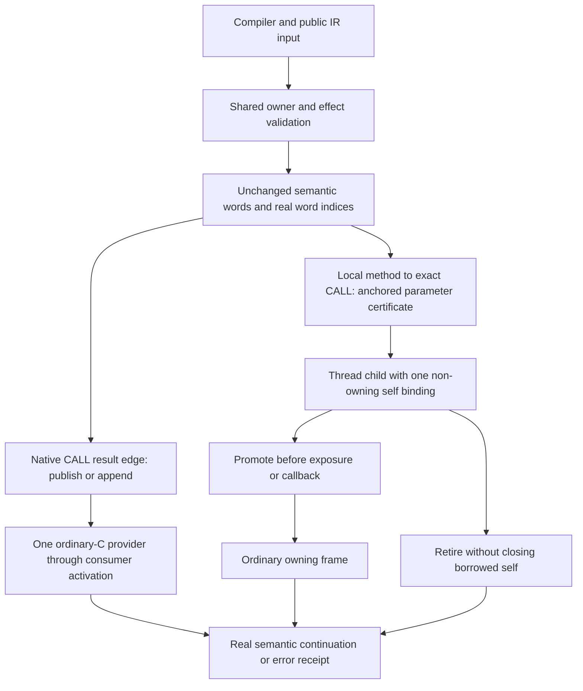
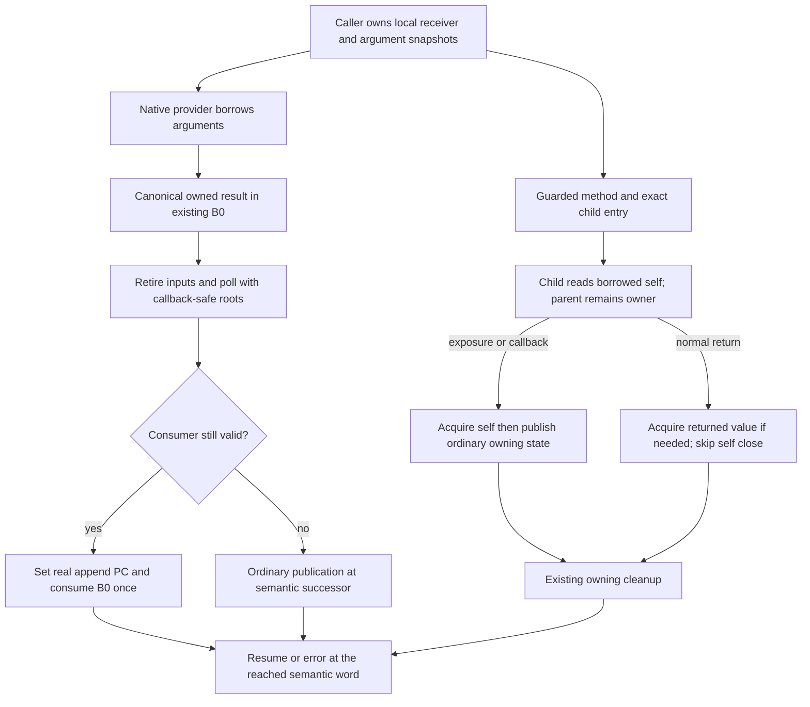

# Interpreter parity67: complete call boundaries and anchored parameters

Status: adopted for bounded source implementation after independent review;
not runtime qualification or performance selection.
Base: canonical `40add6e56c36d53363ec6b4b54cdfb6ace4fdcf9`.
[Review67](../../issues/register-semantics59/review67.md) identifies the actual
source and evidence. [Report](../../issues/register-semantics59/report.md)
closes round66; selected57 remains selected.

**GO for one complete native-callout unit; GO second for one bounded anchored
parameter unit, subject to independent source adoption. STOP the auxiliary
union and standalone continuation rescue.** Work from selected57. At most two
source lanes, with the shared ownership/effect interface agreed before either
worker changes its consumers. These are complementary comp and exact-method
attempts, not a forecast of parity or an instruction-count waiver for round65.

## Adopted implementation interfaces

Independent final-source adoption is
`E59/callout67-source-host/grouped67-adoption-peer.md`, against Astra
`4b484229fe62aa7b7030b72f7029687658484a66`. Root adopts A and B separately from
selected57. Their source proposals are `callout67-source-host/unit-proposal.md`
and `anchored-self67-source-host/unit-proposal.md` under E59. The following
clauses resolve the peer's implementation requirements before source edits:

- B reuses the complete exact-call SIMPLE_SIGNATURE proof: no varargs,
  varkwargs or keyword-only parameters, one positional parameter, ordinary
  optimized non-resumable code, and no self cell/rebind/delete. One argcount
  check alone cannot establish that pending kwargs storage is vacant.
- Shared `_PyFrame_PromoteAnchoredInputs(tstate)` acquires owners without
  allocation before an actual external effect, exposure or supported writer.
  Fully checked non-callback exact transfer/entry may retain loans; a generic
  ESCAPES/PUSHES_FRAME label does not revoke that exemption. Any miss that
  reaches callback-capable binding, observation or error publication promotes
  before those effects. Unit A invokes the shared effect boundary once before
  its complete callback-capable activation, not before every internal helper.
- Promotion walks reachable active frames across evaluator sentinels. A loan
  may not occupy an unreachable staged/unlinked state across an escaping call.
  Entry publishes the complete child and counts it within one non-calling
  interval; overflow declines before effects. Normal retirement clears the
  non-owning self home/mode and decrements the counter before cleanup can reenter.
  Promotion and retirement discharge each loan exactly once.
- The binding auxiliary encoding is typed: existing NONE is `0x0fff`, ordinary
  empty-kwargs slots are `0..4094`, and anchored slots use tag `0x1000` with the
  same 12-bit payload. Unknown tags and invalid payloads are rejected. Every
  existing field consumer uses the typed interface; no deprecated raw alias.
- A's normal and abrupt transfer proof and shared generated straight-line body
  are required even though its selected input operations have UNKNOWN transfer
  metadata. Neither adjacency nor the generic transaction helper establishes
  its B0 owner, completed drain, error state or safe reached append consumer.

Root owns generated products, native jobs and measured selection. Each worker
must acknowledge these interfaces and agree on overlapping effect/owner files
before implementation. No further Astra review is needed for these explicit
clarifications; a genuine design contradiction returns to root.

## What changed the decision

Qualified, unchanged continuation66 improves coroutines 37.4%, comp 2.5%, Delta
2.1%, ray 4.5% and spectral 3.0%, but loses generators 1.45% and logging 7.65%.
It is rejected. Auxiliary union was never implemented. Neither a smaller frame
word nor another private-return branch is an adequate next broad experiment.

The authorized logging diagnostic is finished. Cycles rise 8.54% with retired
instructions down 0.74%, at 100% counter running time and identical work. This
rejects an equal-CPI, proportional instruction-count explanation of the whole
gap. Different instruction mix, dependencies, expensive work and interactions
remain possible. The sampled changed terminals account for 8.307/8.453% of self
periods; proved-equal cleanup accounts for 13.416/13.518%; 78.276/78.029% is other,
largely unproved ordinary/core work. Attributes, exact/general Python calls and
boolean branches are prominent. Neither these independent profiles nor their
share differences assign the cycle loss. No new profiling is part of this review.

There is still a large budget gap. Last matched selected/upstream instruction
ratios are comp 1.436416, Delta 1.361424 and coro 1.307831. Comp must remove
30.38% of its own instructions just to equal upstream's count, not throughput.
Generator's last upstream elapsed ratio is 1.372523 without fresh matched PMU.
No candidate/upstream result is inferred by multiplying old measurements.

## Where the work comes from

Selected comp's real list-step → method-select → argument → CALL → append →
backedge has six semantic words against upstream's eight. Physical work differs:
descriptor/receiver guards lead back through value-vectorcall selection;
the result is canonicalized as required and rooted in B0; callable/argument
owners retire; callbacks and periodic work require valid frame state; the
consumer reloads its operands across another dispatch/helper boundary.
[Selected CALL][i-call], [value dispatch][i-value-call], [descriptor provider][i-descr].

There is no METH_VALUE dict.get boxing-array adapter to eliminate. Upstream's
checked helper also converts StackRefs. Equality/hash can run Python. Selected
comp has A=B=17, so there is no extra B0-to-destination move to claim. Its B0 root
already exists. Invoke59 removed the duplicate window NULL sweep and lost;
provider59 lost too. Moving the same call into a new wrapper earns nothing.

The five-argument NCSR handler ABI makes a complete C callout a useful physical
boundary to reconsider. Selected FAST's retained listing reserves 64 B; general
Python CALL reserves 112 B and preserves/reloads several values during binding.
These are actual listings, not proof that NCSR caused every spill. A normal-C
activation can retain VM state through several internal calls, but may also
add entry/exit traffic. Compact64 paid 93 entry/exit instructions to save 47
inside; the old broad engine used a 4,472 B frame. Neither design is reopened.
[Handler ABI][i-abi], [native evidence](../../issues/register-semantics59/review67.md#native-boundaries).

Exact Python CALL already overlaps argument homes, moves callable ownership,
initializes the child and skips RESUME; ordinary completion is already inline.
General binding already caches scalar plans. Its keyword hit nevertheless
revalidates destination ranges, name identity, duplicate slots and required
coverage. Same-code closures share function versions, so default shape cannot
be assumed. Upstream general CALL uses its consuming binder; its exact CALL
also transfers argument owners. Neither runtime makes all argument ownership
free. [Selected binder][i-bind], [version semantics][i-version], [upstream CALL][u-call].

Upstream's contiguous stack extent also carries the initialized frontier and a
vacant result recipient. Selected return must distinguish scratch, local and
discard recipients: a local needs publication before the displaced owner dies;
discard may finalize the result; cleanup can publish newer control. These are
real ownership/control dependencies, not redundant stack POPs. The independent
[I/U call comparison][python-contract] finds no universal discarded fact that
justifies another Python-call fast path. Its conditional fallback-only binder
would acquire from stable transaction inputs directly into final staged child
homes, avoiding the consuming intermediate vector. Parent and child ownership
populations, callback refresh and partial-child retirement remain necessary.
Adaptive direct plans bypass this path and its coverage is unknown. Keep this
alternative deferred; it neither replaces Unit A nor proves Unit B's benefit.

Retained monitored visits assigned to warmed labels distinguish opportunities:
Delta has 1,523,940 exact method CALL visits and no PY_GENERAL visits; logging
has 600,000 each exact and general. These are not specialized-hit frequencies.
Stronger general-binding facts therefore cannot be the main Delta proposal.
Selected local borrowing ends at call snapshots: a caller-local method receiver
becomes an independently owning argument, then dies with the child. Extending
that lifetime contract can remove work across the whole call, unlike method62's
method-to-call boundary compression. It also creates real observer and GC risk.

## Five options, ranked for the next broad attempt

The ordering combines reachable coverage, removal and semantic cost. It is not
a ranking of measured gains. All five have a producer and a distinct consumer.

| Rank | Change and actual consumer | Work removed; retained and added costs | Decision |
| --- | --- | --- | --- |
| 1 | Native CALL emits an owned-result edge; one ordinary-C activation consumes provider, retirement, poll and that edge | Remove a complete return-to-handler/consumer-dispatch boundary and repeated VM/operand setup. Retain B0, snapshots, recursion, canonicalization when needed and callbacks. Add one entry/exit receipt and edge validation. Comp has real dict.get→append traffic; Delta has 107,040 warmed descriptor-call visits, but its append-edge eligibility is unknown. | **Unit A.** Ordinary publication remains supported; append is the only first consuming edge. No provider roster expansion. |
| 2 | Guarded local method selection enters an exact child with parameter0 anchored to the suspended caller's local; retirement skips that non-owner, exposure promotes it | Remove receiver acquire/retire across a real activation, not already-removed argument movement. Retain callable/code owners, lookup, frame setup and result publication. Add tagged binding state, active-loan count, promotion and one clear/traverse distinction. Structural zero-explicit-argument pairs: Delta 1,280,190, ray 1,026,471; actual read-only, mortal, unpromoted hits are unknown. | **Unit B.** One parameter, one immediate caller, no suspension and no arbitrary borrowed homes. |
| 3 | A call-shape certificate becomes the complete input to the direct/keyword binder | Producer validates destinations and default coverage; consumer guards code/version, current default count, self/arity and exact immutable keyword shape once, then transfers. Removes repeated keyword proof loops; retains actual default acquisitions and frame setup. Adds feedback data/guards; no general-call coverage in retained Delta. | **DEFER.** Keep scalar-only feedback: use a caller-code-owned constant tuple identity when proved, otherwise existing binder. Do not alter global function-version meaning or cache an unowned tuple pointer. |
| 4 | CALL records an owned-result consumer for Python return as well as native completion | A returned exact bool can feed a reached branch without generic publication plus dispatch/decode. Keep real semantic PC, retirement callbacks and slow truth conversion. Adds physical continuation transport and ordinary-return selection; discard is already represented by IR_NO_DST. | **DEFER.** An extra all-return lookup/field is not justified by current coverage. Native A tests the consumer contract without imposing that universal return tax. |
| 5 | Build and retain an exact-generator delegation spine during real descent; resume terminal directly | Remove depth-proportional SEND/delegated-yield/backedge traversal across repeated None resumes. Retain logical executing/exception state and root ownership. Invalidate before throw/close, interior use, mutation or observation. Adds bounded link storage and effective-state readers. | **DEFER.** First scope would be ≤64 links and no depth-proportional hot validation/relinking. Larger generator potential than a resume62 backedge retry, but no comp/Delta removal. |

Ranks1/2 supersede the frame union. Rank3 is simpler than B, but misses Delta's
dominant Python-call path and leaves the native comp boundary alone. B is not
claimed to close the 36% Delta instruction gap: one owner pair cannot do that.
Its purpose is a reusable inter-frame ownership convention with substantial
structural reach, tested without expanding into a borrow bitmap. If its actual
promotion/guard costs defeat it, stop rather than expanding its parameter set.

## Unit A — complete native callout and result consumption

**Source boundary.** `Python/regcfg_passes.c` nominates the result-use edge;
`Python/regcfg.c`, `Objects/codeobject.c` and `Python/ir.c` validate it for every IR producer.
`Python/bytecodes.c`, `Tools/cases_generator/ir_generator.py` and its metadata/
effect generators lower the boundary. Shared declarations belong with
`Include/internal/pycore_ir.h`; execution belongs in `Python/ceval.c` and the
existing value/descriptor call helpers. Generated cases are products, not the
source of a second owner program. Do not change frame layout or all-handler ABI.

**Required admission repair.** Selected FAST CALL and LIST_APPEND currently
report `_PyIR_TRANSFER_UNKNOWN`; specialized CALL also has a manual intermediate
publication/retirement protocol. Their adjacency and final operand relation do
not certify the edge. Add a shared, source-checked transfer description for this
bounded pair: input snapshots, provider failure, B0 publication, every retirement
callback, poll failure, ordinary publication and append success/failure. The
common validator must prove the actual use and normal/abrupt owner states from
that description for compiler and public IR. Unknown coverage rejects fusion;
it does not become a proof by setting a transfer-kind annotation. This is a
prerequisite within Unit A, not a demand to finish universal IRSC2/bitmap work.

Generate the straight-line ordinary-C body from the same specialized CALL
retirement and APPEND source/emitter used for ordinary handlers, with explicit
physical exits instead of NCSR dispatch between them. Factor the shared emission
and ownership description rather than copying generated C into `ceval.c`.
`call_transaction_native` is **not** the fused body: it detaches inputs into a
retired array, uses `local_result` for local/discard destinations, and publishes
temporary results on a different schedule. It may remain an existing ordinary
fallback, but cannot be reused unchanged as evidence that the specialized B0
protocol is preserved. Do not introduce a second handwritten ownership engine
or a compact-domain loop to bridge this difference.

Use a scalar `NativeResultEdge` containing consumer kind, semantic successor
index, result home and append receiver home; no retained PyObject pointers.
`_PyEval_RunNativeCallout(tstate, frame, call_site, edge)` returns a compact
`NativeCallExit {status, semantic_next}`. Status is MISS, COMPLETE or ERROR; MISS
is legal only before effects, with the original homes/control intact, and
returns to the ordinary CALL fallback without repeating an effect. A
completed CALL with an invalidated edge returns COMPLETE at the ordinary
successor with its result published. The caller reloads frame/slots from live
state. No private pointer is placed in semantic `instr_ptr` or `return_pc`.
The API consumes no owner merely by being entered.

**Producer/consumer.** Initial provider family is the existing checked
CALL_METHOD_DESCRIPTOR_FAST path, including METH_VALUE and its existing
compatible FASTCALL provider. Execute its guards inside the complete activation;
a failed guard returns MISS before effects. The hit hands checked facts to the
existing invocation primitive once; do not run both vectorcall and another
direct call. Scalar/object conversion remains provider-specific. Admission of
append requires actual result dependence, exact list operation semantics and
no independent ingress into the consumed edge. Same source line is neither
necessary nor sufficient. Ordinary publication/discard is always an exit.
No generalized region executor, heap activation or per-operation dispatch loop.

**Ownership/effects.** Provider borrows independently owned argument snapshots.
On success replace the callable home with the canonical owned result using the
current B0 publication/retirement order. Retire every argument exactly once;
callbacks can inspect B0. Preserve current refresh, error and displaced-local
rules. Run periodic work at its existing semantic boundary. Revalidate the
live control and edge after callbacks/poll; no cached receiver pointer survives
a callback unchecked. Then either publish normally or set the real append PC,
take B0 once and call the existing consuming append primitive. On append error
the append owns/has consumed according to that primitive's actual contract;
do not replay CALL or close the result twice. Preserve receiver ownership until
the primitive no longer needs it.

Observers, debugger redirects, instrumentation and guard changes exit through
ordinary semantic completion. Exiting after provider success must never invoke
the provider again. Reentry can alter current frame, slots and destination;
reload them from the existing transaction authority. Before a Python-capable
callout, Unit B's promotion hook, if integrated, runs once at this complete
boundary. Do not duplicate it at each internal helper.

**What is new.** The native activation extends through a genuine consumer.
Invoke59 stopped at the owning invocation/cleanup contract; provider59 changed
provider selection; compact64 entered and exited a miniature interpreter. This
unit has no opcode loop and crosses back to NCSR once after the consumed edge.
The hypothesis is fewer complete VM-state/dispatch boundaries and a shorter
dependency chain, not an assumed benefit from ordinary C convention. There is
no guaranteed callee-saved register allocation. No new result root or comp
result-move saving is credited.

**Bounded qualification.** First cover one actual dict.get→append, ordinary
publication/discard, provider miss, provider error, retirement callback,
redirect/reinstrumentation, poll callback and append allocation failure. Use
mortal receiver/query/result values and check error words, owners and no replay.
Root generates both products, builds both roles and peers source plus native
complete paths from provider guards through next dispatch. Include misses and
callback exits, not just the provider body. Record stack/text/rodata and spills.
Focused admission checks must reject an unrelated adjacent append, interior
entry and incomplete transfer description; reached normal and abrupt controls
must confirm the shared description matches actual B0/argument ownership.
An extra static instruction is not a throughput veto. A second ordinary-C
activation around the same work, a new root or no removed complete consumer
boundary is a mechanism failure and stops this unit before timing.

After that one qualified screen decides throughput. A reasonable falsifiable
aim is ≥2% comp improvement, with broad protection below; no claim that 2%
approaches the remaining parity budget. Failure to reach the aim can still be
a useful incremental broad win under the exact selection rule. Do not add
more consumers/providers merely to rescue a losing screen.

## Unit B — one caller-anchored exact-method parameter

**Admission and producer.** Extend the shared IR owner relation with
`ANCHOR_CALLER_LOCAL(parent_slot, child_parameter0)`; it is not a special PyValue
bit pattern. Initial shape is a local-receiver method selection immediately
feeding a zero-explicit-argument exact Python call. The exact callable/version
must certify ordinary optimized non-resumable code, one parameter, no self cell,
and no instruction that rebinds/deletes parameter0. Public IR gets the same
def/use proof. Instrumented, external or already exposed parent frames use the
owning path. PEP523, stack and recursion guards precede any ownership change.

The producer completes the guarded method selection and exact child entry in
one non-callback section. It borrows self directly from the caller local and
acquires the callable as today. **Do not first create an owning self snapshot
and then call it borrowed.** There is no exposed partly prepared borrowed CALL
window: before the section, ordinary owner state applies; after it, a complete
child owns the callable/code and carries the anchored binding. On guard miss
use ordinary method selection/CALL before effects. Retain semantic method and
CALL PCs/events; monitoring uses the ordinary path. This fused preparation is
only the producer of a new lifetime contract, not a retry of method62 alone.

**Representation.** Keep a canonical self value in child slot0 so read-only
uses need no load indirection or tag branch. It is explicitly non-owning while
anchored. Replace the raw `pending_kwargs` field interface by a typed 16-bit
binding-auxiliary interface: NONE, EMPTY_KWARGS(slot), or ANCHORED_SELF(slot).
Actual slots use 12 bits (0..4094); upper bits distinguish the mode. Existing
NONE is 0x0fff. Anchored frames cannot simultaneously have pending kwargs.
Keep the 112 B header and all frame addresses. Update every constructor, copy,
materialization and clear reader of this field; do not reinterpret a tagged
value as a kwargs slot. This storage choice is part of the unit, not the stopped
generator identity/origin union.

Track active anchored frames in a thread counter, incrementing only after the
complete child is published. No new owning anchor, per-call allocation or
ordinary-frame linked-list field. `previous` identifies the immediate suspended
owner, whose local must remain strongly owning until promotion or retirement.
Nested anchored calls are allowed only when their source local is itself an
owner; parameter0 in an anchored parent cannot anchor another loan. An ordinary
owning argument acquired from it can. No chained borrowed root is admitted.

**Consumers and promotion.** Introduce
`_PyFrame_PromoteAnchoredInputs(tstate)` at the shared external-effect boundary:
the zero-counter path returns immediately; otherwise walk the active evaluator
chain, acquire each borrowed self, clear its mode and decrement the counter.
This is non-allocating owner acquisition. Complete promotion before any native/
Python-capable callback, periodic callback, frame exposure, supported locals
write, debugger redirect, frame copy or exceptional unwind that can publish a
frame. Promote across evaluator-entry sentinels as needed until all active
anchored frames reachable by the observer are covered; a current-segment-only
walk is insufficient. Do not put a new check on every dispatch or ordinary
read. Central generated effect boundaries and public observation entry points
must cover actual calls, including helpers that reenter without an opcode name.

Pure exact Python execution can retain the loan. Object mutation through self
is distinct from rebinding the parameter, but any callback-capable operation
first promotes. A dynamic guard miss that reaches generic Python-capable code
also promotes. Existing frame/native aliases must be accounted for before
admission, not repaired by relocating active frames. Writers get owning homes
before changing them. A borrow cannot survive suspension; those callees are
excluded, and any unexpected route materializes before escape.

Unpromoted normal retirement NULLs slot0 without a close, clears the auxiliary
mode and decrements the counter before reentrant cleanup; remaining slots,
callable and independent code owners follow existing retirement. Taking self
as a return value first acquires the owned result. GC traversal does not count
the borrowed slot as a second owning edge; the parent local is the root. Pure
reads may borrow it, but stores to other homes acquire ownership as today.
Error cleanup, transition roots and frame-object takeover must use this same
owner classification. No owner kind based solely on a helper name or annotation.

**Exact files and closure.** Producer/validator: `regcfg_passes.c`, `regcfg.c`,
`Objects/codeobject.c`, `ir.c`, `specialize.c`, bytecode/generator sources.
Runtime consumers: `pycore_interpframe_structs.h`, `pycore_interpframe.h`,
`Python/frame.c`, `Python/ceval.c`, `Objects/frameobject.c`; thread counter in
the existing thread-state definition, initialized/reset in `Python/pystate.c`.
Generated owner/effect/error metadata,
traverse/copy/clear, locals proxy/C API exposure and debugger/remote value
interpretation must agree. Remote semantic PCs remain real. Reader closure is
a focused changed-field/effect-boundary check, not a new whole-runtime census.
Free-threaded execution initially takes the owning path; no unproved concurrent
anchor is enabled. Do not require bitmap, M4 or IRSC2.

**Price and falsifiers.** Saved: one mortal receiver acquisition and retirement
on a complete unpromoted call, plus only genuinely removed producer dispatch
work. Retained: method guard/lookup, callable/code owners, frame initialization,
return and other argument work. Added: proof/guard data, tagged-field accesses,
counter updates, callback zero-test, clear/traverse selection and cold O(depth)
promotion. Promotion repays the acquisition; count it as no owner-pair saving.
The cost on ordinary non-eligible logging/native calls is part of the experiment.

Use one reached natural Delta or ray site plus focused fixtures to establish
actual unpromoted mortal hits, rather than counting all structural pairs as
savings. Qualify normal return, returning self, guard miss, recursion failure,
nested owned/borrowed cases, exception/finalizer, GC, callback observing/mutating
the parent, pre-existing frame alias, locals proxy, C frame getter, debugger
redirect and copy. Check destruction and ownership, without imposing every
CPython destruction/display detail as a blanket requirement. Root peers both
products and complete native producer→body→retirement paths, plus the ordinary
zero-loan callback/return path. Stop if an owner snapshot survives, no natural
unpromoted mortal hit occurs, or readers require arbitrary active relocation.
Native net cost remains predictive; one safe qualified screen may decide a
mixed count tradeoff. Do not expand to more parameters or borrowing across
suspension after a loss. Aim for ≥2% Delta or ray benefit; apply the same broad
selection rule, including the added ordinary-path tax.

## Execution order and selection

1. Sol-high A implements the complete native boundary on selected57. In parallel,
   Sol-high B can implement the single anchored binding after peer agreement on
   the common effect hook; neither worker changes the other's runtime files
   without root coordination. Root owns generation and integration. One source
   peer correction per unit before its final qualification, not a timing rescue.
2. Qualify and screen A first, B independently second. Each has focused semantic
   controls, actual reached mechanism, source/product parity and final-ELF review.
   Preserve existing PrettyPrint quarantine and six debugger-jump baseline errors;
   any new failure is a failure. No broad suite before a coherent promising build.
3. Use the stable balanced hot8 protocol against selected57, two pairs/32 rows.
   Define a promising result precisely: hot8 GM ≤0.995; at least one mean among
   comp/Delta/gen/coro ≤0.98 **or** two hot8 means ≤0.99; every case mean ≤1.01;
   logging mean ≤1.005; and each individual pair for every case ≤1.03. No pair
   exception or coroutine offset pays for a logging loss. A result missing this
   predicate stops; no all29, full suite, PMU or repeat rescue on that loser.
4. For passing units, root integrates only winners, runs focused cross-unit
   controls, then all29 and the full required suite. Balanced confirmation uses
   a fresh hot8 pair: each case ≤1.02 and logging ≤1.01, while pooled three-pair
   means still satisfy the hot8 mean/GM/improvement predicate. All29 requires GM
   ≤1.00 versus selected57, no case mean >1.03 and the protected hot8 means above.
   A failing confirmation is rejection, not permission for repeated sampling.
   Incremental broad winners can be selected before complete parity.
5. At that promising integration checkpoint, obtain direct unchanged hot4 versus
   upstream and matched PMU if root authorizes it. Record actual ratios; parity
   requires each unchanged hot4 mean ≤1.00/upstream with independent confirmation
   and the broad protections. Count reductions alone are not parity.

Only after a broad winner exists should root consider composing it with the
already qualified private-await mechanism as an integration checkpoint. That
composition must pass the same protection rules against selected57 and the new
winner; it is not another standalone66 run or permission to alter frozen G.
The 37.4% coroutine benefit remains valuable evidence, but no ordinary-cost
cause or cancellation is established. If composition loses logging, retain the
broad winner and the await design, not the losing executable. Further await or
delegation source work needs the next grouped decision, not a third lane here.

[i-call]: /home/power/code/cpython/.worktrees/python-boil-the-ocean/build/worktrees/call55-integrated/Python/generated_ir_cases.c.h#L8479
[i-value-call]: /home/power/code/cpython/.worktrees/python-boil-the-ocean/build/worktrees/call55-integrated/Include/internal/pycore_value_call.h#L108
[i-descr]: /home/power/code/cpython/.worktrees/python-boil-the-ocean/build/worktrees/call55-integrated/Objects/descrobject.c#L572
[i-abi]: /home/power/code/cpython/.worktrees/python-boil-the-ocean/build/worktrees/call55-integrated/Python/ceval_macros.h#L43
[i-bind]: /home/power/code/cpython/.worktrees/python-boil-the-ocean/build/worktrees/call55-integrated/Python/ceval.c#L4243
[i-version]: /home/power/code/cpython/.worktrees/python-boil-the-ocean/build/worktrees/call55-integrated/Objects/funcobject.c#L280
[u-call]: /home/power/code/cpython/.worktrees/python-boil-the-ocean/build/worktrees/upstream-3a440b6/Python/bytecodes.c#L4418
[python-contract]: /home/power/code/cpython/.worktrees/python-boil-the-ocean/build/pyjit-link-wave1/register-semantics59/callout67-source-host/python-call-contract.md
