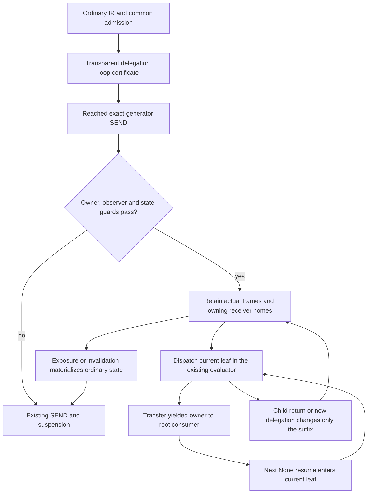
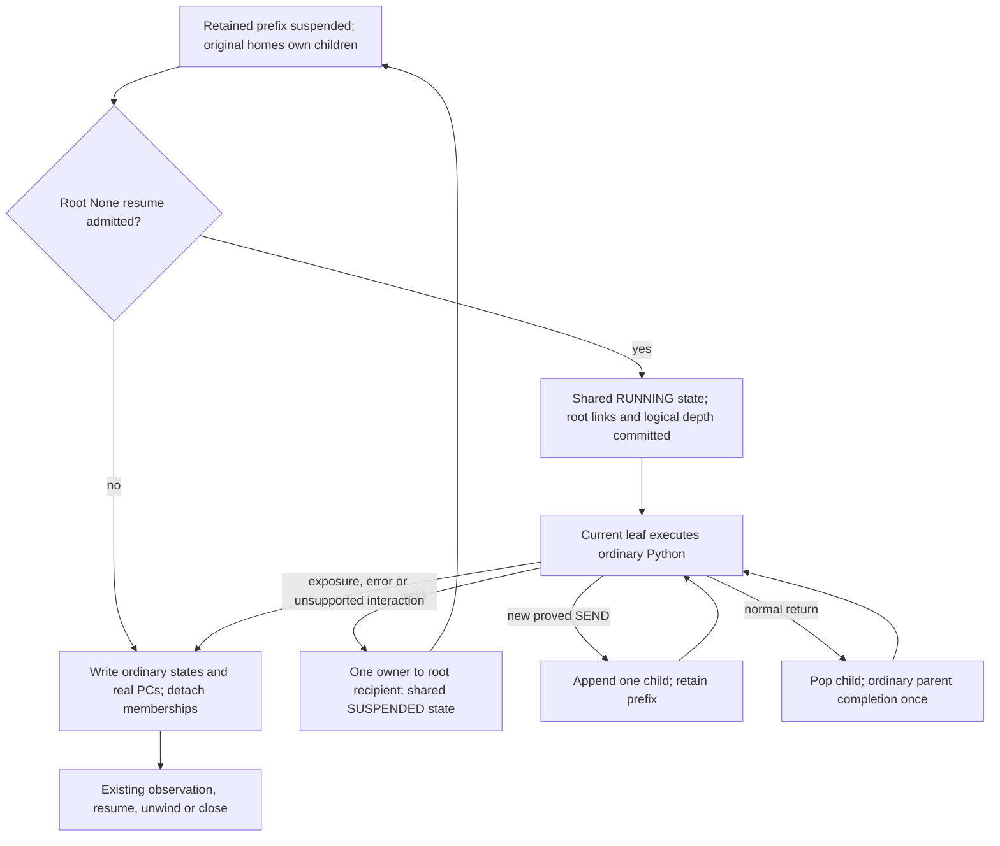

# Interpreter parity68: retain delegation, preserve ordinary ownership

Status: architecture and [exact source contract](../../issues/register-semantics59/retained-delegation68.md)
approved after [independent peer review](../../issues/register-semantics59/retained-delegation68-peer.md).
The inert foundation is being implemented; no runtime qualification or selection
is claimed. Base: canonical `10533a2b2d411a62c26c409438733c6862827333`.
[Review68](../../issues/register-semantics59/review68.md) records the source
contrasts. The [report](../../issues/register-semantics59/report.md) closes 67.
Selected57 `0dcba75bb3df40c32137db453b001f7e8f101de0` remains the runtime base.

**Recommend one source unit: a retained prefix of real exact-generator
delegations, with incremental suffix changes.** Do not fill a second lane with
a smaller owner-pair or dispatch optimization. Root adoption and independent
source-contract GO precede implementation. This review authorizes no runtime
jobs, new profiles, compiler changes or layout searches.

## What the two qualified losses change

A67 removes the intermediate dispatch but its nominal complete boundary grows
228→370 instructions and 72→216 stack bytes; text grows 11,584 bytes. Its hot8
GM is 1.026137, logging 1.210653, Delta 1.022085 and spectral 1.053213. B67 really
removes one unpromoted mortal self owner pair, but adds 149,568 text bytes,
method stack 8→136 bytes and checks at unrelated effects/owner consumers.
B's hot8 GM is 1.114220; all eight means lose, including Delta 1.141350 and
logging 1.430373. Both are rejected. These static facts and screens establish
no quantitative cause of logging's loss.

The structural lesson is stronger than “use fewer instructions”: an abstraction
must remove a complete class of work without moving that work into admission,
promotion, return or ordinary execution. B changes the contract every owner
consumer must handle to save one pair. A wraps already owning operations without
reducing their transaction complexity. Neither is a starting dependency for 68.

The selected design already supplies canonical PyValues, local borrow folding,
exact-call overlap, direct binding plans, inline ordinary return, initialized
arena frontiers and reached-only reentrant clearing. Ordinary feedback is a
cached base plus index. METH_VALUE dict.get has no boxing-vector adapter;
upstream's checked native helper also converts StackRefs. No such savings are
available again. Logical register values are still lowered to physical owning
homes: removing semantic words does not establish reduced native execution.

Python requires live values, data-model callbacks, exceptions, explicit cleanup
and supported observation. It does not require all current intermediate stores
or immediate finalization. This proposal nevertheless retains current owning
homes and release points: its saving is repeated delegation, not borrowed
frame storage or deferred RC. Every existing function/code/result owner stays.

## Five concrete alternatives, ranked

Ranking weighs complete work removal, reach and added obligations, not estimated
speed. Only rank 1 becomes a proposed source unit in this round.

| Rank | Producer → consumer and architectural change | Removed / added work; decision |
| --- | --- | --- |
| 1 | Checked transparent SEND/YIELD loop → retained real delegation prefix; root resumes the current leaf, leaf yields directly to root's consumer | Remove intermediate SEND, input publication, recursion/link updates, delegated YIELD and backedge on each traversal. Add one shared state, generator membership, admission and incremental append/pop. **Unit A**, below. Unlike resume62, this changes depth-proportional execution; no extra evaluator or private frames. |
| 2 | Owning THREAD function → writer-controlled executable-code dependency | Omit the separately emitted mortal code acquire/release only while the actual function owner pins the entry code. Repair at `func_set_code` before replacement and at copy/takeover; keep resumable/external/FT owners. Change frame initialization/retirement, `funcobject.c`, frame/GC and transition-root contracts. **Defer**: no net-saving retirement contract or authority representation is proved. Promoting at every return repays the pair; rare repair must cover parked threads and unlinked retiring frames. No generic callback barrier, spare flag or same-thread assumption. |
| 3 | Shared logical value/use/effect graph → existing generator's complete producer/consumer lowering | Extend the existing parsed ownership graph to represent one result lifetime across a checked non-reentrant consumer, then emit no intermediate home/publication and one guard chain. Preserve real semantic error/observation edges; no region interpreter. **Defer**: retained finite motifs cover at most 1.58% of comp and .88% of Delta dispatches, zero gen/coro/logging, before guards/exit costs. A67 and compact64 forbid counting only interior savings; no broader complete consumer is demonstrated here. |
| 4 | Immediate-await certificate → identity-free activation with residence-specific completion | Retain the qualified removal of coroutine object creation/copy/initial reentry; put materialization in reached exposure/suspension and keep ordinary THREAD completion independent. **Defer**, not a retry of 66: await64 and continuation66 already implement much of this and lose broad protection. A new source unit needs a distinct full boundary removal; a second return alias or field union is insufficient. |
| 5 | Consuming no-reentry release → generated retirement and raw-header clearing | Replace split “may deallocate, then close” interfaces with conditional consumption, leaving last owners for rooted continuation. **No source lane**: selected homes already use `_PyValue_TryXCloseNoReentry`; retained native code already reuses count loads and removes the impossible zero branch, including raw-header clears. C-source duplication is not additional native work. |

Rank 1 is a deliberate change of target. It offers no direct comprehension,
DeltaBlue or immediate-coroutine gain. No defensible second broad unit emerged
from the selected source and closed evidence. Those gaps remain active work.

## Unit A: exact-generator delegation with a retained prefix

**Scope and removal.** GIL-only, exact `PyGen_Type`, ordinary `next()` or
`send(None)`, and real transparent yield-from loops. Coroutines, async
generators, arbitrary iterators, non-None send, throw and close use ordinary
execution after materialization. Preserve the same evaluator, code objects,
frames, owning receiver windows and external recipient/continuation.

The unchanged generator kernel is a binary-tree traversal. A terminal generator
often yields only once. Therefore a design that rebuilds or dissolves the whole
chain on every terminal return fails this proposal. Retain the ancestor prefix;
append one entered child, pop one returning child and let the new leaf execute
its ordinary body. Its next branch may yield directly or enter another child.
Across a traversal, charge changed edges rather than depth on each yielded item.
Full dissolution is reserved for invalidation or unsupported interaction.

**Static certificate.** Extend the existing delegated-suspension/common admission
proof, not an opcode-name matcher. One row identifies actual SEND, delegated
YIELD, real resume/backedge and receiver/input homes. Prove that the successful
yield edge and None-resume path between them contain only the existing transfer,
RESUME and noninterrupting backedge; no user operation, ownership retirement,
extra entry, local/discard input, exception-context change or hidden observer.
Require the intermediate transfer cell to be physically NULL at both retained
boundaries and preserve the receiver owner. The SEND completion/error edges
remain ordinary. Scope is the loop, not the whole function: Tree.__iter__ has
real work before and after each yield-from. Source positions grant no authority.

Compiler construction, `CodeType`, replace, marshal and execution preparation
share this proof. A valid but ineligible image remains ordinary. Malformed
ownership remains rejected. Learned handlers cannot be injected publicly.
Monitoring or specialization changes invalidate/revalidate the existing proof
through their actual code-image epoch; no per-hit global certificate scan.

**Representation.** Add an explicit nullable membership pointer to the common
generator prefix: eight bytes in this profile, also charged to coroutine and
async-generator allocations. Do not claim spare header bits or reuse a live
field. The interpreter-frame header remains 112 bytes. All constructors initialize
membership; subtype layouts, embedded-frame access and remote offsets change
together. Frame/native aliases retain stable addresses after construction.

Membership points to one stable root-owned record, not an owning reference.
Its fields are root/leaf, link-array pointer, count/capacity, shared run state,
observer epoch and saved external frame/exception links. Each link names the
real generator and, for an intermediate, its certified SEND/resume sites and
receiver home. Frame code owners pin those sites. The original parent receiver
homes own child generators; the record adds no duplicate GC edges. Any member's
clear/finalize/GC teardown must materialize or invalidate the whole record before
releasing owners; cyclic GC and interior aliases do not guarantee root-first
teardown. Cold state/PC readers may bounded-scan for a member row or materialize.
Hot append/pop/resume/yield derive tail entries directly, never search the prefix.

Use a bounded growable link array, capacities 4, 8, 16, 32, 64. The stable record
address survives growth; all members point to it, not to relocatable entries.
Growth is allowed only at an actual new edge in a non-calling interval, with
old storage retained until commit. Allocation failure leaves ordinary valid
state and declines this optional optimization. Depth >64 likewise materializes
and continues at the reached edge without replay. This is a storage bound, not
a speed threshold. Sol's source proposal must state exact header/link sizes,
allocation lifetime and worst retained bytes before implementation.

**Entry and continuation.** Create the record at the first admitted nested SEND,
using the existing owning child entry and recursion/space checks. No prewalk
through unexecuted Python is permitted. Append each actual entered child once;
the newest member is the executable leaf. Append can include a CREATED exact
generator after ordinary creation/entry requirements; it does not skip its code.
Only a current leaf can become a retained intermediate by reaching the proved
loop. Do not share a member between records; unsupported nesting materializes
at that reached edge. Ordinary Python calls inside a leaf remain ordinary.

While the root is running, intermediate frames are logically executing at their
real SEND sites. On yield they are logically suspended at their real delegated
resume sites. Keep internal frame/exception links across this interval; update
only the root's external links on resume/yield. Shared record state determines
the effective intermediate state and PC. The leaf keeps its actual current PC
and resume recipient. A suspended root has no live pointer to a departed
evaluator sentinel: detach its external links before returning.

This changes the authority for participating generator state, **not ownership**.
No fabricated PC enters public display or EH. Existing ordinary consumers must
receive materialized real state before using raw fields; approved read-only
state/delegation accessors may resolve the record. Raw intermediate fields are
not silently treated as current. GC visits original owning homes once; retained
links are non-owning. Admission must prove the same readable/owning home view
at the two represented boundaries, including nullable transfer cells.

An admitted root None-resume checks the current monitoring/evaluator epoch and
root/leaf state, links the external caller/exception context, accounts for the
retained logical depth once and enters the leaf's real resume target. Preserve
pending-work service at the root admission boundary; no repeated iteration can
avoid polling. If insufficient recursion budget exists, materialize and use
ordinary entry to preserve its failure site and cleanup. A callback or poll
that invalidates admission cannot be followed by a stale leaf entry.
Active tracing/profile, DTrace or low-level tracing declines admission. Recheck
observable instrumentation at root/leaf boundaries, including enablement without
an epoch setter; materialize before skipped events. Charge these checks. Update
profiling/sampling frame authority consistently with the real logical chain.

Leaf yield takes one canonical owned result, suspends the shared record,
restores external exception/recursion/current-frame state and invokes the root's
existing yielded-result recipient. Intermediate input/result cells remain NULL;
no result owner is copied through them. Keep existing local/discard publication,
error-preservation and redirect semantics at the actual external boundary.
Neither YIELD nor optional record management may introduce a new Python error.

On normal leaf return, remove its membership before retirement, make the real
parent the new leaf, and execute its existing SEND completion once. Preserve
the rest of the prefix and hold the result through callback-capable child
cleanup. Publish the popped state before cleanup; a callback may materialize
and free the record. Re-read surviving membership afterward, honor redirection,
and never reuse a cached record across that callback. The new leaf executes all
nontransparent Python normally. Error,
throw, close or unsupported control first materializes the outstanding logical
chain, then uses the existing unwinder/provider once; it never restarts a
completed SEND or replays user code. Depth accounting must compose with ordinary
leaf calls, recursion failure and root/interior materialization without a leak.
Initial descent debits each actual entry normally; shortcut suspension credits
exactly the remaining member count once, and shortcut resume debits it once.
An appended entry adds one normal debit; a popped return restores one normally.
Materialization changes no recursion count: it hands the outstanding debt to
ordinary per-frame exits. The source peer must verify this ledger on every exit.

## Required closure and source boundary

Every item below is a hard source/behavior gate, not a later optimization.
No all-effect promotion hook, thread loan counter or borrowed-frame mode is added.

| Consumer | Required behavior and affected source |
| --- | --- |
| Certificate and generated transfers | `Python/regcfg.c`, `regcfg_passes.c`, `ir.c`, `Objects/codeobject.c`, `Include/internal/pycore_ir*.h`, `Python/bytecodes.c`, `Tools/cases_generator/ir_generator.py` and affected metadata sources: shared loop/owner proof; root owns generated products. |
| Runtime record and lifecycle | `Include/internal/pycore_interpframe_structs.h:_PyGenObject_HEAD`, `pycore_genobject.h`, `Objects/genobject.c`, `Python/ceval.c`, `ceval_macros.h`, `frame.c`: constructors, bounded allocation, append/pop, root resume/yield, exception/recursion links, finalization, every member's clear and GC teardown. |
| State and ordinary ingress | Every actual `gi_frame_state`/`cr_frame_state`/`ag_frame_state` reader/writer: running/finished checks, send/am_send/iternext, throw/close, finalization, yielded-receiver lookup and test C APIs agree. Interior resume first materializes; a running interior still raises already-executing. FT always retains ordinary state. |
| Observation and aliases | `Objects/frameobject.c`, frame getters/copies, `Python/instrumentation.c`, `sysmodule.c` and evaluator-hook ingress: materialize before frame publication, writable locals, debugger transfer, active tracing/profile reconfiguration or native frame alias exposure. Existing frame aliases prevent admission. A leaf callback can expose any ancestor; no relocation is allowed. |
| Remote readers | `Include/internal/pycore_debug_offsets.h`, `Modules/_remote_debugging/{debug_offsets_validation.h,asyncio.c}` and affected stack readers: versioned membership/state/PC schema or materialized authority, with corrupt-record rejection. Read-only remote inspection cannot call a materializer or silently report stale raw state. Preserve the reader's target-suspension/consistency protocol; publishing and freeing the record require an explicit lifetime proof, not just an epoch comparison. |

Use one explicit effective-state/PC interface and one materializer; update all
affected uses, no raw-field fallback that hides missing closure. Pure getters
may resolve without dissolving. Materialization is non-allocating and completes
before callback, owner close or mutation. It writes actual per-member state,
PC/phase and links for RUNNING or SUSPENDED, clears every membership and only
then frees storage. Active materialization retains the exact live chain and
recursion debt for subsequent ordinary yield/return. Suspended materialization
detaches internal links and leaves each member resumable independently.
No global registry or checks on ordinary CALL, attributes or value retirement.

**Tests and first qualification.** Add discoverable
`Lib/test/test_ir_retained_delegation.py` plus focused source-proof tests.
Cover depths 1, 2, 8, 32, 64, 65; a many-yield leaf; binary-tree leaf replacement;
left completion, parent yield and right descent; non-None send; nested ordinary
calls; exact return values and PEP479; throw/close/finally; independent interior
resume; running rejection; recursion limits; record allocation/growth failure;
root/interior GC and weakrefs; duplicate/cyclic receivers; handled exceptions;
pending callbacks; observation enabled inside the leaf; frame/native aliases;
locals mutation, supported debugger redirects, suspended/active remote reads;
and all four public-image routes. Preserve unsupported-image refusals.
Both builds run relevant generator, IR completion/delegated-yield, error,
monitoring, trace, frame C API and remote-reader controls. New failures fail;
only the established PrettyPrint quarantine and six baseline jump errors remain.

**Mechanism and numerical falsifiers.** Root's exact candidate must show one
natural unchanged tree traversal entering a retained prefix and completing
left→parent→right with that prefix intact. A synthetic chain at depths 2, 8, 32
must execute **zero intermediate SEND/YIELD/backedge bodies and zero per-member
state/PC/home stores per steady None-resume/yield**, excluding the leaf body
and external recipient. Append/pop work must be proportional to changed suffix
edges, with **zero full-prefix rebuilds on ordinary leaf return**. Charge
capacity growth separately. A nominal certificate or ready handler is no hit.
Any missing natural mechanism, per-resume chain validation/relinking, hidden
result-owner relay, or second execution/ownership engine rejects the unit.

Native review prices the complete admission→leaf→external-consumer path,
record build/growth/pop/dissolution, real error/observer paths, simultaneous
stack, added text and allocation bytes. Price the membership branch in ordinary
generator entry/yield/return/access and the eight-byte allocation growth for all
generator subtypes. Ordinary THREAD CALL/return, attributes and native callouts
must acquire **zero new semantic checks, fields or allocations** for this unit;
inspect their actual emitted code rather than infer unchanged native cost.
These resource/count forecasts are predictive, not a speedup or arbitrary
instruction-cap substitute for the protected broad screen.

## Ordered handoff and selection

1. Root independently adopts this single unit or rejects it. Sol-high supplies
   exact record sizes, loop certificate, all changed readers and append/pop/
   materialize owner-state tables; a separate Sol peer resolves them before
   source changes. Work from selected57, preserving every rejected branch.
2. Implement proof plus one complete root/leaf lifecycle first, then all reader,
   observer, failure and test closure within the same unit. No partial runtime
   nomination. Root owns generation, release/debug builds, native evidence and
   actual-hit controls. One source correction after peer findings is bounded;
   a failing complete mechanism returns to grouped review, not a larger spine.
3. After hard qualification, run the unchanged balanced hot8 screen against
   selected57: two pairs/32 successful rows, pinned identities, matched GCC,
   fixed affinity/hash, JIT off. Pass only if GM≤.995; one hot4 mean≤.98 **or**
   two hot8 means≤.99; every mean≤1.01; logging≤1.005; every pair≤1.03.
   A miss stops without confirmation, all29, PMU, full suite or timing rescue.
4. A pass gets one fresh confirmation pair: every case≤1.02, logging≤1.01,
   and pooled three-pair means retain all screen mean/GM/improvement predicates.
   All29 requires GM≤1.00, no case mean>1.03 and protected hot8 means. Complete
   supported diagnostics at this promising coherent checkpoint. No repeated
   confirmation search. Root alone selects an incremental broad winner.
5. Obtain direct unchanged hot4/upstream and matched PMU only at the promising
   checkpoint under root authorization. Parity needs each hot4 mean≤1.00 with
   independent confirmation and broad protection. Retain a broad winner while
   the next grouped review addresses remaining cases; do not append losing 66
   or 67 code as an automatic dependency or offset logging losses with gen wins.

Last selected/upstream PMU is comp instructions 1.436416/cycles 1.333179,
Delta 1.361424/1.118423, coro 1.307831/1.267788. Generator elapsed 1.372523 is
older, without fresh matched PMU. Comp would need 30.38% of its own measured
instructions removed merely to equal count. Selected all29 is .995586/golden56
and 1.127137/upstream under its older two-pair limits. This unit supplies no
complete parity budget; comprehension, DeltaBlue and coroutine mechanisms
remain unresolved. A proposal or a generator win does not complete the stage.
