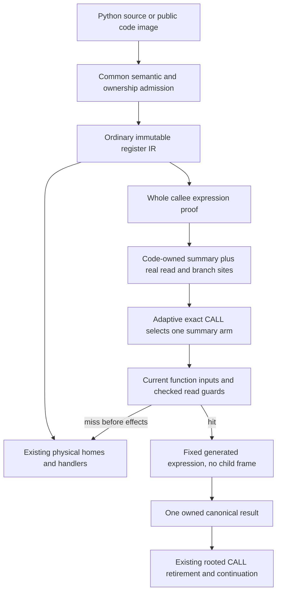
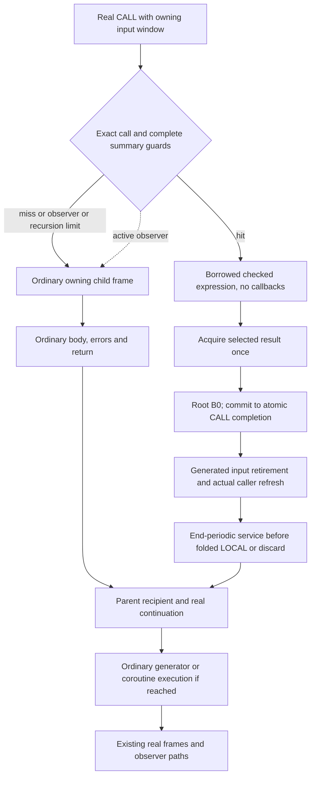

# Interpreter parity69: summarize complete small Python callees

Status: grouped architecture proposal, not implementation or selection.
Base: canonical `0fa1cefea53180f1e41d4acade00d12b5a471fa3`.
[Review69](../../issues/register-semantics59/review69.md) supplies the source and
evidence ledger; the [report](../../issues/register-semantics59/report.md) owns
closed results. Selected57 remains unchanged.

**GO to independent source-contract review for one bounded unit: guarded,
callback-free summaries of complete small Python callee bodies.** Implement
admission and the complete CALL consumer together, from selected57. Do not
start a second runtime lane. **STOP retained68 as an executable candidate**;
preserve its qualified mechanism and frozen evidence. Its generator gain does
not pay for the protected Delta, coroutine and logging losses.

## What the evidence requires us to change

Retained68 genuinely removes intermediate delegation execution. Actual native
depths 2/8/32, VM SEND/FOR entry, the unchanged Tree's retained prefix and forced
allocation failures qualify. Its stable hot8 means are comp .989151, Delta
1.101089, coro 1.072083, gen .708007, logging 1.239007, ray 1.001916,
spectral .892976 and nq 1.005174. GM .989788 passes; protection fails.
There is no confirmation, all29, fresh upstream ratio or demonstrated cause
of those losses. This is a mechanism success and selection rejection.

Costs are real even when sampled ordinary bodies match: all generator-family
objects gain 8 bytes; native `gen_send_value` grows 300→878 bytes and its own
stack 24→72 bytes; `gen_send_value_ex` grows 523→680 and 72→88. Main release
.text grows 13,120 bytes. None of these quantities attributes logging's loss.
The earlier finite logging diagnostic rejects only an equal-CPI, proportional
retired-instruction explanation of the whole gap. Different instruction mixes,
critical paths and unobserved work remain possible; cache/layout is not proved.

Repeated losses with some unchanged ordinary bodies are a **selection problem**:
local qualification is insufficient evidence for a useful executable. The next
unit must remove a complete, broadly recurring boundary, keep unrelated paths
free of new owner-state protocols, and face the same protected screen. Do not
reuse a rejected executable merely because its favored kernel improves. No
additional causal diagnostic or loser profiling campaign is proposed this round.

## Why the selected call boundary still costs work

Upstream represents the caller's continuation largely by a contiguous operand
stack extent and return offset. Selected IR also supports arbitrary register
recipients, displaced local owners, discarded results, callback-selected
control, canonical homes and private result transport. Its generated CALL
begins a transaction even on the exact path. It then reserves/initializes a
child header, owns executable code, installs frame/recursion state, dispatches
the callee, retires its homes and publishes to the recipient. Upstream has
frame and code ownership too; not all of this work is an IR-specific tax.

Exact argument overlap, direct binding, RESUME skipping, frontier initialization,
inline ordinary return, local borrowing/copy propagation, PICs and cached
feedback base+index already exist. The proposed saving is **not** another
binder, faster feedback decoding or copying fewer arguments. It removes the
entire child execution boundary when its complete semantics fit a checked
summary. Upstream's ordinary interpreter also executes that boundary; this can
provide an advantage rather than merely imitate its stack convention.

The register body still turns logical projections into owned temporary homes,
guards/dispatches each operation and clears the frame afterward. A complete
callback-free body can instead read from the still-owning CALL window, select
one result, acquire that result once, then perform ordinary CALL retirement.
No mortal borrowed bits enter a canonical owning home. No new frame ownership
mode, callback barrier or global borrowed-home interpretation is required.

## Five alternatives, ranked and bounded

These are different consumers, not five names for fusing adjacent words. Rank
weighs plausible whole-boundary savings, general reach and semantic cost; it
does not claim measured speed. Only rank 1 is ordered for implementation.

| Rank and decision | Concrete producer → consumer adjustment | Removed, retained and added work; falsifier |
| --- | --- | --- |
| **1 — GO to source peer: complete callee summary** | Common admission derives a finite return/projection/predicate/select expression from the whole callee; adaptive exact CALL consumes it through one generated straight-line body and ordinary completion. | Remove child reservation/header, independent code owner, body homes/dispatch and child clear/return on a hit. Retain CALL inputs, actual read guards, one final result owner, retirement and poll. Add summary/version/observer checks and cross-code feedback loads. Hard falsifiers: any child dispatcher/owning temporary frame, replay after effect, or generic provider inside the speculative body. Native target: at least 25% fewer complete-path instructions on both projection and select witnesses; this is a planning target, not a +1-instruction veto. Protected hot8 decides usefulness. |
| **2 — DEFER: one canonical call-result recipient** | Lower every CALL to a vacant scratch result, followed by explicit local replacement/discard only where required. Callee completion accepts a single recipient kind; register assignment becomes its own effect at the caller. | Remove arbitrary-recipient/displaced-owner choices from common completion; retain input binding, code/frame ownership and actual assignment finalizers. Add explicit result consumption and sometimes another dispatch/home. Comp's known dict.get has A=B17 already, so earns no move credit. A bounded attempt would cover ordinary CALL/RETURN only and port debugger redirect/error/public entry. Reject if explicit assignment merely reproduces all old branches plus extra dispatch, or complete local/discard paths grow over 10% without a compensating common-path reduction. No current whole-boundary budget justifies a second lane. |
| **3 — DEFER: intraframe borrowed predicate regions** | Extend the existing logical value/use graph across a proved no-callback read→comparison→branch region; emit one checked expression and a real semantic branch, without publishing dead interior values. | Remove interior owning temporary homes/dispatch, while retaining the frame, input roots, final branch and every possible callback exit. Add guard/region-entry costs and effect metadata. Unlike rank 1 it cannot remove frame entry/exit. Existing borrowing stays intact; unknown or effectful operations terminate the region. Reject any borrowed home surviving a callback, an interpreter loop over region words, or a complete entry-to-exit path with no net removal. Previous finite-motif coverage is not coverage for this new grammar; its reach is unmeasured. Share the value proof only after rank 1 wins, not as a prerequisite. |
| **4 — CHANGE architecture, STOP current retry: separate ordinary and retained generator ingress** | A public ingress makes one membership choice; an ordinary-only consumer preserves selected entry/exit, while a retained consumer owns claim, tools/epoch, budget and private leaf entry. Keep the qualified real-frame prefix and suffix updates. | Can remove retained claim logic and its live state from the ordinary consumer's native frame; retains membership test, universal storage, all observer/materializer machinery and retained entry costs. A change of C interfaces/function boundaries, not flags or padding. Require ordinary consumer stack no greater than selected 24B/72B at the two native entry functions and no retained checks inside it, then price wrapper cost. These are design targets, not evidence of logging recovery. Even meeting them would not establish removal of the known 23.9% logging loss. No source lane or rerun authorized. |
| **5 — DEFER/STOP extension now: direct create-and-delegate activation** | A common proof connects an exact generator CALL to its actual immediate delegation consumer; enter a stable activation directly and materialize identity before escape, observation or suspension requiring a public object. | Would remove generator allocation, initial frame copy and first reentry, which retained68 preserves; retain real body execution and explicit activation/result owners. Add stable frame storage, identity materialization, alias/GC/resumption ports and exceptional allocation paths. Bound to GIL exact immediate delegation, no arbitrary active-frame relocation. Falsify if it still allocates the object before the first entered body, duplicates the owning frame, or requires ordinary generator-wide state machinery without a priced removal. Await64–66 already show the benefits and broad costs of closely related lifetime changes; this is not a mandatory dependency or an automatic generalization of their losing executables. |

Rank 1 has the strongest new concrete coverage: retained Delta IR contains
whole projection/select callees with hundreds of thousands of monitored entries,
and comp contains a short-circuit predicate callee. These are structural
opportunities, **not summary hits or an additive performance budget**. The first
unit does not directly solve long generator/coroutine lifetimes. That gap is
preferable to adding a second speculative framework to make the plan look broad.

## Unit A: complete guarded callee summaries

### Scope, producer and representation

Start from I selected57, not G or any 67/68 loser. Release and debug admit the
same GIL-only feature; debug adds ownership assertions. FT remains ordinary.
Accept an actual exact Python function with the exact supplied positional
arity, including an already-present method self, with the standard Python call
provider, optimized/new-locals flags and zero keyword-only parameters. Initial
scope excludes bound-method expansion, keyword/default binding, varargs, cells/freevars,
generators/coroutines, nested calls, loops, exception handlers and stores.
Those exclusions are structural, not names, source lines or compiler origin.

Prove one of three complete normal forms: return a parameter/constant/projection;
return a checked primitive predicate; or select one of two such results using
one predicate, including short-circuit `and`/`or` where the test is proved bool.
Bound the expression to four attribute projections, one global→class-value
chain, one comparison and one conditional. At most three supplied parameters.
This bounds implementation and guard costs; it is not a runtime word interpreter.
Do not add nested inlining, arithmetic allocation or a general expression VM.

`ReturnSelect` returns the **actual selected PyValue**, not its truth value.
For `x.kind == K.BIG and x.has_spinner`, false returns False, true returns the
actual `has_spinner` value, including a non-bool object. Only reached-arm reads
are needed; eager speculative reads must be non-calling/non-raising and a miss
must leave the entire ordinary call untouched. Prefer branch-local guards.

The proof belongs to `Objects/codeobject.c` common semantic admission and
`_PyCode_BuildSemanticPlan`, using the same immutable words/edges/owner inputs
as constructor, replace, marshal and execution preparation. Follow actual
transfers, including manual/UNKNOWN boundaries; an annotation or opcode name
does not discharge them. Unsupported valid code has no summary. No claim of
whole M4/bitmap/IRSC2 completion is needed. Rebuilding a code image rebuilds its
proof; public code cannot inject a learned summary handler.

The current `semantic_image` does not contain enough binding information for
this proof. Pass the actual validated signature, flags, localsplus kinds,
constant-slot mapping and constants from the code object/constructor into the
bounded builder. `CO_FAST_CONST` homes initialized by `_PyFrame_FillConstSlots`
are not parameters. A referenced constant comes from that code's validated
mapping, including mortal replacement constants; no initial home is presumed
to be an argument merely because it has a low register number. Public
replace(consts/constslots/kinds) must rebuild or decline the summary. Extend
the existing validated inputs, not the global ownership lattice.

Add a code-owned optional summary record to the semantic plan, containing form,
parameter/result identities and real feedback/semantic sites. Target at most
192 bytes per eligible callee, no per-invocation allocation. Learned read facts
stay in existing callee feedback, with their actual guards; do not own stale
unguarded object pointers. Extend `_PyFbCall.binding` by an explicitly exclusive
summary arm holding scalar plan information. Its existing six-byte union plus
flags is not a spare pointer; retain `func_version`, keep the 16-byte payload
size and use the actual function's code/exec to reach the plan. Account for each
indirection. Do not enlarge every frame, generator or CALL feedback entry.

Keep the current 16-byte `_PyIRCodePlan` header. Add an explicit HAS_SUMMARY flag
and an aligned optional tail after existing sites/phases/ranges; derive its
offset from those counts, not a universal pointer/offset field. A summary-only
plan must allocate even when nsites/nphases are zero; it cannot use or mutate a
shared flag-only singleton. Change builder allocation/overflow handling,
`_PyIR_PlanSize`, `_PyCode_ClearExec` and `_PyCode_ExecSizeOf` together so the
tail flag participates in allocation ownership/free/accounting. Price eligible
record bytes, alignment and newly allocated former-singleton plans separately.
Non-summary plan sizes remain unchanged. The 192B target is for the eligible
record, not a claim that the rest of this lifecycle is free.

Nominate only in cold specialization of an otherwise exact positional Python
CALL. A structurally ineligible callee keeps the existing exact/general/native
head; do not insert a summary lookup ahead of every CALL. A learned summary
misses to ordinary CALL before effects and follows existing backoff. No generic
binder or bound-method-expansion path probes this feature. Charge cold nomination,
summary misses and any compiler changes to nonparticipating bodies, including
logging; source separation does not promise native or timing identity.

`func_version` is **not function identity**: same-code functions may share it.
Check the current callable and code/plan association, use that function's actual
globals/builtins, and guard actual dictionaries and values. Closure cells are
excluded. Mutating defaults/kwdefaults cannot affect an admitted fully supplied
positional call; partial/default/keyword calls never use this arm. No cached
global or class identity is inferred from function version alone.

### Exact execution contract

Proposed internal interfaces are responsibilities, not permission for wrappers:

* `_PyIR_BuildCallSummary(image, plan)` proves the complete expression. It runs
  in existing code preparation; optional ineligibility has no Python effect.
  Plan storage allocation follows code-preparation error handling, never a hot
  allocation followed by replay.
* A generated `CALL_PY_SUMMARY` family member consumes the current `_PyFbCall`,
  function/code and existing CALL window. One of the three fixed bodies executes
  directly in the ordinary handler ABI. No descriptor dispatch loop, compact
  domain, second evaluator, scratch owner vector or duplicate clearing engine.
* Checked projection primitives return `PyValueBorrow` or MISS. Extract the
  actual shape/slot/global/class guards from existing lowering, including
  nullable/missing, descriptor/type/metaclass and canonical-value checks.
  Primitives do not allocate, invoke Python, poll, set an exception or retire
  owners. Parsing/generation must preserve their full read/effect contract.
* `_PyIR_FinishAtomicSummary` names the proposed generated completion recipe
  below: existing B0-rooted native-sized operation retirement/publication,
  with its real read/effect/redirect/error checks. It must not call
  `call_transaction_native` or detach an argument-owner array.

Initially support checked shape/slot projections (including existing finite
polymorphic read facts), guarded module-global and class-value loads, canonical
inline-int comparisons and exact bool tests. A same-exact-type object equality
case may use identity only after guarding the actual object **and value** rich
comparison implementations as the base-object equality semantics. Both operand
types and subclass/reflected behavior matter; an Enum name grants no authority.
If those checks cannot be shared and proved, that case declines and comp
predicate coverage is absent. Other rich comparisons, descriptors, missing
attributes, mixed/custom dictionary lookup or truth conversions fall back
before effects. Never execute a generic provider and retry the callee.

All input owners remain in the original CALL window during proof and evaluation.
They pin projections; the actual function pins code/globals and code pins its
constants. GIL plus absence of callbacks protects these borrowed reads. A
projected mortal result is acquired before any input is released. A borrowed
intermediate never survives into retirement, and no borrowed bits are published
as an owning home. Stop reading plan/feedback/function data before its owner can
be released. No A=B move saving is claimed. Retire each original input once,
including unused parameters, with this single explicit atomic-operation policy.

**Normal atomic-summary completion.** Acquire the result, stop every callee,
descriptor and borrowed-projection read, publish the canonical result in B0,
then close the displaced callable owner. Drain argument homes in reverse order,
then present self, using the existing generated CALL ownership schedule. The
parent remains current. Re-resolve its homes/control after every possible
retirement callback; honor pending-CALL/redirect drains rather than close an
already-drained window again. This uses shared parsed ownership/effect lowering,
not copied handlers, a saved-pointer range loop or a detached transaction.

After the input drain, run `check_periodics_at_end` with the actual reached
parent state, including LOAD_SPECIAL suppression. On success consume B0 through
the generated destination/discard operation and finish displaced-local release
with its actual refresh/error continuation. A=B leaves one owner in place;
other scratch destinations move it, LOCAL publication replaces its prior owner,
and discard releases it. A callback may change the continuation or tools; no
stale descriptor, window, origin or next-PC cache remains authoritative.

This **deliberately differs** from real Python child return, which clears
parameter homes before the function owner and then calls SetReturnValue without
native CALL's end-periodic stage. The admitted body is now one checked atomic
operation. The existing lifetime policy allows bounded delay; do not require
identical finalizer timing/order or construct a child to reproduce it. Input
lifetimes end within this operation, and folded LOCAL/discard publication waits
until its service point succeeds. This changed scheduling is part of adoption,
not a claim that the two completion recipes were already interchangeable.
Tests must preserve values, identity, explicit owners, supported observation
and reached callback/control effects under this stated policy.

On a pre-effect MISS, preserve window, PC/control, exception state and ownership
for ordinary CALL. At commit, fallback/replay is forbidden. A finalizer during
input retirement can inspect/mutate the parent, change code/tools, redirect
control or raise; use existing rooted completion and refresh, not cached frame
pointers after callbacks. On periodic/refresh failure, folded LOCAL retains its
old owner and the unconsumed result stays in B0 for the existing CALL error
checkpoint, traceback/event and unwind order. On redirect honor the actual
already-performed drain and control transfer; each result is either still in
B0, moved to the reached recipient, or consumed exactly once. Never replay the
body or fabricate a callee traceback. The source peer must check these exact
normal/abrupt ownership receipts, including callbacks that already drained the
window. A raw range-close loop with a saved pointer is insufficient.
Local/discard/scratch costs remain. Exact destruction timing is not universally
required, but missing/duplicate release,
wrong live roots or lost callback-selected control is a hard failure.

### Error, observation and resumption

Before the callback-free interval, check PEP523, trace/profile, caller and callee
local/global monitoring, DTrace entry/return and debug LLTRACE. Enabled tools
use ordinary CALL. Prove the actual first executable word is the ordinary RESUME
that selected `IR_SKIP_RESUME` would skip, and compare the **full** current
eval_breaker to the callee's instrumentation version, not an event-mask or epoch
subset. Mismatch declines before effects to ordinary entry, which performs
pending work/updates before the callee body. Check ordinary recursion and stack
admission; a failed condition takes the real path and its real error/traceback.
Keep all platform conditions: initially decline Emscripten before touching its
signal clock, and FT remains excluded. No speculative guard may consume a
platform poll and then consume it again on fallback.

Ordinary exact Python RETURN has no native-call end-periodic stage. This atomic
summary explicitly adds the generated operation's end check described above;
price it, and preserve LOAD_SPECIAL suppression. It does not replace entry
service: a summary cannot bypass a pending full eval-breaker mismatch before
the body, even if a previous end check was suppressed. No chain can starve
pending work. Primitive guard failure raises nothing; a genuine operation that
may fail runs in the ordinary callee, exactly once, with its real error PC.

There is no resumable summary state: the bounded expression cannot yield, call,
allocate or poll. Before commitment the parent is at its real CALL; afterward
the atomic-summary completion owns the result and continuation. Async Python
exceptions are delivered at the stated entry/end service boundaries.
No fake callee PC, private return word or active frame relocation is introduced.

This is an explicit atomic-call observation contract. Python frame APIs cannot
be invoked inside the admitted expression; trace/profile/monitoring/PEP523 use
ordinary execution. An asynchronous native/remote sample during it sees the
real parent at CALL, as for an atomic native operation; it does not receive a
fabricated callee frame. Preserve safe parent homes, real PC and existing remote
layout. Exact asynchronous display of an elided callee is not promised. Root
and source peer must accept this limited display contract explicitly; if a
supported observer requires a live callee inside this interval, decline that
observer mode or stop this unit, rather than add a virtual-frame framework.

## Ordered implementation and disposition

1. **One complete source unit, one source peer.** Sol-high makes the bounded
   admission/summary record, shared checked-read primitives, adaptive arm,
   generated body and completion closure above. Primary files are
   `Objects/codeobject.c`, `Python/{ir.c,specialize.c,bytecodes.c}`,
   `Include/internal/{pycore_ir.h,pycore_feedback.h}` and
   `Tools/cases_generator/{analyzer.py,ir_generator.py,ir_read_effects.py}`.
   Change actual affected metadata/readers, not a blanket census. Generated
   products follow their sources. A peer checks the complete primitive semantics,
   owner/effect exits and atomic observation contract before implementation GO.
   Root may split producer/consumer editing assignments inside this unit; neither
   is an independently enabled runtime. No second optimization unit is queued.
2. **Minimal meaningful qualification.** Root generates and builds both roles.
   Focused tests cover all three forms, both select arms with non-bool RHS,
   polymorphic shape/slot reads, missing/descriptor/overridden comparison fallback
   exactly once, same-code functions with different globals, global/class/code
   mutation, defaults/keyword/closure denial, malformed and valid-ineligible
   public images including constslot/kind replacement and summary-only plan
   allocation/free/sizeof, result/input aliasing, unused mortal input finalizers,
   local/discard/B0 recipients under the atomic policy, reentrant parent mutation/
   redirect that drains the window, recursion/stack/tool fallback, full RESUME
   eval-breaker mismatch before the body, normal pending exceptions, safe remote
   parent display, calls from ordinary generator/coroutine parents, end-periodic
   failure/LOAD_SPECIAL suppression and FT/platform denial.
   Use existing controls for ownership/reader behavior; no exhaustive new census.
3. **Actual mechanism plus complete native boundary.** Prove real hits for a
   projection and a conditional summary, including both branches, and mutation
   misses with untouched inputs. Then obtain actual hits in unchanged comp and
   Delta where admitted; absent comp equality coverage must be reported, not
   replaced by a benchmark-specific case. Inspect selected and candidate from
   caller entry through reads, acquire, retirement, poll and next dispatch,
   including callees. Hard invariant: zero child frame reservations, child
   homes, child dispatcher entries and child clears on an admitted hit.
4. **Price the candidate before screening.** Report guards, feedback/plan loads,
   miss work, nonparticipating CALLs, input/result retirement, own stack, hot text
   and optional data. Planning targets: ≥25% complete-path instruction reduction
   on both representative forms, no new ordinary owner/effect hooks, ≤16 KiB
   added hot text and ≤128B own stack for the summary handler. These are alarms
   for one bounded correction or root reconsideration, not correctness rules
   or a veto for a rare +1 instruction. A safe candidate can reach the screen
   despite a modest target miss if the claimed complete boundary is truly gone
   and all costs are disclosed. A wrapper retaining that boundary, or a second
   engine, fails the mechanism and stops. Do not expand the grammar to rescue it.
5. **One protected screen, then finite confirmation only for a winner.** Root
   runs unchanged hot8 against selected57, two balanced pairs/32 successful rows,
   own libraries, pinned identities and normal fixed JIT-off protocol. Require
   GM≤.995; one hot4 mean≤.98 or two hot8 means≤.99; every mean≤1.01;
   logging≤1.005; every pair≤1.03. No pair exception. A failure stops source and
   timing rescue, confirmation, all29, PMU and full-suite expansion. A pass gets
   one fresh confirmation pair: every case≤1.02, logging≤1.01; pooled three-pair
   means retain all screen GM/improvement/mean predicates. Then all29 GM≤1.00,
   every case mean≤1.03, and protected hot8 pooled means remain within the screen
   limits. Complete supported full diagnostics at that coherent checkpoint;
   retain only the known PrettyPrint quarantine and six inherited debugger-jump
   errors, with exact identities checked. Root selects an incremental winner.

Direct unchanged hot4/upstream and matched PMU belong to the promising integration
checkpoint, under root ownership. Parity requires each hot4 mean≤1.00 plus
independent confirmation and broad protection. Old selected/U ratios remain
comp instructions 1.436416/cycles 1.333179, Delta 1.361424/1.118423 and coro
1.307831/1.267788. Gen's older elapsed 1.372523 has no fresh matched PMU.
Comp needs 30.38% of its own instructions removed merely to equal count. No
complete parity budget is proved here. Keep any protected broad winner, then
perform the next grouped review on the remaining gap; do not append losing
await/delegation packets as offsets or prerequisites.
