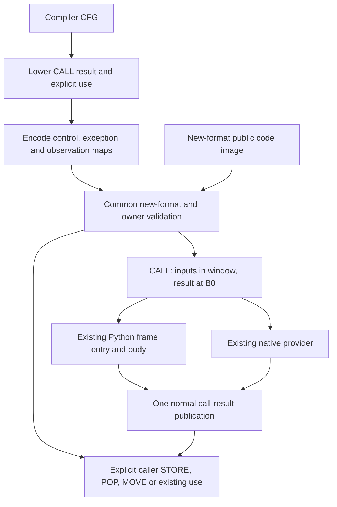
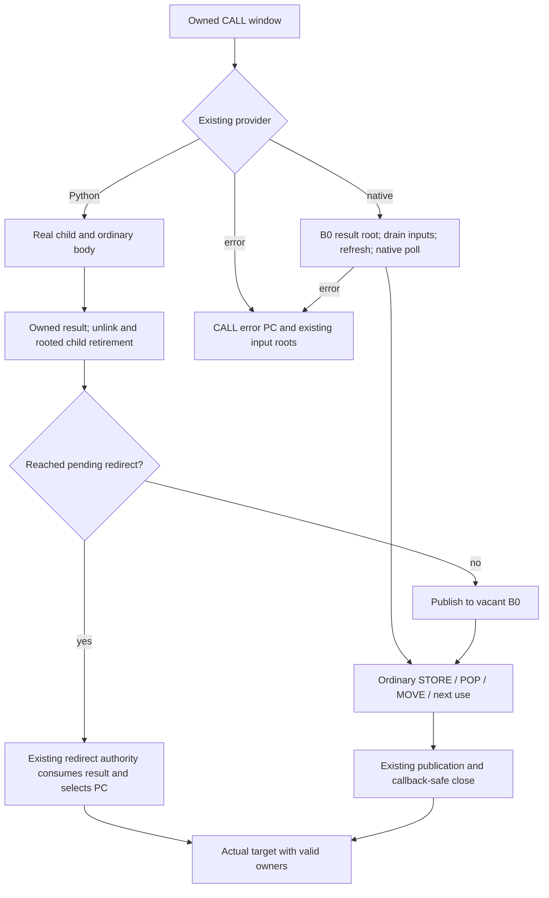

# Interpreter parity70: make call results ordinary caller values

**CHANGE the common call-result convention in one bounded unit from selected57.**
Every ordinary CALL produces an owner in its vacated window base; assignment,
discard and other uses are explicit caller operations. Keep real Python frames,
selected argument overlap and inline return. Do not add another call provider,
summary evaluator or owner state machine. This is a recommendation for independent
source adoption, **not source GO, implementation or native qualification**.

STOP summary69, including its unfinished behavioral qualification. Do not repair
or remeasure it. Retained68 and the earlier losing packets also remain closed.
The [review70 evidence ledger](../../issues/register-semantics59/review70.md)
pins actual runtime sources and receipts. The [report](../../issues/register-semantics59/report.md)
owns historical results; this proposal does not amend them.

## Why the next boundary must change

Summary69 really removes the child frame and its dispatch/retirement, yet its
complete projection path grows from 395 to 437 instructions and 80 to 152 bytes
of reached native stack. Selection grows 537 to 612 and 80 to 264 bytes. The
projection spends 321 instructions in its summary CALL and 116 in the path
reader. Selection spends 337 in CALL, 43 in the predicate and 232 in two path
reads. These totals include real guards and operations: none is an all-removable
metadata tax. Root/path interpretation, repeated feedback/reader selection,
helper state preservation and a replacement completion protocol survive the
removed child. Their source and reached costs explain **why boundary removal did
not imply native-work removal**, not the cause of elapsed-time regressions.

Natural unchanged Delta has a successful 653-instruction witness; comp has zero
demonstrated sites or attempts. The stable screen rejects the executable: GM
1.012667, Delta 1.034596, logging 1.176093, generators 1.018079, ray 1.034177.
Positive committed-summary redirect/service cases remain unqualified. Reached
success is neither full behavioral qualification nor useful throughput.

Upstream also guards calls, owns arguments, constructs and clears frames. Its
result goes onto the caller's contiguous stack; STORE/POP performs later owner
consumption. Selected combines local replacement, vacant scratch and discard in
CALL/RETURN. Consequently the producer carries destination choices through
provider execution, input/child retirement, refresh and publication. Its
`_PyCallTransaction.destination`, generated destination/displaced locals,
`IR_MOVE_TO_DST_OR_DISCARD` and `_PyFrame_SetReturnValue` make that contract
concrete. Compare whole call **plus consumer**, not just upstream RETURN.

Changing this contract can remove destination state across native calls and
local/discard handling from every normal call producer. It does **not** remove
the assignment/discard itself. Added consumer dispatch and stores may outweigh
that saving; the complete native gate below is deliberately able to stop it.
The known comp dict.get already returns at A=B17 and earns no result-move credit.
Selected inline return already reloads the parent after clear; a new terminal
helper without this representation change would mostly rename existing work.

Old selected/upstream matched instruction ratios remain comp 1.436416, Delta
1.361424 and coro 1.307831. Comp needs 30.38% of its own instructions removed just
to equal upstream's count. No option below has a demonstrated combined parity
budget, and instruction equality would not establish throughput parity.

## Five ranked alternatives

Rank considers general reach, whole-consumer removal and semantic cost. Only
rank 1 is ordered. None authorizes a losing-executable rescue.

| Rank / decision | Producer → consumer change | Removed, retained and added work; bounded falsifier |
| --- | --- | --- |
| **1 — CHANGE; one unit** | Common lowering gives CALL/CALL_KW/CALL_FUNCTION_EX one canonical result home, B0. Python return and native completion publish there; ordinary caller STORE/POP/MOVE consumes it. | Remove local/discard classification, destination transport and displaced-local completion from the call producer. Retain real inputs, binding, frame/code owners, retirement, native poll and observer authority. Add explicit consumers and potentially one word/dispatch. Stop if complete call-through-consumer controls show no net removal or if the implementation retains the old destination protocol behind a new wrapper. |
| **2 — DEFER; reject a motif-only retry** | A shared use/effect proof keeps derived field values borrowed from canonical anchors until a primitive predicate or final owned result; compatible dominating receiver facts are reused inside that same pure slice. | Remove interior acquire/retire/home/NULL work, and dispatch only if the physical consumer really subsumes it. Retain each mutable field read/null/value guard and real frame. Add borrowed live ranges, entry/exit reconstruction and a physical lowering. Scalars/immortals earn no mortal owner-pair saving. A fixed attr/compare roster is insufficient: stop if it only reproduces the old finite motifs, or if a larger forest requires another runtime descriptor walker. No new borrowed-home interpretation or all-handler value-carrying ABI is approved. |
| **3 — DEFER** | Generate ordinary native effect bodies whose live execution state ends before the C provider, then reconstruct only the actual result continuation from canonical frame state. | Potentially remove saved word/destination/feedback state across a C ABI. Keep provider checks, B0 root, input drain, poll, refresh and real error PC. Add reloads and terminal transfer. Requires emitted liveness evidence: repeated C source loads may already fold. Stop if it merely moves the same spills into a helper or duplicates native67/Invoke59's already-losing ownership wrapper. Rank 1 may make this unnecessary by deleting destination liveness directly. |
| **4 — DEFER, smaller budget** | Cold exact-call admission supplies validated binding/entry geometry to one generated exact entry, replacing rediscovery among guard/init/entry pieces. | Remove only emitted duplicate immutable arity/geometry work. Keep current function/version, actual defaults/globals, hooks, stack/recursion and full RESUME service conditions; same-code version is not function identity. Add cache dependencies and mutation closure. Stop if only a few scalar checks disappear, if another record/helper is added on every hit, or if ordinary nonparticipants gain a probe. Direct binding/overlap/RESUME skipping are already selected. |
| **5 — STOP current executable; defer a different ingress** | At a future generator-native entry, dispatch once to an ordinary consumer or a retained-delegation consumer, keeping retained claim/materialization state out of the ordinary activation. | Can remove retained machinery's live state from ordinary entry, not universal membership storage or observer work. Preserve real frames, recursion debt, exception links and materialization before alias/mutation/throw. Add wrapper cost; retained68's generator gain is real but its broad loss is closed. Ordinary entry targets remain selected 24B/72B own stack at the two native functions, **including wrapper costs in the complete path**. Even meeting those targets would not prove logging recovery. No round70 implementation or rerun. |

Derived reads were the provisional first choice. Actual retained IR and the
independent source input expose its unresolved physical representation: local
borrow/copy propagation, truth folding, compare-jump and join renaming already
exist. A small new roster cannot claim the coverage of a general read forest;
a general forest cannot be advertised as free straight-line native execution
without specifying its lowering. Rank 1 is the more concrete common adjustment
now. This is not a claim that it will win. There is **no second source lane** and
no automatic rank-2 fallback if rank 1 loses; return to grouped review.

## Unit A: canonical CALL result and explicit consumption

### Scope and source boundaries

One complete change, based on **I selected57**, covers ordinary vector, keyword
and EX calls, both self roles, Python exact/general/custom-provider fallbacks and
native specializations. Do not create a special CALL family for eligible cases.
All normal call outputs satisfy **A=B, B at a scratch window base**. The physical
home already exists for the evaluated callable. No universal frame field,
call-site plan, owner bitmap, new result object or additional handler-ABI
argument is needed. SEND/FOR/YIELD and generator completion retain their existing
separate contracts; this does not port await or retained delegation.

Implementation order within this single coherent unit:

1. **Normalize producers and admit the new invariant.** In
   `Python/regcfg_passes.c` stop folding STORE/discard into CALL-family outputs;
   preserve those folds for other producers. In `Python/regcfg.c` keep CALL's
   result at its window base. Existing scratch users keep that value; local or
   discard uses become existing STORE/POP operations. A logical use requiring
   another scratch receives an explicit owning MOVE B→A if ordinary allocation
   cannot rename it. Perform this before word and semantic-map encoding.
2. **Admit one new public IR format.** Extend
   `Objects/codeobject.c:validate_semantic_image` and shared transfer validation
   in `Python/ir.c` to require A=B at a scratch window for every CALL variant.
   Update all compiler/public-image producers, fixtures and generated format
   descriptions; bump the bytecode/marshal magic through the repository's
   existing mechanism. Constructor/replace/marshal/prepare enforce the same
   invariant. Reject malformed new-format images before execution. Do not add
   old-word translation, live-image rewriting or a compatibility execution path.
3. **Replace normal completion.** Change generated CALL sources in
   `Python/bytecodes.c`, `Tools/cases_generator/ir_generator.py` and their shared
   transfer/effect descriptions. Remove producer-local destination/displaced
   state and the CALL use of `IR_MOVE_TO_DST_OR_DISCARD`. In `Python/ceval.c`,
   remove `_PyCallTransaction.destination`; its result home is `base`. Port all
   binder/frame-entry writers to this fact. Preserve existing provider and
   input-retirement implementations rather than introducing another call engine.
4. **Port the cold observers and prove actual native removal.** Change
   `Include/internal/pycore_interpframe.h` normal-call publication and
   `Objects/frameobject.c` pending-call recipes together. Generate products only
   under root control, then qualify the complete producer/use boundary.

The proposed narrow internal API is
`_PyFrame_SetCallResult(frame, owned_result)`: normal case writes once to the
proved vacant `return_slot` and returns no redirected status. A pending redirect
branches to the existing redirect machinery with an explicit owned-result
argument; it consumes the result exactly once and returns the actual selected
continuation. The precise C return type is a source-peer choice, not permission
for another normal-path receipt structure. Existing `_PyFrame_SetReturnValue`
continues to serve SEND/resumption and other non-CALL contracts. Ordinary THREAD
return already distinguishes generator return; use that existing boundary.
Interpreter entry's fixed recipient is included explicitly, not assumed to be a
regular frame scratch slot. A custom evaluator's entry/return path must also be
ported before this API is used there.

### New format and logical control

The project explicitly rebuilds IR/API consumers and does not require backward
raw-code compatibility. Define the new invariant directly. Round69's A≠B bug
violated its unchanged legal format; rejecting A≠B CALL words in this deliberately
changed format is different. Python expressions, return identity, assignment,
exceptions and supported observation remain requirements. Prior raw words are
not a Python-language compatibility requirement. Update every affected public
constructor/test rather than preserve a legacy mode.

Lower the logical CALL and its use before layout. Existing CFG/assembly then
encodes branches, exception ranges, events, recovery/owner recipes, feedback
references and positions for the final words. An incoming edge to a shared use
must retain its own actual value; adjacency does not license consuming B0 from
another edge. Common admission proves ownership on those edges. Constants,
localsplus kinds and hidden constant homes keep their validated meaning. No
universal side table, second execution image or post-encoding relocation engine
belongs to this unit.

Use existing semantic phases/events to represent the inserted STORE/POP with
the corresponding assignment/discard effect. Do not invent a line event merely
because a word was inserted, erase a real event, or treat equal line numbers as
ownership proof. Code inspection/disassembly sees the admitted code;
all runtime readers use that same image. Public images must supply internally
consistent new-format maps; common validation rejects invalid ones. This is
ordinary compiler/admission work, not a legacy-code normalization subsystem.

### Ownership, error, poll and observer contract

* **Before entry:** the ordinary CALL window owns its evaluated inputs. B0 still
  owns the callable until its existing transfer/retirement point. A=B does not
  mean B0 is vacant before entry. Exact overlap and direct binding remain.
* **Python completion:** acquire/take the returned owner as selected already
  does; leave recursion, unlink the child, and retire it with the existing rooted
  clear/pop mechanism. Only then publish to the parent's vacant call-result
  slot. Do not introduce native CALL's end-periodic stage into Python RETURN.
* **Native completion:** retain the existing B0-rooted result publication,
  callable/argument/self retirement, refresh and `check_periodics_at_end`,
  including LOAD_SPECIAL suppression. Then dispatch to the actual caller
  consumer. No discarded result or displaced local is closed by this producer.
  Provider failure remains at CALL with the existing input/error roots; poll or
  retirement failure must not run the consumer or lose the rooted result.
* **Consumption:** STORE publishes into the local before closing the displaced
  owner; POP detaches before close; MOVE transfers to a vacant scratch. Use the
  existing effect-aware generated implementations and their refresh/error
  behavior. Do not copy a handwritten close loop. The old local remains live
  until STORE, and a discarded result until POP: this bounded lifetime is
  intentional. Call input retirement and native poll still precede the use.
* **Callbacks/observers:** child frames and canonical scratch results are real.
  A finalizer can see the completed result in scratch before its consumer; it
  must see valid owners and a real semantic continuation. Preserve supported
  pending ancestor redirects, immediate redirects and rejection of unsupported
  external-child recipes. The current `return_slot == IR_NO_DST` test in
  `frameobject.c:3564` must become a **cold, common semantic test for the
  explicit CALL→POP continuation**, not a new hot return-mode flag. That test
  proves the actual normal edge and owning POP input, not adjacency alone.
  Redirect completion consumes or preserves the result according to its reached
  target state; it cannot publish blindly after a redirect removed that demand.
* **Resumption/aliases:** parent return PCs, copied frames, C frame access, frame
  locals, remote readers and debugger writers must refer to the admitted real
  words. No arbitrary active alias relocates. Ordinary calls inside generators
  use the new CALL contract; generator return/SEND/FOR continuations retain
  their old contract. A runtime writer of a normal call recipient must never
  install a local/discard destination behind the new fast publisher.

These clauses deliberately move effects to existing ordinary instructions.
They do not assume callback/redirect states unreachable, borrow summary69's
unqualified positive matrix, or require exact CPython finalizer timing. No pure
callee assumption or new atomic-summary observation policy is involved.

### Costs and evidence needed

**Established source removal to implement:** producer local/discard decisions,
normal-call displaced-owner completion, destination field/arguments and their
live range across provider/child retirement. The old result-to-local/discard
work is **moved**, not eliminated. Receiver/query refcounts, binding, code/frame
owners, recursion, mutable guards, native B0 publication, clears and polls remain.
The general native path's `to_local`/`local_result` split and its post-poll
destination completion in I `ceval.c:1799–1870` are concrete removal sites too.
Keep its existing detached-input retirement where required; do not replace it
with a second handwritten drain or claim all native implementations currently
share the specialized handler's publication schedule.
There is no new saving for an already-canonical scratch CALL; its possible
benefit is smaller shared producer code/state, which needs emitted proof.

**Added costs:** one semantic word and ordinary dispatch for each unfolded
local/discard use, possibly a MOVE for a distinct scratch use, and changed
metadata lengths. Price any increased
home count/stack, generated text and read-only data. Target zero common frame/
feedback/header growth and no new private hot handlers. Do not infer cache or
logging causality from text size. Source isolation counts only if actual work or
live state disappears, not because functions move in the executable.

**Reach:** this is a common CALL convention, so it applies to ordinary calls in
comp, Delta and logging as well as calls inside generators/coroutines. That is
semantic applicability, not a measured optimization hit rate. Existing B0 comp
calls may be neutral; logging's ignored Python-call results pay the new POP and
are a required worst-case control. It does not remove generator delegation or
coroutine allocation. No source-position/name eligibility is permitted.

### Bounded qualification and selection

1. **Independent source adoption first.** Peer the new format/lowering and complete
   producer/consumer contract, including every normal return-slot writer and
   native/general fallback. A targeted reader/writer closure is required; a new
   exhaustive instrumentation census, bitmap, M4 or IRSC2 project is not.
2. **Smallest meaningful controls.** Exact/general Python and native calls with
   scratch, local and discard uses; valid public CALL B0→MOVE A and rejection of
   a new-format CALL with A≠B; self/NO_SELF, KW/EX,
   default/vararg/custom-provider fallback; aliasing result/input and mortal
   finalizers; provider and poll errors; recursive/arena failures; calls from
   suspended generators/coroutines. Constructor/replace/marshal controls must
   exercise branches around inserted uses, exceptions and real source events.
   Use actual C/native alias, frame-copy/locals and debugger mutation controls
   for each reachable changed observer boundary. A test taking fallback does
   not prove a changed path. Record the supported/rejected outcome on I first;
   do not expand a setter to satisfy an invented positive fixture.
3. **Root generation, builds and native qualification.** Both release/debug,
   existing extension build set, focused controls and independent product/ELF
   review. Walk CALL entry through the first parent handler **after the result
   consumer**, including every child/helper/provider and callback-free normal
   release. Include exact/general Python and METH_VALUE/native controls for all
   three common uses; public B0→MOVE A is a separate correctness/cost control.
   Retain projection395/select537 baselines only where the endpoint is identical.
   Require actual unchanged comp, Delta and logging reach, not nominated heads.
4. **Predictive budget, not semantic law.** Aim for ≥5% lower geometric mean
   complete native instructions across the predeclared scratch/local/discard
   controls, no >2% scratch-path growth, and no growth in complete ignored-result
   logging controls. Aim for no reached stack growth and no positive main-text
   delta. These are planning targets, not +1-instruction vetoes. If *all* complete
   controls are flat/worse and no saved destination live range is demonstrated,
   stop before timing. A mixed but structurally credible result may receive one
   explicitly labeled early rejection screen; root/peer must record the missed
   targets and residual risk before it. No such screen makes an incompletely
   qualified candidate selectable.
5. **Unchanged protected hot8 screen:** two balanced pairs/32 successful rows,
   identity stable, own Lib/JIT off/fixed configuration. Require GM≤.995;
   at least one hot4 mean≤.98 **or** two hot8 means≤.99; every mean≤1.01;
   logging≤1.005; every pair≤1.03, with no exception. A failure stops the unit:
   no repair, repeat, confirmation, all29, PMU or full-suite rescue.
6. **Promising integration only:** finish every hard gate before selection;
   one fresh confirmation pair, each case≤1.02/logging≤1.01, pooled means still
   satisfying screen predicates. Then all29 GM≤1.00 and each case mean≤1.03,
   retaining the stricter hot8 protections, plus coherent full/extension/tool
   qualification. Preserve the existing PrettyPrint quarantine and exactly six
   inherited debugger-jump errors; no new blanket allowances. Measure direct
   unchanged hot4/upstream at that checkpoint; parity requires each mean≤1.00
   with confirmation and protected broad behavior. Do not multiply historical
   ratios. A qualified broad incremental winner can be integrated before parity.

No additional causal diagnostic, profile or counter campaign is proposed.
Repeated logging losses remain a design-selection constraint with an unknown
cause. If this unit wins, root integrates and commissions the next broad review;
if it loses or the representation cannot close, preserve I and review again.
