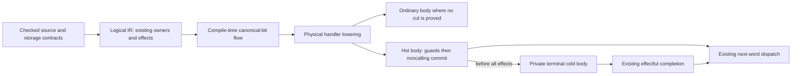
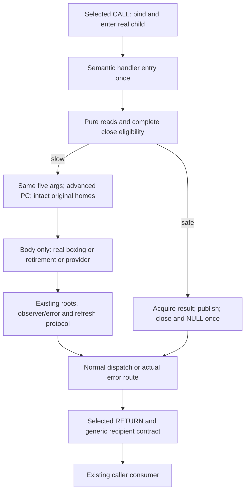

# Interpreter parity71: preserve value facts and separate effectful execution

**CHANGE the generator's physical lowering in two ordered, separately selectable
units from selected57.** A carries audited canonical-value facts to publication.
B generates a non-reentrant hot body and a terminal cold body from one checked
instruction source. B is the larger architectural opportunity; A is the simpler
first implementation and is **not a mandatory winner or prerequisite** for B.
Neither this review nor its commit grants source or implementation GO. Root owns
independent adoption, exact source contracts, qualification and selection.

All losing59–69 packets remain closed. Round70 stopped before implementation:
its recipient convention retained owner work and added transport/dispatch. Do
not resurrect it under either unit. The [review71 ledger](../../issues/register-semantics59/review71.md)
pins sources, retained native evidence and uncertainty; the [report](../../issues/register-semantics59/report.md)
owns historical outcomes. Documentation base is
`704e93379df607e083d7bc902a3b5d063f9656fe`.

## The execution boundary that actually costs work

Selected uses separate NCSR/musttail C functions, passing frame, slots, thread,
advanced instruction pointer and packed word. Its register allocator is not one
monolithic evaluator allocator. An ordinary C call inside a handler, however,
can require preserving those values until retirement, refresh and dispatch.
The actual upstream build uses computed-goto labels inside one evaluator C
activation. Its activation prologue is not paid at each opcode. Both interpreters
still need guards, owners, real calls, errors and observation. This distinction
identifies removable work; it does not establish a throughput explanation.

Retained selected ADD_INT has a 40B own native frame even on the inline,
non-overflow scratch path. SLOT has 56B and surviving canonicalization and
retirement C edges. BOOL branch has only an 8B saved frame pointer: there is no
universal large spill saving. LIST_APPEND necessarily calls its provider and
preserves VM state. Replacing it with another ordinary-C wrapper would repeat67A.

Summary69 removed real child execution but replaced it with guarded descriptor
walking, repeated root/path selection, normal-C state preservation and generated
completion. Complete projection increased395→437 instructions and80→152B reached
native stack; select increased537→612 and80→264B. Mutable read/binding/tool guards
are not interchangeable with immutable plan validation. Removing some of these
checks would not establish a new broad architecture or reopen that loser.

The proposed abstraction is instead: **canonical bits are a compile-time value
property; ownership is a separate existing obligation; a physical hot function
contains only operations proved unable to reenter.** No new runtime value mode,
owner record, observer mode, descriptor evaluator or universal feature test.

## Five ranked options

Rank weighs broad potential, actual whole-consumer removal and semantic cost.
Implementation order differs because A can simplify B's input without dictating
B's fate. Deferred options are concrete alternatives, not additional lanes.

| Rank / decision | Physical producer → consumer change | Removal, price and falsifier |
| --- | --- | --- |
| **1 — CHANGE, unit B** | Existing parsed instruction produces a guarded, pre-effect fork. One generated NCSR body commits a noncalling result; the other terminally executes the complete ordinary body. Same five arguments, words and owners. | Remove only native hot prologue/spills/continuation liveness actually absent in the new ELF. Retain guards, DUP/close/home/NULL/dispatch. Add early finality/alias checks, one slow tail transfer and repeated pure slow-prefix work; duplicate cold text. Stop if complete paths do not improve across arithmetic and read classes, or proof requires another owner engine. |
| **2 — CHANGE, unit A first** | Audited canonical storage readers produce a typed canonical-bit fact; existing copy/borrow/DUP/TAKE and branch merges transport it to canonical publication. | Remove redundant Publish type tests and Canonicalize edges on actual uncovered paths. All owners, homes, guards and dispatch remain. No added runtime checks or metadata. Stop if this becomes more whole-body string matching, grants facts from helper names, or has no emitted removal. This is useful general generator work, not a claimed parity-sized saving. |
| **3 — DEFER: directly addressed physical IR** | Replace packed64-bit words with one16B record: handler16/A16/B16/C16/D32/facts16/reserved16; signed/immediate CD use D. Dispatch passes frame/slots/thread/record pointer, loading operands directly instead of carrying a fifth packed argument. Compiler supplies immutable role facts. | Remove shifts/masks and packed-word live ranges; retain dynamic guards and owners. Double execution-image bytes, add operand loads, change quickening atomics, feedback addressing, PC arithmetic, serializers and every reader. No backward translator. Falsify with whole decode→consumer paths including misses and image footprint; fewer bit operations alone is insufficient. This is a real alternative to the ABI, not a flag experiment. |
| **4 — DEFER: two carried derived values** | Region allocator reserves two explicit PyValue argument lanes across NCSR handlers. Logical derived reads borrow from dominating canonical anchors; physical operands name lanes or homes. Effects/checkpoints acquire live lane values into canonical homes and reset lanes before ordinary execution. | Can remove real interior acquisitions/home traffic; never place borrowed bits in owning scratch. Adds two ABI arguments, lane selection, live ranges, entry/exit acquisition, checkpoint maps and all-handler transport. More than two simultaneous values spill to owned homes. Alias/mutation/effect invalidates borrowing; no runtime path walker. Stop if complete region transfers outweigh removed owners, or realistic two-input expressions spill away the saving. No source-ready general closure currently exists. |
| **5 — DEFER: resident ordinary execution core** | Generate ordinary noncalling bodies as labels in one computed-goto C core; canonical homes are the boundary to terminal outlined effect bodies, which reenter that core at the real next word. Replace the selected dispatch organization, not a tiny nested domain. | Could amortize state setup and keep operands live across dispatch. Adds core activation/return transfers, reloads and a larger allocator CFG. Round60's330-target core had4472B stack and336,799B body; it lost all8. A new version must first remove effect continuations from that CFG and price every core↔effect crossing. Stop if it repeats that organization or compact64's47 internal instructions saved versus93 entry/exit. Not ordered until B demonstrates a useful effect partition. |

General derived borrowing is not promoted merely because it ranked second last
round. Current local forwarding, join renaming, truth folding and compare/branch
fusion already exist. A C local cannot survive the current tail ABI. Either
carry it, fuse a finite signature roster, or run a new domain: each has a real
cost. Options3–5 make those choices explicit rather than promising a free forest.

## Unit A: canonical provenance through existing publication

**Producer contract.** Add a typed, trusted storage-read contract to the existing
generator analysis, with storage kind, required layout/null/lifetime conditions,
result value and ownership effect. Audit actual implementations and writers for
guarded SLOT, WITH_HINT, GLOBAL_MODULE and cell reads. A PyValue return type,
RecheckHome assertion, source annotation or helper spelling alone grants nothing.
The trusted C implementation supplies the storage guarantee; parsed composition
must establish its preconditions. Public IR still receives existing validation.

Reuse `HelperEffect.result_canonical/result_owned/result_nonnull` in
`ir_error_effects.py`. A minimal new reader may be
`_PyValue_DupCanonicalHome(const PyValue *home)`: a live initialized canonical
cell, including NULL, under the caller's existing lifetime/read protection;
load, debug recheck and XDUP; owned nullable canonical result, no callback or
home write. Register the existing cell getter directly without duplicating its
owner again. This is a trusted internal storage API, not permission to pass an
arbitrary temporary pointer. Do not replace protected FT reads with plain loads.

**Consumer contract.** Canonicality is independent of owning/borrowed/location
state. Exact copy, Borrow, DUP/XDUP and TAKE preserve bits while existing ownership
tracking retains its meaning. Unknown transform, reassignment, address escape or
unproved helper kills the fact; merge intersects it. Extend existing
CanonicalResult/canonical_outputs and result-publication analysis, not a second
fact engine. Both before-retirement scratch publication and final local/discard
paths must consume the same proven fact. Use existing canonical stores and debug
home checks; no new runtime guard/table/head.

Concretely, a host-only `Local.canonical_bits` travels through scoped bindings,
Local copy/kill and Storage/IRStack merges. Reuse shared expression transfers and
the existing HelperEffect schema; a narrow result fact must not convert an
UNKNOWN whole-handler error/effect summary into a stronger certificate. Keep
existing recognized canonical sources; no wholesale rewrite of their recognizers.

**Actual boundaries.** Change `Tools/cases_generator/ir_generator.py` and its
existing parsed value/storage interfaces; use small explicit source contracts in
`Python/bytecodes.c` and audited value/cell/storage APIs where necessary. Root
regenerates `Python/generated_ir_cases.c.h` and all affected products. Keep the
current semantic formats, magic, frame layout and handler ABI. Canonical sources
must include the relevant writer contracts in `Objects/structmember.c`,
`Include/internal/pycore_cell.h` and `pycore_value.h`; no exhaustive new census.

**Ownership/error/observer closure.** Preserve close, destination store, NULL,
error origin, poll, callback and refresh ordering. An owned nullable reader may
move XDUP immediately before the NULL check only where NULL acquires nothing
and no later guard can decline a nonnull owner; otherwise preserve the old order
or omit that seed. No other effect may cross acquisition. Arbitrary provider results
remain UNKNOWN and retain Publish. Nullable reads still take their original
error paths; FT retains locks/acquisition. Existing SHAPE_LOCAL_TEMP, local,
list/tuple and arithmetic canonical paths are controls, not new savings.

**Smallest useful qualification.** Generator checks cover flow through copy,
DUP/TAKE, nullable branch and merge; mutate a producer/precondition/unknown call
and require fact loss or rejection. Runtime controls exercise each actual changed
storage source with inline numbers, large boxed ints, NaN, mortal objects, NULL
errors, local replacement/discard and finalizer reentry. Prove the changed
publication path was reached. Retain public-image and debug ownership checks.
All this is future root work, not testing performed by this review.

**Budget.** Add no semantic operation, runtime fact probe or lookup. Nullable
reader lowering can still alter emitted branches: price those rather than assume
they fold away. Static source appearance is not a native saving. Price complete
read→consumer paths, each scratch/local/discard variant and generic controls. A useful native target is
removal of the actual Publish tests/C edges in at least two uncovered storage
families without moving them into helpers. Frame reduction, if any, belongs to A.
If emitted work is unchanged, stop A; do not make it a paper prerequisite for B.

## Unit B: one explicit pre-effect cut, two physical bodies

**First scope.** Inline ADD/SUB integer arithmetic and single-result canonical
field reads whose source admits the same cut, initially SLOT and INSTANCE_VALUE
subject to source proof. Include scratch, local and discard consumers; not
source-position or benchmark eligibility. CALL, boxing/overflow, descriptor or
unknown provider execution, frame switches, mutated iterators, windows/unpack and
multiple-result operations retain ordinary lowering. FT/record-bearing paths
stay ordinary initially; debug either proves the same cut or emits ordinary
assertion-bearing bodies. Claim native removal only in a role that actually splits.

**First-class cut.** A new internal source intrinsic, provisionally
`IR_PRE_EFFECT_SLOW_IF(rare)`, declares one audited fork. It is not an opcode,
runtime mode or arbitrary-C purity annotation. Existing IRStack home graph,
home writes, spent values, native owners and parsed Storage branch merges check
that the prefix has no acquisition/take/close/store, escaping native resource,
callback, observer, body statistic or changed control origin. Only audited
borrowed reads/guards and scalar local calculations precede it. A general
NO_ARENA_WRITE summary is insufficient: DUP also does not write the arena.

Arithmetic names its overflow result once and forks before STAT_INC; hot success
then counts and commits once. Slow execution may repeat the pure calculation,
not the statistic. Field reads fork before DUP/publication. Immutable canonical
facts must remove all impossible Publish edges; if A is not selected, B may use
already-proved sources or its separately reviewed minimum necessary facts.
Do not import a losing A executable as a prerequisite.

A's owned home-reader has already acquired its result and therefore **cannot
precede B's cut**. For a field split, use an explicitly reviewed borrowed-read
form of that same storage contract: guarded canonical home load, null check,
cut, then the existing canonical DUP. Its borrowed result has the unchanged
receiver/storage anchor and cannot escape the noncalling prefix. This is one
additional source-result contract in B, not a runtime home mode or permission
to infer canonicality from RecheckHome. If that decomposition cannot be checked
simply, leave the reader ordinary; do not tail-transfer its acquired result.

**Owner admission.** Derive the finite closing-owner set from actual input roles,
result and displaced destination. Non-consuming local views are not closing
owners. Inline/NULL/immortal values require no last-owner guard. Before commit,
each counted close must satisfy the existing non-reentrant-close criterion.
Two distinct closing owners may alias: independently checking refcount>1 is
unsound. Initially decline every pairwise mortal alias, and uncertain result/
anchor cases, before effects. No reference-count multiset engine. All closes,
including a discarded result, need coverage. No GIL release/callback occurs
between checks and closes; result acquisition can add protection but cannot
justify a missing proof. Preserve publication-before-displaced-close and real
take/NULL ordering. Charge conservative declines and additional tests.

**Physical ABI.** Factor `emit_handler` into setup, semantic entry, parsed body
and finish. Names are proposed APIs, not existing facilities:
`prepare_handler_emission`, `emit_handler_entry`,
`emit_handler_body(mode)` and `emit_handler_finish`, where mode is generation-time
ORDINARY/HOT/SLOW. Both bodies use the same source and owner/error machinery.
Never recursively emit the full handler as the cold entry.

Entry saves the real site and advances PC exactly once. The private cold symbol
has the same five-argument NCSR signature, receiving `next_instr = site + 1`
and the original word; it reconstructs `this_instr = next_instr - 1` and operand
bindings from intact homes. It emits body/finish, not entry/PC advance or
INSTRUCTION_STATS. It has no public handler ID/table entry. Hot tail transfer
carries no C-local owner/pointer record or sixth argument; its native frame ends.
No replay of specialization updates, feedback/statistics, observers or providers.

**Commit and effects.** Hot success uses existing noncalling owner operations,
stores/NULLs and dispatch with no returning escaping C edge. A failed structural
proof emits ordinary code. Cold execution retains the full existing deallocator,
boxing, callback, poll, error, redirect and refresh paths at the real site.
Public effect metadata remains the union of both paths. A normal handler after
an instrumentation wrapper may split only while preserving that wrapper's events;
do not add a tool scan or bypass RESUME/pending work. Python call/return, implicit
property/getitem/shim recipients and generator/resumption representations stay
the selected ones. No summary69 observation policy is imported.

**Files and proof.** Change the existing generator/emitter and parsed effect
handling only as required for this cut; source intrinsic placements are in
`Python/bytecodes.c`. Private prototypes/definitions use `ceval_macros.h`'s
existing signature/tail convention. Root regenerates every affected product.
Host mutation checks move the cut across DUP, TAKE, store, statistic, observer
and unknown call and require refusal. Runtime controls must actually enter hot
and cold branches: overflow, last-owner input/destination, duplicate owners,
result alias, local/discard, null/deopt errors, destructor reentry/redirect,
instrumentation and pending work on the ordinary reached service boundary.
Fallback-only tests do not qualify a changed branch; impossible branches need
source proof, not an invented callback fixture.

**Budget and stop.** Compare B against I and, if present, A. Do not count A's
deleted Canonicalize edges/frame reductions twice. Targets are a removed ADD/SUB
40B hot-frame obligation and a smaller complete field-read path, including
eligibility/retirement/next dispatch. Zero hot stack is a target, not a universal
hard cap. Require actual native removal in both classes; otherwise stop or narrow
the adoption claim before timing. Price slow last-owner/overflow paths including
tail entry and repeated guards, all text/rodata/stack growth and nonparticipants.
If whole representative successful consumers are flat/worse, stop before screen;
a +1 rare-path instruction is not by itself a veto. No provider body is excluded
on only one side. Do not expand the roster to rescue a failed source/native case.

## Ordered qualification and selection

Implement A first, independently peer/generate/build/qualify and screen if native
evidence warrants. B follows serially because it shares generator code. A loss
stops A only; B starts from I with its own reviewed source, or from a selected A.
Every candidate is screened against immutable selected57; a combined winner
also needs attribution against A. No two concurrent generator lanes.

Hard gates are Python behavior, explicit owners, correct actual hot/slow/error/
observer paths, complete products and independent source/native review. Numeric
native targets predict usefulness; they are not substitutes for behavior or
throughput. An explicitly labeled early rejection screen may kill an incomplete
candidate but can never select it. No bulk suite before a promising coherent
integration; retain existing PrettyPrint quarantine and six known debugger-jump
errors only.

Keep hot8 protection unchanged: two balanced pairs/32 rows; GM≤0.995; at least
one hot4 mean≤0.98 or two hot8 means≤0.99; every mean≤1.01, logging≤1.005 and every
pair≤1.03, with no exception. Rejecting a candidate ends its timing campaign.
A promising qualified candidate receives finite confirmation: one fresh pair,
each case≤1.02 and logging≤1.01, with pooled screen predicates retained. This
requires a **prospectively reviewed harness option** because current measure.py
requires even rounds; do not silently substitute another screen or edit controls.
All29 then requires GM≤1.00, each case mean≤1.03 and stricter hot8 protections.
Full coherent integration and fresh direct-upstream hot4 comparison belong at
the winning checkpoint; parity requires each hot4 mean≤1.00 with confirmation.

Old matched I/U instruction ratios remain comp1.436416, Delta1.361424 and
coro1.307831. Comp needs30.38% of its own instructions removed merely to equal
the upstream count. Neither unit has that demonstrated budget. Real unchanged
workload reach must be recorded for changed paths; static sites are not
frequencies. Repeated logging losses remain a selection problem with unknown
cause. No new profile, counter campaign or layout/compiler search is ordered.
