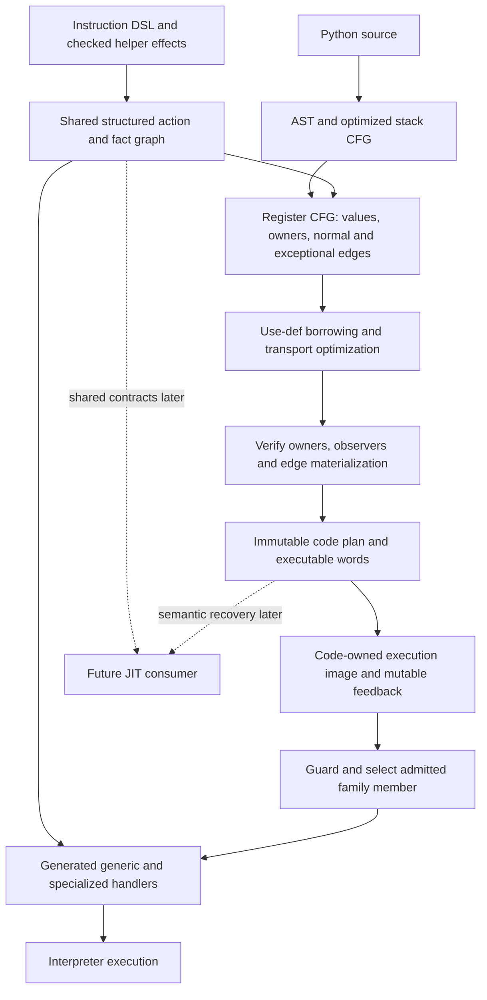
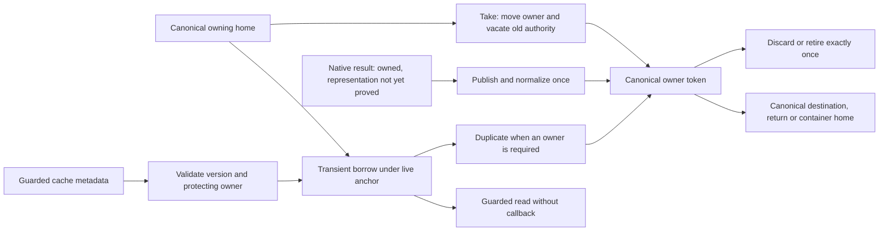
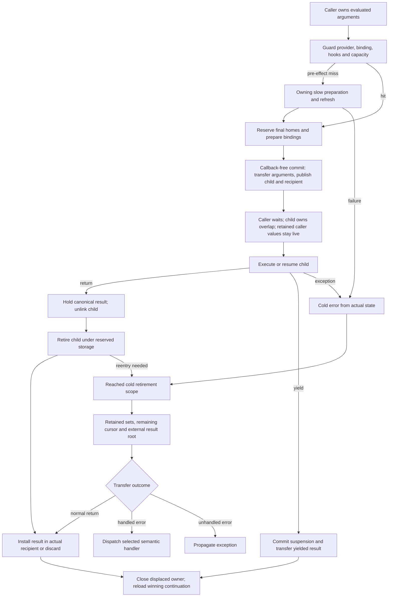

# Ordinary interpreter performance, model56

Status: **proposed combined architecture and implementation sequence**, reviewed
against source on 2026-11-13. This document implements nothing and grants no
native qualification. Golden54 remains selected. The [critical review](../../issues/interpreter-performance56/review.md)
records identities, evidence limits, alternatives and quantitative falsifiers.
Root owns integration, measurements and changes to goal, active plan and status.

## Decision and scope

Improve ordinary execution by carrying value, ownership, effect and specialization
facts from the compiler to generated handlers. Use those facts to eliminate
unnecessary owning snapshots, canonicalization, bridges, call preparation and
completion work. Keep one canonical PyValue representation, the existing owning
frame arena, argument overlap, independent function/code pins and direct returns.
Use the same contracts for arithmetic, attributes, containers, calls, iteration,
generators and coroutines. Native JIT implementation is outside this stage.

The practical unit is a reviewed operation family or transfer, with a demonstrable
change in emitted and executed work. Extend the existing generator action graph,
helper effects, register passes and semantic plan. Do not build a general C
verifier, a second optimizer framework, or a runtime descriptor interpreter for
ordinary instructions. Unproved operations retain their current safe execution.
Each migrated operation has one authoritative contract; retire its superseded
proof parser and update all consumers together.

This is a performance stage across unchanged benchmarks. Preserve Python value
and control behavior, descriptor precedence, argument evaluation, exceptions,
useful frame/locals/monitoring APIs, and explicit ownership. The lifetime policy
does not require exact CPython finalizer order or display. It does require
bounded retention, safe callbacks and complete cleanup; it does not permit
removing observers or holding every intermediate until frame exit. Startup RSS
and zero-box counts are diagnostic, not selection goals. Qualification starts
with the existing GIL configuration; free-threaded publication is a separate gate.

## Starting point and evidence

Canonical documentation is under `C=/home/power/code/cpython/.worktrees/python-jit`.
Its C files are stale. Runtime source anchors below use
`R=/home/power/code/cpython/.worktrees/python-boil-the-ocean/build/worktrees/`:
`I=R/call55-integrated` at `ccb96ccff6c`, `W=R/call55-ir` at `3cfc808d8eb`
(IRSC2 packet `9c297510ac3`), and `U=R/upstream-3a440b6` at `3a440b656956`.
Line anchors are for those identities; symbols are supplied for later rebases.

The last measured I identity is **8232dd8adde**, not current source ccb96.
Its two-pair elapsed ratios, in separate direct campaigns, are:

| Case | I / golden54 | I / upstream |
| --- | ---: | ---: |
| DeltaBlue | 1.017884 | 1.177991 |
| Generators | 0.997913 | 1.430017 |
| Coroutines | 1.022717 | 1.292308 |
| Richards | 0.978000 | 1.242869 |
| Comprehensions | 0.981699 | 1.332579 |
| Logging silent | 0.981101 | 0.756278 |

These are mixed screens, with no promotion or same-head all29/PMU evidence.
The latest broad55 comparison remains ed08ab64c7e: all29/upstream geometric
mean 1.165467, six wins. Golden54's broad ratio is 1.156543. Historical matched
DeltaBlue instruction/cycle ratios around 1.3681/1.2209 describe that earlier
campaign. They are not measurements of 8232. No blanket 40% regression exists,
and flat samples cannot be added into a removable time budget.

Already implemented facts constrain the design:

| Existing mechanism | Source anchor | Remaining opportunity |
| --- | --- | --- |
| Stack-CFG borrowing eligibility | I `Python/flowgraph.c:3068`, `optimize_load_fast` | Track uses and lifetime across more CFG edges |
| Single-use borrowed local folding | I `Python/regcfg_passes.c:155`, `:248`, `_PyRegPass_CopyProp` | Broader equivalence and boundary materialization; count only surviving work |
| Unfolded LOAD_FAST_BORROW owns its temporary | I `Python/bytecodes.c:245`; U `Python/bytecodes.c:290` borrows | Eliminate the temporary where proved; do not introduce borrowed persistent homes |
| Typed views and scalar storage actions | I `Tools/cases_generator/ir_generator.py:2477`, `IRStack`; `:2594`, `take_field`; `:2687`, `code_ran` | Share provenance and effects with optimization and specialization |
| Separate helper result facts | I `Tools/cases_generator/ir_error_effects.py:45`, `HelperEffect` | Extend checked coverage; VALUE alone grants no owner or canonical proof |
| Canonical homes, fallible object bridges | I `Include/internal/pycore_value.h:141`, `_PyValue_Publish`; `:1250`, `PyValue_AsObject` | Remove redundant checks/conversions on proved transports |
| Shared code-owned executing image | I `Python/ir.c:455`, `make_exec`; `:547`, `_PyCode_ClearExec` | Share immutable contracts and mutable cache lifecycle consistently |
| Known positional/keyword binding | I `Python/ceval.c:4215`, `call_bind_known_python` | Remove repeated preparation under the same admission proof |
| Exact CALL_EX tuple still takes snapshots | I `Python/ceval.c:1510`, `call_transaction_prepare_tuple`; U `Python/bytecodes.c:5587` | Probe exact object tuple before owning preparation |
| Explicit exceptional retained partitions | W `Include/internal/pycore_ir.h:656`, `_PyIRHomeView`; W `Python/assemble.c:63`, transfer IDs | Qualify independently; necessary for later allocation freedom, not all local optimization |

The [as-built register IR](../register-ir.md), [interpreter](../interpreter.md),
[frame ABI](../call-and-frame-lifetimes.md), [activation transfers](../activation-transfers.md)
and [PyValue contract](../pyvalue.md) remain authoritative for selected behavior.
The [model55 proposal](register-call-model55.md) supplies the complete storage and
cold lifecycle target. This proposal adds ordinary optimization and unifies its
inputs; it does not silently declare model55 complete.

## One producer pipeline

Extend `HelperEffect` and the structured `IRStack` storage-action graph into
the common producer of these small, independent facts:

| Fact | Meaning |
| --- | --- |
| Value identity and representation | Canonical language value, native temporary needing publication, internal control/index, absent, or unknown |
| Owner identity | Owned token, view anchored to a specific owner/version, moved/retired token, or guarded cache metadata |
| Read role | Required, nullable, conditional on a named predicate, or array/prefix with an explicit extent |
| Effects | Reads/writes bindings or homes; steals/retains inputs; may fail, allocate/collect, release/reenter, observe, suspend or redirect |
| Guard dependency | Exact type, shape/version, function/code/defaults/provider, instrumentation epoch; lifetime of each fact |
| Outcome | Pre-effect miss, successful transfer, exceptional state, suspended state and observer reconstruction |

These are orthogonal. Canonical does not mean owned, non-NULL, mortal or live.
A required value is not established merely because a specialized handler would
eventually test a guard. A pointer alias inherits its source's conditional role
and lifetime; renaming `maybe_self` must not make it a required object.
Array extent and initialized prefix are facts, not consequences of a C pointer.

Parse the supported DSL once, attach checked helper summaries, then record the
actual emitted actions and validate their correspondence. Generate compiler
metadata, handler storage operations, verifier obligations and recovery facts
from that graph. Existing whole-producer canonicality proofs are migration
inputs, not a reason to add more arbitrary-body recognizers. Unknown helpers or
unsupported syntax invalidate the relevant proof. They do not make the whole
interpreter wait for universal coverage. Family metadata is the conservative
contract of all reachable members; a member may refine it after its guards.

## Stronger borrowing pass

Run an ownership-aware register pass after CFG construction and basic renaming,
before final slot compaction and assembly. Inputs are value use-def identities,
normal/exception successors, source-event boundaries, binding writes, escaped
frame obligations, family read roles and the checked effects above. Existing
stack borrowing annotations seed eligibility; they are not the complete proof.

Use a finite forward dataflow lattice, with an intersection at joins, over:
equivalent values, their owner anchors, known representation/type facts, and
whether each required semantic value has an owning materialization. Backward
demand includes handler-retained values and observer reconstruction, in addition
to future Python reads. Track local definitions by compiler versions; no new
per-local runtime version counter is needed for the initial pass.

The first increment extends folding to multiple nonescaping uses inside a
callback-free region. A virtual value names an existing initialized owner; each
consumer reads it in place. It never writes borrowed bits into a frame or
container. A consuming/escaping use acquires or transfers exactly one owner at
the latest safe point. Multiple owning escapes need separate owners. Temporary
owner elimination must remove the corresponding close and storage work as well.

The second increment propagates equivalences across CFG edges. At a join keep a
borrow only if every predecessor proves the same still-live anchor and value;
otherwise insert owning edge materialization and merge a real value. Iterate
loops to a fixed point with finite widening to unknown. A backedge poll is a
callback boundary. Do not retain dead owners across arbitrary loop iterations.
An early implementation may materialize all ambiguous joins and backedges while
still gaining multiple-use and acyclic cross-block cases.

Kill or materialize a virtual snapshot **before** an anchor overwrite/delete,
cell mutation, escape, suspension, unknown call, observer callback or possible
finalizing release. Reloading a changed local afterward does not preserve the
old evaluated value. Materialize only values still demanded at that boundary,
including exceptional and observable uses. For a consuming handler that can
call Python, capture its needed snapshots before its first effect; the existing
`TAKE(local-view)` duplication is the correct baseline. Initial optimization
keeps conservative family effects across instructions. Exploiting a narrower
specialized member across a region requires an explicit guarded region whose
miss materializes before effects; it is a later measured option, not free trust
in mutable feedback.

Source-line restrictions can be relaxed only after reconstructing the semantic
state at every removed load/source event. Before an enabled observer, materialize
the old value if it was already evaluated; expose current named bindings; then
invalidate affected facts and honor callback redirects. Hook installation in a
nested call also invalidates assumptions about an ancestor. Exception edges
must preserve the values required by the actual handler transfer, rather than
the old stack depth. Keep existing restrictions until each such capability is
proved. Useful observers are part of the pass contract, not an optional test.

## PyValue transport and ownership boundaries

There is no new value format. `PyValueBorrow` has the same bits as `PyValue` and
a distinct C type. Every persistent language home remains canonical and owning;
internal control values retain explicit roles. Native helpers may produce an
owned private numeric box whose canonicalization is deferred until publication.

An owned token may move through several C aliases, but they denote one owner,
not several closes. Borrow duplication preserves representation; it does not
prove canonicality of an arbitrary native box. `Kind.VALUE` is a type category;
only explicit producer facts establish `owned`, `canonical` and `nonnull`.
Nullable success/error arms refine the actual token after their tests. A steal
invalidates all aliases of that owner. A failed helper keeps precisely its
declared survivors; an error edge is not a successful NULL result.

Use existing canonical-store paths for proved home loads, container reads,
unchanged returns and checked arithmetic joins. Preserve ordinary Publish at
unknown native/provider boundaries. An object-only helper may receive a
callback-free object borrow when its type and owner are proved; otherwise keep
the owning/fallible bridge. Inline integers/floats, NaNs, overflow, subclasses,
bool and identity-sensitive APIs retain their actual representation rules.
Removing a bridge must not change Python identity or substitute exact-type
semantics for a subclass operation.

Value production and destination replacement are separate transactions. Hold
the result while retiring inputs; publish it into a reconstructible authority
before callbacks that need that state. Read the actual displaced destination
after any permitted observer mutation, detach it before closing, and reload the
winning continuation. Canonicality removes normalization, not these ownership
obligations. Broader elimination of DUP/CLOSE or tag checks uses the same token
facts and effect barriers as borrowing, rather than another peephole parser.

## Specialization and mutable cache lifecycle

Use one semantic family contract with guarded refinements. Keep `specialize.c`
for runtime policy, existing feedback storage for predictions, and generated
handlers for execution. Describe each specialization's inputs, guards, result
facts, effects, miss point and invalidation dependencies in the shared contract.
Do not introduce a universal virtual dispatch layer or multiply every handler
by every ownership/type mode. Add a variant only for a measured recurring form.

The immutable code plan contains geometry, site identities, family effects,
source/recovery recipes and verified transfer descriptions. The existing code
owner pins it and the executing image; a frame adds no new image refcount.
Mutable feedback contains counters, versions, shapes and `_PyValueGuarded`
predictions. It is not an owning home or a persistent borrow. Never inspect a
cached payload until its current guard and live protecting owner are valid.

Specialization constructs a complete candidate entry, then publishes its handler
under the GIL only after readiness and allocation succeed. Misses occur before
irreversible effects and preserve original inputs. Deoptimization restores a
generic member with the same operand/site/recovery contract. If an optimization
virtualized inputs, its miss edge first reconstructs those inputs. A callback
that has already run cannot be replayed by falling back to the generic operation.
Post-effect invalidation completes or errors from the committed state.

Type/MRO and dictionary/shape mutation invalidate attribute predictions;
function code/default/provider changes invalidate relevant binding facts;
monitoring reconfiguration invalidates observer assumptions. Apply existing
version/watcher rules consistently to type caches and per-code caches. Preserve
semantic site and operand geometry when patching handlers. Cache exhaustion,
counter backoff, version exhaustion and allocation failure retain generic
execution. Code teardown clears feedback only after the last code pin; live
frames continue using their independently pinned executing code even when
`function.__code__` changes.

Apply the contract to numeric operations, truth/comparison, globals, attributes,
subscripts, iteration and calls, starting with high-frequency families whose
current checks repeat. Property and classmethod forms are general Python
patterns. Property getters still obey descriptor precedence and may run Python.
Classmethod method-form lookup captures the current function and accessed class
before later argument evaluation; mutable descriptor payloads cannot be assumed
stable merely from a class version. Existing specializations already implement
parts of this behavior (I `Python/specialize.c:1186`, `:1641`); consolidate facts
and remove actual repeated work before adding more cases.

Compiler, interpreter and a future JIT consume these same semantic contracts.
Runtime feedback is evidence for guarded selection, not an immutable compiler
truth. Future native deoptimization still needs machine-location maps and its
own admission; sharing contracts does not claim those are built now.

## Call, return, resume and wait ownership

Use one call convention instantiated into a few direct forms. Its logical
inputs are provider/binding facts, an owning argument window, a real continuation,
a plain recipient, and independent function/code lifetime anchors. These are
existing fields and compile-time parameters where possible, not a new record
constructed on every call. Outcomes are pre-effect miss, committed child,
immediate owned result, suspension or error from a known state.

Before commit, the caller owns the window. Guard current function/code/provider,
arity, defaults/keyword shape, hook configuration and recursion/capacity once
at the appropriate boundary. A fact survives only until its dependency can
change. Fallible or callback-capable preparation keeps owning snapshots and
refreshes current state. The known binder already supports positional defaults
and bounded keywords; extend its admission only where one checked binding plan
replaces repeated work. Retain Python error precedence and duplicate-key handling.

The owner-moving commit is callback-free and cannot fail after its first move:
reserve capacity and perform its fallible preparation first. Later entry checks
may still fail, for example recursion entry after publishing a generator child.
Such a failure exits from committed child state and never retries the call.
Install the new base before using a reused header to initialize homes. Transfer argument ownership, fill
required bindings/defaults, install independent code/function pins, save the
recipient and continuation, then publish a complete child. Remaining owners
may be released only after that publication. No generic retry is legal after
commit. Exact thread calls keep overlap; heap/native adapters move or copy only
as required by their input ownership contract.

While the child runs, the logical `CALL_WAIT` ownership state partitions the
shared arena; this does not imply an implemented phase marker or complete
static WAIT readability proof. In that partition, overlapping
argument homes belong to the child, surviving caller homes to the caller.
Cold GC, escape and error readers use that partition, including retained EH
values. They must not traverse both owners for the same transferred edge or
interpret a dead caller slot. The normal call path records only the minimal
state required by the selected representation; it does not decode retained
sets or exception tables. Do not extend borrow lifetimes through a call just
because the physical local slot still exists.

Return holds a canonical owner across child unlinking, local cleanup, frame
escape and code/function retirement. Keep storage reserved until closes finish.
Ordinary return remains inline; direct recipient geometry and canonical input
select a generated completion form without an unnecessary adapter or repeated
normalization. Returning a named local cannot steal it if a retained frame still
owns it. A temporary can move when the ownership proof permits it. Discard
closes the result without an unused home store. Callback mutation may change the
recipient's displaced owner or continuation; completion respects that state.

SEND/FOR, generator construction, yield/resume, coroutine and async-generator
completion use the same ownership primitives with their own semantic outcomes.
Yielded result and future resume-input recipient are distinct. Resume commits
running state, frame/exception links and recursion before releasing incoming
owners or polling. Completion preserves StopIteration/PEP479, exception context,
FOR's last binding and monitoring semantics. Generate direct known-kind forms
from the shared completion body where that removes work; preserve the already
implemented literal-kind/canonical completion paths. Do not add a per-resume
descriptor lookup or universal continuation-kind switch to ordinary CALL.

Generator direct construction is a separate optional experiment: creation
prefixes, closure setup, genexpr iteration, origin tracking and hooks cannot be
skipped based on code flags. Earlier direct-construction variants lost broad
measurements. Reopen only with a distinct counted cost removal and broad gate.

## Cold recovery and storage prerequisites

Use model55's reached cold records for callback-capable retirement, observation,
unwind and suspended/escaped ownership. A record describes the pinned origin,
actual phase, remaining owner cursor, retained set, result/native roots and
storage reservation. Publish it before the first relevant callback; advance
the cursor and detach an edge before closing it. Nested reentry gets separate
authority. A retained owner remains visible even above a release cursor.
Do not infer initialization from stale bits or double-count external C roots
as container-held edges. Preserve the documented native conservative policy;
removing arena scanning does not remove every native root mechanism.

Mapped active homes can remain the root authority; no new record is required
merely to borrow from them. Detached owners and unlinked retirement need the
appropriate reached authority. Keep the code pin until the last descriptor or
cursor reader finishes, and the reservation until the last storage user finishes.
Frame escape transfers remaining ownership to a separate valid frame before
later locals mutation; it cannot insert owners behind a private retiring cursor.
Cleanup preserves an active exception and the existing unraisable policy for
finalizer failures. A failure after commit never retries the original operation.

Explicit transfer IDs and retained ranges in W's IRSC2 separate EH semantics
from allocation floors. Qualify that packet before using arbitrary placement
across handler edges. It still uses a canonical allocator and explicit
initialized-NULL CONTROL authority for unproved transformed handler states.
Neither a normal storage graph nor an ERROR proof grants CALL_WAIT, suspension,
array or observer readability. Position stripping must preserve execution and
semantic recovery. Cold HomeView growth does not enlarge the hot frame.

Local transport and callback-free borrowing run first on initialized-NULL homes.
They need correct ownership and observer materialization, not complete static
M4. Broader lifetime shortening or allocation freedom adds the corresponding
transfer and cold-read prerequisites. The bitmap rival is independently
qualified and measured before selection; no representation wins by proposal.

## Stage, workstreams and experiments

The stage outcome is lower ordinary executed work and measured broad performance
with explicit ownership and observers. Workstreams below share contracts but
have independent candidate commits. Each experiment records hypothesis,
source/native identities, expected count change, negative cases and stop rule.
Sol follows **propose → peer → implement → focused tests → post-review → integrate**.
Root serializes generation, builds, native diagnosis and measurements.

Implementation boundaries are the existing `Tools/cases_generator/` effect and
emitter modules, `Python/regcfg{,_passes}.c`, instruction DSL and generated
metadata, `Python/specialize.c` and cache readers, and `Python/ceval.c` plus frame
helpers for transfers. Each increment updates only its producers and consumers;
serialized metadata changes also update admission, disassembly and remote readers.

| Order / lane | Concrete first increment | Dependencies and exit |
| --- | --- | --- |
| 0: source foundation | Qualify the I VALUE/error-copy packet and isolated W empty-family repair; freeze exact integration input | Full generation and current narrow gates by root; no new performance claim |
| 1a: early ordinary call | Exact-object-tuple probe before CALL_EX copies; keep final refresh and owning nonexact path | Independent of new fact schema and M4; count exact hits and removed pairs |
| 1b: shared facts and transport | Extend current helper/action facts; migrate one frequent canonical transport producer and remove its old special proof | Owned/canonical/nonnull negative tests; emitted/native removal before expanding |
| 2a: stronger borrowing | Multi-use callback-free virtual values, then acyclic CFG joins with explicit edge snapshots | Shared effects/read roles; current NULL storage and observer boundaries sufficient |
| 2b: common call completion | Unify a remaining adapter/revalidation duplication under one admitted binding or recipient form | Shared token/effect facts; exact call already overlaps and returns inline |
| 2c: specialization consistency | Migrate arithmetic and attribute/call guard facts, then container/iteration families | Same fact producer and invalidation contract; no blanket new handler matrix |
| 3: broader CFG and lifecycle | Cross-line observer reconstruction, exceptional retained edges and measured call/resume reductions | Qualified W transfer packet where needed; independent code pins and cold roots |
| 4: storage decision | Complete static or bitmap authority only under its full lifecycle/read gate | Compare complete total cost; may proceed beside ordinary lanes, not block them |
| 5: integrated selection | Confirm composition, all29 and coherent full diagnostics | Same configuration direct golden/upstream evidence and post-review |

Lanes 1a and 1b can be proposed concurrently; transport is the earliest useful
foundation for the broader lanes, not a required delay before the small call
change. All four requested opportunities receive implementation proposals and
measured increments. A negative result closes that experiment, with counts and
reason, rather than silently deferring its entire workstream to a future JIT or
full storage proof. Keep the first shared-contract slice bounded to one family;
expand only after it produces a useful consumer.

## Validation and admission

Focused semantic checks exercise multiple uses/joins/backedges, anchor overwrite,
destructors that mutate `f_locals`, code/default/provider replacement, property and
classmethod capture, mutation during argument evaluation, generic misses after
guard failure, observer enable/disable and redirects, exceptional retained
values, nested GC/reentry, frame escape, recursion/OOM and generator
send/throw/close. Numeric transport includes inline bounds, boxed overflow, NaN,
subclasses and failing providers. Conditional reads include absent self/kwargs,
iterator deopt and monitoring aliases. Negative generator tests must demonstrate
that wrong ownership/canonicality/alias/guard facts are refused.

Root first checks generated products, release/debug module identity and focused
runtime behavior at the exact candidate head. New compiler transformations need
IR-shape checks plus observable runtime witnesses. Post-review inspects the
actual generated/native change; a source deletion alone is not a cost result.
Run full suites at coherent shared-contract, lifecycle/representation and final
composition gates. Preserve known failure identities and investigate new ones;
no new quarantine or weakened assertions are an admission mechanism.

For each independent increment, collect separate diagnostic counts for surviving
loads, borrow materializations, DUP/CLOSE, Publish/bridge entries, call-plan hits,
refreshes, completion adapters, guard misses and cold-record entries. Match native
instructions/cycles and elapsed runs at one immutable source/ELF/configuration;
instrumented count runs do not supply throughput timing. Track generated code
size, spills and branch/I-cache effects when handler changes increase code.

Use root's fixed GCC configuration, affinity, hash and disabled JIT. Two balanced
hot6 pairs are the checkpoint, a six-pair hot6 campaign confirms viable changes,
and final all29 comparisons run directly against both golden54 and upstream.
Do not multiply ratios from separate campaigns. Keep pair ranges and noise
guards. The review defines proposed numerical stop/selection rules; root may
tighten them before experiments. One hot win cannot admit a broad regression.

## Primary research read for this proposal

V8's register optimizer maintains equivalence sets and materialization and flushes
live registers when required. Its observable-register handling is evidence that
copy elimination needs a visibility contract. The inference here is to use
virtual equivalences and explicit materialization, while adding Python's RC and
mutable-locals obligations. This is not a prescription to copy V8's accumulator
or collector. [V8 source, RegisterTransfer/Flush/Materialize](https://github.com/v8/v8/blob/main/src/interpreter/bytecode-register-optimizer.cc)
(moving `main` page read 2026-11-13; 592-line version, no pinned identity established).

V8 describes explicit register operands and generated interpreter handlers;
this supports reusing the existing generator rather than requiring a new JIT.
[Ignition design article](https://v8.dev/blog/ignition-interpreter).
Its property article describes shape-based property layouts; applying that
idea here requires Python descriptor and mutation guards, not JavaScript lookup
semantics. [Fast properties](https://v8.dev/blog/fast-properties).

LuaJIT's frame definitions distinguish Lua, C, continuation and vararg forms and
place function/link state next to value slots. The inference is to keep explicit
transfer kinds with cheap direct layouts; those definitions do not prove any
Python RC or stale-home safety claim. [LuaJIT lj_frame.h, lines 10–103](https://github.com/LuaJIT/LuaJIT/blob/63c8f1a9b479ba5518cf6a170ff7729178bc3cfd/src/lj_frame.h#L10).
Upstream CPython comparison uses the pinned local source U cited above, including
its borrowed LOAD_FAST and exact-tuple CALL_EX preparation.

The [CPython AI policy](https://devguide.python.org/getting-started/ai-tools/)
was read before this proposal. Human review and accountability remain with the
submitter; this source review is not executed qualification.
